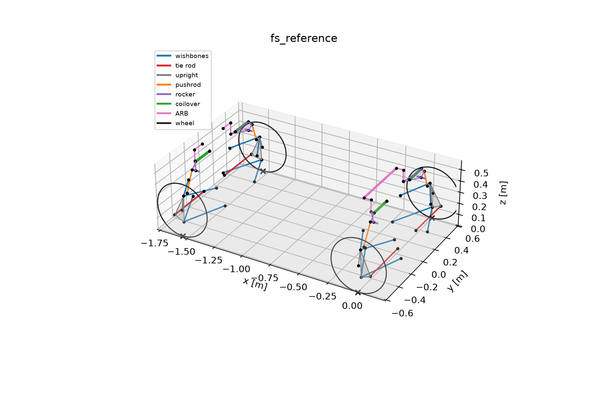

# suspkin

Suspension kinematics toolkit for Formula Student double-wishbone pushrod cars.
It computes kinematic curves (camber, toe, caster, anti-dive/anti-squat, roll centre,
motion ratios, steering geometry) from hardpoint geometry and turns them into
vehicle-dynamics plots and reports. Planned later: geometry optimization, FEM
checks of key parts, and a neural-network surrogate for fast design sweeps.

## Conventions

- ISO 8855 frame: x forward, y left, z up. Origin on the ground, mid front axle.
- SI units internally and in YAML (m, rad, N, N/m). mm and deg are display only.

## Setup

```bash
uv sync
uv run suspkin version
uv run pytest
```

## Usage

User-facing inputs are in mm and deg; CSV/JSON files are SI. `--help` on any command lists the options.

```bash
uv run suspkin show configs/vehicles/fs_reference.yaml --roll 2 --heave 5 --out pose.png
uv run suspkin sweep configs/vehicles/fs_reference.yaml --corner FL --travel -30 30 --metrics --out fl.csv
uv run suspkin summary configs/vehicles/fs_reference.yaml --json summary.json
uv run suspkin vehicle configs/vehicles/fs_reference.yaml --json vehicle.json
uv run suspkin vsweep configs/vehicles/fs_reference.yaml --roll -2 2 --out roll.csv
uv run suspkin animate configs/vehicles/fs_reference.yaml --roll -2 2 --out roll.gif
uv run suspkin report configs/vehicles/fs_reference.yaml --compare other.yaml --out report/
```

`report` writes `report.html` (self-contained), `report.md`, `figures/`, `data/*.csv` and
`summary.json`; every design given with `--compare` is overlaid on the same figures.

### Constraint check

A study YAML in `configs/studies/` points to a vehicle and lists the design variables and
constraints (see [DESIGN_PLAN section 7](docs/DESIGN_PLAN.md) and
[ARCHITECTURE section 14](docs/ARCHITECTURE.md#14-optimization-study-v07)). `check` evaluates the
baseline vehicle against every constraint and prints PASS/FAIL per row; `--plot` writes the 3D
view of the variable domains and keep-outs.

```bash
uv run suspkin check configs/studies/fs_reference_constraints.yaml --plot results/study.png
```

## Development

```bash
uv run pre-commit install
```

Design plan: [docs/DESIGN_PLAN.md](docs/DESIGN_PLAN.md)
Architecture and math: [docs/ARCHITECTURE.md](docs/ARCHITECTURE.md)



Render it yourself: `uv run suspkin show configs/vehicles/fs_reference.yaml`
