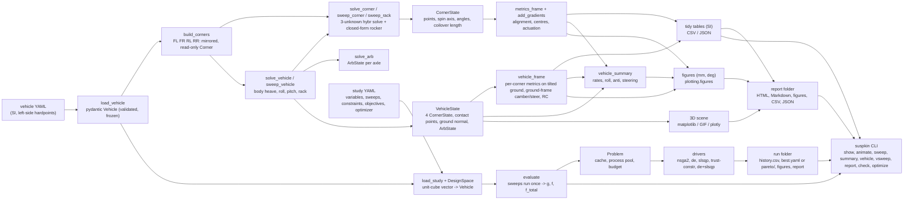
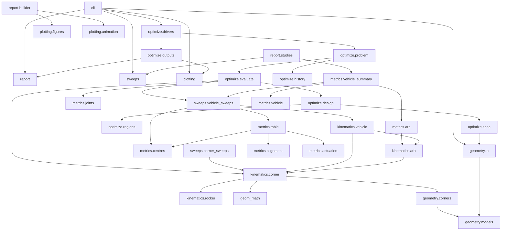

# suspkin architecture and mathematics

> Version described: **suspkin 1.0.0** ([pyproject.toml](../pyproject.toml), [CHANGELOG.md](../CHANGELOG.md)). [Section 15](#15-surrogate-v11-experimental) (surrogate) describes v1.1.0, which is unreleased.
> Companion documents: [DESIGN_PLAN.md](DESIGN_PLAN.md) (design intent and decisions log), [CLAUDE.md](../CLAUDE.md) (project rules), [README.md](../README.md) (usage).
>
> Every formula, default and sign convention below was taken from the code. Citations such as
> [corner.py:88](../src/suspkin/kinematics/corner.py#L88) point at the line where the statement is implemented. Where the code and the
> design plan disagree, the code is described and the disagreement is listed in
> [section 16](#16-known-gaps-discrepancies-limitations).

## Contents

1. [Overview](#1-overview)
2. [Conventions](#2-conventions)
3. [Repository layout and module reference](#3-repository-layout-and-module-reference)
4. [Geometry model](#4-geometry-model)
5. [Corner kinematics math](#5-corner-kinematics-math)
6. [Vehicle-level kinematics math](#6-vehicle-level-kinematics-math)
7. [Metrics math](#7-metrics-math)
8. [Sweeps and tables](#8-sweeps-and-tables)
9. [Plotting and reports](#9-plotting-and-reports)
10. [CLI reference](#10-cli-reference)
11. [Testing and verification strategy](#11-testing-and-verification-strategy)
12. [Tooling and workflow](#12-tooling-and-workflow)
13. [Extending the code](#13-extending-the-code)
14. [Optimization (v0.7–v0.8)](#14-optimization-v07v08)
15. [Surrogate (v1.1, experimental)](#15-surrogate-v11-experimental)
16. [Known gaps / discrepancies / limitations](#16-known-gaps-discrepancies-limitations)
17. [Glossary](#17-glossary)
18. [Web app (experimental)](#18-web-app-experimental)

---

## 1. Overview

### 1.1 Purpose and scope

`suspkin` computes the **rigid-body kinematics** of a four-wheeled Formula Student car with
double-wishbone, pushrod-actuated suspension on both axles, and turns the result into the curves and
scalars a vehicle-dynamics engineer reads: camber, toe, caster, kingpin inclination, scrub, trail, roll
centres, instant centres, anti-features, motion ratios, wheel and ride rates, anti-roll-bar (ARB) rates,
roll stiffness, load-transfer distribution, Ackermann, steering ratio and more
([DESIGN_PLAN.md section 1](DESIGN_PLAN.md)).

What the model **is**:

* ideal joints, rigid links, no compliance (no bushing or chassis flex);
* a closed-loop mechanism per corner solved by a small non-linear system, by continuation along sweeps;
* quasi-static: no inertia, no time, no tyre forces;
* a rigid-disc tyre (contact patch = lowest point of the wheel circle).

What it is **not** (yet): a force solver, FEM of members, stress prediction, or an
elasto-kinematic (K&C) model ([DESIGN_PLAN.md sections 1 and 11](DESIGN_PLAN.md)). A kinematic neural-network surrogate is experimental in v1.1.0 ([section 15](#15-surrogate-v11-experimental)). The optimizer
(objectives, drivers, `suspkin optimize`) was added in v0.8.0, see [section 14](#14-optimization-v07v08).
The `opt` extra (`pymoo`) is used by the NSGA-II driver ([pyproject.toml](../pyproject.toml)).

**Stable surface (1.0).** The vehicle YAML (`schema: 1`), the study YAML (`schema: 1`), the CLI and the names in `suspkin.__all__` follow SemVer; `suspkin.optimize` is experimental. Details and the deprecation policy are in [stability.md](guides/stability.md).

### 1.2 Design principles ([CLAUDE.md](../CLAUDE.md))

* Core math is **pure functions on numpy arrays**; solved states are frozen dataclasses with read-only arrays.
* SI units everywhere internally and in YAML/CSV/JSON; mm and deg only at the CLI and in figures.
* **Plotting reads result tables** (pandas frames or solved states) and does not run the solver itself;
  the only solver call on the output side is the report layer's 3D section
  ([builder.py:144](../src/suspkin/report/builder.py#L144), see [section 16](#16-known-gaps-discrepancies-limitations)).
* One source of truth for geometry: the YAML file validated by pydantic.

### 1.3 Data-flow pipeline



The lower branch (study YAML to run folder, added in v0.7 and v0.8) reuses the same solvers and metric
functions through `evaluate` and is described in [section 14](#14-optimization-v07v08).

The same chain written as a call graph (what actually calls what):



(`metrics.vehicle_summary` imports `sweeps.vehicle_sweeps` lazily inside functions ([vehicle_summary.py:153](../src/suspkin/metrics/vehicle_summary.py#L153), [vehicle_summary.py:215](../src/suspkin/metrics/vehicle_summary.py#L215)) because `sweeps.vehicle_sweeps` imports `metrics.centres` and `metrics.table` at top level ([vehicle_sweeps.py:17-18](../src/suspkin/sweeps/vehicle_sweeps.py#L17)); a top-level import back would close an import cycle through `metrics/__init__`.)

### 1.4 Hello world

```python
from suspkin.geometry import load_vehicle, build_corners
from suspkin.kinematics import solve_corner, sweep_corner, solve_vehicle
from suspkin.metrics import metrics_frame, add_gradients, static_summary, vehicle_summary
import numpy as np

veh = load_vehicle("configs/vehicles/fs_reference.yaml")
fl = build_corners(veh)["FL"]
states = sweep_corner(fl, np.linspace(-0.03, 0.03, 31))          # metres, bump positive
df = add_gradients(metrics_frame(states, fl))                      # SI tidy table
print(static_summary(df)["camber_gain"])                           # rad/m at travel = 0
vs = solve_vehicle(veh, roll=np.radians(1.0))                      # body roll, CG pivot
print(vehicle_summary(veh).roll_gradient)                          # rad per g
```

---

## 2. Conventions

### 2.1 Frame, origin, units

* **ISO 8855** vehicle frame: x forward, y left, z up. Origin on the ground plane, at the mid-point of the
  front axle ([CLAUDE.md](../CLAUDE.md)). The rear axle is therefore at x = -wheelbase. The loader enforces
  this: the front `wheel_center` x must be 0 within 5 mm and greater than the rear one
  ([models.py:368](../src/suspkin/geometry/models.py#L368)).
* **Units**: SI internally and in all files (m, rad, N, N/m, N m/rad, kg). The CLI takes lengths in **mm** and
  angles in **deg** and converts at the boundary ([cli.py:25](../src/suspkin/cli.py#L25)); figures display mm,
  deg, N/mm ([figures.py:46](../src/suspkin/plotting/figures.py#L46)). [units.py](../src/suspkin/units.py) holds the
  four display converters (`m_to_mm`, `mm_to_m`, `rad_to_deg`, `deg_to_rad`) and nothing else.
* The YAML hardpoints are the **static ride-height pose**: wheel travel 0, rack 0, body pose 0
  ([corner.py:1](../src/suspkin/kinematics/corner.py#L1), [models.py:355](../src/suspkin/geometry/models.py#L355)).
* The solvers work in the **body frame** (the car body is fixed); in vehicle sweeps the *ground* moves relative to it
  ([vehicle.py:10](../src/suspkin/kinematics/vehicle.py#L10)).
* Corner ids: `FL`, `FR`, `RL`, `RR` ([corners.py:15](../src/suspkin/geometry/corners.py#L15)). Hardpoints are entered
  for the **left** side (y > 0) and the right side is the y-mirror ([models.py:1](../src/suspkin/geometry/models.py#L1)).

### 2.2 Sign conventions (one table)

All signs are the same for left and right corners unless stated ("L/R-symmetric").

| Quantity | Positive means | Where defined |
|---|---|---|
| Wheel **travel** $z$ | bump: wheel centre moves **up** relative to the body | [corner.py:104-114](../src/suspkin/kinematics/corner.py#L104-L114) (residual `wc[2] - wc0[2] - travel`) |
| Body **heave** $h$ | body **up** (so wheels droop, travel < 0) | [vehicle.py:5-6](../src/suspkin/kinematics/vehicle.py#L5-L6) |
| Body **roll** $\varphi$ | right-hand rotation about +x: the **left (+y) side goes up** (roll of a left turn) | [vehicle.py:7](../src/suspkin/kinematics/vehicle.py#L7) |
| Body **pitch** $\theta$ | right-hand rotation about +y: **nose down** | [vehicle.py:8](../src/suspkin/kinematics/vehicle.py#L8) |
| **Rack** displacement $r$ | both `tie_inner` points move along +`rack_axis` (+y); front-steer geometry then steers **left** | [models.py:259-266](../src/suspkin/geometry/models.py#L259-L266) |
| **Camber** | **negative** = top of wheel leans toward the car centreline; $\gamma=-\arcsin(n_z)$, $n$ = spin axis | [alignment.py:65-67](../src/suspkin/metrics/alignment.py#L65-L67) |
| **Toe** | **toe-in** (wheel front toward the centreline), L/R-symmetric | [alignment.py:70-73](../src/suspkin/metrics/alignment.py#L70-L73) |
| **Steer angle** | ISO yaw: wheel heading points **left**; hence steer = $-$toe on left, $+$toe on right | [alignment.py:76-80](../src/suspkin/metrics/alignment.py#L76-L80) |
| **Caster** | top of steering axis **rearward** | [alignment.py:83-86](../src/suspkin/metrics/alignment.py#L83-L86) |
| **KPI** | top of steering axis **inboard** | [alignment.py:89-92](../src/suspkin/metrics/alignment.py#L89-L92) |
| **Scrub radius** | ground intercept of the steering axis **inboard** of the contact patch | [alignment.py:95-99](../src/suspkin/metrics/alignment.py#L95-L99) |
| **Mechanical trail** | ground intercept **ahead** (+x) of the contact patch | [alignment.py:102-106](../src/suspkin/metrics/alignment.py#L102-L106) |
| **Kingpin offset at wheel centre** | steering axis **inboard** of the wheel centre (y distance at wheel-centre height) | [alignment.py:109-117](../src/suspkin/metrics/alignment.py#L109-L117) |
| `contact_patch_dy`, `half_track_change` | **outboard** | [alignment.py:133-146](../src/suspkin/metrics/alignment.py#L133-L146) |
| `contact_patch_dx`, `wheel_center_recession` | **forward** (+x) relative to static | [alignment.py:138-151](../src/suspkin/metrics/alignment.py#L138-L151) |
| **Front-view swing angle** | FVIC **above** the contact patch; horizontal axis positive **inboard** | [centres.py:124-131](../src/suspkin/metrics/centres.py#L124-L131) |
| **Side-view swing angle** (patch and wheel-centre) | **anti-geometry**: front axle: SVIC rearward of and above the reference point; rear axle: forward of and above | [centres.py:134-149](../src/suspkin/metrics/centres.py#L134-L149) |
| **Anti-dive / lift / squat %** | anti-geometry (positive = resists pitch) | [vehicle.py:25-59](../src/suspkin/metrics/vehicle.py#L25-L59) |
| **Roll-centre lateral position** $y_{rc}$ | +y (toward the left), measured in the body frame relative to the centreline | [vehicle_sweeps.py:159-171](../src/suspkin/sweeps/vehicle_sweeps.py#L159-L171) |
| **RC migration** | $d y_{rc}/d\varphi$ [m/rad]; positive = toward +y for left-up roll | [vehicle_summary.py:10-14](../src/suspkin/metrics/vehicle_summary.py#L10-L14), [cli.py:318-321](../src/suspkin/cli.py#L318-L321) |
| **Roll camber** | $d\gamma_{ground}$(outer wheel)/$d\varphi$; outer wheel for +roll is the **right** wheel (FR/RR) | [vehicle_summary.py:5-8](../src/suspkin/metrics/vehicle_summary.py#L5-L8), [vehicle_summary.py:236](../src/suspkin/metrics/vehicle_summary.py#L236) |
| **Roll steer** | $d\,\overline{\delta_{ground}}/d\varphi$ (mean of left and right) | [vehicle_summary.py:9](../src/suspkin/metrics/vehicle_summary.py#L9) |
| **Corner angles** $\theta_U,\theta_L,\psi$ and **rocker angle** $\chi$ | right-hand rotation about the **left** corner's axes. On right corners the stored axes are mirrored, so the *physical* rotation is `side_sign * angle` (`+1` left, `-1` right); the reported angle is L/R-equal for mirrored motion | [corner.py:13-16](../src/suspkin/kinematics/corner.py#L13-L16), [rocker.py:36-38](../src/suspkin/kinematics/rocker.py#L36-L38) |
| **Rocker angle** (actuation metric) | `rocker_rotation` = reported angle minus static angle | [actuation.py:47-49](../src/suspkin/metrics/actuation.py#L47-L49) |
| **ARB tube/blade angle** $\beta$ | same per-side rule as the rocker; elastic coordinate `twist` $=\beta_L-\beta_R$ | [arb.py:1-14](../src/suspkin/kinematics/arb.py#L1-L14) |
| **ARB beam** | ends move vertically: left $+(c+\delta)$, right $+(c-\delta)$, elastic coordinate $\delta$, slider heave $c$ | [arb.py:11-13](../src/suspkin/kinematics/arb.py#L11-L13) |
| **Coilover compression** | $L_{static}-L$, positive in bump | [actuation.py:57-59](../src/suspkin/metrics/actuation.py#L57-L59) |
| **Spring force** | positive = compressive; $F=F_{pre}+k(L_0-L)$, never clamped | [actuation.py:72-75](../src/suspkin/metrics/actuation.py#L72-L75) |
| **Motion ratio** | $MR=-dL/dz$, positive when bump compresses the spring | [actuation.py:95-113](../src/suspkin/metrics/actuation.py#L95-L113) |
| **Pushrod angle** | angle of the vector outer→inner above the horizontal plane | [actuation.py:35-38](../src/suspkin/metrics/actuation.py#L35-L38) |
| **Lateral load transfer** $\Delta W$ | per wheel: outside wheel **gains** $\Delta W$, inside **loses** $\Delta W$ | [vehicle.py:129-143](../src/suspkin/metrics/vehicle.py#L129-L143) |
| **Ackermann %** | 100 = true Ackermann, 0 = parallel steer, negative = anti-Ackermann | [vehicle.py:233-247](../src/suspkin/metrics/vehicle.py#L233-L247) |
| **Gradients** | $d(\text{metric})/dz$ in rad/m or m/m (travel); $d(\text{steer})/d(\text{rack})$ in rad/m | [table.py:18-27](../src/suspkin/metrics/table.py#L18-L27) |

Note on the **per-side sign**: a right corner is the *reflection* $M=\mathrm{diag}(1,-1,1)$ of a left corner.
For an improper $M$ and a proper rotation $R(\mathbf a,\theta)=\exp(\theta[\mathbf a]_\times)$ one has
$M\,R(\mathbf a,\theta)\,M=R(M\mathbf a,-\theta)$ because $M[\mathbf a]_\times M=-[M\mathbf a]_\times$ ($\det M=-1$).
So the mirror image of "rotate by $\theta$ about $\mathbf a$" is "rotate by $-\theta$ about the mirrored axis
$M\mathbf a$". The code stores the mirrored axes and multiplies every angle by `side_sign = -1` on right
corners, so that a left and a right corner performing mirror-image motion report **identical** angles
([rocker.py:36](../src/suspkin/kinematics/rocker.py#L36), [corner.py:88](../src/suspkin/kinematics/corner.py#L88)).

---

## 3. Repository layout and module reference

### 3.1 Tree

```
veichle-dynamics/
├── pyproject.toml                 package metadata, deps, ruff/mypy/pytest config, `suspkin` entry point
├── README.md                      install and CLI usage
├── CHANGELOG.md                   Keep a Changelog, one section per milestone tag
├── CLAUDE.md                      project rules (conventions, agent orchestration, git)
├── LICENSE                        MIT
├── .gitattributes / .gitignore    line endings; ignores results/, *.parquet, caches
├── .pre-commit-config.yaml        ruff, ruff-format, mypy + whitespace/yaml/toml hooks
├── .github/workflows/ci.yml       CI: ruff, format check, mypy, pytest on Python 3.11-3.13
├── .claude/agents/                coder, chore, reviewer, scout, verifier agent definitions
├── configs/
│   ├── vehicles/fs_reference.yaml reference Formula Student car (the main worked example)
│   ├── vehicles/.gitkeep
│   └── studies/                   fs_reference_constraints.yaml (v0.7), fs_reference_optimize.yaml (v0.8 demo), fs_reference_surrogate.yaml (v1.1 benchmark)
├── scripts/
│   ├── setup.ps1                  one-shot setup (Windows): installs uv if missing, `uv sync --all-extras`
│   ├── setup.sh                   same for Linux and macOS
│   ├── profile_fom.py             timing breakdown of one FOM evaluation (v1.1)
│   └── benchmark_surrogate.py     resumable surrogate vs direct DE benchmark (v1.1, not yet run)
├── docs/
│   ├── DESIGN_PLAN.md             design intent, milestones, decisions log (D1-D9, O1-O8)
│   ├── ARCHITECTURE.md            this document
│   └── images/fs_reference.png    static 3D render used by the README
├── src/suspkin/
│   ├── __init__.py                __version__ = "1.0.0"
│   ├── units.py                   display converters; parse_quantity, format_quantity, dimension table (study YAML)
│   ├── cli.py                     typer CLI (10 commands)
│   ├── geom_math/                 pure geometry helpers
│   │   ├── vectors.py             mirror_y, unit, distance, wheel_spin_axis
│   │   ├── rotations.py           axis_angle_matrix, rotate_about_line, rotation_between
│   │   └── lines.py               plane/line/section helpers for instant centres
│   ├── geometry/                  data model
│   │   ├── models.py              pydantic models + validators (the YAML schema)
│   │   ├── io.py                  load_vehicle / save_vehicle / VehicleConfigError
│   │   └── corners.py             Corner dataclass, left->right mirroring, arb_points
│   ├── kinematics/                solvers
│   │   ├── corner.py              3-unknown corner solver, continuation, cold-start staging
│   │   ├── rocker.py              closed-form rocker solution, toggle margin, KinematicsError
│   │   ├── arb.py                 ARB kinematics, stiffness, energy
│   │   └── vehicle.py             body heave/roll/pitch -> per-corner travel on tilted ground
│   ├── metrics/                   derived quantities
│   │   ├── alignment.py           camber, toe, steer, caster, KPI, scrub, trail, wheel position
│   │   ├── centres.py             instant centres, swing arms/angles, roll centre
│   │   ├── actuation.py           pushrod/rocker/coilover metrics, motion ratios, wheel/ride rate
│   │   ├── arb.py                 ARB metrics, motion ratios, ARB wheel rates
│   │   ├── table.py               metrics_frame, add_gradients, static_summary
│   │   ├── vehicle.py             anti-features, roll stiffness/gradient, load transfer, steering, pitch centre
│   │   ├── vehicle_summary.py     the static vehicle summary (VehicleSummary)
│   │   ├── joints.py              body rotations (Kabsch), rod-end and ball-joint misalignment angles (v0.7)
│   │   └── batch.py               vectorised corner kernels over N states, shared by the FOM and the surrogate (v1.1)
│   ├── sweeps/
│   │   ├── corner_sweeps.py       states_to_frame
│   │   └── vehicle_sweeps.py      sweep_vehicle, vehicle_frame
│   ├── plotting/
│   │   ├── style.py               palette, line styles, rc params, figure sizes
│   │   ├── figures.py             2D figure sets, summary table, FIGURE_SET registry
│   │   ├── geometry3d.py          scene builder (VehicleScene) + matplotlib 3D drawing
│   │   ├── animation.py           GIF / MP4 sweep animation
│   │   ├── interactive.py         plotly HTML (optional `viz` extra)
│   │   ├── regions.py             plot_study_3d: variable domains and keep-outs of a study (v0.7)
│   │   ├── optimization.py        convergence, Pareto front, parallel coordinates, constraint margins (v0.8)
│   │   └── surrogate.py           surrogate validation plots and active-learning figures (v1.1)
│   ├── report/
│   │   ├── studies.py             run_standard_studies -> StudyResults
│   │   └── builder.py             build_report -> folder with CSV/JSON/figures/HTML/MD
│   ├── surrogate/                 neural-network surrogate, active learning (v1.1, experimental), section 15
│   │   ├── channels.py            output channel registry (encodings, tolerances, axle membership)
│   │   ├── grid.py                fixed travel x rack output grid per axle
│   │   ├── extract.py             corner extractor: sweep -> channel tensor and mask
│   │   ├── data_types.py          AxleDataset (sampling -> training contract)
│   │   ├── sampling.py            sub design space per axle, Latin hypercube
│   │   ├── dataset.py             sharded .npz dataset, sampling with resume, load
│   │   ├── normalise.py           channel standardisation, POD basis (numpy)
│   │   ├── model.py               per-axle MLP (regression and validity heads, torch)
│   │   ├── train.py               resolve_device, masked loss, training, fine-tuning, evaluation
│   │   ├── hpo.py                 Optuna architecture search (torch, optuna)
│   │   ├── predict.py             batched inference from a saved axle model
│   │   ├── workflow.py            train_surrogate, validate_surrogate
│   │   ├── vehicle_layer.py       analytic vehicle layer (numpy), layer_error
│   │   ├── evaluate.py            SurrogateEvaluator: networks -> corner states -> v0.8 evaluator
│   │   ├── problem.py             SurrogateProblem (v0.8 Problem interface)
│   │   └── active.py              active-learning optimizer, trust region, run folder
│   └── optimize/                  study layer (v0.7) and optimizer (v0.8), section 14
│       ├── spec.py                study models, load_study, objectives, optimizer block
│       ├── regions.py             hexahedron map, inverse, signed distances
│       ├── design.py              DesignSpace (unit cube <-> Vehicle)
│       ├── metric_registry.py     metric dimensions for validation and display
│       ├── evaluate.py            evaluate(): constraints and objectives -> Evaluation
│       ├── problem.py             cached, budgeted, pooled batch evaluation; forward-difference Jacobian
│       ├── history.py             history.csv writer and reader, EvalCache, resume
│       ├── drivers.py             nsga2, de, slsqp, trust-constr, de+slsqp; run_optimization
│       └── outputs.py             run folder: best / Pareto YAML, result.json, meta.json, figures, report
└── tests/
    ├── fixtures/minimal_vehicle.yaml   minimal test car (see 4.6)
    ├── unit/                      41 test modules + helpers.py
    ├── property/                  hypothesis invariants for the corner solver
    └── regression/                reference-car sweeps (ARB, corners, vehicle)
```

(`results/` is git-ignored: [.gitignore](../.gitignore). A local `results/fs_reference_report/` exists
as a sample report output and is not part of the repository content.)

### 3.2 Module reference

Each subsection gives purpose, public API, key internals, inputs/outputs and connections. Signatures are
abbreviated to the parameters that matter.

#### 3.2.1 `suspkin/__init__.py` and `units.py`

* [\_\_init\_\_.py:3](../src/suspkin/__init__.py#L3): `__version__ = "1.0.0"`; a smoke test asserts it
  equals `pyproject.toml`'s version.
* [units.py:9-26](../src/suspkin/units.py#L9): `m_to_mm`, `mm_to_m`, `rad_to_deg`, `deg_to_rad` (thin `numpy` wrappers
  accepting scalars or arrays). Used by the CLI display layer ([cli.py:236](../src/suspkin/cli.py#L236)).
  Core math never imports it.
* v0.7 added quantities with units for the study YAML. A dimension is a product of base atoms with integer exponents
  (`Dim` = canonical name such as `length`, `angle/length`, `1/length`, `force*length/angle`; `ratio` is dimensionless; `percent`, `gload` and `accel` are separate atoms).
  `parse_quantity(v, dim)` ([units.py:150](../src/suspkin/units.py#L150)) turns `"30 mm"`, `"-1.5 deg"`, `"34 N/mm"`, `"50 %"` or a plain number (already SI) into an SI float and raises `ValueError`
  naming the expected dimension on a wrong unit. `normalize_dim`, `slope_dim(metric_dim, input_dim)`, `display_unit`, `display_factor` and `format_quantity` serve the evaluator, the CLI tables and the plots. The module
  stays free of the solvers.

#### 3.2.2 `geom_math/vectors.py`

* `mirror_y(p)`: negate the y component of a point or an `(N, 3)` array; always returns a **copy**
  ([vectors.py:11](../src/suspkin/geom_math/vectors.py#L11)).
* `unit(v)`: normalise, `ValueError` for norm < 1e-12 ([vectors.py:29](../src/suspkin/geom_math/vectors.py#L29)).
* `distance(a, b)` Euclidean distance ([vectors.py:39](../src/suspkin/geom_math/vectors.py#L39)).
* `wheel_spin_axis(side, camber, toe)`: unit wheel spin axis pointing **outboard** at the given static camber
  and toe ([vectors.py:44-67](../src/suspkin/geom_math/vectors.py#L44)). Math in [5.9](#59-spin-axis-from-static-camber-and-toe).

#### 3.2.3 `geom_math/rotations.py`

* `axis_angle_matrix(axis, angle)`: Rodrigues rotation matrix ([rotations.py:11](../src/suspkin/geom_math/rotations.py#L11)).
* `rotate_about_line(p, origin, axis, angle)`: rotate a point about a line not through the origin
  ([rotations.py:26](../src/suspkin/geom_math/rotations.py#L26)).
* `rotation_between(a, b)`: minimal rotation taking direction $\hat a$ to $\hat b$, with an explicit antiparallel
  branch ([rotations.py:36](../src/suspkin/geom_math/rotations.py#L36)). Math in [5.2](#52-rotation-about-an-axis-rodrigues) and [5.3](#53-minimal-rotation-aligning-two-vectors).

#### 3.2.4 `geom_math/lines.py`

A 2D line is stored as `(unit_normal, offset)` with the line $\mathbf n\cdot\mathbf q=d$. All parallel cases
return `None` / raise `ValueError` instead of dividing by zero ([lines.py:1-6](../src/suspkin/geom_math/lines.py#L1)).

| Function | Role |
|---|---|
| `plane_from_points(a,b,c)` [lines.py:17](../src/suspkin/geom_math/lines.py#L17) | plane through 3 points `(point, unit_normal)`; `ValueError` if collinear (cross norm < 1e-12) |
| `plane_section_2d(point, normal, axis, value)` [lines.py:33](../src/suspkin/geom_math/lines.py#L33) | intersect plane with the axis-aligned plane `coord[axis]=value`; returns a 2D line in the two remaining coordinates; `ValueError` if parallel |
| `line_through_2d(p, q)` [lines.py:57](../src/suspkin/geom_math/lines.py#L57) | 2D line through two points |
| `line_direction_2d(normal)` [lines.py:68](../src/suspkin/geom_math/lines.py#L68) | direction = normal rotated by $-90^\circ$ |
| `intersect_lines_2d(l1, l2, tol)` [lines.py:74](../src/suspkin/geom_math/lines.py#L74) | solve the 2x2 system; `None` if the normalised cross of normals is below `PARALLEL_TOL = 1e-9` |
| `intersect_line_plane(p0, d, plane_point, n)` [lines.py:86](../src/suspkin/geom_math/lines.py#L86) | 3D line/plane; `None` if parallel |

Consumers: [centres.py](../src/suspkin/metrics/centres.py) only (plus tests).

#### 3.2.5 `geometry/models.py`

Pydantic v2 models (all `frozen=True, extra="forbid"`: [models.py:52](../src/suspkin/geometry/models.py#L52)). Public
names: `Vec3`, `HARDPOINT_NAMES`, `CornerHardpoints`, `Wheel`, `Coilover`, `TorsionalARB`, `BladeARB`, `BeamARB`,
`ARB` (union), `Steering`, `Axle`, `VehicleParams`, `Vehicle`. Full schema and validators in [section 4](#4-geometry-model).
Connects to: `geometry/io.py` (parse), `geometry/corners.py` (mirror), `kinematics/*` (read parameters).

#### 3.2.6 `geometry/io.py`

* `load_vehicle(path) -> Vehicle`: `yaml.safe_load` then `Vehicle.model_validate`; any `OSError`, `YAMLError` or
  `ValidationError` is re-raised as `VehicleConfigError(f"{path}: ...")` ([io.py:18-31](../src/suspkin/geometry/io.py#L18)).
* `save_vehicle(vehicle, path)`: `model_dump`, tuples to lists, `yaml.safe_dump(sort_keys=False)`; lossless round trip
  (tested by `test_geometry_io.py`) ([io.py:42-45](../src/suspkin/geometry/io.py#L42)).

#### 3.2.7 `geometry/corners.py`

* `Corner` (frozen dataclass): `id`, `axle` (`"front"|"rear"`), `side` (`"left"|"right"`), `points: Mapping[str, ndarray]`
  (read-only), `rocker_axis` (read-only, mirrored on the right), `axle_cfg: Axle` ([corners.py:19-27](../src/suspkin/geometry/corners.py#L19)).
* `build_corners(vehicle) -> dict[CornerId, Corner]` ([corners.py:61](../src/suspkin/geometry/corners.py#L61)). Details in [4.4](#44-left-to-right-mirroring-and-overrides).
* `arb_points(corner)`: `arm_end` plus `bar_pivot` (tube/blade) or `beam_center` (beam), mirrored for right corners; `{}`
  without ARB ([corners.py:77-96](../src/suspkin/geometry/corners.py#L77)).

#### 3.2.8 `kinematics/rocker.py`

* `KinematicsError(RuntimeError)`: the single exception for unassemblable or non-converging mechanisms
  ([rocker.py:15](../src/suspkin/kinematics/rocker.py#L15)).
* `RockerResult(angle, pushrod_inner, rocker_spring, rocker_arb, toggle_margin)` ([rocker.py:20](../src/suspkin/kinematics/rocker.py#L20)).
* `side_sign(corner)` ([rocker.py:36](../src/suspkin/kinematics/rocker.py#L36)); `rotate_rocker_points(corner, angle)` ([rocker.py:41](../src/suspkin/kinematics/rocker.py#L41));
  `solve_rocker(corner, pushrod_outer, guess=0.0)` ([rocker.py:55](../src/suspkin/kinematics/rocker.py#L55)).
* Math in [5.7](#57-rocker-closed-form-solution) and [5.8](#58-toggle-margin).

#### 3.2.9 `kinematics/corner.py`

* `CornerState` frozen dataclass: `corner_id, travel, rack, theta_uca, theta_lca, psi, rocker_angle, points, spin_axis,
  coilover_length, toggle_margin, max_residual, coilover_in_range` ([corner.py:43-62](../src/suspkin/kinematics/corner.py#L43)).
  `points` has the 14 hardpoints (moved), `rocker_arb` when present, and the derived `contact_patch`.
* `solve_corner(corner, travel, rack=0.0, *, guess=None) -> CornerState` ([corner.py:117](../src/suspkin/kinematics/corner.py#L117)).
* `sweep_corner(corner, travels, rack=0.0) -> list[CornerState]` ([corner.py:331](../src/suspkin/kinematics/corner.py#L331)).
* `sweep_rack(corner, racks, travel=0.0)` ([corner.py:340](../src/suspkin/kinematics/corner.py#L340)).
* Internals: `_Ctx` static precomputation, `_pose`, `_residuals`, `_solve_raw`, `_assemble`, `_Advance`, `_reach` (step halving),
  `_walk`, `_staged`, `_continuation`. Math in [section 5](#5-corner-kinematics-math).
* Inputs: a `Corner`. Outputs: states consumed by `metrics/*`, `sweeps/*`, `kinematics/vehicle.py`, `kinematics/arb.py`.

#### 3.2.10 `kinematics/arb.py`

* `ArbState(type, beta_left, beta_right, heave, elastic, arm_end_left, arm_end_right, max_residual)` ([arb.py:54](../src/suspkin/kinematics/arb.py#L54)).
* `solve_arb(axle_cfg, left, right, *, guess=None) -> ArbState` ([arb.py:202](../src/suspkin/kinematics/arb.py#L202)): raises
  `KinematicsError` if a drop link cannot be closed or the residual exceeds `_TOL = 1e-9` m ([arb.py:50](../src/suspkin/kinematics/arb.py#L50)).
* `arb_stiffness(axle_cfg) -> float` ([arb.py:252](../src/suspkin/kinematics/arb.py#L252)), `arb_energy(axle_cfg, state)` ([arb.py:272](../src/suspkin/kinematics/arb.py#L272)),
  `arm_length(arb)` ([arb.py:244](../src/suspkin/kinematics/arb.py#L244)).
* Internals: `_circle_angle` (same closed form as the rocker), `_solve_tube`, `_solve_beam`, `_rect_inertia`, `_drop_length`.
* Math in [7.5](#75-anti-roll-bar).

#### 3.2.11 `kinematics/vehicle.py`

* `VehicleState(heave, roll, pitch, rack, corners, contact_points, ground_normal, arb, max_residual, pivot)` ([vehicle.py:48](../src/suspkin/kinematics/vehicle.py#L48)).
* `solve_vehicle(vehicle, corners=None, *, heave, roll, pitch, rack, pivot=None, guess=None)` ([vehicle.py:137](../src/suspkin/kinematics/vehicle.py#L137)).
* `contact_point(state, ground_normal, tyre_radius)` ([vehicle.py:63](../src/suspkin/kinematics/vehicle.py#L63)); `cg_pivot(vehicle)` ([vehicle.py:73](../src/suspkin/kinematics/vehicle.py#L73));
  `body_rotation(roll, pitch)` ([vehicle.py:79](../src/suspkin/kinematics/vehicle.py#L79)).
* Math in [section 6](#6-vehicle-level-kinematics-math).

#### 3.2.12 `metrics/alignment.py`

Pure functions `f(state, corner[, static])` returning SI floats: `camber, toe, steer_angle, caster, kpi, scrub_radius,
mechanical_trail, kingpin_offset_wc, spindle_length, half_track, half_track_change, contact_patch_dx, contact_patch_dy,
wheel_center_recession, wheelbase_change_contribution`, plus `static_state(corner)` and `alignment_metrics(state, corner,
static) -> dict` ([alignment.py:164](../src/suspkin/metrics/alignment.py#L164)). Math in [7.1](#71-wheel-alignment-and-wheel-position).

#### 3.2.13 `metrics/centres.py`

`InstantCentre(h, z, is_finite, direction)` ([centres.py:42](../src/suspkin/metrics/centres.py#L42)); `front_view_ic`, `side_view_ic`, `fvsa_length`,
`svsa_length`, `fv_swing_angle`, `sv_swing_angle`, `sv_wc_angle`, `roll_centre_symmetric`, `roll_centre_pair`, `centre_metrics`.
Math in [7.2](#72-instant-centres-swing-arms-and-roll-centre).

#### 3.2.14a `metrics/joints.py`

Joint misalignment angles (v0.7), used by the `joint_angle` constraint. `body_rotations(state, static, corner)` ([joints.py:81](../src/suspkin/metrics/joints.py#L81)) fits a rotation to each body's hardpoint set against the static pose
(Kabsch, SVD with a determinant fix; the chassis is the identity). `joint_angle(state, static, corner, joint, axis=None)` ([joints.py:115](../src/suspkin/metrics/joints.py#L115)) returns the angle $\operatorname{atan2}(\lVert a	imes b
Vert, a\cdot b)$ in rad
for one of `JOINTS` (`tie_inner`, `tie_outer`, `pushrod_outer`, `pushrod_inner`, `spring_chassis`, `rocker_spring`, `uca_outer`, `lca_outer`): rod ends compare the current link direction with the static one carried by the housing body, ball joints compare the stud axis
(static `lca_outer -> uca_outer`) carried by the upright with the same axis carried by the wishbone. `axis` overrides the stud/bore axis (approximate for rod ends). `joint_angles_frame(states, corner)` gives columns `joint_<name>` over a sweep.
Evaluated, not enforced by the solver ([section 16](#16-known-gaps-discrepancies-limitations)).

#### 3.2.14 `metrics/actuation.py` and `metrics/arb.py`

Per-state actuation metrics, `MotionRatios`, `motion_ratios(corner, travel, rack, h=1e-5, guess)`, `wheel_load_spring`,
`wheel_rate_linear`, `wheel_rate`, `ride_rate`; ARB: `ArbRates`, `arb_metrics`, `arb_rates`. Math in [7.4](#74-actuation-and-rates) and
[7.5](#75-anti-roll-bar).

#### 3.2.15 `metrics/table.py`

`metrics_frame(states, corner) -> DataFrame` ([table.py:30](../src/suspkin/metrics/table.py#L30)), `add_gradients(df, x="travel")` ([table.py:65](../src/suspkin/metrics/table.py#L65)),
`static_summary(df, x="travel") -> dict` ([table.py:98](../src/suspkin/metrics/table.py#L98)), `GRADIENTS` mapping ([table.py:18](../src/suspkin/metrics/table.py#L18)). See
[section 8](#8-sweeps-and-tables).

#### 3.2.16 `metrics/vehicle.py` and `metrics/vehicle_summary.py`

`vehicle.py`: stateless formulas on numbers ([vehicle.py:1](../src/suspkin/metrics/vehicle.py#L1)). `vehicle_summary.py`: orchestrates solvers and formulas
into `VehicleSummary` ([vehicle_summary.py:206](../src/suspkin/metrics/vehicle_summary.py#L206)). Math in [7.6](#76-vehicle-level-formulas) and [7.7](#77-the-vehicle-summary).

#### 3.2.17 `sweeps/*`

`states_to_frame(states, corner=None, metrics=False)` ([corner_sweeps.py:25](../src/suspkin/sweeps/corner_sweeps.py#L25));
`sweep_vehicle(vehicle, *, heave|roll|pitch|rack, base, pivot)` ([vehicle_sweeps.py:47](../src/suspkin/sweeps/vehicle_sweeps.py#L47));
`vehicle_frame(states, vehicle)` ([vehicle_sweeps.py:95](../src/suspkin/sweeps/vehicle_sweeps.py#L95)). See [section 8](#8-sweeps-and-tables).

#### 3.2.18 `plotting/*`, `report/*`, `cli.py`

See [section 9](#9-plotting-and-reports) and [section 10](#10-cli-reference). Plotting additions: `plotting/regions.py` (`plot_study_3d`, variable domains and keep-outs of a study, v0.7)
and `plotting/optimization.py` (`plot_convergence`, `plot_pareto`, `plot_parallel_coordinates`, `plot_constraint_margins`, `pareto_mask`, `knee_index`, v0.8); both read tables or the spec only ([14.1](#141-file-roles), [14.7](#147-run-folder-and-outputs)).

#### 3.2.19 `optimize/*`

The study layer (v0.7) and the optimizer (v0.8). `optimize/__init__.py` re-exports the public names (`DesignSpace`, `evaluate`, ...). Roles, one line each; details and line references in [section 14.1](#141-file-roles).

* `spec.py`: frozen pydantic study models and `load_study` -> `(Study, Vehicle)` ([14.2](#142-study-yaml-schema)).
* `metric_registry.py`: metric name -> dimension, for validation and display units.
* `regions.py`: pure geometry, trilinear hexahedron map, Newton inverse, signed distances ([14.3](#143-math)).
* `design.py`: `DesignSpace`, the unit-cube vector <-> `Vehicle` map.
* `evaluate.py`: `evaluate(space, x)` -> `Evaluation` (constraint `g`, objective `f`, `f_total`; one solve per sweep).
* `problem.py`: `Problem`, cached, budgeted, pooled batch evaluation and forward-difference Jacobian ([14.5](#145-problem-cache-pool-and-budget)).
* `history.py`: `history.csv` writer and reader, `EvalCache`, resume.
* `drivers.py`: `run_optimization` and the method drivers ([14.6](#146-drivers)).
* `outputs.py`: run folder writer ([14.7](#147-run-folder-and-outputs)).


---

#### 3.2.20 `surrogate/*`, `metrics/batch.py`, `plotting/surrogate.py` (v1.1, experimental)

Purpose: the neural-network surrogate of the corner kinematics, the analytic vehicle layer and the active-learning optimizer; the batch kernels are shared by the FOM and the surrogate. Data flow, folder layout, CLI and limitations are in [section 15](#15-surrogate-v11-experimental). Entry points: `sample_axle`, `load_dataset` (`dataset.py`); `train_surrogate`, `validate_surrogate` (`workflow.py`); `SurrogateEvaluator` (`evaluate.py`); `SurrogateProblem` (`problem.py`); `vehicle_layer`, `layer_error` (`vehicle_layer.py`); `run_active_learning` (`active.py`); `corner_metric_arrays`, `joint_angle_arrays` (`metrics/batch.py`). The package is not exported in `suspkin.__all__`.

---

## 4. Geometry model

The model layer turns a YAML file into frozen, validated objects ([models.py](../src/suspkin/geometry/models.py)) and
then into four mirrored, read-only `Corner` objects ([corners.py](../src/suspkin/geometry/corners.py)). It is deliberately
strict (`extra="forbid"`): a misspelt key is an error, not a silent default.

### 4.1 YAML schema

Top level: `vehicle`, `front`, `rear` ([models.py:355](../src/suspkin/geometry/models.py#L355)). Lengths m, angles rad, forces N, rates N/m.
Points are `[x, y, z]` in the ISO frame, **left side**.

**`vehicle`** (`VehicleParams`, [models.py:335](../src/suspkin/geometry/models.py#L335))

| Field | Type / range | Meaning |
|---|---|---|
| `name` | str | label (used in plots and report) |
| `mass` | > 0 kg | **total** mass including driver |
| `cg_height` | > 0 m | height of the **total** CG |
| `front_mass_ratio` | (0, 1) | static front weight fraction; CG x = $-a$, $a=L(1-\text{ratio})$ |
| `drive` | `rwd` (default) `fwd` `awd` | drive layout |
| `brake_bias_front` | [0, 1], default **0.6** | front share of brake force |
| `drive_split_front` | [0, 1] or omitted | front share of drive torque; omitted gives 0 (rwd), 1 (fwd), 0.5 (awd) ([models.py:347-352](../src/suspkin/geometry/models.py#L347)) |
| `unsprung_cg_height` | > 0 m or omitted | unsprung CG height; omitted means the axle's `tyre_radius` ([vehicle_summary.py:248](../src/suspkin/metrics/vehicle_summary.py#L248)) |

**`front` / `rear`** (`Axle`, [models.py:284](../src/suspkin/geometry/models.py#L284))

| Field | Type / range | Meaning |
|---|---|---|
| `brakes` | `outboard` (default) / `inboard` | selects the side-view angle used for braking anti-features ([vehicle.py:62](../src/suspkin/metrics/vehicle.py#L62)) |
| `pushrod_mount` | `upright` (default) / `lca` / `uca` | member carrying `pushrod_outer` ([section 5.6](#56-pushrod-mounts)) |
| `unsprung_mass` | > 0 kg | unsprung mass **per corner** |
| `hardpoints` | `CornerHardpoints` | see below |
| `wheel` | `Wheel` | see below |
| `coilover` | `Coilover` | see below |
| `arb` | optional, discriminated by `type` | `torsional` / `blade` / `beam`, see 4.5 |
| `steering` | `Steering`; **required on front, forbidden on rear** | rack data |
| `right_overrides` | map name -> point | per-point right-side coordinates ([4.4](#44-left-to-right-mirroring-and-overrides)) |

**`hardpoints`** (`CornerHardpoints`, [models.py:56](../src/suspkin/geometry/models.py#L56)): 14 mandatory points
([HARDPOINT_NAMES, models.py:15](../src/suspkin/geometry/models.py#L15)), one optional point and one direction.

| Name | Body | Meaning |
|---|---|---|
| `uca_front`, `uca_rear` | chassis | upper wishbone chassis pivots; the UCA rotates about the line through them |
| `uca_outer` | upright | upper ball joint (UBJ) |
| `lca_front`, `lca_rear`, `lca_outer` | chassis / chassis / upright | lower wishbone pivots and lower ball joint (LBJ) |
| `tie_inner` | rack (front) or chassis (rear) | inner tie-rod/toe-link pivot |
| `tie_outer` | upright | steering arm / toe-link outer pivot |
| `pushrod_outer` | upright, LCA or UCA (per `pushrod_mount`) | outer pushrod pivot |
| `pushrod_inner` | rocker | inner pushrod pickup |
| `rocker_pivot` | chassis | a point on the rocker axis |
| `rocker_spring` | rocker | spring/damper pin on the rocker |
| `spring_chassis` | chassis | fixed chassis end of the coilover |
| `wheel_center` | upright | wheel centre; z is the loaded radius |
| `rocker_arb` (optional) | rocker | drop-link pickup on the rocker; **required when an ARB is present** |
| `rocker_axis` | direction | rocker rotation axis; normalised on load ([models.py:76-79](../src/suspkin/geometry/models.py#L76)) |

**`wheel`** (`Wheel`, [models.py:132](../src/suspkin/geometry/models.py#L132)): `tyre_radius` > 0, `rim_width` > 0 (validated but not used by any
computation), `static_camber` in (-0.2, 0.2) rad, `static_toe` in (-0.1, 0.1) rad, `tyre_vertical_stiffness` > 0 N/m.

**`coilover`** (`Coilover`, [models.py:142](../src/suspkin/geometry/models.py#L142)): `spring_rate` > 0, `free_length` > 0, `preload` >= 0 (N, extra collar
force), `length_min` > 0, `length_max` > `length_min`. Spring force: $F_s=F_{pre}+k(L_0-L)$
([actuation.py:72](../src/suspkin/metrics/actuation.py#L72)).

**`steering`** (`Steering`, [models.py:259](../src/suspkin/geometry/models.py#L259)): `c_factor` > 0 (m of rack per pinion revolution), `rack_travel` $[r_{min},r_{max}]$
with $r_{min}<0<r_{max}$, `rack_axis` default `(0, 1, 0)` (normalised).

### 4.2 Validators and why each exists

All checks run at load time so that no solver ever sees a degenerate mechanism.

| Validator | Rule | Reason |
|---|---|---|
| `CornerHardpoints._check` y-signs ([models.py:83-91](../src/suspkin/geometry/models.py#L83)) | outboard points `y > 0`; `tie_inner`, `rocker_pivot`, `rocker_spring`, `spring_chassis`, `pushrod_inner`, `rocker_arb` `y >= 0` (`_Y_NONNEG`) | catches right-side coordinates typed into the left-side block; inboard points may sit on the centreline |
| minimum link length ([models.py:92-102](../src/suspkin/geometry/models.py#L92)) | UCA/LCA front and rear links, tie rod, pushrod longer than `_MIN_LINK` = 10 mm | a zero-length link makes the constraint singular |
| `uca_outer.z > lca_outer.z` ([models.py:103](../src/suspkin/geometry/models.py#L103)) | UBJ above LBJ | the steering axis `LBJ -> UBJ` must point upward (caster/KPI formulas and the ground-intercept division by $u_z$ assume it) |
| wishbone axis not degenerate ([models.py:105-108](../src/suspkin/geometry/models.py#L105)) | front/rear pivots > 10 mm apart | the rotation axis is their difference |
| rocker arms not degenerate ([models.py:109-128](../src/suspkin/geometry/models.py#L109)) | `pushrod_inner`, `rocker_spring`, `rocker_arb` farther than 10 mm from the rocker axis | a point on the axis would not move; the closed-form solve would be singular |
| `Wheel` ranges ([models.py:135-139](../src/suspkin/geometry/models.py#L135)) | small-angle bounds on static camber/toe | rejects degrees typed instead of radians |
| `Coilover._check` ([models.py:151](../src/suspkin/geometry/models.py#L151)) | `length_max > length_min` | well-formed stroke range |
| `_TubeARB._check_tube` ([models.py:181-187](../src/suspkin/geometry/models.py#L181)) | `inner_diameter < outer_diameter`; arm length (distance of `arm_end` from the bar axis) > 10 mm | valid hollow section; non-zero lever |
| `BeamARB._check` ([models.py:239-253](../src/suspkin/geometry/models.py#L239)) | `beam_center` on the centreline (`abs(y) < 1 mm`); half-length $a$ = projection of `arm_end - beam_center` on `beam_axis` > 10 mm | the beam is one part centred on the car; $a$ appears cubed in the stiffness |
| `Steering._check` ([models.py:277-281](../src/suspkin/geometry/models.py#L277)) | $r_{min}<0<r_{max}$ | static pose must be inside the rack range |
| `Axle._check` ARB ([models.py:304-305](../src/suspkin/geometry/models.py#L304)) | an ARB requires `hardpoints.rocker_arb` | the drop link needs a rocker pickup |
| `Axle._check` overrides ([models.py:306-317](../src/suspkin/geometry/models.py#L306)) | keys must be hardpoint names (or `rocker_arb`), `y <= 0`, outer points strictly `y < 0` | overrides are right-side coordinates |
| `Axle._check` coilover ([models.py:318-324](../src/suspkin/geometry/models.py#L318)) | static length `abs(rocker_spring - spring_chassis)` inside `[length_min, length_max]` | the static pose must be a legal pose |
| `Axle._check` bar span ([models.py:325-332](../src/suspkin/geometry/models.py#L325)) | tube/blade: `abs(2*bar_pivot.y - bar_length) < 10 mm` | the bar runs between the mirrored pivots; keeps `bar_length` consistent with the pivots used for the kinematics |
| `Vehicle._check` ([models.py:368-386](../src/suspkin/geometry/models.py#L368)) | front steering present, rear absent; front `wheel_center.x > rear`; front `wheel_center.x` within 5 mm of 0; `abs(wheel_center.z - tyre_radius) < 20 mm` per axle | origin convention; no rear steering; wheel centre height must be consistent with the (loaded) tyre radius |

Derived properties: `wheelbase = x_front - x_rear`, `front_track = 2 y_{wc,front}`, `rear_track = 2 y_{wc,rear}`
([models.py:388-401](../src/suspkin/geometry/models.py#L388)). Tracks are therefore **wheel-centre** tracks.

### 4.3 The static pose is the zero pose

The hardpoints describe the car at static ride height. Travel 0 / rack 0 / body pose 0 must reproduce them exactly
(a test asserts it for every pushrod mount). The wheel spin axis is **not** a hardpoint: it is computed from
`static_camber` and `static_toe` and carried rigidly with the upright ([5.9](#59-spin-axis-from-static-camber-and-toe)).
`wheel_center.z` is allowed to differ from `tyre_radius` by up to 20 mm (loaded radius); the contact patch is therefore
`wheel_center - R * up` and need not sit exactly at z = 0 ([5.10](#510-contact-patch-on-the-wheel-circle)).

### 4.4 Left-to-right mirroring and overrides

`build_corners` ([corners.py:61](../src/suspkin/geometry/corners.py#L61), `_build` [corners.py:36](../src/suspkin/geometry/corners.py#L36)):

1. Left corners take every hardpoint as given (plus `rocker_arb` if set).
2. Right corners reflect each point across the x-z plane, $M=\mathrm{diag}(1,-1,1)$: $(x,y,z)\mapsto(x,-y,z)$
   ([mirror_y](../src/suspkin/geom_math/vectors.py#L11)).
3. The right `rocker_axis` is mirrored as a direction: $(a_x,a_y,a_z)\mapsto(a_x,-a_y,a_z)$.
4. `right_overrides` then **replace** individual right-side points by absolute right-side coordinates
   ([corners.py:47-50](../src/suspkin/geometry/corners.py#L47)) for asymmetric designs. Note: only points (and
   `rocker_arb`) can be overridden, not `rocker_axis`; ARB points are mirrored only ([corners.py:77](../src/suspkin/geometry/corners.py#L77)), except that
   the right drop-link *length* uses an overridden `rocker_arb` ([arb.py:78-87](../src/suspkin/kinematics/arb.py#L78)).
5. Arrays are made read-only ([corners.py:30-33](../src/suspkin/geometry/corners.py#L30)).

**Why the rotation sense flips.** Mirroring is a reflection ($\det M=-1$), not a rotation. If the left rocker turns by
$+\chi$ about $\hat a$ (right-hand rule) then its mirror image turns by $-\chi$ about $M\hat a$ (derivation in
[section 2.2](#22-sign-conventions-one-table)). The solver therefore applies `side_sign * angle` to every rotation about a stored axis
([corner.py:88-96](../src/suspkin/kinematics/corner.py#L88), [rocker.py:41-52](../src/suspkin/kinematics/rocker.py#L41)).
Left/right results are equal for mirrored input; this is asserted by the symmetry tests.

**The rack is not mirrored.** The rack is one rigid part: both `tie_inner` points translate by the same vector
$r\,\hat e_{rack}$ with the **global** `rack_axis` ([corner.py:154-158](../src/suspkin/kinematics/corner.py#L154)). A positive rack therefore
pushes both wheels the same way (left turn), and a "mirror-image" rack on the right corner has the opposite sign
(test `test_nonsymmetric_rack_mirror`).

### 4.5 ARB schema

`arb` is a discriminated union on `type` ([models.py:298](../src/suspkin/geometry/models.py#L298)); all points are left-side.

| Type | Fields (besides the common ones) | Physical idea |
|---|---|---|
| `torsional` | `arm_end`, `bar_pivot`, `bar_axis` (default y), `bar_length`, `outer_diameter`, `inner_diameter` (>= 0), `shear_modulus`, `arm_diameter` (optional; omitted = rigid arms), `arm_youngs_modulus` (default 200 GPa) | torsion tube between the mirrored `bar_pivot`s with round solid bending arms |
| `blade` | tube fields as above + `blade_width`, `blade_thickness`, `blade_youngs_modulus`, `blade_angle` (default 0) | tube with flat blade arms; angle 0 = flat = soft, $\pi/2$ = edge-on = stiff |
| `beam` | `beam_center` (on the centreline), `beam_axis` (default y), `arm_end`, `beam_width`, `beam_thickness`, `beam_youngs_modulus`, `beam_angle` (default 0) | transverse bar; central slider is heave-free but clamps rotation; roll bends each half as a cantilever |

Common tube fields ([models.py:165-174](../src/suspkin/geometry/models.py#L165)): `arm_end` (drop-link end of the arm), `bar_pivot` (where the arm is clamped on the bar axis),
`bar_axis`, `bar_length`, `outer_diameter`, `inner_diameter`, `shear_modulus`. The arm is the segment from `bar_pivot` to `arm_end`; its length
$r$ is the distance of `arm_end` from the bar axis line ([models.py:158-162](../src/suspkin/geometry/models.py#L158)).
The drop link connects the **rocker's** `rocker_arb` pickup to the arm tip; its length is fixed by the static pose
([arb.py:78-87](../src/suspkin/kinematics/arb.py#L78)).

### 4.6 The reference car and the test fixture

**`configs/vehicles/fs_reference.yaml`** ([fs_reference.yaml](../configs/vehicles/fs_reference.yaml)) is a fictional but internally consistent Formula Student car (its header
comment states the design intent): wheelbase 1.550 m, front/rear track 1.220/1.180 m, 10" wheels with R = 0.228 m, total mass 290 kg,
CG 0.28 m, 47 % front, RWD, outboard brakes, pushrod on the **UCA** on both axles in compression, rocker above the UCA
on a longitudinal axis, a transverse horizontal coilover on top of the chassis (static length 0.200 m, motion ratio about 0.98-0.99), a
torsional front ARB with 12 mm round arms and a blade rear ARB (25 x 3 mm, flat). Front tie rod is front-steer and aligned with
the wishbone instant centre to keep bump steer low. Its UCA and LCA hardpoints have equal z front and rear, which
makes the side-view wishbone planes horizontal: the side-view instant centre is at infinity and the anti-features and
pitch centre come out as 0 / undefined by construction (see tests in [11](#11-testing-and-verification-strategy)).

**`tests/fixtures/minimal_vehicle.yaml`** is a smaller car with deliberately *generic* features so that tests exercise code paths the reference does not:
`pushrod_mount: upright`, a **tilted** `rocker_axis` `[1, 0, 0.1]`, a **torsional** front ARB with rigid arms (no `arm_diameter`), a **beam** rear ARB,
non-zero static camber on both axles, and UCA front/rear pivots at different heights (0.30 vs 0.29 m) so that the side-view wishbone planes are not parallel. Helpers in [tests/unit/helpers.py](../tests/unit/helpers.py) load it, build a near-toggle
variant (in-memory) and compute the rigid-body invariant error.

---

## 5. Corner kinematics math

Notation: bold symbols are 3-vectors in the body frame; subscript 0 is the static (YAML) pose; $\hat{\mathbf v}=\mathbf v/\lVert\mathbf v\rVert$.
$s=\pm1$ is the per-side sign (`side_sign`, +1 left). "UBJ"/"LBJ" are the upper/lower ball joints.

### 5.1 The reduced three-unknown formulation

A corner is a closed-loop mechanism: two wishbones (each hinged to the chassis along a line), an upright
connecting their ball joints, a tie rod from the rack/chassis to the upright. Treating the upright as a free 6-DOF body with
6 constraints (UCA front/rear links, LCA front/rear links, tie rod) would work (the test suite does exactly that as an independent check,
[11.4](#114-independent-cross-checks)), but the wishbone geometry lets us eliminate most unknowns analytically.

**Unknowns** $\mathbf x=(\theta_U,\theta_L,\psi)$:

* $\theta_U$: rotation of the UCA about its chassis axis (through `uca_front` along `uca_rear - uca_front`);
* $\theta_L$: same for the LCA;
* $\psi$: spin of the upright about the line LBJ $\to$ UBJ (the "kingpin" line).

**Ball-joint positions.** Each wishbone is rigid and hinged along an axis through both of its chassis pivots, so its
ball joint moves on a circle about that axis and both link lengths are automatically preserved:

$$
\mathbf u(\theta_U)=\mathbf p_{UF}+R(\hat{\mathbf a}_U,\,s\,\theta_U)\,(\mathbf u_0-\mathbf p_{UF}),\qquad
\mathbf l(\theta_L)=\mathbf p_{LF}+R(\hat{\mathbf a}_L,\,s\,\theta_L)\,(\mathbf l_0-\mathbf p_{LF}),
$$

with $\mathbf a_U=\mathbf p_{UR}-\mathbf p_{UF}$, $\mathbf a_L=\mathbf p_{LR}-\mathbf p_{LF}$
([corner.py:88-93](../src/suspkin/kinematics/corner.py#L88), axes built in `_Ctx` [corner.py:65-85](../src/suspkin/kinematics/corner.py#L65)). $\mathbf u$ is the UBJ, $\mathbf l$ the LBJ.

**Upright pose.** The upright is a rigid body containing LBJ, UBJ, tie-rod outer point and wheel centre. Let
$\mathbf d_0=\mathbf u_0-\mathbf l_0$ and $\mathbf d=\mathbf u-\mathbf l$. The orientation is

$$
R_{up}=R(\hat{\mathbf d},\,s\,\psi)\;R_{\min}(\mathbf d_0\to\mathbf d),
$$

and any upright-fixed point $\mathbf q_0$ moves to $\mathbf q=\mathbf l+R_{up}(\mathbf q_0-\mathbf l_0)$ (anchored at the LBJ;
`_on_upright`, [corner.py:99-101](../src/suspkin/kinematics/corner.py#L99)). $R_{\min}$ is the minimal rotation taking $\hat{\mathbf d}_0$ onto $\hat{\mathbf d}$
([5.3](#53-minimal-rotation-aligning-two-vectors)); the extra rotation $R(\hat{\mathbf d},s\psi)$ about the new kingpin line leaves $\mathbf d$ fixed, so it is exactly the one degree of freedom the two ball joints do not
determine. If $\lVert\mathbf d\rVert=\lVert\mathbf d_0\rVert$ then $\mathbf l+R_{up}\mathbf d_0=\mathbf u$ (the UBJ lands where the UCA says).

### 5.2 Rotation about an axis (Rodrigues)

For a unit axis $\hat{\mathbf n}$ and the skew matrix $K=[\hat{\mathbf n}]_\times$ (so $K\mathbf v=\hat{\mathbf n}\times\mathbf v$):

$$
R(\hat{\mathbf n},\alpha)=I+\sin\alpha\,K+(1-\cos\alpha)\,K^2 .
$$

Derivation: split $\mathbf v=\mathbf v_\parallel+\mathbf v_\perp$ along/perpendicular to $\hat{\mathbf n}$. The parallel part is unchanged;
the perpendicular part rotates in its plane: $\mathbf v_\perp\cos\alpha+(\hat{\mathbf n}\times\mathbf v)\sin\alpha$. Using $K^2\mathbf v=-\mathbf v_\perp$ and $K\mathbf v=\hat{\mathbf n}\times\mathbf v$ gives the formula.
Implemented in [axis_angle_matrix](../src/suspkin/geom_math/rotations.py#L11) (axis normalised internally; `ValueError` for norm < 1e-12). A rotation about a line not through the origin is
$\mathbf o+R(\mathbf p-\mathbf o)$ ([rotate_about_line](../src/suspkin/geom_math/rotations.py#L26)).

### 5.3 Minimal rotation aligning two vectors

Given unit $\hat{\mathbf u},\hat{\mathbf v}$, $\mathbf w=\hat{\mathbf u}\times\hat{\mathbf v}$, $c=\hat{\mathbf u}\cdot\hat{\mathbf v}$,
the rotation about $\hat{\mathbf w}$ by $\arccos c$ is, with $[\mathbf w]_\times=\sin\theta\,K$ and $[\mathbf w]_\times^2=\sin^2\theta\,K^2$:

$$
R_{\min}=I+[\mathbf w]_\times+\frac{[\mathbf w]_\times^2}{1+c},
$$

because $1-\cos\theta=\sin^2\theta/(1+\cos\theta)$. This needs no trigonometric function and no division by $\sin\theta$, so it is smooth through $\theta\to0$
([rotation_between](../src/suspkin/geom_math/rotations.py#L36), [rotations.py:51](../src/suspkin/geom_math/rotations.py#L51)). It fails only when $c\to-1$ (antiparallel); the code detects `c < -1 + 1e-12` and returns a rotation by $\pi$ about any axis
perpendicular to $\hat{\mathbf u}$ (helper axis x, or y when $\lvert u_x\rvert\ge0.9$) ([rotations.py:45-48](../src/suspkin/geom_math/rotations.py#L45)). In a suspension $\mathbf d$ stays within a few degrees of $\mathbf d_0$ so this branch is a safety net.

### 5.4 The three constraint equations

Residual vector ([_residuals](../src/suspkin/kinematics/corner.py#L104)), all in metres:

$$
\mathbf f(\mathbf x)=\begin{pmatrix}
\lVert\mathbf u-\mathbf l\rVert-\ell_{UL}\\[2pt]
\lVert\mathbf t_{out}(\mathbf x)-\mathbf t_{in}\rVert-\ell_{tie}\\[2pt]
w_z(\mathbf x)-w_{z,0}-z
\end{pmatrix}=\mathbf 0 ,
$$

with $\ell_{UL}=\lVert\mathbf d_0\rVert$ (static ball-joint distance), $\ell_{tie}$ the static tie-rod length, $\mathbf t_{out}$ the upright-carried tie-rod outer point, $\mathbf w$ the upright-carried wheel centre, $z$ the prescribed wheel travel, and
$\mathbf t_{in}=\mathbf t_{in,0}+r\,\hat{\mathbf e}_{rack}$ ($r=0$ on the rear axle; a non-zero rack there raises `ValueError`, [corner.py:154-157](../src/suspkin/kinematics/corner.py#L154)).

**Why it is well-posed.** Counting: a free upright has 6 DOF. The two wishbones restrict the ball joints to circles, leaving 2 parameters ($\theta_U,\theta_L$) for the two ball joints plus the kingpin spin $\psi$: **3 coordinates** describe every
assembly of the upright. The rigid upright (ball-joint distance, equation 1) and the tie rod (equation 2) remove two of them, so for a fixed `tie_inner` the corner has **1 DOF**. Equation 3 prescribes that DOF through the wheel-centre height. On the front axle the rack
moves `tie_inner`, which enters equation 2 as a second input; so every pair $(z,r)$ gives 3 equations in 3 unknowns. The Jacobian is regular except near true singularities of the linkage (lock-up or fold-over configurations); for the small, monotone motions of a
real suspension the wheel-centre height is a regular coordinate on the solution branch, and continuation keeps the solve on that branch.

### 5.5 Solver choice, tolerances, continuation, staging

* **Solver** (v0.7): an own **damped Newton** on the 3 x 3 closing system with the **analytic Jacobian** ([_newton](../src/suspkin/kinematics/corner.py#L284), [_jacobian](../src/suspkin/kinematics/corner.py#L262)); a scalar fast path
  (plain floats and tuples, no numpy calls on 3-vectors) is used inside the iteration. At most `_NEWTON_MAX_ITER` = 30 iterations; the step is halved up to `_MAX_BACKTRACKS` = 10 times until the squared residual decreases;
  converged when every residual is below `_NEWTON_F_TOL` = 1e-12 m (a stalled step below `_NEWTON_X_TOL` = 1e-14 is accepted if the residual is below 1e-10). Results agree with the former solver within 1e-9 ([CHANGELOG.md](../CHANGELOG.md) 0.7.0).
  If Newton does not converge from any start, `_hybr` ([corner.py:321](../src/suspkin/kinematics/corner.py#L321)) falls back to `scipy.optimize.root(method="hybr", tol=1e-14)` **with the same analytic Jacobian**.
* **Per-sweep context**: `_Ctx` ([corner.py:121](../src/suspkin/kinematics/corner.py#L121)) holds the static data of a corner as plain floats and tuples; one `_Ctx` is built per sweep (or per `solve_corner` call), not per point.
* **Acceptance tolerance**: after the solve, the maximum absolute residual must be $\le$ `_RESIDUAL_TOL` = 1e-9 m ([corner.py:35](../src/suspkin/kinematics/corner.py#L35)), otherwise `KinematicsError`.
  Non-finite `x` also raises. `CornerState.max_residual` stores the worst of the three residuals and the pushrod-length error.
* **Starting point**: $\mathbf x_0=\mathbf 0$ is exactly the static pose ($R_{\min}=I$, $\psi=0$), so a solve at $z=r=0$ starts on the root and returns immediately. With a `guess` state, $\mathbf x_0$ is the neighbour's
  $(	heta_U,	heta_L,\psi)$ and the rocker angle seeds the rocker root choice. In a continuation the **linear predictor** is tried first: the angles extrapolated from the two previous states (`_Advance._predict`, skipped if the extrapolation ratio exceeds 4), then the plain neighbour.
* **Tiny-guess fix** (fallback only): in `_hybr`, if $\lVert\mathbf x_0
Vert<10^{-4}$ it is replaced by exactly zero. `hybr` bounds its first step by a factor of $\lVert\mathbf x_0
Vert$; a tiny non-zero start would stall
  the solver, while an exact zero makes it fall back to a default step bound.
* **Branch-jump guard** (v0.7): a guided solve whose angles $(	heta_U,	heta_L,\psi)$ differ from the guess by more than `_MAX_ANGLE_STEP` = 0.05 rad ([corner.py:39](../src/suspkin/kinematics/corner.py#L39)) is rejected with `KinematicsError` ("branch jump"), so the solver
  cannot silently land on another root of the multi-root system (mirrored kingpin spins, the two rocker roots). The rejection triggers the step halving below.
* **Continuation** ([_continuation](../src/suspkin/kinematics/corner.py#L586)): a sweep solves the value nearest 0 first, then walks outward in both directions, each solve starting from the previous state. This keeps the solution on the **same branch**.
  If a solve fails (no convergence or a branch jump), `_reach` ([corner.py:544](../src/suspkin/kinematics/corner.py#L544)) bisects the step recursively, at most `_MAX_HALVINGS` = 6 times
  (so a step is subdivided into at most 64 pieces) before re-raising.
* **Staged continuation**: `solve_corner` without a guess and with $\lvert z
vert>5$ mm or $\lvert r
vert>5$ mm (`_COLD_LIMIT`) does not solve directly: `_staged` ([corner.py:573](../src/suspkin/kinematics/corner.py#L573)) solves the static pose, walks travel to the
  target in steps of at most `_STAGE_STEP` = 5 mm at rack 0, then walks rack at the final travel (`_walk`, [corner.py:562](../src/suspkin/kinematics/corner.py#L562)). A cold solve therefore lands on the same branch as a sweep (test `test_cold_solve_matches_sweep_branch`).
  Since v0.7 the same staging applies to a **far guess**: if the direct solve from `guess` fails or jumps branch, `solve_corner` walks from the guess to the target in guarded steps (travel at the guess's rack, then rack).
* `sweep_rack` with a non-zero travel first reaches that travel by the same walk, then continues in rack.

### 5.6 Pushrod mounts

`pushrod_outer` is a point of the upright, the LCA or the UCA depending on `pushrod_mount` ([corner.py:202-212](../src/suspkin/kinematics/corner.py#L202)):

* `upright`: $\mathbf q=\mathbf l+R_{up}(\mathbf q_0-\mathbf l_0)$ (rigid with the upright);
* `lca`: rotated with the LCA about its chassis axis, $\mathbf q=\mathbf p_{LF}+R(\hat{\mathbf a}_L,s\theta_L)(\mathbf q_0-\mathbf p_{LF})$;
* `uca`: the same with the UCA axis and $\theta_U$ (the reference car).

The point is therefore treated as rigidly attached to that wishbone body. It does not enter the three constraint equations: the **rocker is decoupled** (it only responds to the pushrod's outer point).

### 5.7 Rocker closed-form solution

Given the pushrod outer point $\mathbf p_o$ (already moved), find the rocker angle $\chi$ such that the pushrod keeps its static length $L$ ([solve_rocker](../src/suspkin/kinematics/rocker.py#L55)). The rocker rotates about the line through
`rocker_pivot` $\mathbf c$ with unit direction $\hat{\mathbf a}$ (stored axis). Write the static inner pickup relative to the pivot,
$\mathbf v_0=\mathbf p_{i,0}-\mathbf c$, and split $\mathbf v_0=\mathbf v_\parallel+\mathbf w$ with $\mathbf v_\parallel=(\mathbf v_0\cdot\hat{\mathbf a})\hat{\mathbf a}$ and $\mathbf w\perp\hat{\mathbf a}$ ([rocker.py:74-76](../src/suspkin/kinematics/rocker.py#L74)).
Rotating by physical angle $\xi=s\chi$ about $\hat{\mathbf a}$ (Rodrigues for a vector perpendicular to the axis):

$$
\mathbf p_i(\xi)=\mathbf c+\mathbf v_\parallel+\mathbf w\cos\xi+(\hat{\mathbf a}\times\mathbf w)\sin\xi .
$$

Let $\mathbf r=(\mathbf p_o-\mathbf c)-\mathbf v_\parallel$. The pushrod constraint $\lVert\mathbf p_o-\mathbf p_i(\xi)\rVert^2=L^2$ becomes, using
$\lVert\mathbf w\cos\xi+(\hat{\mathbf a}\times\mathbf w)\sin\xi\rVert^2=\lVert\mathbf w\rVert^2$ (the two terms are orthogonal with equal norm),

$$
\lVert\mathbf r\rVert^2+\lVert\mathbf w\rVert^2-2\,\mathbf r\!\cdot\!\mathbf w\cos\xi-2\,\mathbf r\!\cdot\!(\hat{\mathbf a}\times\mathbf w)\sin\xi=L^2
$$

$$
\boxed{A\cos\xi+B\sin\xi=C},\quad
A=\mathbf r\!\cdot\!\mathbf w,\;\;
B=\mathbf r\!\cdot\!(\hat{\mathbf a}\times\mathbf w),\;\;
C=\tfrac12\big(\lVert\mathbf r\rVert^2+\lVert\mathbf w\rVert^2-L^2\big)
$$

([rocker.py:77-81](../src/suspkin/kinematics/rocker.py#L77)). With amplitude $\rho=\sqrt{A^2+B^2}$ and phase $\beta=\operatorname{atan2}(B,A)$ this is $\rho\cos(\xi-\beta)=C$, so

$$
\xi=\beta\pm\arccos(C/\rho).
$$

**Existence**: real roots need $\lvert C\rvert\le\rho$; the code raises `KinematicsError("pushrod cannot reach the rocker circle")` if $\rho<10^{-12}$ or $\lvert C\rvert>\rho(1+10^{-12})$ ([rocker.py:82-83](../src/suspkin/kinematics/rocker.py#L82)).
The `arccos` argument is clamped to $[-1,1]$ ([rocker.py:84](../src/suspkin/kinematics/rocker.py#L84)).
**Root choice**: of the two roots, the one nearest the guess (the previous physical angle $s\cdot$`guess`, only the *difference* to the guess is wrapped to $(-\pi,\pi]$) is kept, so continuation stays on one branch ([rocker.py:86-92](../src/suspkin/kinematics/rocker.py#L86)); the angle is then reported as $\chi=s\xi$. The returned angle is not wrapped: it is the guess plus the wrapped difference, hence continuous along a sweep.
The spring pin, the ARB pickup and the pushrod inner point all rotate rigidly by the same angle ([rotate_rocker_points](../src/suspkin/kinematics/rocker.py#L41)); the coilover length is
$L_c=\lVert\mathbf p_{spring}-\mathbf p_{chassis}\rVert$ ([corner.py:227](../src/suspkin/kinematics/corner.py#L227)) and `coilover_in_range` flags $L_{min}\le L_c\le L_{max}$.
The identical closed form (`_circle_angle`, [arb.py:90](../src/suspkin/kinematics/arb.py#L90)) places the ARB arm for torsional/blade bars.

### 5.8 Toggle margin

In the plane normal to the rocker axis, let $\mathbf q_l$ be the rocker lever (inner pickup minus pivot, axial part removed) and $\mathbf q_p=\mathbf p_o-\mathbf p_i$ the pushrod vector (axial part removed). With
$\cos a=\hat{\mathbf q}_l\cdot\hat{\mathbf q}_p$ ([rocker.py:96-103](../src/suspkin/kinematics/rocker.py#L96)):

$$
\text{toggle margin}=\min(a,\ \pi-a)\quad[\text{rad}].
$$

The pushrod's moment on the rocker is proportional to $\sin a$; at $a=0$ or $\pi$ the rod is collinear with the lever (toggle, zero mechanical advantage, singular motion ratio). The margin is a **reported health value only**:
nothing enforces a minimum (the regression tests require $\ge25^\circ$ over the reference sweep). If the geometry really passes toggle the rocker solve typically fails (`near_toggle` test).

### 5.9 Spin axis from static camber and toe

For the **left** wheel, the outboard unit spin axis at camber $\gamma$ and toe $\tau$ ([wheel_spin_axis](../src/suspkin/geom_math/vectors.py#L44)) starts as $(0,\cos\gamma,-\sin\gamma)$ (negative camber tilts the top inboard, so the axis points
slightly **up**), then is rotated about $z$ by $-\tau$:

$$
\hat{\mathbf n}_L=(\sin\tau\cos\gamma,\ \cos\tau\cos\gamma,\ -\sin\gamma),\qquad
\hat{\mathbf n}_R=(\sin\tau\cos\gamma,\ -\cos\tau\cos\gamma,\ -\sin\gamma)
$$

(right = y-mirror, [vectors.py:61-66](../src/suspkin/geom_math/vectors.py#L61)). Positive toe turns the left axis toward +x, i.e. the wheel heading (perpendicular to the axis) toward the centreline: toe-in. In the solver the static axis rides on the
upright: $\hat{\mathbf n}=R_{up}\hat{\mathbf n}_0$ (renormalised, [corner.py:221-222](../src/suspkin/kinematics/corner.py#L221)); the metrics invert this: $\gamma=-\arcsin n_z$, $\tau=\operatorname{atan2}(n_x,\,o\,n_y)$ with $o=+1$ left, $-1$ right.

### 5.10 Contact patch on the wheel circle

The tyre is a rigid disc of radius $R$ (`tyre_radius`), centre $\mathbf w$, plane normal $\hat{\mathbf n}$ (spin axis). A point on the rim is $\mathbf w+R(\cos\alpha\,\mathbf e_1+\sin\alpha\,\mathbf e_2)$ with
$\mathbf e_{1,2}\perp\hat{\mathbf n}$. Its height along a unit "up" direction $\hat{\mathbf g}$ is $\hat{\mathbf g}\cdot\mathbf w+R(\cos\alpha\,\hat{\mathbf g}\cdot\mathbf e_1+\sin\alpha\,\hat{\mathbf g}\cdot\mathbf e_2)$. The two dot products are
the components of the in-plane projection $\hat{\mathbf g}_p=\hat{\mathbf g}-(\hat{\mathbf g}\cdot\hat{\mathbf n})\hat{\mathbf n}$, so the minimum is at $(\cos\alpha,\sin\alpha)=-\hat{\mathbf g}_p/\lVert\hat{\mathbf g}_p\rVert$:

$$
\mathbf c=\mathbf w-R\,\frac{\hat{\mathbf g}-(\hat{\mathbf g}\cdot\hat{\mathbf n})\hat{\mathbf n}}{\lVert\hat{\mathbf g}-(\hat{\mathbf g}\cdot\hat{\mathbf n})\hat{\mathbf n}\rVert}.
$$

At corner level $\hat{\mathbf g}=\hat{\mathbf e}_z$ ([corner.py:221-225](../src/suspkin/kinematics/corner.py#L221)), the "contact_patch" of the body-frame corner, so camber moves the patch inboard/outboard of the wheel centre. The vehicle level
uses the same formula with the tilted ground normal ([6.3](#63-per-corner-contact-point-on-tilted-ground)). It is undefined only if $\hat{\mathbf g}\parallel\hat{\mathbf n}$ (a horizontal wheel), which cannot occur for a road wheel.
Note the contact point is a *geometric* lowest point; the loaded radius is not modelled (the rigid-disc decision O5).

### 5.11 What a `CornerState` contains

`points` holds all moved hardpoints: `uca_outer`, `lca_outer`, `tie_outer`, `tie_inner` (rack-shifted), `wheel_center`, `pushrod_outer`, `pushrod_inner`, `rocker_spring`, `rocker_arb` (if any), unchanged chassis points and the derived
`contact_patch`; `spin_axis`; the three solver angles; `rocker_angle`; `coilover_length`; `toggle_margin`; `max_residual`; `coilover_in_range` ([corner.py:189-278](../src/suspkin/kinematics/corner.py#L189)). All arrays are read-only.

---

## 6. Vehicle-level kinematics math

### 6.1 Body motion

The solver prescribes body heave $h$, roll $\varphi$, pitch $\theta$ (and rack $r$ at the front). With the pivot $\mathbf p_v$ and
$R=R_y(\theta)\,R_x(\varphi)$ ([body_rotation](../src/suspkin/kinematics/vehicle.py#L79)) a body point maps to the world as ([vehicle.py:10-12](../src/suspkin/kinematics/vehicle.py#L10)):

$$
\mathbf x_w=R(\mathbf x_b-\mathbf p_v)+\mathbf p_v+h\,\hat{\mathbf e}_z .
$$

$R_yR_x$ acts on column vectors: roll about the x axis is applied first, then pitch about the y axis of the fixed (ground-aligned) frame. Signs: $R_x(\varphi)$ maps $(0,1,0)\mapsto(0,\cos\varphi,\sin\varphi)$, lifting the left side for $\varphi>0$;
$R_y(\theta)$ maps $(1,0,0)\mapsto(\cos\theta,0,-\sin\theta)$, lowering the nose for $\theta>0$ ([vehicle.py:7-8](../src/suspkin/kinematics/vehicle.py#L7)).

**Pivot.** The default pivot is the vehicle CG, $(-a,\,0,\,h_{cg})$ with $a=L(1-\text{front\_mass\_ratio})$ the distance from the front axle ([cg_pivot](../src/suspkin/kinematics/vehicle.py#L73), decision D9). The pivot changes the *combination* of heave and pitch seen by each wheel (rotating about the
front axle instead of the CG lowers the front wheels' travel); it can be overridden per call (`pivot=`, CLI `--pivot`). RC lateral position and migration are independent of the pivot (test `test_rc_migration_independent_of_pivot`).

### 6.2 The ground plane in the body frame

The corner solvers work in the body frame, so express the ground there. The world height of a body point is the z component of $\mathbf x_w$:

$$
z_w=\hat{\mathbf e}_z\cdot R(\mathbf x_b-\mathbf p_v)+p_{v,z}+h=(R^{\mathsf T}\hat{\mathbf e}_z)\cdot(\mathbf x_b-\mathbf p_v)+p_{v,z}+h .
$$

Define the **ground normal in the body frame** $\mathbf n=R^{\mathsf T}\hat{\mathbf e}_z$ ([vehicle.py:172](../src/suspkin/kinematics/vehicle.py#L172)) and the offset $o=p_{v,z}-\mathbf n\cdot\mathbf p_v+h$ ([vehicle.py:173](../src/suspkin/kinematics/vehicle.py#L173)). Then

$$
z_w(\mathbf x_b)=\mathbf n\cdot\mathbf x_b+o ,
$$

an affine height field over the body frame (the ground plane is $z_w=0$, i.e. $\mathbf n\cdot\mathbf x_b+o=0$). `VehicleState.ground_normal` stores $\mathbf n$.

### 6.3 Per-corner contact point on tilted ground

Contact is the point of the wheel circle **lowest along $-\mathbf n$** (lowest world height). By the derivation of [5.10](#510-contact-patch-on-the-wheel-circle) with $\hat{\mathbf g}=\mathbf n$ (it is a unit vector since $R$ is orthogonal):

$$
\mathbf c_k=\mathbf w_k-R_t\,\frac{\mathbf n-(\mathbf n\cdot\hat{\mathbf s}_k)\hat{\mathbf s}_k}{\lVert\mathbf n-(\mathbf n\cdot\hat{\mathbf s}_k)\hat{\mathbf s}_k\rVert},
$$

with $\hat{\mathbf s}_k$ the corner's spin axis and $R_t$ the tyre radius ([contact_point](../src/suspkin/kinematics/vehicle.py#L63)). A test compares it with a brute-force minimisation over a finely sampled circle
(`test_contact_matches_brute_force`).

### 6.4 Per-corner travel root solve

For each corner the wheel travel $z$ is the root of a scalar function: the contact point must lie on the ground at the corner's **static contact height** $z_{s,k}$ (the static contact patch height: equal to 0 only if
the loaded radius equals the unloaded one and camber is ignored; using it makes the static pose give travel exactly 0, [vehicle.py:19-21](../src/suspkin/kinematics/vehicle.py#L19), [_static_contact](../src/suspkin/kinematics/vehicle.py#L85)):

$$
g(z)=\mathbf n\cdot\mathbf c_k(z)+o-z_{s,k}=0 .
$$

Algorithm ([_solve_corner_ground](../src/suspkin/kinematics/vehicle.py#L94)):

1. Start: with a guess state, $z_0$ = its travel; otherwise $z_0=-g_s/n_z$ with the static-contact error $g_s=\mathbf n\cdot\mathbf c_{static}+o-z_s$ ([vehicle.py:110-114](../src/suspkin/kinematics/vehicle.py#L110)). Rationale: a vertical wheel move $dz$ changes the contact height by $\approx n_z\,dz$.
2. Evaluate $g_0=g(z_0)$ with a full `solve_corner` ([vehicle.py:117-120](../src/suspkin/kinematics/vehicle.py#L117)); the first update uses slope $n_z$: $z_1=z_0-g_0/n_z$. Then **secant** updates $z_{k+1}=z_k-g_k/\hat g'$ with $\hat g'=(g_k-g_{k-1})/(z_k-z_{k-1})$, falling back to $n_z$ if the denominator or $\Delta g$ is negligible ([vehicle.py:131](../src/suspkin/kinematics/vehicle.py#L131)).
3. Every evaluation calls `solve_corner(corner, z, rack, guess=previous_state)` (continuation), so the nested solve stays on one branch.
4. Stop at $\lvert g\rvert<$ `_G_TOL` = 1e-11 m; at most `_MAX_ITER` = 30 iterations; $\lvert z\rvert>$ `_MAX_TRAVEL` = 0.25 m raises `KinematicsError("wheel cannot reach the ground")`.

The 1D secant on top of the 3x3 corner solve is a nested solve. A corner solve failure (no convergence, no rocker root) propagates as `KinematicsError`; sweeps then halve the **input** step ([8.3](#83-vehicle-sweeps-and-the-vehicle-table)).

### 6.5 ARB coupling

The ARB couples left and right corners **only through the drop links**, not through the corner solutions, so ARBs are solved *after* both corners of the axle ([vehicle.py:193-202](../src/suspkin/kinematics/vehicle.py#L193)): `solve_arb(cfg, left_state, right_state, guess=...)`.
Kinematic output: `twist` (tube/blade) or `delta` (beam), zero in pure symmetric heave ([7.5](#75-anti-roll-bar)). The ARB residual enters `VehicleState.max_residual`.

### 6.6 Ground-frame quantities

`vehicle_frame` reports camber and steer relative to the **ground**, not the body ([vehicle_sweeps.py:143-171](../src/suspkin/sweeps/vehicle_sweeps.py#L143)). With the world spin axis $R\hat{\mathbf s}$:

$$
\gamma_{ground}=-\arcsin\big((R\hat{\mathbf s})_z\big),\qquad
\delta_{ground}=\operatorname{atan2}\big(-o\,(R\hat{\mathbf s})_x,\ o\,(R\hat{\mathbf s})_y\big),
$$

the same formulas as the body-frame metrics applied to the world-frame axis. The axle roll centre is computed in the body frame (y relative to the centreline) from the tilted-ground contact points, and its **height** is converted to the world frame by
mapping the point $(\overline{x_{cp}},\,y_b,\,z_b)$ through $\mathbf x_w=R(\mathbf x_b-\mathbf p_v)+\mathbf p_v+h\,\hat{\mathbf e}_z$ and taking $z$ ([vehicle_sweeps.py:159-171](../src/suspkin/sweeps/vehicle_sweeps.py#L159)),
with $\overline{x_{cp}}$ the mean x of the axle's two contact points.

### 6.7 Combined cases

Combined heave/roll/pitch/rack are just tuples of the same four inputs; `sweep_vehicle` sweeps one of them while `base` holds the others ([8.3](#83-vehicle-sweeps-and-the-vehicle-table)). Steer-while-rolling therefore needs no extra code.


---

## 7. Metrics math

All formulas are stated **as implemented**. Corner-level metrics take `(state, corner[, static])` where `static = solve_corner(corner, 0.0)` is
the static pose ([static_state](../src/suspkin/metrics/alignment.py#L40)). $o=+1$ for a left corner, $-1$ for a right corner (`_out`, outboard direction in y,
[alignment.py:45](../src/suspkin/metrics/alignment.py#L45)).

### 7.1 Wheel alignment and wheel position

Let $\hat{\mathbf n}=(n_x,n_y,n_z)$ be the spin axis, $\mathbf u=\mathbf u_{UBJ}-\mathbf l_{LBJ}$ the **steering axis** (LBJ $\to$ UBJ, not normalised, [alignment.py:50](../src/suspkin/metrics/alignment.py#L50)), $\mathbf c$ the contact patch, $\mathbf w$ the wheel centre.

| Metric | Formula | Code |
|---|---|---|
| camber $\gamma$ | $-\arcsin(\operatorname{clip}(n_z,-1,1))$ | [alignment.py:65](../src/suspkin/metrics/alignment.py#L65) |
| toe $\tau$ | $\operatorname{atan2}(n_x,\ o\,n_y)$ | [alignment.py:70](../src/suspkin/metrics/alignment.py#L70) |
| steer angle $\delta$ | $\operatorname{atan2}(-o\,n_x,\ o\,n_y)$ (so $\delta=-\tau$ left, $+\tau$ right) | [alignment.py:76](../src/suspkin/metrics/alignment.py#L76) |
| caster | $\operatorname{atan2}(-u_x,\ u_z)$ | [alignment.py:83](../src/suspkin/metrics/alignment.py#L83) |
| KPI | $\operatorname{atan2}(-o\,u_y,\ u_z)$ | [alignment.py:89](../src/suspkin/metrics/alignment.py#L89) |
| ground intercept at height $z^\ast$ | $\mathbf g=\mathbf l+t\,\mathbf u$, $t=(z^\ast-l_z)/u_z$ | [alignment.py:56-62](../src/suspkin/metrics/alignment.py#L56) |
| scrub radius | $o\,(c_y-g_y)$ with $z^\ast=c_z$ | [alignment.py:95](../src/suspkin/metrics/alignment.py#L95) |
| mechanical trail | $g_x-c_x$ with $z^\ast=c_z$ | [alignment.py:102](../src/suspkin/metrics/alignment.py#L102) |
| kingpin offset at wheel centre | $o\,(w_y-a_y)$, $\mathbf a$ = intercept at $z^\ast=w_z$ | [alignment.py:109](../src/suspkin/metrics/alignment.py#L109) |
| spindle length | $\lVert\mathbf r-(\mathbf r\cdot\hat{\mathbf u})\hat{\mathbf u}\rVert$, $\mathbf r=\mathbf w-\mathbf l$ (distance wheel centre to steering axis) | [alignment.py:120](../src/suspkin/metrics/alignment.py#L120) |
| half-track | $\lvert c_y\rvert$; change = relative to static (positive outboard) | [alignment.py:128-135](../src/suspkin/metrics/alignment.py#L128) |
| contact-patch shift | $\Delta c_x$ (forward +), $o\,\Delta c_y$ (outboard +) vs static | [alignment.py:138-146](../src/suspkin/metrics/alignment.py#L138) |
| wheel-centre recession | $\Delta w_x$ (forward +) vs static | [alignment.py:149](../src/suspkin/metrics/alignment.py#L149) |
| wheelbase-change contribution | $+\Delta c_x$ front, $-\Delta c_x$ rear (wheelbase $=x_f-x_r$) | [alignment.py:154-161](../src/suspkin/metrics/alignment.py#L154) |

Remarks:

* Caster is measured in the x-z projection and KPI in the y-z projection of the steering axis (the usual definitions), so they are not true angles in orthogonal planes for a skew axis.
* Scrub, trail and kingpin offset need $u_z\ne0$, guaranteed by the "UBJ above LBJ" validator.
* In `vehicle_frame` the same functions run on a state whose `contact_patch` is replaced by the tilted-ground contact point ([vehicle_sweeps.py:137-140](../src/suspkin/sweeps/vehicle_sweeps.py#L137)); the "static" reference is still the body-frame
  corner static pose, so under roll/pitch the shifts mix the tilted-ground contact point with the body-frame static point (this is how the code is written; see [16](#16-known-gaps-discrepancies-limitations)).

### 7.2 Instant centres, swing arms and roll centre

**Plane-section method** ([centres.py:1-27](../src/suspkin/metrics/centres.py#L1), [_ic](../src/suspkin/metrics/centres.py#L56)).

*Why it works.* A wishbone rotates about the line through its two chassis pivots. Its ball joint at $\mathbf b$ therefore moves perpendicular to the **wishbone plane** (the plane through the two pivots and $\mathbf b$): the velocity is $\boldsymbol\omega\times\mathbf r$ with both
$\boldsymbol\omega$ (along the axis) and $\mathbf r$ (axis to $\mathbf b$) lying in that plane. Let $L=\Pi_U\cap\Pi_L$ be the intersection line of the two wishbone planes. A rotation of the upright about $L$ gives each ball joint a velocity $\boldsymbol\omega'\times\mathbf r'$
with $\boldsymbol\omega'\parallel L\subset\Pi$ and $\mathbf r'\in\Pi$, i.e. perpendicular to that plane: exactly the admissible ball-joint velocity. So $L$ is the instantaneous axis of the upright under the two wishbone constraints, and its piercing point with a view plane is the instant centre (the
tie rod only fixes the extra spin about the kingpin line and does not move $L$).

*Computation.*

1. For each wishbone, `plane_from_points(front pivot, rear pivot, outer BJ)` gives a point $\mathbf p$ and unit normal $\mathbf N=\widehat{(\mathbf b-\mathbf a)\times(\mathbf c-\mathbf a)}$ ([lines.py:17](../src/suspkin/geom_math/lines.py#L17)).
2. Cut it with the view plane `coord[axis] = v`: front view $x=c_x$ (`axis=0`, remaining coordinates $(y,z)$), side view $y=c_y$ (`axis=1`, remaining $(x,z)$), where $\mathbf c$ is the contact patch ([centres.py:56-58](../src/suspkin/metrics/centres.py#L56)).
   Substituting $x_{axis}=v$ into $\mathbf N\cdot\mathbf x=\mathbf N\cdot\mathbf p$ gives the 2D line $\mathbf N_2\cdot\mathbf q=\mathbf N\cdot\mathbf p-N_{axis}\,v$; dividing by $\lVert\mathbf N_2\rVert$ stores it as (unit normal, offset)
   ([plane_section_2d](../src/suspkin/geom_math/lines.py#L33), [lines.py:46-54](../src/suspkin/geom_math/lines.py#L46)).
3. Intersect the two 2D lines: solve the $2\times2$ system $[\mathbf n_1;\mathbf n_2]\,\mathbf q=[d_1;d_2]$ ([intersect_lines_2d](../src/suspkin/geom_math/lines.py#L74)).

*Infinity handling.* Lines are parallel when $\lvert n_{1x}n_{2y}-n_{1y}n_{2x}\rvert<10^{-9}\lVert\mathbf n_1\rVert\lVert\mathbf n_2\rVert$ ([lines.py:81](../src/suspkin/geom_math/lines.py#L81)). Then the `InstantCentre` has `is_finite=False`, `h = z = nan`, and `direction` = the common line direction
($\mathbf n$ rotated by $-90^\circ$, [line_direction_2d](../src/suspkin/geom_math/lines.py#L68)). Degenerate planes (collinear pivots, plane parallel to the cut) return `nan` coordinates and `direction=(nan,nan)`; no exception is raised ([centres.py:60-65](../src/suspkin/metrics/centres.py#L60)).
Swing-arm lengths are `inf` for an IC at infinity.

**Swing-arm lengths**: $\text{FVSA}=\lvert y_{ic}-c_y\rvert$, $\text{SVSA}=\lvert x_{ic}-c_x\rvert$ ([centres.py:83-96](../src/suspkin/metrics/centres.py#L83)).

**Signed swing angles.** For a finite IC and reference point $(h_r,z_r)$, with a sign $\sigma$ choosing the positive horizontal direction ([_angle](../src/suspkin/metrics/centres.py#L99)):

$$
\alpha=\operatorname{atan2}\big(z_{ic}-z_r,\ \sigma\,(h_{ic}-h_r)\big)\in(-\pi,\pi] .
$$

* Front view: reference = contact patch $(c_y,c_z)$, $\sigma=-1$ for left corners (inboard is $-y$), $+1$ for right ([_inboard](../src/suspkin/metrics/centres.py#L115)); positive = FVIC above the patch.
* Side view, patch angle: reference = contact patch $(c_x,c_z)$; $\sigma=-1$ on the front axle (rearward positive) and $+1$ on the rear axle ([_anti_sign](../src/suspkin/metrics/centres.py#L119)). Equivalent to
  $\operatorname{atan2}(z_{ic}-c_z,\ s\,(c_x-x_{ic}))$ with $s=+1$ front, $-1$ rear. Positive = **anti-geometry**.
* Side view, wheel-centre angle `sv_wc_angle`: same, reference = wheel centre ([centres.py:146-149](../src/suspkin/metrics/centres.py#L146)).
* For an IC at infinity, the line direction $(d_h,d_z)$ is multiplied by $\sigma$ on its horizontal part and flipped if the horizontal component is negative, then $\alpha=\operatorname{atan2}(d_z,d_h)\in[-\pi/2,\pi/2]$ ([centres.py:109-112](../src/suspkin/metrics/centres.py#L109)):
  the same convention as a finite IC far away. A horizontal pair gives exactly 0.

**Roll centre.** The "force line" of a corner runs from its contact patch $(c_y,c_z)$ through the FVIC (or along the common direction at infinity) ([_roll_line](../src/suspkin/metrics/centres.py#L152)).

* *Symmetric roll centre* `rc_height`: height where that line crosses the **centreline** $y=0$: with unit direction $(d_y,d_z)$, $z_{rc}=c_z+(d_z/d_y)(0-c_y)$; `nan` if $\lvert d_y\rvert<10^{-12}$ (vertical line) ([roll_centre_symmetric](../src/suspkin/metrics/centres.py#L163)).
* *Pair roll centre*: intersect the left and right force lines; the result $(y_{rc},z_{rc})$ is in the **body frame**, so $y_{rc}$ is measured from the car centreline and is non-zero when the car is rolled or the geometry is asymmetric. Coincident lines (e.g. parallel horizontal wishbones: both lines
  horizontal on the ground) return the point of the line at $y=0$; parallel distinct lines or non-finite input return `(nan, nan)` ([roll_centre_pair](../src/suspkin/metrics/centres.py#L174)).
* `centre_metrics` bundles `fvic_y, fvic_z, fvsa, fv_swing_angle, svic_x, svic_z, svsa, sv_swing_angle, sv_wc_angle, rc_height` ([centres.py:195](../src/suspkin/metrics/centres.py#L195)).

### 7.3 Gradients and the static summary

**Gradients** ([add_gradients](../src/suspkin/metrics/table.py#L65)): for each metric column the code calls `np.gradient(metric, x)` with the actual (possibly non-uniform) sweep coordinates $x_i$. For interior points of a uniform grid this is the central difference $(y_{i+1}-y_{i-1})/2h$;
`np.gradient` uses the second-order non-uniform formula in the interior and first-order one-sided differences at both ends (default `edge_order=1`). Requirements: strictly monotonic $x$ and at least 3 rows ([_check_axis](../src/suspkin/metrics/table.py#L53)).

| Sweep variable | Metric $\to$ gradient column | Unit |
|---|---|---|
| `travel` | `camber` $\to$ `camber_gain`; `toe` $\to$ `bump_steer`; `caster` $\to$ `caster_change`; `half_track_change` $\to$ `track_change_rate`; `rc_height` $\to$ `rc_migration_rate` | rad/m or m/m |
| `rack` | `steer_angle` $\to$ `steer_gain` | rad/m |

([GRADIENTS](../src/suspkin/metrics/table.py#L18)). With `travel` and the actuation columns present it also derives `mr_spring`, `mr_progression`, `wheel_load_spring`, `wheel_rate_linear`, `wheel_rate`, `ride_rate`
(formulas in [7.4](#74-actuation-and-rates)); note these use **gradients of table values**, an independent route from the solver-based `motion_ratios` (a test checks the two agree).

**Static summary** ([static_summary](../src/suspkin/metrics/table.py#L98)): each float column except `travel`/`rack` is linearly interpolated at $x=0$ with `np.interp` ([table.py:105](../src/suspkin/metrics/table.py#L105)); `ValueError` if 0 is outside the sweep range, or (via `_check_axis`, [table.py:100](../src/suspkin/metrics/table.py#L100)) for fewer than 3 rows or a non-monotonic axis. For a sweep that includes exactly 0 (e.g. an odd number of points
symmetric about 0) this is the exact table value, and the gradient there is the central difference. Constant columns (`spring_rate`, `tyre_stiffness`) pass through.

### 7.4 Actuation and rates

Per-state ([actuation.py](../src/suspkin/metrics/actuation.py)), with $\mathbf d=\mathbf p_{inner}-\mathbf p_{outer}$ the pushrod vector:

| Metric | Formula |
|---|---|
| `pushrod_angle` | $\operatorname{atan2}(d_z,\ \sqrt{d_x^2+d_y^2})$ ([actuation.py:35](../src/suspkin/metrics/actuation.py#L35)) |
| `pushrod_angle_fv` | $\operatorname{atan2}(d_z,\ \lvert d_y\rvert)$, front-view projection, same on both sides ([actuation.py:41](../src/suspkin/metrics/actuation.py#L41)) |
| `rocker_rotation` | $\chi-\chi_{static}$ (side-signed) |
| `coilover_compression` | $L_{static}-L$ |
| `bump_stroke_remaining` / `droop_stroke_remaining` | $L-L_{min}$ / $L_{max}-L$ |
| `spring_force` | $F_s=F_{pre}+k(L_0-L)$, **not clamped**: a negative value means the spring would be unloaded |

**Motion ratios** ([motion_ratios](../src/suspkin/metrics/actuation.py#L115)) by central finite differences of the **solver** at $z\pm h$, $h=10^{-5}$ m, each neighbour solve seeded with the centre state:

$$
MR_{spring}=-\frac{L(z+h)-L(z-h)}{2h},\qquad
MR_{pushrod}=\hat{\mathbf d}(z)\cdot\frac{\mathbf p_i(z+h)-\mathbf p_i(z-h)}{2h},\qquad
MR_{rocker}=\frac{MR_{spring}}{MR_{pushrod}} ,
$$

$$
\text{progression}=\frac{dMR_{spring}}{dz}=-\frac{L(z+10h)-2L(z)+L(z-10h)}{(10h)^2}
$$

(the second difference uses the wider step $10h$ to limit round-off, [actuation.py:136-141](../src/suspkin/metrics/actuation.py#L136)). `damper` equals `spring` (one coilover is both). $MR_{pushrod}$ is the velocity of the pushrod inner point along the rod axis per unit wheel travel
(equal to the outer-point component since the rod is rigid). $MR_{rocker}$ is the coilover travel per unit pushrod travel.

**Wheel rate by virtual work.** The spring's contribution to the vertical wheel force follows from equating virtual work. A wheel displacement $\delta z$ shortens the spring by $\delta(-L)=MR\,\delta z$ so
$F_w\,\delta z=F_s\,MR\,\delta z$:

$$
F_w(z)=F_s(z)\,MR(z),\qquad MR=-\frac{dL}{dz},\qquad F_s=F_{pre}+k(L_0-L)\Rightarrow \frac{dF_s}{dz}=-k\frac{dL}{dz}=k\,MR .
$$

Differentiating the product:

$$
\boxed{k_w=\frac{dF_w}{dz}=k\,MR^2+F_s\,\frac{dMR}{dz}}
$$

([wheel_rate](../src/suspkin/metrics/actuation.py#L161)); the first term is the "linearised" rate `wheel_rate_linear` $=k\,MR^2$ ([L156](../src/suspkin/metrics/actuation.py#L156)) and the second the **spring-force term** that appears when the motion ratio is not constant. With $F_s>0$ (compressed spring) and positive progression
(MR rising in bump) the wheel rate exceeds $kMR^2$. `wheel_load_spring` $=F_sMR$ ([L151](../src/suspkin/metrics/actuation.py#L151)). Tests verify $k_w$ against a finite difference of $F_w(z)$ and the energy balance
$\int F_w\,dz=\Delta(\tfrac12k(L_0-L)^2)$ with $U=F_{pre}x+\tfrac12kx^2$, $x=L_0-L$ (`test_energy_balance`).

**Ride rate**: wheel rate in series with the tyre vertical stiffness, $\;1/k_r=1/k_w+1/k_t\;\Rightarrow\;k_r=k_wk_t/(k_w+k_t)$ ([ride_rate](../src/suspkin/metrics/actuation.py#L166)).

### 7.5 Anti-roll bar

#### 7.5.1 Kinematics

Source: [kinematics/arb.py](../src/suspkin/kinematics/arb.py).

The static pose is the stress-free state. The drop link joins the rocker pickup `rocker_arb` (moves with the rocker, hence with the wheel) to the arm tip; its length is the static distance.

* **Torsional and blade** ([_solve_tube](../src/suspkin/kinematics/arb.py#L130)): each side's arm is rigid about the bar axis line through that side's `bar_pivot`. It rotates by a physical angle $\xi$ such that the drop link keeps its length: the
  arm tip lies on a circle (centre on the axis) and the link-length constraint is the same $A\cos\xi+B\sin\xi=C$ equation as the rocker, solved by `_circle_angle` with the same root-nearest-guess rule
  ([arb.py:90-113](../src/suspkin/kinematics/arb.py#L90)). The right side uses the mirrored arm, pivot and axis (`sign = -1`), and the reported angle is $\beta=\text{sign}\cdot\xi$, so symmetric heave gives $\beta_L=\beta_R$. The elastic coordinate is
  the **twist** $q=\beta_L-\beta_R$ [rad] ([arb.py:152-159](../src/suspkin/kinematics/arb.py#L152)), zero in pure heave.
* **Beam** ([_solve_beam](../src/suspkin/kinematics/arb.py#L166)): small-deflection model, the beam ends move only vertically. For each side, with $\mathbf d=\mathbf r_{pickup}-\mathbf a$ ($\mathbf a$ = static arm end, mirrored for the right) and link length $\ell$, the end offset $e$ satisfies
  $d_x^2+d_y^2+(d_z-e)^2=\ell^2$, so $e=d_z\pm\sqrt{\ell^2-d_x^2-d_y^2}$ (root nearest the previous value; no real root $\Rightarrow$ `KinematicsError`) ([arb.py:181-189](../src/suspkin/kinematics/arb.py#L181)). Then
  slider heave $c=\tfrac12(e_L+e_R)$ and elastic coordinate $\delta=\tfrac12(e_L-e_R)$ [m]. Drop-link residual must be $<10^{-9}$ m ([arb.py:202-234](../src/suspkin/kinematics/arb.py#L202)).

#### 7.5.2 Stiffness ([arb_stiffness](../src/suspkin/kinematics/arb.py#L252))

Energy $E=\tfrac12k\,q^2$ for the elastic coordinate $q$.

**Torsional tube + arms** ([arb.py:259-269](../src/suspkin/kinematics/arb.py#L259)):

$$
J=\frac{\pi}{32}\,(D^4-d^4),\qquad
\frac1k=\frac{L}{GJ}+\frac{2r}{3EI},\qquad I_{round}=\frac{\pi d_a^4}{64}.
$$

Derivation: the tube between the two clamped arms twists by $L/(GJ)$ rad per N m of bar moment $M$. Each arm is a cantilever of length $r$ loaded at its tip by $F$; the moment on the bar is $M=Fr$, the tip deflection $\delta=Fr^3/(3EI)$ (tip stiffness $3EI/r^3$), and the equivalent
rotation is $\delta/r=Mr/(3EI)$, i.e. a compliance $r/(3EI)$ per arm. The two arms and the tube are in series: $1/k=L/(GJ)+2\cdot r/(3EI)$. Units N m/rad. `arm_diameter=None` means rigid arms (the bending term is omitted); $L$ = `bar_length`, $r$ = arm length (`arm_length`, tip to bar axis,
[arb.py:244](../src/suspkin/kinematics/arb.py#L244)).

**Blade**: the same series formula with $E_b$ = `blade_youngs_modulus` and an effective second moment of area for a rectangular blade section $w\times t$ whose load direction is rotated by the blade angle $\alpha$ from the soft axis ([_rect_inertia](../src/suspkin/kinematics/arb.py#L237)):

$$
I_{flat}=\frac{w\,t^3}{12},\quad I_{edge}=\frac{t\,w^3}{12},\qquad
\boxed{\frac1{I_{eff}}=\frac{\cos^2\alpha}{I_{flat}}+\frac{\sin^2\alpha}{I_{edge}}}
$$

*Derivation of the harmonic (compliance) form.* A tip force $F$ along the load direction splits into principal-axis components $F\cos\alpha$ (soft) and $F\sin\alpha$ (stiff). Tip deflections: $\delta_{soft}=F\cos\alpha\,a^3/(3EI_{flat})$ and
$\delta_{stiff}=F\sin\alpha\,a^3/(3EI_{edge})$. The deflection component along the load direction is $\delta_\parallel=\delta_{soft}\cos\alpha+\delta_{stiff}\sin\alpha=\dfrac{Fa^3}{3E}\Big(\dfrac{\cos^2\alpha}{I_{flat}}+\dfrac{\sin^2\alpha}{I_{edge}}\Big)$.
Defining $I_{eff}$ by $\delta_\parallel=Fa^3/(3EI_{eff})$ gives the boxed result: it assumes the deflection perpendicular to the load direction is free (no lateral constraint). It is exact at $\alpha=0$ (flat, soft, $I_{flat}$) and $\alpha=\pi/2$ (edge-on, stiff, $I_{edge}$) and gives
$I_{eff}$ between the two extremes otherwise. Note the module docstring ([arb.py:24-27](../src/suspkin/kinematics/arb.py#L24)) also prints the *arithmetic* form $(wt^3\cos^2\alpha+tw^3\sin^2\alpha)/12$; the **code uses the harmonic form** ([arb.py:241](../src/suspkin/kinematics/arb.py#L241)).

**Beam**: two cantilever halves of length $a=(\mathbf p_{arm}-\mathbf p_{centre})\cdot\hat{\mathbf b}$, each with tip stiffness $k_{end}=3EI/a^3$. The elastic coordinate is the end deflection $\delta$ of both halves (equal magnitude, opposite sign), so
$E=2\cdot\tfrac12k_{end}\delta^2=\tfrac12\,(2k_{end})\,\delta^2$:

$$
k=2k_{end}=\frac{6EI}{a^3}\quad[\text{N/m}],\qquad I=I_{eff}(w,t,\alpha_{beam}).
$$

([arb.py:255-258](../src/suspkin/kinematics/arb.py#L255)).

**Energy** ([arb_energy](../src/suspkin/kinematics/arb.py#L272)): $E=\tfrac12k\,q^2$ [J].

#### 7.5.3 Motion ratios and ARB wheel rates by virtual work

Source: [metrics/arb.py](../src/suspkin/metrics/arb.py).

`arb_rates(corner_left, corner_right, axle_cfg, travel=0, h=1e-5)` evaluates, by central differences of the ARB solver around `travel`, with $q(z_L,z_R)$ the elastic coordinate ([arb.py:75-104](../src/suspkin/metrics/arb.py#L75)):

$$
MR_{roll}=\frac{q(z{+}h,z{-}h)-q(z{-}h,z{+}h)}{2h},\quad
MR_{single}=\frac{q(z{+}h,z)-q(z{-}h,z)}{2h},\quad
\text{coupling}=\frac{q(z{+}h,z{+}h)-q(z{-}h,z{-}h)}{2h}
$$

(`heave_coupling` should be 0: heave does not load the bar; asserted by a regression test).

*Virtual work.* Energy $E=\tfrac12kq^2$.

* **Roll mode** (left $+z$, right $-z$): $q=MR_{roll}\,z$. The two wheels carry equal and opposite forces $F$ and the virtual work is $2F\,dz=dE$, so $F=\tfrac12dE/dz=\tfrac12k\,MR_{roll}^2\,z$ and the per-wheel rate is
  $$k_{w,roll}=\tfrac12\,\frac{d^2E}{dz^2}=\tfrac12\,k\,MR_{roll}^2 .$$
* **Single wheel** (left $+z$, right fixed): $F=dE/dz$, $\;k_{w,single}=k\,MR_{single}^2$.

The term $q\,d^2q/dz^2$ (motion-ratio progression of the bar) is neglected; it vanishes at $q=0$, which is where `arb_rates` is evaluated (static and symmetric-heave poses) ([metrics/arb.py:1-13](../src/suspkin/metrics/arb.py#L1)).
Since $MR_{roll}\approx2MR_{single}$, $k_{w,roll}\approx2k_{w,single}$ (tested). The energy check: $E(z)=k_{w,roll}z^2$ (two wheels, each $\tfrac12k_wz^2$).

`arb_metrics` ([metrics/arb.py:47](../src/suspkin/metrics/arb.py#L47)) returns, per pose: `arb_elastic`, `arb_beta_left/right`, `arb_heave`, `arb_energy`, `arb_residual` and `drop_link_angle_left/right` (angle of the drop link from vertical, $\arccos(\lvert\ell_z\rvert/\lVert\boldsymbol\ell\rVert)$).

### 7.6 Vehicle-level formulas

Source: [metrics/vehicle.py](../src/suspkin/metrics/vehicle.py).

Conventions follow Milliken, *Race Car Vehicle Dynamics* (module docstring, [vehicle.py:1-6](../src/suspkin/metrics/vehicle.py#L1)). $L$ = wheelbase, $h_{cg}$ = **total** CG height (`vehicle.cg_height`), $b_f$ = `brake_bias_front`, $g=9.80665$ m/s² (`G`, [vehicle.py:19](../src/suspkin/metrics/vehicle.py#L19)).

#### 7.6.1 Anti-features

With $\theta$ the signed side-view swing angle (positive = anti-geometry):

$$
\text{anti-dive}_f=\tan\theta\;b_f\,\frac{L}{h_{cg}}\cdot100,\qquad
\text{anti-lift}_r=\tan\theta\,(1-b_f)\frac{L}{h_{cg}}\cdot100,
$$
$$
\text{anti-squat}_r=\tan\theta_{wc}\,(1-s_f)\frac{L}{h_{cg}}\cdot100,\qquad
\text{anti-lift}_{f,accel}=\tan\theta_{wc}\,s_f\,\frac{L}{h_{cg}}\cdot100
$$

([vehicle.py:25-59](../src/suspkin/metrics/vehicle.py#L25)); $s_f$ = `effective_drive_split_front`.

*Derivation (braking, front).* The total braking force $F_x=ma_x$ produces a longitudinal load transfer $\Delta W=F_xh_{cg}/L$. The front axle carries the fraction $b_f$ of $F_x$ at its contact patch. When the brake torque is reacted through the suspension links, the
force transmitted to the sprung mass through the side-view swing arm (inclined at $\theta$) has a vertical component $b_fF_x\tan\theta$. Anti-dive is that vertical force over $\Delta W$: $b_fF_x\tan\theta\big/(F_xh_{cg}/L)=b_f\tan\theta\,L/h_{cg}$. Rear anti-lift and the drive cases follow with
the other axle's share of the force.

**Angle choice** ([anti_angle_for](../src/suspkin/metrics/vehicle.py#L62)):

| Phase | Axle brakes | Angle used |
|---|---|---|
| brake | `outboard` | contact-patch angle `sv_swing_angle` (reaction through the contact patch) |
| brake | `inboard` | wheel-centre angle `sv_wc_angle` (reaction through the chassis) |
| drive | any | wheel-centre angle `sv_wc_angle` (inboard drive with half-shafts; "hub/outboard drive" would need the patch angle, **not implemented**) |

Front anti-lift under acceleration is only computed when the drive split is > 0 (otherwise `None`, [vehicle_summary.py:311-313](../src/suspkin/metrics/vehicle_summary.py#L311)).

#### 7.6.2 Roll stiffness and roll gradient

With wheel-rate per wheel $k_w$ [N/m] and track $t$ (wheel-centre track):

$$
K_{springs}=\tfrac12k_wt^2,\quad K_{arb}=\tfrac12k_{w,roll}^{ARB}t^2,\quad K_{tyres}=\tfrac12k_tt^2 \quad[\text{N m/rad}]
$$

(Derivation: roll $\varphi$ moves the wheels by $\pm t\varphi/2$; each wheel force $k_wt\varphi/2$ acts on a lever $t/2$; two wheels give $k_wt^2\varphi/2$.) ([vehicle.py:81-96](../src/suspkin/metrics/vehicle.py#L81)).
Springs and ARB act in parallel and the tyres in series with that sum:

$$
K_{axle}=\frac{(K_{springs}+K_{arb})\,K_{tyres}}{K_{springs}+K_{arb}+K_{tyres}}
$$

([axle_roll_stiffness](../src/suspkin/metrics/vehicle.py#L99)). The **roll gradient** (rad per g of lateral acceleration) comes from moment balance about the roll axis, $m_sa_yd=(K_f+K_r)\varphi-m_sg\,d\,\varphi$, with $d=h_s-h_{ra}$ ($h_s$ sprung CG height, $h_{ra}$ roll-axis height at the CG):

$$
\frac{\varphi}{a_y/g}=\frac{m_sg\,d}{K_f+K_r-m_sg\,d}
$$

([roll_gradient](../src/suspkin/metrics/vehicle.py#L105)); the $-m_sgd$ term is the destabilising weight moment of the sprung mass; `ValueError` if the denominator is not positive.

**Roll axis height** at longitudinal position $x$: linear interpolation between the front and rear roll centres, $h_{ra}(x)=rc_f+\dfrac{x-x_f}{x_r-x_f}(rc_r-rc_f)$ ([roll_axis_height_at](../src/suspkin/metrics/vehicle.py#L121)), with $x_f=0$, $x_r=-L$.

#### 7.6.3 Sprung mass, CG by moments

$m_s=M-2\,(m_{u,front}+m_{u,rear})$ ([sprung_mass](../src/suspkin/metrics/vehicle.py#L216)), where $m_u$ is `unsprung_mass` per corner. The total CG is at $x=-a_{tot}$ with $a_{tot}=L(1-\text{front\_mass\_ratio})$ and height $h_{cg}$. The unsprung masses of an axle sit at the wheel-centre x and at
`unsprung_cg_height` (default the tyre radius). Moments about the origin give the sprung CG ([vehicle_summary.py:243-254](../src/suspkin/metrics/vehicle_summary.py#L243)):

$$
h_s=\frac{M\,h_{cg}-m_{uf}\,h_{uf}-m_{ur}\,h_{ur}}{m_s},\qquad
x_s=\frac{M(-a_{tot})-m_{uf}\,x_{uf}-m_{ur}\,x_{ur}}{m_s},\qquad a=-x_s,
$$

with axle totals $m_{uf}=2m_{u,front}$, $m_{ur}=2m_{u,rear}$.

#### 7.6.4 Lateral load transfer and TLLTD

For lateral acceleration $a_y$ ([lateral_load_transfer](../src/suspkin/metrics/vehicle.py#L167)): $h_{ra}$ is the roll-axis height at the sprung CG ($x=-a$), $d=h_s-h_{ra}$, $K=K_f+K_r-m_sgd$, roll angle $\varphi=m_sa_yd/K$, and sprung-mass shares
$m_{sf}=m_s(L-a)/L$, $m_{sr}=m_sa/L$. Per axle $i$ the load shift **per wheel** (outside wheel gains $\Delta W$, inside loses it) is the sum of three parts:

$$
\Delta W_i^{elastic}=\frac{K_i\,\varphi}{t_i},\qquad
\Delta W_i^{geometric}=\frac{m_{si}\,a_y\,rc_i}{t_i},\qquad
\Delta W_i^{unsprung}=\frac{m_{ui}\,a_y\,h_{u,i}}{t_i}.
$$

(Meaning: the elastic part is the roll moment carried by the axle's springs/ARB, converted to a vertical couple over the track; the geometric part is the lateral force $m_{si}a_y$ reacted at the roll-centre height; the unsprung part is the lateral inertia of the unsprung mass at its CG height.) Total
per axle $\Delta W_f,\Delta W_r$; the front **TLLTD** is

$$
\text{TLLTD}_f=\frac{\Delta W_f}{\Delta W_f+\Delta W_r}
$$

(`nan` if the total is zero) ([tlltd_front](../src/suspkin/metrics/vehicle.py#L161)). The outside-minus-inside load difference of an axle is $2\Delta W$.

#### 7.6.5 Steering

* **Inner/outer** ([inner_outer](../src/suspkin/metrics/vehicle.py#L222)): if $\delta_L+\delta_R\ge0$ (left turn) the left wheel is inner; otherwise the right.
* **Ackermann %** ([ackermann_percent](../src/suspkin/metrics/vehicle.py#L233)): angles are first sign-flipped so the turn is positive. The ideal inner angle for the geometric (true-Ackermann) condition $\cot\delta_o-\cot\delta_i=t/L$ is
  $\delta_i^{ideal}=\operatorname{atan2}\!\big(1,\ \cot\delta_o-t/L\big)$ (steering-axis spacing taken as the track; the summary uses `front_track`), and
  $$\text{Ackermann}=\frac{\delta_i-\delta_o}{\delta_i^{ideal}-\delta_o}\cdot100 .$$
  100 = true Ackermann, 0 = parallel steer, negative = anti-Ackermann; `nan` if $\lvert\delta_o\rvert<10^{-4}$ rad.
* **Steering ratio** ([steering_ratio](../src/suspkin/metrics/vehicle.py#L250)): handwheel angle $=2\pi\,r/c$ ($c$ = `c_factor`, m of rack per pinion revolution) divided by the mean road-wheel angle; `nan` if $<10^{-9}$ rad. The summary evaluates it by a central difference over rack $\pm1$ mm
  ([vehicle_summary.py:196-202](../src/suspkin/metrics/vehicle_summary.py#L196)), i.e. a differential ratio at the static pose. The `fig_steering` figure plots $(2\pi/c)/\text{gain}$ with gain $=d\bar\delta/dr$ ([figures.py:331-333](../src/suspkin/plotting/figures.py#L331)).
* **Turning radius** ([turning_radius](../src/suspkin/metrics/vehicle.py#L261)): bicycle model, $R=L/\tan\big(\tfrac12(\delta_i+\delta_o)\big)$ (to the rear-axle centre), `inf` for zero steer.

#### 7.6.6 Pitch centre

Two side-view lines (point, direction) $\mathbf p_1+s\mathbf d_1$ and $\mathbf p_2+u\mathbf d_2$ (front and rear: contact patch to side-view IC, `_sv_line`, [vehicle_summary.py:119-125](../src/suspkin/metrics/vehicle_summary.py#L119)). Crossing both sides of $\mathbf p_1+s\mathbf d_1=\mathbf p_2+u\mathbf d_2$
with $\mathbf d_2$ gives, with the 2D cross product $a\times b=a_xb_z-a_zb_x$:

$$
s=\frac{(\mathbf p_2-\mathbf p_1)\times\mathbf d_2}{\mathbf d_1\times\mathbf d_2},\qquad \text{pitch centre}=\mathbf p_1+s\,\mathbf d_1
$$

(`nan, nan` if $\lvert\mathbf d_1\times\mathbf d_2\rvert<10^{-12}\lVert\mathbf d_1\rVert\lVert\mathbf d_2\rVert$) ([pitch_centre](../src/suspkin/metrics/vehicle.py#L271)). For the reference car both lines are horizontal, so the result is undefined (`null` in `summary.json`).

### 7.7 The vehicle summary

Source: [vehicle_summary](../src/suspkin/metrics/vehicle_summary.py#L206).

Pipeline (SI throughout):

1. **Roll sweep**: `rolls = linspace(-roll_range, roll_range, n | 1)` with defaults `roll_range=0.035` rad, `n=15` (the `| 1` makes the count odd so that 0 is included, [vehicle_summary.py:218](../src/suspkin/metrics/vehicle_summary.py#L218)); `sweep_vehicle` + `vehicle_frame`; `i0` = index nearest roll 0.
2. **Per-axle static values** ([_axle_static](../src/suspkin/metrics/vehicle_summary.py#L128)): a $\pm10$ mm, 21-point travel sweep of the **left** corner $\to$ `static_summary` $\to$ `wheel_rate` at 0; `arb_rates(...).wheel_rate_roll` at travel 0 (0 without ARB); then $K_{springs},K_{arb},K_{tyres},K_{axle}$ as in 7.6.2.
3. **Roll centre, roll camber, roll steer, RC migration, RC curvature** per axle from the roll-sweep columns, with $\varphi$ in rad:
   * `rc_height` = world-frame RC height at $i_0$ (`rc_<axle>_z`);
   * `roll_camber` $=d\gamma_{ground}^{(right\ wheel)}/d\varphi$; `roll_steer` $=d\big(\tfrac12(\delta^{L}_{ground}+\delta^{R}_{ground})\big)/d\varphi$;
   * `rc_migration` $=d\,y_{rc}/d\varphi$ [m/rad]; `rc_height_curvature` $=d^2z_{rc}/d\varphi^2$ [m/rad²];
   * each derivative is the derivative **at $\varphi=0$ of a cubic least-squares fit** `np.polyfit(roll, y, 3)`: slope = coefficient of $\varphi^1$, curvature = $2\times$ coefficient of $\varphi^2$ ([_slope0](../src/suspkin/metrics/vehicle_summary.py#L105), [_curv0](../src/suspkin/metrics/vehicle_summary.py#L112)). `nan` if any sample is non-finite.
     The first derivative of $z_{rc}$ is zero by symmetry, hence the curvature is reported.
4. **Mass and CG** per 7.6.3; $h_{ra}$ at $x_s$; **roll gradient**; **load transfer** at `ay_ref` (default 9.81 m/s²) and TLLTD.
5. **Anti-features** from the static `solve_vehicle` pose: front braking angle, rear braking angle, rear drive angle, front drive angle (via `anti_angle_for`), evaluated on the FL and RL corners; **pitch centre** from the same two side-view lines.
6. **Steering** ([_steering](../src/suspkin/metrics/vehicle_summary.py#L150)): a 41-point rack sweep over the full `rack_travel`; steer angles relative to the straight-ahead pose; lock side = the rack end with the larger $\lvert$mean steer$\rvert$ (`i_lock`); `max_steer_inner/outer` and `turning_radius` at lock; Ackermann % at outer-wheel steer of
   5/10/15 deg by linear interpolation along the lock side (`nan` if the angle is not reached); `steering_ratio` from a $\pm1$ mm rack central difference.

`VehicleSummary.to_dict()` returns nested SI floats (`nan` stays `nan`; `AxleSummary` becomes a dict) ([vehicle_summary.py:100-102](../src/suspkin/metrics/vehicle_summary.py#L100)).

**Reference-car snapshot (informational).** A local report run on the reference car (`results/fs_reference_report/summary.json`, git-ignored, not asserted by tests) gave: sprung mass 250 kg, sprung CG 288 mm, front/rear wheel rate 34.6/40.9 N/mm, roll centres 33.7/40.0 mm, roll stiffness 29.8/26.9 kN m/rad,
roll gradient 0.0110 rad/g ($\approx0.63$ deg/g), front TLLTD 0.503, steering ratio 5.42, turning radius 3.70 m, anti-dive/lift/squat 0 %. Re-run `suspkin report` to regenerate.


---

## 8. Sweeps and tables

### 8.1 Corner sweeps

`sweep_corner(corner, travels, rack=0.0)` and `sweep_rack(corner, racks, travel=0.0)` ([corner.py:331-350](../src/suspkin/kinematics/corner.py#L331)) return one `CornerState` per requested value, **in input order**, solved by continuation from the value nearest 0
([5.5](#55-solver-choice-tolerances-continuation-staging)). Inputs are SI (m). A rack on the rear axle raises `ValueError`; non-convergence after 6 step halvings raises `KinematicsError`.

### 8.2 Corner tables

**`states_to_frame(states, corner=None, metrics=False)`** ([corner_sweeps.py:25](../src/suspkin/sweeps/corner_sweeps.py#L25)): one row per state (SI, rad):

| Group | Columns |
|---|---|
| identity | `corner` (id string) |
| solver scalars | `travel, rack, theta_uca, theta_lca, psi, rocker_angle, coilover_length, toggle_margin, max_residual` ([_SCALARS, corner_sweeps.py:12-22](../src/suspkin/sweeps/corner_sweeps.py#L12)) |
| spin axis | `spin_x, spin_y, spin_z` |
| points | `<point>_x/_y/_z` for every key of `state.points`: the 14 hardpoints, `rocker_arb` (if any) and `contact_patch` |
| health | `coilover_in_range` (bool) |

With `metrics=True` and a `corner`, the columns of `metrics_frame` (minus `travel` and `rack`) are concatenated ([corner_sweeps.py:48-52](../src/suspkin/sweeps/corner_sweeps.py#L48)).

**`metrics_frame(states, corner)`** ([table.py:30](../src/suspkin/metrics/table.py#L30)): `travel`, `rack`; then
* alignment ([alignment_metrics](../src/suspkin/metrics/alignment.py#L164)): `camber, toe, steer_angle, caster, kpi, scrub_radius, mechanical_trail, kingpin_offset_wc, spindle_length, half_track, half_track_change, contact_patch_dx, contact_patch_dy, wheel_center_recession, wheelbase_change_contribution`;
* centres ([centre_metrics](../src/suspkin/metrics/centres.py#L195)): `fvic_y, fvic_z, fvsa, fv_swing_angle, svic_x, svic_z, svsa, sv_swing_angle, sv_wc_angle, rc_height`;
* actuation ([actuation_metrics](../src/suspkin/metrics/actuation.py#L78)): `pushrod_angle, pushrod_angle_fv, rocker_rotation, coilover_compression, bump_stroke_remaining, droop_stroke_remaining, spring_force`;
* constants `spring_rate`, `tyre_stiffness` (inputs for the rate columns of `add_gradients`).

**`add_gradients(df, x)`** adds (`x="travel"`): `camber_gain, bump_steer, caster_change, track_change_rate, rc_migration_rate` and, when the actuation columns exist, `mr_spring, mr_progression, wheel_load_spring, wheel_rate_linear, wheel_rate, ride_rate`; (`x="rack"`): `steer_gain`
([7.3](#73-gradients-and-the-static-summary)). **`static_summary(df, x)`** returns `{column: value at x=0}`.

Units in tables: m, rad, N, N/m, m/m or rad/m for gradients. Instant-centre coordinates are `nan` and swing-arm lengths `inf` when the IC is at infinity (kept in the table; plots drop them).

### 8.3 Vehicle sweeps and the vehicle table

**`sweep_vehicle(vehicle, *, heave|roll|pitch|rack, base=None, pivot=None)`** ([vehicle_sweeps.py:47](../src/suspkin/sweeps/vehicle_sweeps.py#L47)):

1. Exactly one of `heave, roll, pitch, rack` must be an array (else `ValueError`); `base` (a mapping with keys from the same four) fixes the others, default 0 ([vehicle_sweeps.py:62-74](../src/suspkin/sweeps/vehicle_sweeps.py#L62)).
2. Solve the value nearest 0 directly; if that fails (e.g. a large first pose), reach it from the static pose with the same step-halving routine.
3. Continue outward in both directions, each pose seeded by the previous `VehicleState` (corner states and ARB states as guesses).
4. On `KinematicsError` the step is **halved in input space over all four body inputs** (`_reach`, up to `_MAX_HALVINGS` = 6) ([vehicle_sweeps.py:25-44](../src/suspkin/sweeps/vehicle_sweeps.py#L25)).

Returns `list[VehicleState]` in input order. SI inputs (m, rad). `pivot` defaults to the CG.

**`vehicle_frame(states, vehicle)`** ([vehicle_sweeps.py:95](../src/suspkin/sweeps/vehicle_sweeps.py#L95)): one row per state, SI.

| Group | Columns |
|---|---|
| body inputs | `heave, roll, pitch, rack` |
| per corner `<id>_` (id in FL, FR, RL, RR) | every `metrics_frame` column except `rack`, prefixed (`FL_travel`, `FL_camber`, `FL_rc_height`, `FL_spring_force`, ...) computed on the state whose `contact_patch` is the **tilted-ground** contact point ([_on_ground](../src/suspkin/sweeps/vehicle_sweeps.py#L137)) |
| contact points | `<id>_cp_x/_y/_z` (body frame) |
| ground frame ([_ground_frame](../src/suspkin/sweeps/vehicle_sweeps.py#L143)) | `<id>_camber_ground`, `<id>_steer_ground` (4 corners); `rc_front_y, rc_front_z, rc_rear_y, rc_rear_z` (y relative to the centreline in the body frame, z = world height; `nan` if undefined) |
| ARB | `arb_front_elastic`, `arb_rear_elastic` (`nan` without ARB; rad for tube/blade, m for beam) |

The final `.copy()` consolidates pandas blocks ([vehicle_sweeps.py:133-134](../src/suspkin/sweeps/vehicle_sweeps.py#L133)). No gradient columns are added to vehicle frames.

---

## 9. Plotting and reports

### 9.1 Style rules

Source: [style.py](../src/suspkin/plotting/style.py).

* **Colour encodes the design** (overlay index): the Okabe-Ito colour-blind-safe palette, 8 colours, wrapping ([PALETTE, style.py:19-28](../src/suspkin/plotting/style.py#L19)).
* **Line style encodes the side/series within a panel**: solid = left/front, dashed = right/rear, then dotted and dash-dot ([SIDE_LINESTYLES, style.py:31](../src/suspkin/plotting/style.py#L31)). Multi-series panels get a grey legend of line styles; multi-design figures get one colour legend at the bottom.
* **No global state**: `use_style()` is a context manager over `mpl.rc_context(RC_PARAMS)` ([style.py:99-102](../src/suspkin/plotting/style.py#L99)); a test asserts it does not leak. Figures are created with `Figure(...)` (not pyplot) and never shown.
* Presets (inches): `a4_width` 6.3 x 4.2, `a4_tall` 6.3 x 8.0, `a4_landscape` 10 x 6.5, `wide` 10 x 4.5; with `rows`, height = 2.3 in per row + 0.6 ([figure_size, style.py:74-79](../src/suspkin/plotting/style.py#L74)).
* Grid on, top/right spines off, thin grey zero lines tagged `gid="zero"` ([zero_lines, style.py:87](../src/suspkin/plotting/style.py#L87)), constrained layout.
* **Display units** come from `_KINDS` ([figures.py:46-56](../src/suspkin/plotting/figures.py#L46)): `mm` (x1e3), `m`, `deg`, `N`, `N/mm` (x1e-3), `1/m`, `pct`, `ratio`, `raw`. Tables stay SI; conversion is a per-series factor at draw time.
* Non-finite values are dropped from lines ([_values, figures.py:96](../src/suspkin/plotting/figures.py#L96)); panels flagged `ic=True` print "IC at infinity (n pts dropped)". Panels whose columns are absent from every dataset are left out ([_keep, figures.py:142](../src/suspkin/plotting/figures.py#L142)).

### 9.2 Figures

Every `fig_*` takes `datasets: Sequence[(label, DataFrame)]` (N designs overlay) and returns a `Figure`. Registered in `FIGURE_SET` ([figures.py:573](../src/suspkin/plotting/figures.py#L573)); `FIGURE_INPUTS` documents the frame kind each consumes ([figures.py:585](../src/suspkin/plotting/figures.py#L585)).

| Function | Input frame | Panels (x axis) |
|---|---|---|
| `fig_corner_alignment` [L192](../src/suspkin/plotting/figures.py#L192) | corner frame | camber, toe (bump steer), caster, KPI, scrub radius, mechanical trail (wheel travel, mm) |
| `fig_corner_position` [L209](../src/suspkin/plotting/figures.py#L209) | corner frame | half-track change, contact-patch shift (dx, dy), wheel-centre recession, wheelbase-change contribution |
| `fig_corner_centres` [L233](../src/suspkin/plotting/figures.py#L233) | corner frame | RC height, FVIC y, FVIC z, FVSA, FV swing angle, side-view angles (patch and wheel centre) |
| `fig_actuation` [L258](../src/suspkin/plotting/figures.py#L258) | corner frame after `add_gradients` | coilover compression, coilover length, spring MR, MR progression, wheel and ride rate, spring force, pushrod and rocker angle, toggle margin, bump/droop stroke remaining |
| `fig_steering` [L339](../src/suspkin/plotting/figures.py#L339) | rack-sweep vehicle frame | steer angle left/right vs rack, Ackermann % vs outer steer, toe vs rack, steering ratio (if `c_factor` known) else steer gain |
| `fig_roll` [L398](../src/suspkin/plotting/figures.py#L398) | roll-sweep vehicle frame | corner travel, camber to ground, steer to ground, RC height, RC lateral position, ARB elastic coordinate (vs body roll, deg) |
| `fig_heave_pitch` [L430](../src/suspkin/plotting/figures.py#L430) | heave and pitch vehicle frames | heave: corner travel, RC height; pitch: axle travel, side-view swing angle |
| `fig_summary_table` [L529](../src/suspkin/plotting/figures.py#L529) | `VehicleSummary` or its dict | two-column table of the 31 rows of `_SUMMARY_ROWS` with display units ([figures.py:472-504](../src/suspkin/plotting/figures.py#L472)) |

Details:

* Steering derived table ([_steering_frame, figures.py:293](../src/suspkin/plotting/figures.py#L293)): steer angles are made relative to the row nearest rack 0; `outer` is the outer-wheel angle with the turn sign made positive (`nan` below $10^{-4}$ rad); Ackermann is computed with the wheelbase (from the constant `wheelbase` column, else the keyword) and the
  track (kwarg, else $y_{FL}-y_{FR}$ of the contact points); the ratio is $(2\pi/c)/\text{gradient}$ of the mean steer.
* Corner figures show **one corner per frame** (FL for front, RL for rear in the report).
* `save_figure(fig, path, formats=("png","svg"), dpi=200)` writes `<stem>.<fmt>` ([figures.py:597](../src/suspkin/plotting/figures.py#L597)); `format_value` suppresses negative zero ([figures.py:507](../src/suspkin/plotting/figures.py#L507)).

### 9.3 3D views

`vehicle_segments(vehicle, state=None) -> VehicleScene` ([geometry3d.py:171](../src/suspkin/plotting/geometry3d.py#L171)) is the one scene builder; matplotlib, GIF and plotly all consume it. The scene (frozen dataclass, [geometry3d.py:62](../src/suspkin/plotting/geometry3d.py#L62)) holds:

* `segments` per group (`wishbones`, `tie rod`, `upright`, `pushrod`, `rocker`, `coilover`, `ARB`), `polygons` (upright triangle UBJ-LBJ-tie_outer; rocker polygon), `wheels` (73-point circles, radius = tyre radius, in the wheel plane from the spin axis), `points` (markers), `contacts`, `labels`, `ground_normal`, `ground_point`;
* **static**: hardpoints as given, wheel circles from `wheel_spin_axis`, ground $z=0$; **with a `VehicleState`**: moved points from each `CornerState`, ARB arm ends from `ArbState` (beam: root lifted by the slider heave), wheel circles from each solved spin axis, **ground plane tilted** by `state.ground_normal`
  through the mean of the contact points ([geometry3d.py:229-235](../src/suspkin/plotting/geometry3d.py#L229)). The body frame is fixed and the ground moves.
* `ground_quad` evaluates the plane height $z=z_0-(n_x\Delta x+n_y\Delta y)/n_z$ over the bounds ([geometry3d.py:82-88](../src/suspkin/plotting/geometry3d.py#L82)); `scene_bounds` takes common bounds over several scenes so animation axes stay fixed ([geometry3d.py:91](../src/suspkin/plotting/geometry3d.py#L91)).
* `draw_scene`, `plot_vehicle_3d(vehicle, ax=None, state=None, show_labels=False)` draw with matplotlib; line widths per group are shared with plotly ([GROUP_WIDTHS, geometry3d.py:49](../src/suspkin/plotting/geometry3d.py#L49)).
* `animate_sweep(vehicle, states, path, fps=15, view=(22, -60))` ([animation.py:16](../src/suspkin/plotting/animation.py#L16)): `.gif` via Pillow, `.mp4` via ffmpeg (`RuntimeError` if absent), `ValueError` for other suffixes or empty states; fixed axis limits over the whole sweep, 80 dpi.
* `interactive_view(vehicle, state=None, path="vehicle_3d.html", inline=False)` ([interactive.py:32](../src/suspkin/plotting/interactive.py#L32)): plotly `Scatter3d` lines and `Mesh3d` plates; needs the `viz` extra (`ImportError` with install hint otherwise, [interactive.py:21-29](../src/suspkin/plotting/interactive.py#L21));
  `inline=True` embeds plotly.js (about 4 MB) instead of the CDN.

### 9.4 Studies and reports

**`run_standard_studies(vehicle, *, travel=0.030, rack=None, roll_deg=2.0, heave=0.025, pitch_deg=1.5, steps=31) -> StudyResults`** ([studies.py:52](../src/suspkin/report/studies.py#L52)) is pure (no file output):

| Table | Content |
|---|---|
| `front_corner`, `rear_corner` | `add_gradients(states_to_frame(sweep_corner(FL or RL, linspace(-travel, travel, steps)), corner, metrics=True))` |
| `rack` | `vehicle_frame` of a rack sweep over the full `rack_travel` (or $\pm$`rack`), plus constants `wheelbase`, `steer_c_factor`; empty without steering |
| `heave`, `roll`, `pitch` | `vehicle_frame` of heave $\pm0.025$ m, roll $\pm2^\circ$, pitch $\pm1.5^\circ$ |
| `summary` | `vehicle_summary(vehicle)` |

`StudyResults.tables()` returns the non-empty tables by CSV file stem ([studies.py:39-49](../src/suspkin/report/studies.py#L39)). `steps` must be >= 3.

**`build_report(results, out_dir, *, formats=("png","svg"), include_3d=True, vehicle_for_3d=None) -> Path`** ([builder.py:160](../src/suspkin/report/builder.py#L160)) takes `[(label, StudyResults), ...]` and writes:

```
<out>/
├── report.html              self-contained: figures embedded as base64
├── report.md                links to figures/*
├── summary.json             {label: VehicleSummary dict}, SI, nan/inf -> null
├── data/<label>_<table>.csv   <table> in front_corner, rear_corner, rack, heave, roll, pitch   (SI)
└── figures/
    ├── corner_alignment_{front,rear}.<fmt>   corner_position_*, corner_centres_*, actuation_*
    ├── steering.<fmt>  roll.<fmt>  heave_pitch.<fmt>
    ├── summary_table_<label>.<fmt>
    └── geometry_3d.png, roll_sweep.gif     (only with include_3d)
```

Rules: labels must be unique after slug sanitising (else `ValueError`); the 3D section is built from `vehicle_for_3d` (default the first design) with a 9-frame $\pm2^\circ$ roll sweep GIF at 8 fps ([_three_d, builder.py:144-157](../src/suspkin/report/builder.py#L144)); the HTML puts a metadata table (suspkin version, date, designs, units note), a
summary comparison table (one column per design, rows from `_SUMMARY_ROWS`, `-` for undefined) and one section per figure, 3D first ([builder.py:160-209](../src/suspkin/report/builder.py#L160)). With designs overlaid, colour distinguishes designs in every figure. The `report` CLI labels designs by YAML file stem and
de-duplicates clashes with `_2`, `_3`, ... suffixes ([cli.py:490-498](../src/suspkin/cli.py#L490)).

---

## 10. CLI reference

Entry point `suspkin = suspkin.cli:app` (typer; `no_args_is_help=True`) ([cli.py:11](../src/suspkin/cli.py#L11), [pyproject.toml](../pyproject.toml)). **User-facing inputs are mm and deg; written CSV/JSON files are SI.** `--help` on any command lists its options. Run via `uv run suspkin ...`
(or `python -m uv run suspkin ...` where `uv` is not on PATH). Exit codes: 0 ok; **1** load/solve error (message on stderr); **2** usage error (wrong option combination, unknown corner, empty `--formats`). `check` and `optimize` use **2** for a study-file, argument or output error and **1** for an infeasible result (below).

| Command | Purpose |
|---|---|
| `version` | print `suspkin 1.0.0` |
| `show` | 3D geometry, static or at a solved body pose |
| `animate` | animate a body-pose sweep (GIF/MP4) |
| `sweep` | single-corner sweep over travel or rack to CSV |
| `summary` | static alignment, centre and gradient table for FL and RL |
| `vehicle` | vehicle-level summary (rates, roll, anti, steering) |
| `vsweep` | body-pose sweep (heave, roll, pitch or rack) to CSV |
| `report` | standard studies -> report folder |
| `check` | evaluate a study's constraints on the baseline (section 14) |
| `optimize` | optimise a study's variables against its objectives and constraints -> run folder (section 14) |

**`show VEHICLE_YAML`** ([cli.py:44](../src/suspkin/cli.py#L44)): `--out PATH` save the figure (without it a window opens via `plt.show()`); `--labels` annotate hardpoints; pose `--heave MM --roll DEG --pitch DEG --rack MM` (any subset; none = static geometry; solved with the CG pivot);
`--html` writes an interactive plotly file to `--out` (default `<yaml stem>.html`; needs `viz`). Example: `suspkin show configs/vehicles/fs_reference.yaml --roll 2 --heave 5 --out pose.png`.

**`animate VEHICLE_YAML --out FILE`** ([cli.py:107](../src/suspkin/cli.py#L107)): exactly one of `--heave MIN MAX` [mm], `--roll MIN MAX` [deg], `--pitch MIN MAX` [deg], `--rack MIN MAX` [mm]; `--steps N` (default 15, >= 2); `--fps N` (default 15). `.gif` or `.mp4` (ffmpeg). Example: `suspkin animate fs.yaml --roll -2 2 --out roll.gif`.

**`sweep VEHICLE_YAML --out CSV`** ([cli.py:161](../src/suspkin/cli.py#L161)): `--corner FL|FR|RL|RR` (default FL); exactly one of `--travel MIN MAX` [mm, bump positive] or `--rack-sweep MIN MAX` [mm, at zero travel]; `--steps N` (default 21, >= 2); `--rack MM` fixed rack for a travel sweep (default 0);
`--metrics` adds metric and gradient columns (needs >= 3 steps; gradient axis = `travel` or `rack`). CSV = `states_to_frame` (SI). Example: `suspkin sweep fs.yaml --corner FL --travel -30 30 --metrics --out fl.csv`.

**`summary VEHICLE_YAML [--json FILE]`** ([cli.py:258](../src/suspkin/cli.py#L258)): prints a table of every static metric and gradient of **FL and RL** (from a $\pm10$ mm, 21-point sweep) in display units (`_display`, [cli.py:236-254](../src/suspkin/cli.py#L236): angles deg, forces N, rates N/mm, `mr_progression` 1/mm, angle gradients deg/mm,
ratio columns mm/mm, everything else mm); `--json` writes the SI values.

**`vehicle VEHICLE_YAML [--json FILE]`** ([cli.py:349](../src/suspkin/cli.py#L349)): prints `vehicle_summary` rows (nested axle values as `front.<name>`) in the units of `_VS_UNITS` ([cli.py:306-345](../src/suspkin/cli.py#L306)); `n/a` for `None`; `--json` writes SI.

**`vsweep VEHICLE_YAML --out CSV`** ([cli.py:392](../src/suspkin/cli.py#L392)): exactly one of `--heave/--roll/--pitch/--rack MIN MAX` (units as above); `--steps N` (21); fixed values `--base-heave MM --base-roll DEG --base-pitch DEG --base-rack MM` (default 0; the swept one is ignored); `--pivot X Y Z` [mm] rotation centre (default the CG).
CSV = `vehicle_frame` (SI). Example: `suspkin vsweep fs.yaml --roll -2 2 --out roll.csv`.

**`report VEHICLE_YAML --out DIR`** ([cli.py:463](../src/suspkin/cli.py#L463)): `--compare OTHER.yaml` (repeatable) overlays more designs on the same figures; `--no-3d`; `--formats png,svg` (comma separated); `--steps N` (31, >= 3). Prints the path of `report.html`.
Example: `suspkin report fs.yaml --compare other.yaml --out report/`.

**`check STUDY_YAML`** ([cli.py:532](../src/suspkin/cli.py#L532), v0.7): evaluates the baseline vehicle against every constraint (and objective, if the study has them) and prints one row per constraint in display units with `g` and status `PASS`, `FAIL`, `UNSOLVED`, `INFEASIBLE` or `OFF` (disabled), then `f_total`.
Options: `--csv PATH` constraint table (SI); `--plot PATH` 3D region view image; `--strict` exit 1 if the baseline is not feasible or lies outside a variable domain. Exit codes: 0 ok; **2** study-file or output error; **1** only with `--strict`. Details: [14.4](#144-the-check-command).
Example: `suspkin check configs/studies/fs_reference_constraints.yaml --strict`.

**`optimize STUDY_YAML`** ([cli.py:644](../src/suspkin/cli.py#L644), v0.8): runs the study's optimizer. Options: `--out DIR` (default `results/opt/<study>_<timestamp>`), `--resume` (continue `--out` from its `history.csv`), `--workers N|auto`, `--evaluations N`, `--time "30 min"` (budget overrides),
`--method nsga2|de|slsqp|trust-constr|de+slsqp`, `--no-report`; command-line values override the study's `optimizer` block. Prints objective and constraint tables (baseline vs best) and the run folder. Exit codes: 0 ok; **2** study, argument or I/O error; **1** no feasible design found (the folder is still written). Details: [14.8](#148-the-optimize-command).
Example: `suspkin optimize configs/studies/fs_reference_optimize.yaml --out results/opt/demo`.

---

## 11. Testing and verification strategy

### 11.1 Layout

436 test functions (before parametrisation) in `tests/`; the full run is 710 tests passed with all extras installed (an earlier run recorded 707 passed, 3 skipped: tests that need an optional dependency or tool are skipped when it is absent):

| Directory | Content |
|---|---|
| `tests/unit/` (41 modules + `helpers.py`) | one module per source module or concept: geometry models/IO/corners, rotations/vectors/lines, rocker, corner solver and Jacobian (`test_corner_jacobian.py`), corner sweeps, ARB, actuation, alignment, centres, metrics table, vehicle metrics/solver/sweeps/summary, figures, 3D, animation, interactive, report, CLI, reference vehicle, smoke; v0.7: `test_units_parse.py`, `test_regions.py`, `test_study_spec.py`, `test_design_space.py`, `test_evaluate.py`, `test_joints.py`, `test_plot_regions.py`, `test_cli_check.py`; v0.8: `test_objectives.py`, `test_problem.py`, `test_history.py`, `test_drivers.py`, `test_plot_optimization.py`, `test_cli_optimize.py` |
| `tests/property/test_corner_invariants.py` | hypothesis: random travel/rack on the fixture |
| `tests/regression/` | reference-car sweeps (`test_reference_sweeps.py`, `test_reference_arb.py`, `test_reference_vehicle_sweeps.py`) |
| `tests/fixtures/minimal_vehicle.yaml` | the fixture car ([4.6](#46-the-reference-car-and-the-test-fixture)) |

**`perf` marker** ([pyproject.toml](../pyproject.toml)): wall-clock performance guards (machine dependent, generous limits), currently one in `test_corner_sweeps.py` and one in `test_reference_vehicle_sweeps.py`. Other timing tests use machine-independent work-count budgets since v0.7. Deselect with `-m "not perf"`.

Shared helpers ([helpers.py](../tests/unit/helpers.py)): `fixture_vehicle`, `fixture_corners`, `near_toggle_corners` (front rocker re-placed in memory so the pushrod is nearly collinear with the lever) and `max_invariant_error`.

### 11.2 Invariants

`max_invariant_error(corner, state)` ([helpers.py:40](../tests/unit/helpers.py#L40)) is the largest deviation of any **rigid-body distance** from its static value: wishbone links, pushrod length, rocker arm lengths, upright rigidity (all pair distances among UBJ, LBJ, tie-rod outer, wheel centre,
and pushrod outer when upright-mounted), tie-rod length and the axial offsets of rocker points along the rocker axis. Property tests assert it is below $10^{-9}$ m for random travel (+-30 mm) and rack (+-20 mm) on all four fixture corners, plus `max_residual < 1e-9`, exact wheel-centre height
$=z_0+\text{travel}$ and a unit spin axis ([test_corner_invariants.py](../tests/property/test_corner_invariants.py)). Other invariants: static pose reproduced for each pushrod mount, link lengths constant for all mounts, ARB drop-link length invariant, beam ends move purely vertically,
arm end stays on its circle, left/right symmetry.

### 11.3 Analytic cases

* **Parallelogram** wishbones (equal parallel arms): the upright translates; spin axis unchanged, $\psi=0$, $\theta_U=\theta_L$, wheel-centre $y=y_0+a(\sqrt{1-(z/a)^2}-1)$ (a circle of radius $a$) (`test_parallelogram_has_no_camber_change_and_circular_track_change`).
* Instant centres: parallel horizontal wishbones $\Rightarrow$ IC at infinity and RC on the ground; converging wishbones $\Rightarrow$ exact hand-computed IC; side-view anti-geometry signs for all four corners; hand-built right-corner cases.
* Alignment: vertical steering axis over the contact patch gives zero scrub/trail; tilted axes of known caster/KPI; hand-built spin axes.
* ARB: rigid-arm torsional $k=GJ/L$; bending arms in series; blade at 0, 90 and 45 deg (harmonic inertia); beam cantilever $6EI/a^3$; static state stress-free; symmetric heave gives zero elastic coordinate.
* Vehicle formulas: hand-number anti-features, zero anti for a horizontal line, full anti-dive line through the CG height, roll gradient hand number and monotonicity (unstable case raises), load-transfer moment balance, ideal Ackermann, steering ratio/turning radius, pitch centre, sprung mass and sprung CG by moments.

### 11.4 Independent cross-checks

* **6-DOF pose check** (`test_upright_pose_matches_brute_force_6dof`, [test_corner_solver.py:230](../tests/unit/test_corner_solver.py#L230)): solves the upright as a free rigid body (rotation vector + translation, 6 unknowns) with **six independent constraints** (UCA front/rear link lengths, LCA front/rear link lengths, tie rod, wheel-centre height)
  using `scipy.optimize.least_squares`, started near the reduced solution (Kabsch alignment of the four upright points). It must reproduce all upright points to $10^{-8}$ m and the rigidly carried spin axis. This validates the reduced 3-unknown formulation.
* **Brute-force contact point** (`test_contact_matches_brute_force`): sample the tyre circle at 20001 angles, refine with `minimize_scalar`, compare with `contact_point` within $10^{-6}$ m for roll, pitch+heave and combined poses.
* **Ground contact** (hypothesis, `test_contact_on_ground_plane`): for random heave/roll/pitch/rack, every contact point lies on its static ground height within $10^{-9}$ m.
* **Energy checks**: spring work $\int F_w\,dz$ (Simpson) equals the change of spring energy to $10^{-6}$ relative (`test_energy_balance`); ARB stored energy equals $k_{w,roll}z^2$ for roll travel $z$ (`test_energy_consistency_with_wheel_rate`).
* **Virtual work vs finite difference**: $k_w$ from the formula equals the finite difference of $F_w(z)$ (rel $10^{-3}$); table motion ratio (from `np.gradient`) equals the solver motion ratio.
* **Branch consistency**: a cold solve at large travel/rack equals the end of a sweep (`test_cold_solve_matches_sweep_branch`); a `guess` does not change the solution.
* **Symmetry**: mirrored geometry gives mirrored results (left/right equal angles; non-symmetric rack mirror), FL and FR summaries equal.

### 11.5 Hypothesis usage

`hypothesis` generates floats within physical ranges and the test asserts invariants rather than values: property tests with `max_examples` 80 (front, travel x rack x {FL, FR}) and 60 (rear), `deadline=None`, `HealthCheck.too_slow` suppressed for the front one; the vehicle ground-contact test uses
25 examples over heave +-20 mm, roll +-0.035 rad, pitch +-0.02 rad, rack +-20 mm. A `.hypothesis/` example database is created locally (not versioned).

### 11.6 Regression values (reference car)

The hand-picked regression tests assert ranges and signs; the stored snapshots are described in [11.8](#118-golden-snapshots):

| Check | Bound |
|---|---|
| FL and RL 61-point $\pm30$ mm sweeps solve; coilover always in range; residual | `max_residual < 1e-8` |
| spring motion ratio at 0 | 0.9 .. 1.1 |
| MR variation between $\pm25$ mm | < 15 % of MR(0) |
| bump shortens the coilover | yes |
| toggle margin over the sweep | $\ge25^\circ$ (also over a $\pm25$ mm rack sweep) |
| bump steer at static | $<10^{-2}$ rad/m; camber gain < 0 |
| ride rate < wheel rate < $k\,MR_{max}^2$; spring force > 0 | yes |
| ARB (anti-symmetric sweep, 31 pts) | elastic coordinate strictly monotonic and odd (atol $10^{-4}$); `heave_coupling` $\approx0$ (abs $10^{-6}$); ARB roll wheel rate 5..60 N/mm and within 0.3..1.5 of the spring rate |
| roll sweep $\pm2^\circ$, 41 points | solves in < 3 s; residual < $10^{-9}$; FL droops, FR bumps and mirror-equal; ARB elastic decreasing; FR travel at 1 deg $\approx0.61\,\varphi$ (5 %) |
| vehicle summary | roll gradient 0.5..2.5 deg/g; front TLLTD 0.3..0.8; anti-dive/lift/squat $=0$ (abs $10^{-6}$); finite Ackermann at 10 deg; sums consistent |
| signs | `rc_migration > 0` both axles; `roll_camber > 0` front; `rc_front_y` and `FR_camber_ground` increase with roll |

### 11.7 Running

```bash
python -m uv run pytest -q                 # all tests (CI runs `uv run pytest -q`)
python -m uv run pytest tests/property -q  # property tests only
python -m uv run mypy src && python -m uv run ruff check && python -m uv run ruff format --check
```

### 11.8 Golden snapshots

`tests/regression/golden/` holds CSV / JSON snapshots of the reference car: the four corner bump sweeps, the FL rack sweep, the vehicle heave / roll / pitch / rack sweeps, the vehicle summary (JSON) and the reference study evaluation frames. `tests/regression/test_golden.py` compares them with `rtol = 1e-6` and `atol = 1e-9`; finite-difference gradient columns (`camber_gain`, `bump_steer`, `FL_camber_gain`, ...) use `atol = 1e-8` because their near-zero values carry platform round-off noise. The helpers are in `tests/regression/_golden.py`.

Snapshots are rewritten only on purpose with `python -m uv run pytest tests/regression --update-golden`; the run prints the files it wrote. The flag is **refused** when the `CI` or `GITHUB_ACTIONS` environment variable is set, so a CI run can never overwrite the baseline. Review the diff of every regenerated file and say why it changed in the commit and in the CHANGELOG.

---

## 12. Tooling and workflow

### 12.1 Environment and dependencies

* **Python >= 3.11** ([pyproject.toml](../pyproject.toml)); build backend `hatchling`, wheel package `src/suspkin`.
* Runtime: `numpy>=2.0`, `scipy>=1.13`, `pandas>=2.2`, `pydantic>=2.7`, `pyyaml>=6.0`, `matplotlib>=3.9`, `typer>=0.12`. Extras: `viz` (`plotly>=5.22`, interactive HTML) and `opt` (`pymoo>=0.6.1`, the NSGA-II driver; the scipy drivers need no extra). Dev group: `pytest>=8`, `hypothesis>=6.100`, `ruff>=0.6`, `mypy>=1.11`, `pre-commit>=3.7`, `types-PyYAML`, `pandas-stubs`.
* **uv**: `uv sync` creates the environment, `uv run <cmd>` runs inside it. On the development PC `uv` may not be on PATH: call it as **`python -m uv`** (e.g. `python -m uv run pytest -q`) ([CLAUDE.md](../CLAUDE.md)). The pre-commit hooks also use `python -m uv run`.
* **Install everything**: `uv sync --all-extras` (dev group, `viz` and `opt`; CI does the same). The one-shot setup scripts [scripts/setup.ps1](../scripts/setup.ps1) (Windows) and [scripts/setup.sh](../scripts/setup.sh) (Linux, macOS) install `uv` if it is missing and then run `uv sync --all-extras`.

### 12.2 Quality gate

| Tool | Config | Notes |
|---|---|---|
| ruff (lint) | line length 100, target py311, rules `E F W I N UP B SIM NPY RUF` | `ruff check` |
| ruff (format) | same | `ruff format --check` in CI |
| mypy | `strict = true`, python 3.11, `files = ["src"]`, `pydantic.mypy` plugin; `ignore_missing_imports` for scipy, matplotlib, plotly, pymoo | `mypy src` (tests are not type-checked) |
| pytest | `testpaths = ["tests"]`, `addopts = "-ra"` | |

**Pre-commit** ([.pre-commit-config.yaml](../.pre-commit-config.yaml)): local hooks `ruff check --fix`, `ruff format`, `mypy src` (`pass_filenames: false`) through `python -m uv run`; plus `pre-commit-hooks` v5.0.0: `trailing-whitespace`, `end-of-file-fixer`, `check-yaml`, `check-toml`, `mixed-line-ending --fix=lf`.
Install with `uv run pre-commit install` (README). Tests are **not** part of pre-commit (the design plan says they should be; see [16](#16-known-gaps-discrepancies-limitations)).

**CI** ([.github/workflows/ci.yml](../.github/workflows/ci.yml)): on push and pull request to `main`; matrix **ubuntu-latest, windows-latest** x Python **3.11, 3.12, 3.13**; steps `actions/checkout@v4`, `astral-sh/setup-uv@v5` (with the matrix Python), `uv sync --all-extras`, `uv run ruff check`, `uv run ruff format --check`, `uv run mypy src`, `uv run pytest -q -m "not examples" --cov=suspkin` (coverage floor `fail_under` in [pyproject.toml](../pyproject.toml)). Two more jobs: `docs` (`mkdocs build --strict`) and `examples` (ubuntu, Python 3.12, `pytest -m examples`).

### 12.2.1 Docs site, CI jobs and release

* **Docs site**: MkDocs Material with mkdocstrings ([mkdocs.yml](../mkdocs.yml), [docs/](.)). Install with `python -m uv sync --group docs --all-extras`, preview with `python -m uv run mkdocs serve`, check with `python -m uv run mkdocs build --strict`. The `docs` workflow ([docs.yml](../.github/workflows/docs.yml)) builds on every relevant push to `main` and deploys to GitHub Pages only from `main`.
* **Coverage floor**: `[tool.coverage.report] fail_under` in `pyproject.toml`, measured without the examples job; raise it when coverage rises, never lower it to hide a gap.
* **Release workflow** ([release.yml](../.github/workflows/release.yml)): on a `v*` tag it checks that the tag equals the pyproject version and that the tagged commit is on `origin/main`, runs `uv sync --all-extras` and `pytest -m "not examples"`, builds the sdist and wheel with `uv build`, takes the release notes from the matching CHANGELOG section and publishes a GitHub Release (tags containing `-` are marked pre-release).

### 12.3 Git conventions ([CLAUDE.md](../CLAUDE.md), [DESIGN_PLAN.md section 10](DESIGN_PLAN.md))

* `main` stays green; feature branches `feat/<topic>`, `fix/<topic>`, `docs/<topic>` (plan).
* **Conventional Commits** (`feat:`, `fix:`, `docs:`, `test:`, `refactor:`, `chore:`, with scopes as in `fix(sweeps): ...`, `feat(report): ...` in the history).
* **SemVer** annotated tag `vX.Y.Z` at the end of each milestone (plan section 11: v0.0.1 scaffold ... v0.6.0 plots and report; v0.7.0 optimization study spec; v0.8.0 optimizers; v1.0.0 stable kinematics; v1.1.0 surrogate, unreleased).
* `CHANGELOG.md` in **Keep a Changelog** format; entries go under `## [Unreleased]` until a release.
* Only the orchestrator commits (agents never do).

### 12.4 Agent orchestration ([CLAUDE.md](../CLAUDE.md), [.claude/agents/](../.claude/agents))

The main session (Opus) plans, writes specs, decides and commits; it does not write bulk code or read large files. Work is delegated to role agents:

| Agent | Model | Tools | Use for |
|---|---|---|---|
| `coder` | sonnet | Read, Write, Edit, Glob, Grep, Bash, PowerShell | one scoped code slice plus its tests; runs ruff/mypy/pytest before finishing; no commits; does not touch CHANGELOG, pyproject deps or docs unless told |
| `chore` | haiku | same | scaffolding, configs, YAML, README, CHANGELOG, renames; follows the spec literally |
| `verifier` | haiku | Read, Glob, Grep, Bash, PowerShell | runs ruff check, ruff format --check, mypy src, pytest; read-only; terse report |
| `reviewer` | sonnet | Read, Glob, Grep, Bash, PowerShell | read-only math/spec/test review of a slice (frames, signs, units, mirroring, degenerate cases) ending with APPROVE or CHANGES NEEDED |
| `scout` | haiku | Read, Glob, Grep | read-only lookups, answers in under 10 lines with `file:line` |

**Slice protocol**: (1) the orchestrator writes a spec (goal, allowed files, public signatures, acceptance tests, plan section); (2) `coder`/`chore` implements; (3) `verifier` runs the gate, failures go back to the same agent; (4) `reviewer` for math-heavy slices and at each milestone end; (5) the orchestrator commits.
Independent slices (no shared files) may run in parallel. Agent reports stay short and never paste code.


---

## 13. Extending the code

General rules that keep the architecture intact ([CLAUDE.md](../CLAUDE.md)): core math stays a **pure function of numpy arrays or numbers**; SI units internally; no I/O in kinematics or metrics; plotting consumes tables; every new public function gets a NumPy-style docstring, type hints
(mypy strict), an analytic or invariant test, and a CHANGELOG line under `## [Unreleased]`.

### 13.1 Add a corner metric

1. Write `def my_metric(state: CornerState, corner: Corner[, static: CornerState]) -> float` in the matching module ([alignment.py](../src/suspkin/metrics/alignment.py), [centres.py](../src/suspkin/metrics/centres.py) or [actuation.py](../src/suspkin/metrics/actuation.py)); SI in, SI out; document the sign convention.
2. Add it to that module's aggregate dict (`alignment_metrics` [L164](../src/suspkin/metrics/alignment.py#L164), `centre_metrics` [L195](../src/suspkin/metrics/centres.py#L195), `actuation_metrics` [L78](../src/suspkin/metrics/actuation.py#L78)). It then appears automatically in `metrics_frame`, in
   every `vehicle_frame` (as `<id>_<name>`), in the CSVs and in the `summary` command.
3. If a gradient is wanted, add `metric -> gradient_name` to `GRADIENTS` ([table.py:18](../src/suspkin/metrics/table.py#L18)).
4. Export from [metrics/__init__.py](../src/suspkin/metrics/__init__.py) (`__all__` is explicit).
5. **Display unit**: add the column name to the right tuple in [cli.py:225-233](../src/suspkin/cli.py#L225) (`_ANGLE_COLS`, ...). Unlisted names fall through to **mm** ([cli.py:254](../src/suspkin/cli.py#L254)), which is wrong for an angle.
6. Optionally add a panel to a figure in [figures.py](../src/suspkin/plotting/figures.py) (a `_Panel` with the right `kind`).
7. Test with a hand-built geometry (see `tests/unit/test_alignment.py`, `test_centres.py`), including left/right symmetry.

**A vehicle-level scalar**: formula in [metrics/vehicle.py](../src/suspkin/metrics/vehicle.py); add a field to `VehicleSummary` and compute it in `vehicle_summary`; add its display scale to `_VS_UNITS` ([cli.py:306](../src/suspkin/cli.py#L306)); optionally a row to `_SUMMARY_ROWS` ([figures.py:472](../src/suspkin/plotting/figures.py#L472)).

### 13.2 Add an ARB type

1. [models.py](../src/suspkin/geometry/models.py): a frozen model with `type: Literal["mytype"]`; validators for degenerate inputs; add it to the `ARB` union ([L256](../src/suspkin/geometry/models.py#L256)) **and** to the `Axle.arb` discriminated annotation ([L298](../src/suspkin/geometry/models.py#L298)); update the `isinstance` bar-span check in `Axle._check` if it
   is a tube type.
2. [corners.py](../src/suspkin/geometry/corners.py) `arb_points`: return the points (mirrored for the right side) the 3D view and the kinematics need.
3. [kinematics/arb.py](../src/suspkin/kinematics/arb.py): a `_solve_mytype` returning an `ArbState` (reuse `_circle_angle` for rotating arms), dispatch it in `solve_arb` ([L202](../src/suspkin/kinematics/arb.py#L202)); add the stiffness of the **elastic coordinate** to `arb_stiffness` ([L252](../src/suspkin/kinematics/arb.py#L252)) and, if the energy is not
   $\tfrac12kq^2$, change `arb_energy`. Define the elastic coordinate so that it is zero in symmetric heave and the static pose is stress-free.
4. [plotting/geometry3d.py](../src/suspkin/plotting/geometry3d.py) `_add_corner`: it keys on `bar_pivot` vs `beam_center` in the `arb_points` dict.
5. Tests, mirroring `tests/unit/test_arb.py`: YAML round trip, validators reject bad input, requires `rocker_arb`, static state stress-free, symmetric heave gives zero elastic coordinate, drop-link length invariant, root-branch continuity with `guess`, unreachable link raises, stiffness against a hand formula,
   energy consistency $E=k_{w,roll}z^2$.

### 13.3 Add a figure

1. In [figures.py](../src/suspkin/plotting/figures.py) build `_Panel`s (`_s(column, label, kind)`) and `_Item`s with an x column/kind/name, then `return _make(items, ncols, title)`; reuse `_corner_items` for corner frames. Columns absent from the data silently drop their panel.
2. Register in `FIGURE_SET` and `FIGURE_INPUTS` ([L573-594](../src/suspkin/plotting/figures.py#L573)); export in [plotting/__init__.py](../src/suspkin/plotting/__init__.py).
3. To include it in the report: add a title to `FIGURE_TITLES` and a branch in `_make_figures` ([builder.py:33-94](../src/suspkin/report/builder.py#L33)).
4. Test in `tests/unit/test_figures.py` (overlay of two designs, missing columns, NaN/inf, registry). The figure function must not call the solver.

### 13.4 Add a CLI command

Add a function decorated `@app.command()` in [cli.py](../src/suspkin/cli.py): `typer.Argument`/`Option` with `Annotated`; **convert mm/deg to SI at the top** (reuse `_pose_kwargs`, [cli.py:25](../src/suspkin/cli.py#L25)); import heavy modules inside the function; catch `VehicleConfigError` and `KinematicsError`/`ValueError`, print to stderr and `raise typer.Exit(code=1)`
(code 2 for usage errors); write files in SI. Test with `typer.testing.CliRunner` ([test_cli.py](../tests/unit/test_cli.py)). Document it in the README and section 10. Commands that read a study (`check`, `optimize`) import `suspkin.optimize` inside the function and use exit code 2 for study-file and argument errors.

### 13.5 Where future phases plug in

| Phase | Plug-in point | What exists to build on |
|---|---|---|
| **Optimizer** (delivered in v0.8, [DESIGN_PLAN section 7](DESIGN_PLAN.md)) | `suspkin/optimize/` (study spec, evaluator, objectives, drivers and resume exist, section 14), `opt` extra (`pymoo`) | `solve_corner`/`solve_vehicle` are pure; `Vehicle` is a frozen model, so a design point is a `model_copy(update=...)` of the hardpoints (see `near_toggle_corners` in `tests/unit/helpers.py`); objectives read `metrics_frame`/`static_summary`/`vehicle_summary`;
  constraints map to existing signals: link lengths (validators), `toggle_margin`, `coilover_in_range`/stroke remaining, packaging regions (`inside`/`outside`). Joint angles are evaluated as constraints, not enforced in the solver. Cost note: sweeps are sequential Python (no vectorisation); the roll regression test budgets 3 s for 41 poses |
| **Forces** (v1.x) | new `forces/` consuming `CornerState`/`VehicleState` | virtual work is already used for wheel and ARB rates; motion ratios, pushrod/rocker geometry and instant centres give the load paths; link loads need tyre load cases per axle (load-transfer formulas exist) |
| **FEM** (next after forces) | new module fed by link loads | solved hardpoint positions per pose (every `CornerState.points`) provide geometry for member models |
| **NN surrogate** (v1.1, implemented, experimental) | behind the same `evaluate`/`Problem` interface as the optimizer: `SurrogateProblem` subclasses `Problem` | Training data are FOM corner sweeps on a fixed grid, sampled by Latin hypercube, not the `history.csv` of optimization runs. See [section 15](#15-surrogate-v11-experimental). |

---

## 14. Optimization (v0.7–v0.8)

Version 0.7.0 added the study layer: a study YAML (variables, sweeps, constraints), a design
space that maps a unit-cube vector onto a `Vehicle`, a pure constraint evaluator, joint
misalignment angles and the `suspkin check` command. Version 0.8.0 adds objectives, an optimizer
block, the drivers (pymoo NSGA-II; scipy DE, SLSQP, trust-constr and DE+SLSQP), a cached and
parallel problem with an evaluation and wall-time budget, an append-only history with resume,
run folders, optimization plots and the `suspkin optimize` command. The design decisions are in
[DESIGN_PLAN.md section 7](DESIGN_PLAN.md) (7.10–7.14) and section 12 (O15–O21).

### 14.1 File roles

| File | Role |
|---|---|
| [optimize/spec.py](../src/suspkin/optimize/spec.py) | Frozen pydantic models: `Study`, `Variable`, the region, sweep and constraint unions (constraints discriminated on `type`). Unit strings are parsed on load. `load_study` ([spec.py:837](../src/suspkin/optimize/spec.py#L837)) returns `(Study, Vehicle)` or raises `StudyConfigError`. Cross-checks: point refs, sweep and metric names, `where`/`at` inside the sweep range, `min <= max`, dimensions, scales for zero limits |
| [optimize/regions.py](../src/suspkin/optimize/regions.py) | Pure numpy/scipy geometry: trilinear hexahedron map and Jacobian, Newton inverse, validity and convexity checks, signed distances for box, hexahedron, sphere and cylinder |
| [optimize/design.py](../src/suspkin/optimize/design.py) | `DesignSpace`: `n`, `names`, bounds [0, 1]^n, `to_vehicle(x)`, `from_vehicle(v)`, mirroring and `right_overrides`; `InfeasibleDesign` ([design.py:45](../src/suspkin/optimize/design.py#L45)) |
| [optimize/metric_registry.py](../src/suspkin/optimize/metric_registry.py) | Metric name -> dimension for corner metrics (with gradients), vehicle-frame columns and dotted `VehicleSummary` fields; used for validation and display units |
| [optimize/evaluate.py](../src/suspkin/optimize/evaluate.py) | `evaluate(space, x)` ([evaluate.py:683](../src/suspkin/optimize/evaluate.py#L683)): runs each referenced sweep once, computes `value`, limits, `g` and status per constraint, and the objectives (`ObjectiveResult`: raw SI value and normalised `f`; `_eval_objective` at [evaluate.py:623](../src/suspkin/optimize/evaluate.py#L623)); returns `Evaluation` ([evaluate.py:167](../src/suspkin/optimize/evaluate.py#L167)) with `f_vector()`, `g_vector()`, `f_total`, `max_g` and `feasible`. `F_FAIL` and `G_FAIL` = 1e3 ([evaluate.py:125](../src/suspkin/optimize/evaluate.py#L125)) |
| [optimize/problem.py](../src/suspkin/optimize/problem.py) | `Problem`: cached, budgeted, pooled batch evaluation (`evaluate_batch`, `evaluate_one`) and the forward-difference Jacobian (`fd_jacobian`). `BudgetExhausted` ([problem.py:33](../src/suspkin/optimize/problem.py#L33)); `resolve_workers` (`auto` = CPU − 1). Pool workers use top-level functions, `_init_worker` ([problem.py:55](../src/suspkin/optimize/problem.py#L55)) and `_eval_worker` ([problem.py:67](../src/suspkin/optimize/problem.py#L67)), for the `spawn` start method |
| [optimize/history.py](../src/suspkin/optimize/history.py) | The `history.csv` contract: `history_columns`, `HistoryWriter` ([history.py:92](../src/suspkin/optimize/history.py#L92), header on create, one flushed row per evaluation), `read_history` ([history.py:147](../src/suspkin/optimize/history.py#L147)), `EvalCache` keyed by `cache_key` (x rounded to 12 decimals; `EvalCache.from_history` for resume, [history.py:40](../src/suspkin/optimize/history.py#L40)), `evaluation_status`; `HistoryError` for a column mismatch |
| [optimize/drivers.py](../src/suspkin/optimize/drivers.py) | `run_optimization` ([drivers.py:393](../src/suspkin/optimize/drivers.py#L393)) returns `RunResult`. Method drivers: `_run_nsga2` ([drivers.py:141](../src/suspkin/optimize/drivers.py#L141)), `_run_de` ([drivers.py:188](../src/suspkin/optimize/drivers.py#L188)), `_run_local` for SLSQP and trust-constr ([drivers.py:269](../src/suspkin/optimize/drivers.py#L269)), `_run_de_slsqp` ([drivers.py:349](../src/suspkin/optimize/drivers.py#L349)). Warm start `_initial_population` ([drivers.py:110](../src/suspkin/optimize/drivers.py#L110)); progress echo `_install_progress` ([drivers.py:368](../src/suspkin/optimize/drivers.py#L368)); `RunError` for invalid arguments |
| [optimize/outputs.py](../src/suspkin/optimize/outputs.py) | Run folder writer `write_outputs` ([outputs.py:124](../src/suspkin/optimize/outputs.py#L124)), `copy_inputs` ([outputs.py:220](../src/suspkin/optimize/outputs.py#L220)), `make_meta` ([outputs.py:232](../src/suspkin/optimize/outputs.py#L232)), `best_row` ([outputs.py:49](../src/suspkin/optimize/outputs.py#L49)), `pareto_rows` ([outputs.py:56](../src/suspkin/optimize/outputs.py#L56)), `ranked_rows` ([outputs.py:40](../src/suspkin/optimize/outputs.py#L40)), `git_hash` ([outputs.py:73](../src/suspkin/optimize/outputs.py#L73)) |
| [plotting/optimization.py](../src/suspkin/plotting/optimization.py) | `plot_convergence` ([optimization.py:118](../src/suspkin/plotting/optimization.py#L118)), `plot_pareto` ([optimization.py:162](../src/suspkin/plotting/optimization.py#L162)), `plot_parallel_coordinates` ([optimization.py:273](../src/suspkin/plotting/optimization.py#L273)), `plot_constraint_margins` ([optimization.py:322](../src/suspkin/plotting/optimization.py#L322)); helpers `pareto_mask` and `knee_index`. Reads the `history.csv` table and `Evaluation` frames only |
| [cli.py](../src/suspkin/cli.py) | The `check` command ([cli.py:532](../src/suspkin/cli.py#L532)) and the `optimize` command ([cli.py:644](../src/suspkin/cli.py#L644)) |
| [tests/unit/](../tests/unit/) | Tests of the v0.8 modules: `test_objectives.py`, `test_problem.py`, `test_history.py`, `test_drivers.py` (tiny budgets; pymoo tests use `importorskip`), `test_plot_optimization.py` (synthetic history), `test_cli_optimize.py` |
| [configs/studies/fs_reference_optimize.yaml](../configs/studies/fs_reference_optimize.yaml) | Demo optimisation study for [fs_reference.yaml](../configs/vehicles/fs_reference.yaml): the variables and sweeps of the constraints study, 12 constraints, 4 objectives, `weighted` mode, `de+slsqp`, seed 1, `workers: auto`, budget 300 evaluations or 15 min |
| [metrics/joints.py](../src/suspkin/metrics/joints.py) | Body rotations by Kabsch fit and the `joint_angle` of a joint over a corner sweep |
| [plotting/regions.py](../src/suspkin/plotting/regions.py) | `plot_study_3d`: vehicle plus variable domains (green) and keep-outs (red). Reads the spec and the design space only |
| [units.py](../src/suspkin/units.py) | `parse_quantity(v, dim)` and `format_quantity`; a small unit table, no external units library |
| [configs/studies/fs_reference_constraints.yaml](../configs/studies/fs_reference_constraints.yaml) | Reference study for [fs_reference.yaml](../configs/vehicles/fs_reference.yaml). It uses every region, sweep and constraint type, and the baseline passes |

### 14.2 Study YAML schema

A study has `schema: 1`, a `vehicle` path (relative to the study file) and three blocks. One
vehicle can have many studies. Values are SI numbers or strings with a unit (`"30 mm"`,
`"-1.5 deg"`, `"0.5 deg/deg"`); a block-level `units: mm` applies to every coordinate in that
block. Coordinates are ISO 8855 vehicle-frame metres on the left side (y > 0).

| Block | Entries |
|---|---|
| `variables` | `point: <axle>.<hardpoint>`, `domain` (one of `hexahedron`, `box`, `offset`), optional `asymmetric` and `side` |
| `sweeps` | `kind: corner` (`corner`, `travel`, `steps`) or `kind: vehicle` (`input` heave / roll / pitch / rack, `range` or `full`, `steps`, optional `base`) |
| `constraints` | `name`, `type`, type-specific keys, optional `min`, `max`, `scale`, `enabled`, `note` |
| `objectives` (v0.8) | `name`, `type` (`curve`, `target`, `minimize`, `maximize`, `linearity`), `sweep` and `metric` (or a summary metric without `sweep`), `where`, `at`, `of` (`value`, `slope`, `max`, `min`, `max_abs`, `mean`), `target` (a number, or `{x, y}` lists for `curve`), `scale`, `weight` (default 1, weighted mode only), optional `note` |
| `optimizer` (v0.8) | `mode` (`weighted` or `pareto`), `method` (`nsga2`, `de`, `slsqp`, `trust-constr`, `de+slsqp`), `seed`, `workers` (int or `auto`), `budget` (`evaluations`, `time`), `start` (`baseline` or `best`), `options` (passthrough: `pop_size`, `popsize`, `maxiter`, `ftol`, `xtol`, `gtol`, `fd_step`, DE keys) |

Durations take `s`, `min` or `h` (`"15 min"`); they are converted to seconds on load.

The constraint types and their semantics are in [DESIGN_PLAN.md section 7.4](DESIGN_PLAN.md).
Abridged from the reference study:

```yaml
schema: 1
vehicle: ../vehicles/fs_reference.yaml

variables:
  - point: front.uca_front
    domain:
      hexahedron:
        units: mm
        vertices: [[112, 282, 307], [148, 282, 307], ...]   # 0-3 bottom CCW from +z, 4-7 above
  - point: front.tie_inner
    domain: {box: {min: [70, 135, 139], max: [100, 165, 169], units: mm}}
  - point: rear.pushrod_outer
    domain: {offset: {x: [-10 mm, 10 mm], z: [-8 mm, 8 mm]}}

sweeps:
  bump_f: {kind: corner, corner: FL, travel: [-30 mm, 30 mm], steps: 13}
  roll: {kind: vehicle, input: roll, range: [-2 deg, 2 deg], steps: 9}

constraints:
  - {name: camber_band_f, type: band, sweep: bump_f, metric: camber, where: [-25 mm, 25 mm], min: -4 deg, max: 0 deg, scale: 1 deg}
  - {name: mr_front, type: value, sweep: bump_f, metric: mr_spring, at: 0 mm, min: 0.9, max: 1.1}
  - {name: travel_f, type: reach, corner: FL, travel: [-30 mm, 30 mm], min_toggle_margin: 20 deg, stroke: true}
  - {name: ubj_angle, type: joint_angle, corner: FL, joint: uca_outer, sweep: bump_f, max: 25 deg}
  - {name: uca_front_keepout, type: outside, point: front.uca_front, region: {sphere: {center: [0.13, 0.40, 0.46], radius: 30 mm}}, over: bump_f}
  - {name: tie_len, type: distance, a: front.tie_inner, b: front.tie_outer, min: 400 mm}
  - {name: uca_above_lca, type: relation, lhs: front.uca_front.z, op: ">=", rhs: front.lca_front.z, offset: 100 mm}
```

Hexahedron vertices use the FEM order: 0-1-2-3 is the bottom face, counter-clockwise seen from
+z, and 4-7 sit above 0-3. Each vertex `i` is the image of the unit-cube corner `i` (section 14.3).

### 14.3 Math

**Trilinear hexahedron map.** Vertex `i` sits at the unit-cube corner `c_i` in {0, 1}^3. The map
is `x(u, v, w) = sum_i N_i(u, v, w) V_i` with `N_i = f_i,u f_i,v f_i,w`, where `f_i,k = u_k` if
`c_i,k = 1` and `1 - u_k` otherwise ([regions.py:40](../src/suspkin/optimize/regions.py#L40)).
`hex_map` ([regions.py:52](../src/suspkin/optimize/regions.py#L52)) evaluates it; `hex_jacobian`
([regions.py:60](../src/suspkin/optimize/regions.py#L60)) gives `dx/d(u, v, w)` from the derivatives
of `N_i`.

**Validity.** `check_hexahedron` ([regions.py:68](../src/suspkin/optimize/regions.py#L68)) requires
`det J > 0` at the eight corners and at the centre (0.5, 0.5, 0.5). This rejects inverted and
twisted vertex order. `inside` and `outside` also need a convex hexahedron:
`is_convex_hexahedron` ([regions.py:168](../src/suspkin/optimize/regions.py#L168)) is checked at load
([spec.py:517](../src/suspkin/optimize/spec.py#L517)).

**Inverse.** `hex_inverse` ([regions.py:77](../src/suspkin/optimize/regions.py#L77)) solves
`hex_map(uvw) = p` by Newton iteration. The design space uses it to express the baseline hardpoint
in the unit cube (`DesignSpace.from_vehicle`, [design.py:216](../src/suspkin/optimize/design.py#L216)).

**Signed distances** (negative inside, positive outside):

- Box: the standard box distance ([regions.py:113](../src/suspkin/optimize/regions.py#L113)).
- Sphere: `|p - c| - r` ([regions.py:123](../src/suspkin/optimize/regions.py#L123)).
- Finite cylinder between `p0` and `p1`: distance to the axis segment minus the radius
  ([regions.py:130](../src/suspkin/optimize/regions.py#L130)).
- Convex hexahedron ([regions.py:208](../src/suspkin/optimize/regions.py#L208)): half-spaces come
  from `scipy.spatial.ConvexHull`. Inside, the value is the largest face-plane value, i.e. minus the
  distance to the nearest face. Outside, it is the exact Euclidean distance to the hull triangles.

**Joint misalignment angles** ([joints.py](../src/suspkin/metrics/joints.py)). Each body's rotation
`R` from the static pose to the current pose is a Kabsch fit of its hardpoints (SVD of the
cross-covariance with a determinant sign fix, [joints.py:62](../src/suspkin/metrics/joints.py#L62)).
The chassis is the identity. Every angle uses `theta = atan2(|a x b|, a . b)`
([joints.py:109](../src/suspkin/metrics/joints.py#L109)):

- Two-force links (`tie`, `pushrod`, `coilover`): `d = unit(b - a)` is compared with the static
  direction carried by the housing, `theta(d_now, R_housing d_static)`.
- Ball joints (`uca_outer`, `lca_outer`): the stud axis `a0` is the static kingpin direction from
  `lca_outer` to `uca_outer`. `theta(R_upright a0, R_wishbone a0)`, measured from the static pose.
- `axis:` override: a static vector replaces `a0`.

`joint_angle` ([joints.py:115](../src/suspkin/metrics/joints.py#L115)) returns the value for one
joint and state; `joint_angles_frame` ([joints.py:151](../src/suspkin/metrics/joints.py#L151)) runs
it over a sweep.

**Normalised constraint values.** For limits `[min, max]`:

    g = max((v - max) / s, (min - v) / s)

`g <= 0` is feasible, and a limit that is not given is ignored. The scale `s` is the constraint's
`scale`; else `max - min` when both limits are given and differ; else the default for the
dimension (`_DEFAULT_SCALE` in [spec.py](../src/suspkin/optimize/spec.py)):

| Dimension | Default `s` (SI) | Shown as |
|---|---|---|
| length | 1 mm (`1e-3` m) | mm |
| angle | 0.1 deg | deg |
| ratio | 0.01 | plain |
| percent | 1 % | % |
| force | 10 N | N |
| stiffness (force/length) | 1000 N/m (1 N/mm) | N/mm |

Any other dimension uses `|limit|`; a zero limit needs an explicit `scale`, checked at load.
Region constraints use `g = sd / s` (`inside`) or `-sd / s` (`outside`). For `reach`, the toggle
term uses `s = 0.1 deg` and the stroke terms use `s = 1 mm` by default
([evaluate.py](../src/suspkin/optimize/evaluate.py)). Override them with `toggle_scale` and
`stroke_scale`; a plain `scale` on `reach` is rejected. The row reports the worst term, and
`detail` names it. The solve uses 13 evenly spaced travel steps.

`over` must name a corner sweep. For `inside`/`outside` the region centroid must lie on that
corner's side (y > 0 for FL/RL, y < 0 for FR/RR). For `distance` both points must be on the
sweep's axle. `g` is a margin in display-sized units, not comparable across constraints.
Constraints stay hard (g ≤ 0), so the scaling of g only affects margins, display and SLSQP
conditioning, never the cost.

**Evaluation** ([evaluate.py](../src/suspkin/optimize/evaluate.py)). Each referenced corner or
vehicle sweep runs once per call: corner sweeps through `sweep_corner`, `states_to_frame(metrics=True)`
and `add_gradients`; vehicle sweeps through `sweep_vehicle` and `vehicle_frame`. `vehicle_summary`
runs only when a `summary` constraint exists. `band` takes the worst point over `where`; `slope` is
a least-squares fit over the same points; `value` interpolates at `at`. Geometric constraints with
`over:` take the worst state of that sweep. A `KinematicsError`, a non-finite value or a missing
point gives status `unsolved` with `g = G_FAIL = 1e3` ([evaluate.py:98](../src/suspkin/optimize/evaluate.py#L98)).
An invalid design (`InfeasibleDesign`) gives `infeasible` for every enabled constraint.
`Evaluation.frame()` returns SI values and `display_frame()` returns display units.

**Objective values** (raw, SI). Let `m(s)` be the metric over the sweep input `s`, and let the
window `W` be `where` (for `curve`, default: the overlap of the target x range with the sweep).
Window ends are interpolated before the statistics are taken.

- `curve`: `J = sqrt( mean_k (m(s_k) - t(s_k))^2 )` over the samples in `W`, where `t` is the
  target, interpolated linearly in `s`.
- `target`: `J = |v - T|`, where `v` is the value at `at` of the sweep, or the summary metric
  when no sweep is given.
- `minimize` / `maximize`: `of` selects `v(at)`, the least-squares slope of `m` against `s`,
  `max(m)`, `min(m)`, `max|m|`, or the trapezoidal mean over `W`. A summary metric is used
  when no sweep is given.
- `linearity`: `J = sqrt( mean_k r_k^2 )`, where `r_k` are the residuals of the least-squares
  line `m ≈ a + b s` over `W`.

**Normalisation and weighting.** The normalised value is `f = raw / scale`. The scale is the
user `scale`, else the dimension default (as for constraints), else `|target|` for a `target`
objective. `maximize` uses `f = -raw / scale`. In weighted mode `f_total = Σ wᵢ fᵢ` (`w` = 1 by
default). In pareto mode the `fᵢ` are separate NSGA-II objectives.

**Failures** (O19). A solver failure or missing data gives `status = unsolved`, and an invalid
design gives `status = infeasible`. The constraints get `g = G_FAIL` and the objectives get
`f = F_FAIL` (both 1e3), with `raw = nan`. A design is feasible when every enabled `g ≤ 0`.

### 14.4 The check command

    uv run suspkin check configs/studies/fs_reference_constraints.yaml --csv study.csv --plot study.png --strict

Loads the study and the vehicle, evaluates the baseline (no design change) and prints one row per
constraint: type, value, limits, unit, `g` and status (`PASS`, `FAIL`, `UNSOLVED`, `INFEASIBLE`,
`OFF` for disabled). `--csv` writes the SI table; `--plot` writes the 3D region view
([plotting/regions.py:131](../src/suspkin/plotting/regions.py#L131)). Exit codes: 0 ok; **2** study
file error (message on stderr); **1** with `--strict` when the baseline is not feasible. See
[section 10](#10-cli-reference) for the other commands.

### 14.5 Problem, cache, pool and budget

[`Problem`](../src/suspkin/optimize/problem.py) wraps one study. Every driver works in the unit cube
`[0, 1]^n` and calls only `Problem` methods:

- **Batch evaluation** (`evaluate_batch`): cached points are free, and a duplicate inside one batch
  is evaluated once. New points run in a `ProcessPoolExecutor` (`spawn` context, `chunksize=1`);
  each worker loads the study once in its initializer. With one worker, evaluation runs in-process.
  Results are appended to the history in input order and then added to the cache.
- **Cache key**: `tuple(np.round(x, 12))` ([history.py:54](../src/suspkin/optimize/history.py#L54)).
- **Budget**: `evaluations` counts new evaluations and `time` is wall seconds since the problem was
  created. A batch that starts within the budget completes even if it crosses the limit; a batch
  that starts after the limit raises `BudgetExhausted`, which the drivers catch.
- **Forward-difference Jacobian** (`fd_jacobian`): `∂f/∂xᵢ ≈ (f(x + h eᵢ) − f(x)) / h` with
  `h = 1e-3` (`FD_STEP`, or the `fd_step` option). The step is backward (`−h`) where `xᵢ + h > 1`.
  The base point and the `n` perturbed points form one parallel batch. The same difference gives
  the constraint Jacobian `∂g/∂x`.

### 14.6 Drivers

`run_optimization` ([drivers.py:393](../src/suspkin/optimize/drivers.py#L393)) loads the study, copies
the inputs into the run folder, evaluates the baseline, runs the method, and then writes the
outputs of section 14.7. Pareto mode requires `nsga2`. The initial population is a Latin
hypercube with the baseline as its first row, unless resume warm-starts it (section 14.6.1).

- **`nsga2`** (pymoo `NSGA2`): the enabled constraints are `n_ieq_constr` with `G ≤ 0` feasible.
  Weighted mode has one objective (`f_total`); pareto mode has one per objective. The population
  is `max(20, 4n)` unless `options.pop_size` is given. The number of generations is
  `max_evals // pop_size`, or 10 000 with no evaluation budget. The budget stops the run through
  `BudgetExhausted`.
- **`de`** (scipy `differential_evolution`): vectorised, `updating="deferred"`, `polish=False`. The
  constraints are one `NonlinearConstraint(g, −∞, 0)`. The population size is `popsize` (from the
  option, or derived from the evaluation budget) times `n`, and `maxiter` comes from the budget
  unless given.
- **`slsqp`** and **`trust-constr`** (scipy `minimize`): both start from `start` (the baseline, or
  the best history point with `best`). SLSQP gets `{"type": "ineq", fun: −g, jac: −∂g/∂x}`.
  trust-constr gets `NonlinearConstraint(g, −∞, 0)` with its Jacobian and a `BFGS` Hessian.
  `maxiter` defaults to 100.
- **`de+slsqp`**: DE runs with 80 % of the remaining evaluations and wall time (`DE_SHARE`). Then
  SLSQP starts from the best history point (feasible with minimal `f_total`, else least `max_g`,
  [outputs.py:49](../src/suspkin/optimize/outputs.py#L49)). The `start` key is not read by this method.

Progress is echoed about every 5 s (best feasible `f_total` so far) when the CLI passes an echo.

#### 14.6.1 Resume

`--resume` needs `--out` with a `history.csv` in it, and the history columns must match the study
(`HistoryError` otherwise). The cache is rebuilt from the history, `eval_id` continues from the last
row, and the budget counts only the new evaluations. Population methods (`nsga2`, `de`) warm-start
from the best history rows (feasible first, by `f_total`, duplicates removed), and the rest of the
population is filled with a Latin hypercube. History rows are never rewritten, so an interrupted
run can continue after any row.

### 14.7 Run folder and outputs

The run folder is `results/opt/<study>_<YYYYmmdd-HHMMSS>` by default, or `--out`
([outputs.py:124](../src/suspkin/optimize/outputs.py#L124)):

| Path | Content |
|---|---|
| `study.yaml`, `vehicle.yaml` | Copies of the inputs; the study points at `vehicle.yaml` ([outputs.py:220](../src/suspkin/optimize/outputs.py#L220)) |
| `history.csv` | One row per evaluation, in the column order of `history_columns`: `eval_id`, `x_*` (unit cube), `p_<point>_x/_y/_z` (SI), `f_*`, `f_total`, `g_*`, `max_g`, `feasible`, `status` (`ok`, `unsolved`, `infeasible`), `seconds`, `source` (`de`, `slsqp`, `fd`, `init`, ...) |
| `best.yaml` | Weighted mode: the best feasible design, or the least infeasible one if none is feasible |
| `pareto/pareto_<k>.yaml`, `pareto.csv` | Pareto mode: the feasible non-dominated, x-unique designs; `pareto.csv` flags the knee |
| `result.json` | Best `x`, `f` and `g`, and a summary per objective and constraint for baseline and best |
| `meta.json` | Package version, git hash (`git rev-parse HEAD`, or null), seed, method, mode, start and end times, evaluation counts, workers, resumed ([outputs.py:232](../src/suspkin/optimize/outputs.py#L232)) |
| `figures/` | `convergence`, `parallel` and `constraint_margins` (PNG; the last only with baseline and best constraint rows), plus `pareto` when there are at least two objectives and a Pareto set |
| `report/` | `build_report` of the baseline and the optimized vehicle (`run_standard_studies` for each), unless `--no-report` |

**Best point.** Feasible points rank first by `f_total`; infeasible points follow by `max_g`
([outputs.py:40](../src/suspkin/optimize/outputs.py#L40)). In pareto mode the summary shows the knee:
each objective is normalised to [0, 1] over the front, and the knee is the front point closest to
the origin (the ideal point) ([knee_index](../src/suspkin/plotting/optimization.py#L63)).

**Plots** ([plotting/optimization.py](../src/suspkin/plotting/optimization.py)). All four read only
the history table (and `Evaluation` frames for the margins); none calls the solver.

- `plot_convergence` ([optimization.py:118](../src/suspkin/plotting/optimization.py#L118)): best
  feasible `f_total` so far (step line) and the best `max_g` so far, against `eval_id`.
- `plot_pareto` ([optimization.py:162](../src/suspkin/plotting/optimization.py#L162)): the feasible
  points with the non-dominated front highlighted and the infeasible points in grey.
- `plot_parallel_coordinates` ([optimization.py:273](../src/suspkin/plotting/optimization.py#L273)):
  the unit-cube variables as parallel axes, coloured by `f_total`.
- `plot_constraint_margins` ([optimization.py:322](../src/suspkin/plotting/optimization.py#L322)):
  horizontal bars of `g` per constraint, baseline vs best; `g > 0` is infeasible.

### 14.8 The optimize command

    uv run suspkin optimize configs/studies/fs_reference_optimize.yaml --out results/opt/demo

Options: `--out DIR`, `--resume`, `--workers N`, `--evaluations N`, `--time "30 min"`, `--method M`
(`nsga2`, `de`, `slsqp`, `trust-constr`, `de+slsqp`) and `--no-report`. Command-line values override
the study's `optimizer` block. It prints the method, the mode, the variable, constraint and objective
counts, the worker count and the budget, then the progress lines and a summary table of objectives
(baseline vs best, with `f`). Exit codes: 0 ok; **1** when the best design is not feasible (the
folder is still written); **2** for a study, argument or I/O error (message on stderr).

### 14.9 Limitations of v0.8

- The constraint `g` values use the per-dimension default scales. Objectives are weighted through
  `scale` and `weight`; constraints are hard, so g scaling never enters the cost.
- `start` applies only to `slsqp` and `trust-constr`. `de+slsqp` always polishes from the best
  history point; the baseline is only a DE starting point.
- FD gradients are unreliable near the failure cliff (F_FAIL/G_FAIL = 1e3), so SLSQP is best used
  as a polish from a feasible start.
- The pool parallelises across designs only. Each evaluation still runs its sweeps sequentially, so
  one evaluation costs one solve per sweep.
- Joint angles are evaluated as study constraints only; the solver does not enforce them
  ([section 16](#16-known-gaps-discrepancies-limitations)).
- The demo budget (300 evaluations, 15 min) is a smoke run. A real study needs thousands of
  evaluations.

---

## 15. Surrogate (v1.1, experimental)

**Status**: implemented in v1.1.0 (unreleased). Design and decisions: [DESIGN_PLAN.md section 13](DESIGN_PLAN.md) and the S-decisions in [section 12](DESIGN_PLAN.md). The benchmark against direct DE is **not yet run** ([15.8](#158-limitations)). `suspkin.surrogate` is experimental ([stability](guides/stability.md)): its API may change in minor releases and it is not exported in `suspkin.__all__`. Training and inference need the `surrogate` extra (`torch`, `optuna`). Torch is imported only by the training and prediction modules, never by the FOM worker processes.

The surrogate predicts the **left corner** of each axle on a fixed grid (front: wheel travel × rack; rear: wheel travel). Two networks (one per axle) propose designs. An analytic vehicle layer turns the curves into vehicle results. The unchanged v0.8 evaluator then gives the constraints and objectives. Every design the optimizer reports is verified with the full-order model (FOM).

### 15.1 Package map

`src/suspkin/surrogate/`, one line per module:

| Module | Role |
|---|---|
| [channels.py](../src/suspkin/surrogate/channels.py) | Channel registry (name, source column, encoding `value` or `line_angle`, SI tolerance, axle membership; `wrap_line_angle`; 29 front and 28 rear channels) and the corner extractor: one design's left-corner sweep gives the channel tensor `Y` and the validity mask. |
| [data.py](../src/suspkin/surrogate/data.py) | `AxleDataset` (the in-memory contract between sampling and training), the sub design space of one axle (`AxleSpace`) with the Latin hypercube (`lhs`), and the fixed output grid per axle (`AxleGrid`: travel and, on the front, rack; both contain 0). |
| [dataset.py](../src/suspkin/surrogate/dataset.py) | Sharded `.npz` dataset: sampling with resume, append, load, split assignment, meta hashes. |
| [model.py](../src/suspkin/surrogate/model.py) | `MLPConfig` and `SurrogateMLP` (body, regression head and validity head), per-channel standardisation (`ChannelScaler`) and POD basis (`PodBasis`). |
| [train.py](../src/suspkin/surrogate/train.py) | `TrainConfig`, `resolve_device`, masked loss, training and fine-tuning, `evaluate`, `TrainedModel` save and load, `SurrogatePredictor` (batched inference from a saved axle model). |
| [hpo.py](../src/suspkin/surrogate/hpo.py) | Optuna architecture search per axle (TPE, Hyperband pruner, SQLite storage) and its Markdown report (`write_hpo_report`). |
| [workflow.py](../src/suspkin/surrogate/workflow.py) | `train_surrogate` and `validate_surrogate` from a study and a surrogate root; validation tables and figures. |
| [vehicle_layer.py](../src/suspkin/surrogate/vehicle_layer.py) | Analytic vehicle layer (numpy): heave, roll and pitch travel, roll centre, anti-features, roll stiffness, TLLTD, steering, summary; `layer_error`. |
| [evaluate.py](../src/suspkin/surrogate/evaluate.py) | `SurrogateEvaluator`: networks, then exact corner states, then the v0.8 constraint evaluator. |
| [problem.py](../src/suspkin/surrogate/problem.py) | `SurrogateProblem`: the v0.8 `Problem` on the networks, with constraint margin `delta`. |
| [active.py](../src/suspkin/surrogate/active.py) | `run_active_learning`: the driver (FOM verification, run folder, resume). |
| [active_steps.py](../src/suspkin/surrogate/active_steps.py) | Pure trust-region, stop, infill and fine-tune rules, `BoxProblem`, per-axle fine-tuning. |

Outside the package: [metrics/batch.py](../src/suspkin/metrics/batch.py) (vectorised corner kernels, [15.6](#156-where-metricsbatch-fits)) and [plotting/surrogate.py](../src/suspkin/plotting/surrogate.py) (validation plots and active-learning figures).

### 15.2 Data flow

```
study YAML (surrogate block)
  sample    sampling -> extract (FOM corner sweeps, left corner) -> dataset
            ROOT/dataset/<axle>/
  train     hpo (Optuna) -> train per axle (front and rear in parallel on CUDA)
            ROOT/models/<axle>/
  validate  test-split error per channel, layer error, plots
            ROOT/validation/<axle>/
  optimize --surrogate DIR
            SurrogateProblem: networks -> curves -> vehicle layer -> SurrogateEvaluator -> f, g
            iteration k: trust-region search on the networks -> infill points
                         -> FOM verification (whole design, both axles)
                         -> rows appended to the datasets (source al_<k>) -> fine-tune
```

A dataset sample runs the FOM for the left corner of one axle (about half the cost of a design). A verification run runs the whole design. Rates (camber gain, motion ratios, wheel rate) are finite differences of the predicted curves, not network outputs.

### 15.3 Folder layout

Surrogate root (`--root DIR` of `sample`, `train`, `validate`; `DIR` of `optimize --surrogate`):

```
DIR/
├── dataset/<axle>/            shard_00000.npz, shard_00001.npz, ... (X, Y, mask, feasible, source)
│                              meta.json (vehicle, design-space, grid hashes; channels; seed), lhs.npy
├── models/<axle>/
│   ├── optuna.db, trials.csv  architecture search (SQLite, resumable)
│   ├── model/                 current network: model.pt, model.json, norm.npz
│   ├── pre_al/                network before the active-learning loop
│   └── al_<k>/                network snapshot after iteration k
└── validation/<axle>/         validation.csv, worst.csv, parity.csv, worst_curves.csv, summary.json, figures/
```

`lhs.npy` caches the Latin-hypercube matrix (row 0 is the baseline), so an interrupted sampling resumes with the same design points. Shards are append-only.

Active-learning run folder (`optimize --surrogate DIR --out RUN`):

```
RUN/
├── study.yaml, vehicle.yaml   copies of the inputs
├── meta.json                  package and git versions, seed, surrogate hashes, AL settings, stop reason, budgets
├── history.csv                FOM history; sources baseline and al_<k>
├── al.csv                     one row per iteration (radius, f_nn, f_fom, feasibility, rho, best f, budgets)
├── al/iter_<k>/               surrogate_history.csv of the inner network search of iteration k
├── figures/                   al_progress, al_residual, al_radius (png)
└── best.yaml                  best FOM-verified design (pareto/ holds the verified front in pareto mode)
```

### 15.4 CLI commands

- `suspkin surrogate sample STUDY --root DIR`: Latin-hypercube dataset of each axle (`--axle front|rear|both`, `--n`, `--workers N|auto`, `--resume`). Reports the feasible fraction and warns below 30 %. `--out` is a deprecated alias of `--root`.
- `suspkin surrogate train STUDY --root DIR`: architecture search, then training, per axle (`--axle`, `--trials`, `--timeout`, `--device`).
- `suspkin surrogate validate STUDY --root DIR`: test-split error per channel against its tolerance (`--axle`, `--device`). Exit 1 when a channel is over tolerance.
- `suspkin optimize STUDY --surrogate DIR`: active-learning optimizer (`--device`, `--evaluations` as the FOM budget of the whole run folder, `--time`, `--resume`, `--out`).

Options and exit codes are in the [CLI guide](guides/cli.md). Settings are in the study `surrogate` block ([study YAML guide](guides/study-yaml.md)).

### 15.5 Device handling and installation

- `resolve_device`: `auto` picks CUDA when available, else the CPU (logged once). `cuda` raises when no CUDA device exists. The study key `training.device` is overridden by `--device`.
- Models load on any device. Inference moves inputs to the caller's device.
- Installation: `uv sync --extra surrogate`. Windows gets the CUDA build of torch from the `pytorch-cu124` index (about 2.5 GB). Linux gets the CPU build. macOS uses the PyPI wheels: Intel Macs have no torch build in the pinned range, so the extra is unsupported there; Apple silicon works. The `surrogate` extra is not in the dev dependency group, so a plain `uv sync` installs neither torch nor optuna.
- Process pools: FOM workers never import torch. On Windows the pools use the spawn method, so a script that calls `sample_axle`, `search_axles` or `run_active_learning` directly needs an `if __name__ == "__main__":` guard. The CLI is safe.
- Reproducibility: with the same seed, a run repeats on the same device. CPU and CUDA runs are not bit-identical, because deterministic algorithms are requested in warn-only mode.
- Fine-tuning uses `training.finetune_lr_factor` (default 0.1) and no warm-up. The returned model is never worse than the starting weights on the scoring set.
- Compatibility: models and datasets store the grid, design-space and vehicle hashes and the channel list. The entry points `sample --resume`, `train`, `validate` and `optimize --surrogate` refuse a mismatch.

### 15.6 Where `metrics.batch` fits

[metrics/batch.py](../src/suspkin/metrics/batch.py) holds vectorised kernels over N corner states at once (`corner_metric_arrays`, `joint_angle_arrays`). The FOM uses them in `metrics_frame` and `states_to_frame`, which makes a full evaluation about 3× faster (0.75 s to 0.24 s on the reference study; max deviation 9e-16 from the per-state functions). The surrogate uses the same formulas in two places: [channels.py](../src/suspkin/surrogate/channels.py) builds the training targets, and [evaluate.py](../src/suspkin/surrogate/evaluate.py) rebuilds the corner columns from the solver coordinates (`theta_uca`, `theta_lca`, `psi`, rocker angle). Training targets and surrogate outputs therefore come from the same formulas as the FOM.

### 15.7 Measured performance and accuracy

| Item | Measured value |
|---|---|
| FOM evaluation, reference study, after vectorisation | about 240 ms per design |
| `SurrogateProblem` evaluation | about 2.5 to 2.9 ms per design at batch 1024 |
| Vehicle layer | about 0.46 ms per design at batch 256 |
| Surrogate evaluator with exact curves (`OraclePredictor`) vs FOM | g within 8e-6, f within 2e-6 |
| Vehicle-layer error with FOM curves (broad designs, all ARB types, brake and drive layouts) | roll-centre height about 1e-13 mm; TLLTD up to 2.6e-4 %-pt; roll gradient up to 4e-6 deg/g; wheel rate about 5e-5 relative |
| Dataset sampling, front 41 × 21 grid | 14.8 samples/s, about 23 min for 20 000 samples |
| Dataset size | about 100 kB per sample (float32) |
| Training, GPU smoke test (GTX 1650) | 20 000 samples, 29 channels, 21 × 41 grid: 1.33 GB, 4.4 s per epoch |
| Test RMSE per channel | not yet recorded in the repository; run `suspkin surrogate validate` |

### 15.8 Limitations

- **Symmetric variables only** (decision S1). A variable moves the left point and the right side mirrors it. Right-hand overrides cannot be represented: the right corner is the mirror of the left one.
- **One ARB type per batch**: mixed ARB types in one batch are unsupported.
- **Unsupported vehicle-sweep columns**: a constraint or objective that needs a column the vehicle layer does not provide is reported as unsolved, not approximated.
- **Mask and extrapolation**: the mask is "kinematically solved and finite" only. Coilover range and toggle margin are constraints and channels, not mask. A query outside the grid, or touching a masked node, gives NaN for the affected outputs; the layer never extrapolates.
- **Channels**: no ARB channel (the drop-link position is rebuilt from the rocker angle) and no wheel-centre z (it follows from the travel). Swing angles are line angles wrapped to (-90, 90] degrees (direction dropped, see DESIGN_PLAN S17).
- **Derived rates**: gains, motion ratios and wheel rates come from finite differences of the grid curves, so their accuracy is bounded by the grid spacing. Spring rates and ARB stiffness are not design variables on this path.
- **Bound networks**: a model is bound to one vehicle baseline, one design space and one output grid. Changing any of them needs a new dataset ([15.5](#155-device-handling-and-installation)).
- **Benchmark not yet run**: the claim that the active-learning optimizer matches direct DE at the same FOM budget is unmeasured ([DESIGN_PLAN 13.13](DESIGN_PLAN.md)).
- **Platforms**: no torch build for Intel macOS in the pinned range; see [15.5](#155-device-handling-and-installation).

---

## 16. Known gaps / discrepancies / limitations

**Rule applied**: the code is the truth; where [DESIGN_PLAN.md](DESIGN_PLAN.md) says something else it is listed here.

### 16.1 Code vs design plan

| # | Plan statement | What the code does |
|---|---|---|
| 1 | Section 4.2: `scipy.optimize.root` "with an analytic Jacobian where practical" | resolved in v0.7: own damped Newton with an analytic Jacobian, `root(method="hybr")` with the same Jacobian as fallback ([5.5](#55-solver-choice-tolerances-continuation-staging)) |
| 2 | Section 4.2: core is "vectorizable over sweeps" | solves are scalar; sweeps are sequential continuation loops ([corner.py:586](../src/suspkin/kinematics/corner.py#L586), [vehicle_sweeps.py:47](../src/suspkin/sweeps/vehicle_sweeps.py#L47)) |
| 3 | Section 4.2: health checks after each step: link-length invariance, rocker toggle, **joint angle limits**, coilover stroke | in the solver only the residual gate (3 equations and pushrod length, 1e-9 m) and `KinematicsError`; toggle margin and `coilover_in_range` are **reported, not enforced**; joint-angle limits are **not enforced** (since v0.7 `joint_angle` exists as a study constraint, evaluated after the solve, [3.2.14a](#3214a-metricsjointspy)); full link-length invariance is checked in tests only |
| 4 | Section 6: data export "CSV / Parquet" | CSV and JSON only (`.gitignore` lists `*.parquet`, nothing writes it) |
| 5 | Section 8: `math/` package; `configs/studies/{heave,roll,steer,optimize}.yaml`; CLI `suspkin run\|plot\|report\|optimize`; report under `plotting/` | the package is `geom_math/` (avoids shadowing the stdlib `math`); `configs/studies/` holds `fs_reference_constraints.yaml` (v0.7) and `fs_reference_optimize.yaml` (v0.8); the heave, roll and steer study files are not written; commands are `version, show, animate, sweep, summary, vehicle, vsweep, report, check, optimize` (no `run` or `plot`); the report lives in `report/` |
| 6 | Section 5.4: anti-features "as % vs travel" | `anti_*` are **static scalars** in `VehicleSummary`; vs-travel curves only exist as the swing-angle columns (`*_sv_swing_angle`, `*_sv_wc_angle`) the user can convert with $\tan\theta\,b\,L/h$ |
| 7 | Section 5.5: wheel rate "k MR^2 from virtual work" | code and CHANGELOG use the complete virtual-work rate $kMR^2+F_s\,dMR/dz$ ([actuation.py:161](../src/suspkin/metrics/actuation.py#L161)); `k MR^2` is kept as `wheel_rate_linear` |
| 8 | Section 9: "Regression: golden CSVs for the reference FS geometry" | regression tests assert **ranges and signs** on the reference car ([11.6](#116-regression-values-reference-car)); golden CSV/JSON snapshots were added in 1.0 ([11.8](#118-golden-snapshots)) |
| 9 | Section 10: "pre-commit runs ruff + mypy + fast tests" | pre-commit runs ruff, ruff-format, mypy and file hygiene hooks; **no tests**; tests run in CI |
| 10 | Section 3.3 YAML sketch: `coilover: {k: ...}` | actual keys are `spring_rate, free_length, preload, length_min, length_max`; the sketch also omits `wheel`, `unsprung_mass` and the full ARB fields |
| 11 | Section 5.8: "Toe change vs travel at steer angles (combined steer + bump)" | no dedicated output; reachable with `sweep --rack` (corner) or `vsweep ... --base-rack` (vehicle) and the `toe` columns |
| 12 | Section 5.1: camber "to body and to ground" | `camber` (body) per corner; ground camber only in vehicle frames (`<id>_camber_ground`) |
| 13 | Section 2: origin "mid-point between front contact patches at static ride height" | the loader requires front `wheel_center.x` = 0 (+-5 mm); the corner metrics take the ground as the horizontal plane through each corner's own contact patch; the vehicle solver additionally uses each corner's **static contact height** ([vehicle.py:19-21](../src/suspkin/kinematics/vehicle.py#L19)), which differs from 0 when `wheel_center.z != tyre_radius` or camber is non-zero |
| 14 | CLAUDE.md: "Plotting reads result tables only, never calls the solver" | holds for `plotting/` apart from drawing helpers that import pure formulas (`metrics.vehicle.ackermann_percent`, `inner_outer`) and `build_corners` for geometry; the **report layer** (`report/builder.py:_three_d`) calls `sweep_vehicle` to render the 3D GIF ([builder.py:144-153](../src/suspkin/report/builder.py#L144)) |

### 16.2 Docstring / documentation inconsistencies inside the code

* [arb.py:24-27](../src/suspkin/kinematics/arb.py#L24): the module docstring writes the blade inertia first as the arithmetic form $(wt^3\cos^2a+tw^3\sin^2a)/12$ and then as the harmonic form; the **implemented** form is harmonic ([arb.py:237-241](../src/suspkin/kinematics/arb.py#L237)).
* [metrics/arb.py:47-54](../src/suspkin/metrics/arb.py#L47): the `arb_metrics` docstring promises the "change from the static pose" of the drop-link angles; the function returns only the absolute angles (the static ARB state is used only as a root-branch guess).
* [models.py:357-361](../src/suspkin/geometry/models.py#L357): the `Vehicle` docstring says the loaded radius "may be a little below" the unloaded radius, but the validator accepts $\lvert z-R\rvert<20$ mm in **both** directions ([models.py:379-385](../src/suspkin/geometry/models.py#L379)).
* `Wheel.rim_width` is validated and stored but used by no computation.
* The reference-car YAML comments state design intent (roll centres about 34/40 mm, motion ratio about 0.98/0.99, progression about 6/9 %); these are comments, not asserted values (the tests use ranges), and the file is the only place those targets are recorded.

### 16.3 Modelling limitations (only what the code/docs show)

* **Rigid-disc tyre** (decision O5): contact patch = lowest point of the rigid wheel circle; no tyre deflection, loaded radius, carcass or contact-patch width effects ([5.10](#510-contact-patch-on-the-wheel-circle)). Tyre vertical stiffness enters only in the ride rate and roll-stiffness series formulas.
* **Rigid links, ideal joints**: no compliance, no joint limits, no clearance/packaging checks. The pushrod outer point is rigidly attached to its wishbone ([5.6](#56-pushrod-mounts)).
* **Kinematics only**: no forces; the spring force is evaluated from the coilover length with $F_{pre}+k(L_0-L)$ and may be negative (not clamped).
* **Instant-centre / roll-centre geometry** is the wishbone-plane (instantaneous axis) construction in the **body frame**; the tie rod does not enter it. The roll centre is the kinematic (geometric) roll centre, defined from contact-patch/IC force lines of the **left and right** corners.
* **Beam ARB**: small-deflection model; the ends move only vertically and the elastic coordinate is the end deflection ([7.5.1](#751-kinematics)); stiffness is the cantilever formula with constant $a$ (no large-deflection or twist-bending coupling).
* **Tube/blade ARB stiffness** is a **constant** $k$ (small-deflection arm bending in series with tube torsion); the pose dependence enters only through the drop-link geometry (motion ratio, drop-link angle). The energy $\tfrac12kq^2$ ignores arm axial/lateral effects.
* **ARB wheel rate** neglects the $q\,d^2q/dz^2$ term; it is evaluated only at the static / symmetric-heave pose where $q=0$ ([7.5.3](#753-motion-ratios-and-arb-wheel-rates-by-virtual-work)).
* **Anti-features** use the **total** CG height `cg_height`, the static brake bias and drive split, and the side-view swing angles of the **FL and RL** corners at the static pose. Braking uses the patch or wheel-centre angle by `brakes`; **drive always uses the wheel-centre angle** (inboard-drive assumption; hub/outboard
  drive would need the contact-patch angle) ([7.6.1](#761-anti-features)). The front acceleration anti-lift is computed only for a non-zero front drive split.
* **Ackermann** assumes the steering-axis spacing equals the **wheel-centre track** (`front_track`) in the summary and the contact-point spacing in the figure; it ignores scrub, trail and kingpin-offset effects.
* **Steering ratio** is the differential ratio at the static pose (rack $\pm1$ mm), not an integral lock-to-lock ratio.
* **Vehicle summary symmetry**: wheel rates come from the **left** corner of each axle ($\times$ symmetry), anti-features from FL/RL, roll camber from the **right** wheel; asymmetric designs using `right_overrides` are only partially reflected in these static scalars (the sweeps and tables are per corner and exact).
* **Gravity constant**: $g=9.80665$ m/s² in the roll gradient and load-transfer formulas, but the default reference lateral acceleration of the summary is 9.81 m/s² (`ay_ref`); the difference is 0.03 %.
* **Instant-centre degeneracy** returns `nan`/`inf` rather than raising; downstream tables and figures must tolerate them (the plots do, [9.1](#91-style-rules)).
* **Relative wheel-position metrics in vehicle frames** compare the tilted-ground contact point with the **body-frame static** contact point ([7.1](#71-wheel-alignment-and-wheel-position)).
* **Not implemented**: forces, FEM, stresses, elasto-kinematics, Parquet export, joint-angle limits in the solver, loaded tyre radius, rear steer. Objectives and optimizers are in v0.8.0 ([section 14](#14-optimization-v07v08)); the kinematic surrogate is experimental in v1.1.0 ([section 15](#15-surrogate-v11-experimental)), with the limitations in [15.8](#158-limitations).
* **Optimizer (v0.8)**: constraint scaling, `start` handling, unreliable finite-difference gradients near the failure cliff, parallelism across designs only and the smoke-size demo budget are listed in [14.9](#149-limitations-of-v08).
* **Local-only artefacts**: `results/` and `.hypothesis/` are generated, git-ignored folders; the sample report in `results/` is not part of the repository.

---

## 17. Glossary

### 17.1 Terms

| Term | Meaning |
|---|---|
| ARB | anti-roll bar; here `torsional`, `blade` or `beam` ([4.5](#45-arb-schema)) |
| Anti-dive / anti-lift / anti-squat | share of the longitudinal load transfer reacted through the suspension links, from the side-view swing angle |
| Body frame | ISO 8855 frame fixed to the car body; the solvers work in it, the ground moves |
| Bump / droop | wheel moving up / down relative to the body (travel > 0 / < 0) |
| Bump steer | toe change with wheel travel (`bump_steer` = d toe / d travel) |
| Camber gain | camber change with wheel travel (`camber_gain`) |
| Caster / KPI / SAI | side-view / front-view inclination of the steering axis (LBJ to UBJ) |
| Closed-loop mechanism | linkage whose members form loops; solved through constraint equations |
| Continuation | solving a sweep by starting each solve from the previous solution (keeps the branch) |
| Corner | one wheel station (FL, FR, RL, RR) |
| Study | a YAML file (schema 1) with design variables, sweeps, constraints and, from v0.8, objectives and an optimizer block, bound to one vehicle YAML ([14.2](#142-study-yaml-schema)) |
| Design variable | a hardpoint position that the optimizer may move inside its domain; the optimizer sees it as a coordinate in the unit cube $[0,1]$ ([14.2](#142-study-yaml-schema)) |
| Hexahedron domain | variable domain given by 8 vertices and mapped trilinearly from the unit cube; also used for `inside`/`outside` packaging regions when convex ([14.3](#143-math)) |
| `g` / feasible | normalised constraint value, $g\le0$ satisfied; a design is feasible when every enabled $g\le0$ ([14.3](#143-math)) |
| `f` / `f_total` | normalised objective ($f=\text{raw}/\text{scale}$, negated for `maximize`); `f_total` is the weighted sum in weighted mode |
| `G_FAIL` / `F_FAIL` | penalty values $10^3$ given to `g` and `f` when a design is unsolved or infeasible (`evaluate.py`) |
| Pareto front | the set of feasible, non-dominated designs of a multi-objective (`pareto` mode) run |
| Knee point | the Pareto-front point closest to the ideal point after normalising each objective to $[0,1]$ over the front |
| FVIC / SVIC | front-view / side-view instant centre |
| FVSA / SVSA | front-view / side-view swing-arm length (patch to IC) |
| Hardpoint | a fixed pivot or joint position given in the YAML |
| Kingpin line | line from LBJ to UBJ; the steering axis |
| LBJ / UBJ | lower / upper ball joint (`lca_outer`, `uca_outer`) |
| LCA / UCA | lower / upper control arm (wishbone) |
| Motion ratio (MR) | $-dL/dz$: coilover compression per unit wheel travel |
| Pitch centre | intersection of the front and rear side-view force lines |
| Progression | $dMR/dz$ |
| Pushrod / rocker | compression member from the wishbone/upright to the rocker (bellcrank), which actuates the coilover and drop link |
| Rack | steering rack; rack displacement is the front steering input |
| Ride rate | wheel rate in series with the tyre vertical stiffness |
| Roll axis / roll centre | line through the front and rear roll centres / the point about which the sprung mass rolls kinematically |
| Roll gradient | body roll per unit lateral acceleration (rad/g) |
| Scrub radius / mechanical trail | lateral / longitudinal distance patch to steering-axis ground intercept |
| Static pose | YAML geometry: travel 0, rack 0, body pose 0 |
| Toggle (margin) | pushrod collinear with the rocker lever (zero leverage); the margin is the angle to it |
| TLLTD | total lateral load transfer distribution (front share) |
| Wheel rate | vertical wheel force per unit wheel travel from the spring (and ARB) at the contact patch |

### 17.2 Symbols

| Symbol | Meaning | Unit |
|---|---|---|
| $\hat{\mathbf v}$ | unit vector $\mathbf v/\lVert\mathbf v\rVert$ | - |
| $R(\hat{\mathbf n},\alpha)$ | right-hand rotation by $\alpha$ about $\hat{\mathbf n}$ | - |
| $R_{\min}(\mathbf a\to\mathbf b)$ | minimal rotation taking direction $\mathbf a$ to $\mathbf b$ | - |
| $s$ | per-side sign (+1 left, -1 right) | - |
| $o$ | outboard sign in y (+1 left, -1 right) | - |
| $z$ | wheel travel (bump +) | m |
| $r$ | rack displacement | m |
| $h,\varphi,\theta$ | body heave (up +), roll (left up +), pitch (nose down +) | m, rad |
| $\mathbf p_v$ | body rotation pivot (default CG) | m |
| $\mathbf n$ | ground normal in the body frame $R^{\mathsf T}\hat{\mathbf e}_z$ | - |
| $\theta_U,\theta_L,\psi$ | UCA rotation, LCA rotation, upright spin about the kingpin line | rad |
| $\chi$ | rocker angle (reported, side-signed); $\xi=s\chi$ is the physical rotation about the stored axis (also used for the ARB arm rotation) | rad |
| $\mathbf u,\mathbf l,\mathbf w,\mathbf c$ | UBJ, LBJ, wheel centre, contact patch | m |
| $\hat{\mathbf s}$ (or $\hat{\mathbf n}$ in 5.9) | wheel spin axis (outboard) | - |
| $\gamma,\tau,\delta$ | camber, toe, steer angle | rad |
| $L_c,\;L_0$ | coilover length, free length | m |
| $k,\;k_w,\;k_r,\;k_t$ | spring rate, wheel rate, ride rate, tyre stiffness | N/m |
| $MR$ | motion ratio | - |
| $F_s,\;F_w$ | spring force, equivalent wheel force | N |
| $q,\;k_{ARB}$ | ARB elastic coordinate (twist rad, or deflection m), ARB stiffness | rad or m; N m/rad or N/m |
| $K$ | roll stiffness (axle or total) | N m/rad |
| $t$ | track | m |
| $L$ | wheelbase | m |
| $a$ | distance CG to front axle (or beam half-length in the ARB context) | m |
| $h_{cg},h_s,h_{ra}$ | total CG, sprung CG, roll-axis height at the CG | m |
| $m_s,\;m_u$ | sprung mass, unsprung mass | kg |
| $b_f,\;s_f$ | front brake bias, front drive split | - |
| $\Delta W$ | lateral load transfer per wheel | N |
| $g$ | standard gravity 9.80665 (`G` in [metrics/vehicle.py](../src/suspkin/metrics/vehicle.py#L19)) | m/s² |
| $J,\;I$ | polar moment of the tube section, second moment of area of an arm/blade/beam section | m⁴ |
| $G,\;E$ | shear modulus, Young's modulus (the symbol $G$ is used only for the shear modulus in the ARB formulas; gravity is $g$) | Pa |


---

## 18. Web app (experimental)

The branch `feat/webapp` adds a local web app: a FastAPI backend (`suspkin.app`, extra `app`)
and a React/TypeScript frontend (`frontend/`). It rests on three contracts: the result bundle
(`report/bundle.py`), the figure spec (`plotting/spec.py`) and the versioned `/api/v1`. The core
solver is untouched. Usage is in the [web app guide](guides/app.md) and the decisions in
[ADR 0001](adr/0001-webapp-architecture.md).
