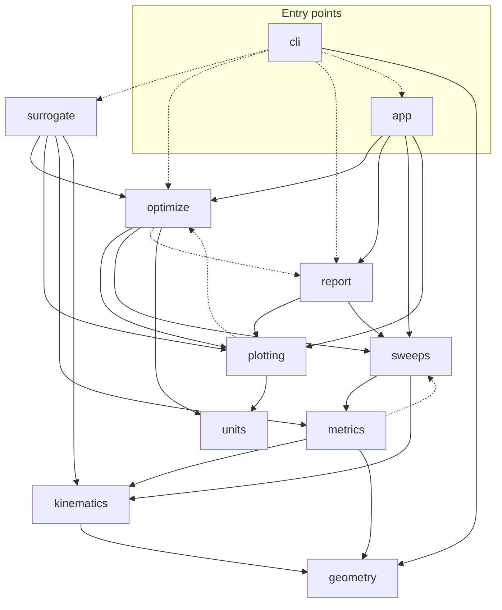
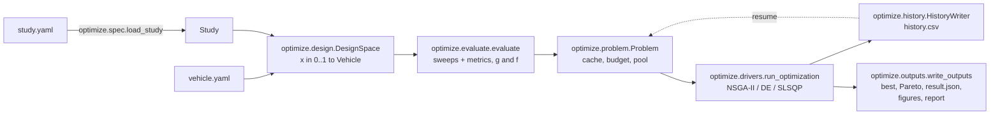
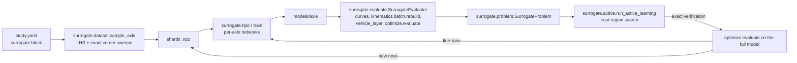
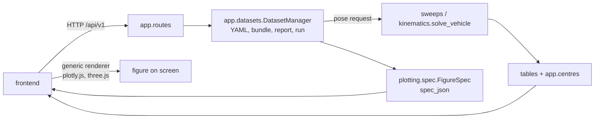

# Architecture: the map of the codebase

`suspkin` computes the kinematics of a Formula Student double-wishbone, pushrod-actuated car.
A vehicle is a YAML file of hardpoints. It is loaded into pydantic models, split into four
corners, and solved as rigid bodies with ideal joints. The solutions are turned into metric
tables (camber, toe, roll centre, motion ratios, ...), which feed reports and figures, the
optimiser, the surrogate and the web app. The code is organised in **layers**: a lower layer
never imports a higher one at module level, so every layer can be used and tested without the
ones above it.

This page is the map. Each concept page below explains one part in depth:

| Page | Topic |
|---|---|
| [Conventions](conventions.md) | frame (ISO 8855), units, sign conventions |
| [Vehicle model](vehicle-model.md) | hardpoints, YAML, mirroring, ARB models |
| [Corner kinematics](corner-kinematics.md) | the single-corner solver, rocker, numba, batch path |
| [Vehicle kinematics](vehicle-kinematics.md) | body poses, ground contact, anti-roll bar |
| [Metrics](metrics.md) | every column computed from a solved state |
| [Sweeps and reports](sweeps-and-reports.md) | sweeps, tidy tables, bundles, reports, figures |
| [Optimisation](optimization.md) | study YAML, design space, evaluator, drivers |
| [Surrogate](surrogate.md) | datasets, networks, active learning |
| [Web app](web-app.md) | backend, API, frontend contract |

The design decisions behind the layout are recorded as ADRs in `docs/adr/`:
[0001 web app](../adr/0001-webapp-architecture.md),
[0002 scope and modelling level](../adr/0002-scope-and-modelling-level.md),
[0003 frame, units, conventions](../adr/0003-frame-units-conventions.md),
[0004 corner solver](../adr/0004-corner-solver.md),
[0005 optimisation framework](../adr/0005-optimisation-framework.md),
[0006 stability, testing and release](../adr/0006-stability-testing-and-release.md),
[0007 surrogate model](../adr/0007-surrogate-model.md),
[0008 the 2026 restructure](../adr/0008-2026-restructure.md).

---

## 1. Layers and the import graph

The graph below was derived from the code: every `import` / `from ... import` in
`src/suspkin`, parsed with `ast`, grouped by top-level package. Solid arrows are imports
executed when the module is imported (module level). Dotted arrows are imports done inside a
function body (lazy). Imports under `TYPE_CHECKING` are not drawn.



Edges that are implied by transitivity (for example `sweeps -> geometry`, or
`app -> kinematics`) are omitted from the picture but exist in the code. The full
module-level adjacency, from the script, is:

| Package | Imports at module level | Imports inside functions (lazy) |
|---|---|---|
| `geometry` | (nothing else in `suspkin`) | |
| `kinematics` | `geometry` | |
| `metrics` | `geometry`, `kinematics` | `sweeps` (in `metrics.vehicle`) |
| `sweeps` | `geometry`, `kinematics`, `metrics` | |
| `report` | `geometry`, `kinematics`, `metrics`, `sweeps`, `plotting` | `plotting`, `sweeps` |
| `plotting` | `geometry`, `kinematics`, `metrics`, `units`, `optimize` (only `plotting.spec`) | `optimize` |
| `optimize` | `geometry`, `kinematics`, `metrics`, `sweeps`, `plotting`, `units` | `plotting`, `report` |
| `surrogate` | `geometry`, `kinematics`, `metrics`, `optimize`, `plotting` | `sweeps` |
| `app` | `geometry`, `kinematics`, `metrics`, `sweeps`, `report`, `optimize`, `plotting`, `units` | `plotting` |
| `cli` | `geometry` | everything else (`kinematics`, `metrics`, `sweeps`, `report`, `plotting`, `optimize`, `surrogate`, `app`, `units`) |

(`units` is a leaf module with no `suspkin` imports of its own beyond the standard library.
`plotting.units` is a different module, the display-unit helper of the figures.)

### Layering rules

1. **Core math is pure.** `geometry`, `kinematics` and `metrics` are pure functions on numpy
   arrays and frozen dataclasses. No global state, no file or network I/O. (The one piece of
   process-level state is the cached numba availability flag in `suspkin.kinematics._numba`.)
2. **`kinematics` never imports `metrics`.** A solver returns states (point tables); metrics are
   computed from states afterwards. `kinematics.batch` and `kinematics.ic_arrays` hold the array
   kernels the metric code reuses, which is why `metrics` imports `kinematics` and not the other
   way round.
3. **`metrics` does not import `sweeps` at module level.** `suspkin.metrics.vehicle` needs
   `sweep_vehicle` for the vehicle summary, but `sweeps` imports `metrics`, so the import sits
   inside the two functions that use it. Likewise `suspkin.metrics.corner` imports
   `metrics.arrays` lazily (`arrays` imports `corner`).
4. **Plotting reads tables, never calls the solver.** `plotting` consumes DataFrames and
   `Vehicle` objects. It imports `kinematics.vehicle` only for the `VehicleState` type, `metrics.vehicle` for
   formulas it displays, and `geometry` for the vehicle and corner models. Report building (`report`) is the layer that runs the solver and then
   hands tables to plotting.
5. **`optimize` and `plotting` form a cycle that is cut by laziness.** `suspkin.optimize` imports
   `suspkin.plotting.optimization` (Pareto helpers) at module level. `suspkin.plotting.spec` and
   `suspkin.plotting.regions` need `suspkin.optimize` (the metric registry, the study spec). The
   package `suspkin.plotting.__init__` therefore does **not** import `spec` or `regions`;
   `plot_study_3d` is resolved on first access through a module `__getattr__`, and the
   `plotting.regions` module imports `optimize` names inside its functions. Importing `spec`
   explicitly is fine because `optimize` is already loaded by then.
6. **`report` is called from `optimize` lazily.** `optimize.outputs.write_outputs` builds a
   report for the best design through function-level imports of `report`, so the `optimize`
   package can be imported without pulling in the full report stack.
7. **`cli` imports everything lazily.** Each command imports what it needs inside its function,
   so `suspkin --help` and `suspkin version` do not load pandas, scipy, matplotlib, torch or
   pymoo, and a missing optional extra fails only the command that needs it.
8. **`app` and `cli` are top-level.** Nothing imports them except each other (`cli.webapp`
   imports `app` lazily).

The light-import rule is enforced by a test: `tests/unit/test_public_api.py::test_light_import`
runs a subprocess that imports `suspkin` and `suspkin.cli` and asserts that `torch`, `optuna`,
`fastapi`, `plotly` and `pymoo` are not in `sys.modules`. By hand, in this checkout:
`import suspkin` loads none of numpy, pandas, scipy, matplotlib or pydantic; `import
suspkin.cli` loads numpy, pydantic, typer and yaml (through `geometry`) but not pandas, scipy
or matplotlib.

---

## 2. Module map

Every module under `src/suspkin`. Names in the last column are the main public names (see the
reference pages for all of them).

### Top level

| Module | Responsibility | Main names |
|---|---|---|
| `suspkin` | Package root: version and the stable public API, resolved lazily (section 4). | `__version__`, `__all__` |
| `suspkin.units` | Unit conversion and parsing of quantities with units (`"12 mm"`, `"3 deg"`) used by the study YAML; display unit/factor per dimension. | `parse_quantity`, `normalize_dim`, `display_unit`, `display_factor`, `m_to_mm`, `rad_to_deg` |
| `suspkin.sweeps` | Runs vehicle sweeps and builds the tidy per-state result tables (one row per pose). | `sweep_vehicle`, `vehicle_frame`, `states_to_frame` |

### `suspkin.geometry`: vehicle description

| Module | Responsibility | Main names |
|---|---|---|
| `geometry.vectors` | Vector, rotation and line/plane helpers in the ISO 8855 frame (mirroring, Rodrigues rotation, 2D line intersections, body rotation). | `mirror_y`, `unit`, `axis_angle_matrix`, `rotation_between`, `body_rotation`, `intersect_lines_2d` |
| `geometry.model` | Pydantic models of the vehicle: hardpoints, wheel, coilover, the three ARB types, steering, axle, params. Validated, frozen. | `Vehicle`, `Axle`, `CornerHardpoints`, `Coilover`, `TorsionalARB`, `BladeARB`, `BeamARB`, `Steering`, `VehicleParams` |
| `geometry.corners` | Expands a `Vehicle` into four `Corner` objects (FL, FR, RL, RR) with left/right mirroring; ARB attachment points. | `Corner`, `build_corners`, `arb_points` |
| `geometry.io` | Reads and writes the vehicle YAML (SI, schema versioned); `VehicleConfigError` for any invalid file. | `load_vehicle`, `save_vehicle`, `vehicle_yaml`, `VehicleConfigError` |

### `suspkin.kinematics`: solvers

| Module | Responsibility | Main names |
|---|---|---|
| `kinematics.corner` | Single-corner solver: Newton iteration on three unknowns: the upper-arm angle, the lower-arm angle and `psi` (spin of the upright about the LBJ→UBJ axis, closed by the tie-rod length); travel and rack sweeps with continuation. | `CornerState`, `solve_corner`, `sweep_corner`, `sweep_rack` |
| `kinematics.rocker` | Closed-form pushrod-length constraint on a rotating rocker; raises `KinematicsError` when unreachable. | `solve_rocker`, `RockerResult`, `RockerCtx`, `KinematicsError` |
| `kinematics.arb` | Anti-roll bar solve (drop-link constraint), stiffness and stored energy; pure functions. | `ArbState`, `solve_arb`, `arb_stiffness`, `arb_energy`, `arm_length` |
| `kinematics.vehicle` | Vehicle poses: prescribed heave/roll/pitch/rack, wheel travel found per corner by a secant iteration so the contact patch lies on the ground. | `VehicleState`, `solve_vehicle`, `contact_point`, `cg_pivot` |
| `kinematics.batch` | Batched forward kinematics: rebuilds many corner states from given arm angles without iterating, and computes metric columns; used by sweeps' array path and the surrogate. | `rebuild`, `make_static`, `corner_columns`, `CStatic`, `Rebuilt`, `GRADIENTS` |
| `kinematics.ic_arrays` | Instant centres and swing angles as arrays over N states (numpy only). | `ic_arrays`, `roll_line_arrays`, `swing_angle`, `Ic` |
| `kinematics._numba` | Optional numba kernels (`newton`, `ground`) and the availability check; pure Python is used when numba is absent or `SUSPKIN_NO_NUMBA` is set. Private. | `available`, `newton`, `ground`, `reset` |

### `suspkin.metrics`: quantities computed from states

| Module | Responsibility | Main names |
|---|---|---|
| `metrics.corner` | Scalar corner helpers: steer angle, wheel and ride rate, front/side-view instant centres, joint angles, Kabsch body rotations. | `steer_angle`, `wheel_rate`, `ride_rate`, `front_view_ic`, `side_view_ic`, `roll_centre_pair`, `kabsch` |
| `metrics.arrays` | Vectorised per-state metrics over N corner states, no per-state Python calls. | `corner_arrays`, `corner_metric_arrays`, `joint_angle_arrays`, `stack_points` |
| `metrics.arb` | ARB metrics: elastic coordinate, drop-link angles, motion ratio and wheel rate of the bar. | `arb_metrics`, `arb_rates`, `ArbRates` |
| `metrics.table` | Metric tables: `metrics_frame` (per-state columns), `add_gradients` (finite-difference slopes vs the sweep variable), `static_summary`. | `metrics_frame`, `add_gradients`, `static_summary`, `joint_angles_frame` |
| `metrics.vehicle` | Vehicle-level formulas (anti-dive/squat/lift, roll stiffness, TLLTD, roll gradient, pitch centre) and the vehicle summary. | `vehicle_summary`, `anti_dive_front`, `axle_roll_stiffness`, `tlltd_front`, `pitch_centre` |

### `suspkin.report`: study runner and outputs

| Module | Responsibility | Main names |
|---|---|---|
| `report.studies` | Runs the standard study set of one design (corner sweeps, steering, heave/roll/pitch, summary). | `run_standard_studies`, `StudyResults` |
| `report.bundle` | Portable, versioned result folder of one design (tables + JSON), the exchange format between runs and the app. | `save_bundle`, `load_bundle`, `is_bundle`, `Bundle`, `BundleError`, `BUNDLE_SCHEMA` |
| `report.builder` | Writes a report folder (CSV, JSON, figures, HTML, Markdown) from study results, optionally comparing designs. | `build_report` |

### `suspkin.plotting`: figures (read-only consumers of tables)

| Module | Responsibility | Main names |
|---|---|---|
| `plotting.style` | Shared look of the figures (colours, line styles, sizes, axis labels); no global matplotlib state left behind. | `use_style`, `design_color`, `figure_size`, `axis_label` |
| `plotting.units` | Display units and formatting of the vehicle summary rows, shared by figures, report, spec and CLI. | `SUMMARY_ROWS`, `format_value` |
| `plotting.figures` | Report-quality 2D figure sets (matplotlib) from result tables. | `FIGURE_SET`, `fig_corner_alignment`, `fig_roll`, `fig_heave_pitch`, `fig_summary_table`, `save_figure` |
| `plotting.spec` | Declarative figure description (panels, series, axes) as data, for the web app's generic renderer. | `FigureSpec`, `FIGURES`, `spec_json`, `derived_columns` |
| `plotting.geometry3d` | 3D suspension view (matplotlib); the scene builder shared by all 3D views. | `plot_vehicle_3d`, `VehicleScene`, `draw_scene`, `vehicle_segments` |
| `plotting.animation` | Animated 3D pose sweep (GIF through Pillow, MP4 through ffmpeg). | `animate_sweep` |
| `plotting.interactive` | Interactive 3D view (plotly, `viz` extra). | `interactive_view`, `interactive_figure` |
| `plotting.regions` | 3D view of an optimisation study: vehicle, variable domains, constraint regions. Loaded lazily. | `plot_study_3d` |
| `plotting.optimization` | Convergence, Pareto, parallel-coordinate and constraint-margin plots, plus Pareto/knee helpers. | `plot_convergence`, `plot_pareto`, `pareto_mask`, `knee_index` |
| `plotting.surrogate` | Surrogate validation and active-learning figures (experimental). | `write_surrogate_figures`, `plot_parity`, `plot_worst_curves` |

### `suspkin.optimize`: studies and optimisation

| Module | Responsibility | Main names |
|---|---|---|
| `optimize.spec` (package) | Study YAML, schema 1: package facade re-exporting the loader and `Study`. | `load_study`, `Study`, `StudyConfigError`, `check_against_vehicle` |
| `optimize.spec.variables` | Design variables, regions (box, hexahedron, offset, sphere, cylinder), point references, sweeps. | `BoxRegion`, `HexahedronRegion`, `SphereRegion`, `CylinderRegion`, `parse_point_ref` |
| `optimize.spec.criteria` | Constraint and objective models, curve objectives, optimiser settings. | `BandConstraint`, `SlopeConstraint`, `InsideConstraint`, `DistanceConstraint`, `CurveObjective` |
| `optimize.spec.study` | The `Study` model, cross-checks against a vehicle, and the YAML loader. | `Study`, `load_study`, `check_against_vehicle`, `region_centroid` |
| `optimize.spec.surrogate` | The `surrogate:` block of a study (dataset, training, HPO, infill, fine-tune, trust region, stop). | `SurrogateSpec`, `DatasetSpec`, `TrainingSpec`, `ActiveLearningSpec` |
| `optimize.registry` | Metric name to physical dimension, for validating constraints and choosing display units. | `corner_metric_dim`, `summary_metric_dim`, `slope_dim`, `MetricNameError` |
| `optimize.regions` | Region geometry in the vehicle frame: trilinear hexahedron map, signed distances to boxes/spheres/cylinders. | `hex_map`, `hex_inverse`, `sd_box`, `sd_hexahedron`, `snap_hexahedron` |
| `optimize.design` | Maps a normalised vector `x` in $[0,1]^n$ to a `Vehicle`; raises `InfeasibleDesign`. | `DesignSpace`, `InfeasibleDesign` |
| `optimize.evaluate` | Evaluates one design: runs the needed sweeps and returns normalised constraints `g` (feasible when $g \le 0$) and objectives. | `evaluate`, `Evaluation`, `ConstraintResult`, `ObjectiveResult` |
| `optimize.problem` | Cached, budgeted, optionally parallel batch evaluation of designs. | `Problem`, `BudgetExhausted` |
| `optimize.pool` | Worker-count resolution and the spawn process pool. | `make_pool`, `resolve_workers` |
| `optimize.drivers` | The optimisers: NSGA-II (pymoo), differential evolution, SLSQP / trust-constr (scipy), DE + SLSQP. | `run_optimization`, `RunResult` |
| `optimize.history` | Append-only CSV history of a run, its reader, and the evaluation cache used for resume. | `HistoryWriter`, `read_history`, `EvalCache`, `cache_key` |
| `optimize.outputs` | Run-folder writer: best and Pareto vehicles, `result.json`, `meta.json`, figures, report. | `write_outputs`, `best_row`, `pareto_rows`, `read_meta` |

### `suspkin.surrogate`: neural surrogate (experimental, needs the `surrogate` extra for training)

| Module | Responsibility | Main names |
|---|---|---|
| `surrogate.channels` | Registry of predicted channels (name, source column, encoding, tolerance, axle) and extraction of one design's corner curves. | `CHANNELS`, `Channel`, `extract_corner`, `extract_axles`, `wrap_line_angle` |
| `surrogate.data` | In-memory dataset contract, per-axle sub design space with Latin hypercube sampling, fixed output grid. | `AxleDataset`, `AxleSpace`, `AxleGrid`, `lhs`, `axle_grids` |
| `surrogate.dataset` | Sharded on-disk `.npz` dataset: sampling with resume, append, load, split assignment, consistency hashes. | `sample_axle`, `load_dataset`, `append_rows`, `assign_split`, `DatasetError` |
| `surrogate.normalise` | Per-channel standardisation and POD basis; numpy only. | `ChannelScaler`, `PodBasis` |
| `surrogate.model` | The per-axle MLP: body, regression head, validity head (torch). | `MLPConfig`, `SurrogateMLP` |
| `surrogate.train` | Training and fine-tuning, masked loss, evaluation, model persistence, batched inference (torch). | `TrainConfig`, `train`, `TrainedModel`, `SurrogatePredictor`, `masked_loss` |
| `surrogate.hpo` | Optuna architecture search per axle (torch + optuna). | `search`, `search_axles`, `retrain_best`, `HpoResult` |
| `surrogate.report` | Markdown report of an Optuna search; stdlib only, reads the study database read-only. | `write_hpo_report` |
| `surrogate.workflow` | `train_surrogate` / `validate_surrogate` from a study and a surrogate root; validation tables and figures. | `train_surrogate`, `validate_surrogate`, `validation_table`, `retrain_surrogate` |
| `surrogate.vehicle_layer` | Analytic vehicle layer on predicted corner curves (heave/roll/pitch travel, roll centre, anti-features, roll stiffness, TLLTD, steering, summary) and its error against the exact model. | `vehicle_layer`, `layer_error`, `LayerResult`, `AxleStatics` |
| `surrogate.evaluate` | `SurrogateEvaluator`: networks, then exact corner states, then the optimiser's constraint evaluator. Predictor interfaces including the exact-model oracle. | `SurrogateEvaluator`, `NetworkPredictor`, `OraclePredictor`, `AxlePredictor` |
| `surrogate.problem` | The optimiser `Problem` evaluated on the networks, with a constraint margin. | `SurrogateProblem` |
| `surrogate.active` | Active-learning driver: surrogate search in a trust region, exact verification, run folder, resume. | `run_active_learning`, `ActiveResult` |
| `surrogate.active_steps` | Pure rules of the active loop: trust region, stopping, infill selection, fine-tune schedule. | `update_radius`, `advance_stop`, `select_infill`, `BoxProblem`, `FinetuneState` |

### `suspkin.app`: web backend (experimental, `app` extra)

| Module | Responsibility | Main names |
|---|---|---|
| `app.server` | FastAPI application factory and uvicorn launcher; serves the built frontend. | `create_app`, `run` |
| `app.routes` | The `/api/v1` routes (sync handlers, run in FastAPI's threadpool). | `make_router` |
| `app.models` | Pydantic request/response models, the source of the OpenAPI schema. | `PoseInput`, `DatasetOut`, `SceneCentres`, ... |
| `app.datasets` | Dataset manager: opens vehicle YAMLs, bundles, reports, optimiser runs inside a workspace. | `DatasetManager`, `Dataset`, `DatasetError` |
| `app.edits` | Applies hardpoint edits to a vehicle (pure). | `apply_hardpoint_edits`, `HardpointEditError` |
| `app.centres` | Rotation centres of a solved pose for the 3D view. | `scene_centres` |
| `app.regions` | Study regions as wireframes for the 3D view. | `study_regions`, `is_study_data` |
| `app.snapshot` | Static snapshot export: datasets embedded in one self-contained HTML file. | `export_snapshot`, `export_dataset_snapshot`, `is_snapshot_file` |
| `app.openapi` | Dumps the OpenAPI schema (input of the frontend type generation). | `main` |

### `suspkin.cli`: command line (Typer)

| Module | Responsibility | Commands |
|---|---|---|
| `cli` (`__init__`) | Builds the Typer app, registers all commands, entry point `suspkin`. | `version`, `main` |
| `cli._common` | Shared error exit and vehicle loading for the commands. | `fail`, `load_vehicle_or_exit` |
| `cli.vehicle` | Vehicle-level commands. | `show`, `animate`, `sweep`, `summary`, `vehicle`, `vsweep`, `report` |
| `cli.study` | Study commands. | `check`, `optimize` |
| `cli.surrogate` | Surrogate commands. | `surrogate sample`, `surrogate train`, `surrogate validate` |
| `cli.webapp` | Web app commands. | `app`, `app-export` |

---

## 3. Data flow of the main pipelines

### 3.1 Vehicle YAML to summary and report

```mermaid
flowchart LR
    Y[vehicle.yaml] -->|geometry.io.load_vehicle| V[Vehicle]
    V -->|geometry.corners.build_corners| C[4 x Corner]
    V -->|kinematics.vehicle.solve_vehicle<br/>one pose| S[VehicleState<br/>4 x CornerState + ARB]
    C --> S
    S -->|sweeps.sweep_vehicle<br/>many poses| L[list of VehicleState]
    L -->|sweeps.vehicle_frame<br/>metrics.arrays.corner_arrays| T[tidy DataFrame<br/>one row per pose]
    T -->|metrics.table.add_gradients| G[table + slopes]
    G -->|metrics.vehicle.vehicle_summary| M[summary dict]
    G --> R[report.studies.run_standard_studies<br/>StudyResults]
    M --> R
    R -->|report.bundle.save_bundle| B[bundle folder]
    R -->|report.builder.build_report<br/>plotting.figures| O[CSV, JSON, PNG, HTML, MD]
```



Corner sweeps (`kinematics.corner.sweep_corner`) skip the vehicle layer: they iterate the Newton
solve along a travel or rack range and `metrics.table.metrics_frame` turns the states into a
table. The table builders use the vectorised kernels in `metrics.arrays` and
`kinematics.ic_arrays`; the scalar helpers in `metrics.corner` are the reference definitions.

### 3.2 Study YAML to optimiser outputs



### 3.3 Surrogate dataset to active learning



### 3.4 Web app request to figure spec



Figure content is declared once as data in `suspkin.plotting.spec` and the frontend renders it,
so the Python figures (`plotting.figures`) and the web figures cannot silently drift. Details
of the API are in [Web app](web-app.md).

---

## 4. Optional extras and lazy imports

The base install needs only numpy, scipy, pandas, pydantic, pyyaml, matplotlib and typer.
Everything else is an extra declared in `pyproject.toml`:

| Extra | Packages | Needed by | Without it |
|---|---|---|---|
| `fast` | numba | `kinematics._numba` (compiled `newton` and `ground` kernels) | pure-Python solver, same results |
| `viz` | plotly | `plotting.interactive` (`show --html`) | `ImportError` raised inside the function |
| `opt` | pymoo | NSGA-II in `optimize.drivers` (imported inside the driver function) | other drivers still work |
| `app` | fastapi, uvicorn | the whole `suspkin.app` package; `cli.webapp` checks for them before importing | `suspkin app` exits with an install hint |
| `surrogate` | torch, optuna | `surrogate.model`, `surrogate.train`, `surrogate.hpo`, and so `surrogate.workflow` | sampling (`surrogate sample`) and the exact-model oracle work without torch |

How the code stays light:

- **`import suspkin` loads nothing heavy.** `suspkin/__init__.py` defines `_LAZY`, a dict from
  each public name to its defining module (for example `"solve_corner":
  "suspkin.kinematics.corner"`). A module-level `__getattr__` (PEP 562) imports the module on
  first access and caches the value in `globals()`; `__dir__` lists the lazy names. Importing
  `suspkin` alone loads neither numpy nor pandas. An `if TYPE_CHECKING:` block repeats the
  imports so mypy and IDEs see the real types.
- **`__all__ = ["__version__", *_LAZY]` is the stable public API.** It is the 19 names of
  `_LAZY` plus the version. `tests/unit/test_public_api.py` snapshots `__all__` and checks that
  each name imports and has a docstring, so adding or removing a public name is a deliberate,
  reviewed change (see [ADR 0006](../adr/0006-stability-testing-and-release.md)). Everything
  not in `__all__` is internal and may change in a minor release.
- **`plotting.__init__` uses the same trick for one name**, `plot_study_3d`, to cut the
  `optimize`/`plotting` cycle (layering rule 5).
- **Heavy third-party imports sit inside functions or in modules that are only imported on
  demand:** `pymoo` inside the NSGA-II driver, `plotly` inside `interactive`, `numba` inside
  `kinematics._numba` (never at module import), `uvicorn` inside `app.server.run`.
  `torch`/`optuna` are imported at the top of `surrogate.model`, `train` and `hpo`, but those
  modules are not imported by `suspkin.surrogate.__init__` (which exposes only the
  numpy-based evaluator, problem, channels, data and vehicle layer); `import suspkin.surrogate`
  does not load torch.
- **`cli` imports inside each command**, for the reason in layering rule 7.

`SUSPKIN_NO_NUMBA` (any value other than empty or `0`) switches the numba path off for the
process. The decision is cached by `suspkin.kinematics._numba.available`; tests call
`reset()` to re-read it.

---

## 5. Performance overview

The corner solver is called thousands of times by sweeps, studies, the optimiser and the
surrogate dataset generator, so its cost matters. Where the time goes and what was done about it:

- **A corner solve** is a Newton iteration on three angles with an analytic Jacobian; one pose
  takes a few tenths of a millisecond (0.27 ms pure Python, 0.14 ms with numba on the
  development machine). Along a sweep each point starts from the neighbour's solution and costs
  about 22 microseconds with numba, 37 microseconds without.
- **A vehicle pose** solves four corners, and for each a secant iteration on wheel travel so the
  contact patch lies on the ground plane. Heave, roll and rack sweeps of 61 poses take 21 to 27 ms
  in pure Python and 12 ms with numba. `run_standard_studies` at 61 points takes about 166 ms
  pure Python, 94 ms with numba.
- **What the optimisation work changed** (these are properties of the current code):
  - the point table is built once per pose; only the converged pose becomes a `CornerState`;
  - static points are shared read-only arrays, not copies;
  - the secant iteration starts from the neighbouring pose's converged slope (private
    `VehicleState._slopes`), cutting a heave or roll pose from about 4 to about 2 corner solves
    per corner;
  - the ARB drop-link solve uses scalar math instead of numpy calls on 3-vectors.
  The warm start moves the converged pose only within the ground-contact tolerance
  (`_G_TOL = 1e-11` m), so golden snapshots pass unchanged.
- **numba** compiles the Newton solve and the whole ground-contact secant. Results match the
  pure-Python path to rtol 1e-9 (checked in `tests/unit/test_fast_kernel.py`). Fallback is
  narrow: a *failed* Newton (status 0) returns `None` from `_numba.newton`, exactly as the Python
  body does, and is not re-run; only an exception in the kernel call disables the fast path and
  re-runs the Python body; `_numba.ground` returns `None` on any non-zero status so the
  pure-Python secant runs and the error behaviour is unchanged (details in
  [Corner kinematics, section 3](corner-kinematics.md)).
  The price is a one-off cost of 0.91 s per process (kernel load plus first vehicle sweep, warm
  disk cache; compile is cached after the first run). It pays off in the app, optimiser runs and dataset generation; for a single short
  command set `SUSPKIN_NO_NUMBA=1`.
- **The batch path** (`kinematics.batch`) avoids iteration altogether when the arm angles are
  already known (surrogate networks predict them), rebuilding the points of many designs and
  states in one vectorised step.
- **After the kernels** the remaining time is Python: pose bookkeeping, the ARB solve, building
  `CornerState` arrays and the metric tables.

The measured table (pure Python vs numba, per case) and the profile are in
[Corner kinematics, section 6](corner-kinematics.md#6-performance). Reproduce with:

```bash
python -m uv run python scripts/bench_kinematics.py            # timings
python -m uv run python scripts/bench_kinematics.py --profile  # + cProfile top list
python -m uv run python scripts/bench_kinematics.py --no-numba
```

Timings are machine dependent; the ratios are what matter. Two wall-clock guards run in the test
suite under the `perf` marker (`tests/unit/test_corner_sweeps.py`,
`tests/regression/test_reference_vehicle_sweeps.py`) with generous limits (a few times the
development-machine time), so they catch order-of-magnitude regressions only.
`tests/regression/behaviour/BENCH_BASELINE.txt` keeps the benchmark output recorded before the
refactor for comparison.

---

## 6. Testing strategy

The suite lives in `tests/` and runs with `python -m uv run pytest -q`. The layers of tests,
from fast and local to slow and global:

| Layer | Where | What it protects |
|---|---|---|
| Unit | `tests/unit/` | one module's behaviour: solver Jacobian vs finite differences, rocker, ARB, metrics, YAML validation, study spec, drivers, CLI, app API, public API, surrogate parts. Prefers analytical or invariant checks to magic numbers. |
| Property | `tests/property/` (hypothesis) | invariants over random inputs: corner solutions keep link lengths (front, rear, all four corners, random travel and rack); a design vector round-trips through `DesignSpace` (also on the quantisation grid). |
| Regression, golden | `tests/regression/` | the numbers of the reference car do not drift (below). |
| Regression, reference and equivalence | `tests/regression/test_reference_*.py`, `test_vectorised_equivalence.py`, `test_surrogate_*.py` | vectorised paths equal the scalar reference definitions (including random designs); the surrogate oracle path equals the exact model; the vehicle-layer error stays within planned tolerances. |
| Behaviour lock | `tests/regression/behaviour/` | the observable behaviour of the CLI, the web API and the surrogate sampling does not change (below). |
| Examples | `tests/examples/` (marker `examples`) | every `examples/0*.py` script runs end to end into a temporary folder (subprocess, 180 s timeout) and prints something and writes files. |
| Frontend | `frontend/src/**/*.test.ts(x)` (vitest) | the TypeScript side: store, formatting, panel data, traces, hardpoint editing, snapshot source, a few components. |

### Golden snapshots

`tests/regression/golden/` holds frozen outputs of `configs/vehicles/fs_reference.yaml` and its
reference studies, all in SI: the four corner travel sweeps (-30..30 mm, 25 steps), the rack
sweep, the heave/roll/pitch/rack vehicle sweeps (11 steps), the flattened vehicle summary and the
baseline study evaluation. `tests/regression/test_golden.py` compares a fresh run with the files
column by column: same columns, same row count, `rtol = 1e-6`, `atol = 1e-9`, and a looser
`atol = 1e-8` for gradient columns and polynomial-slope summary keys (finite differences carry
round-off that differs a little across platforms). The rule for regenerating is in
`tests/regression/golden/README.md`: only after a deliberate, reviewed model change, with
`python -m uv run pytest tests/regression --update-golden`, reviewing the diff and noting the
change in `CHANGELOG.md`. A failing comparison with no such change is a regression.

### Behaviour lock

The behaviour lock is the safety net for refactors. `tests/regression/behaviour/` runs the real
program and stores everything it observably does under `snapshots/<case>/`:

- `test_cli_lock.py`: every CLI command (including every `--help` text, error exits for a bad
  vehicle and a bad study, `report` with `--compare`, `optimize`, `app-export` against a stub
  template, `surrogate sample`). Each case stores `stdout.txt`, `exit_code.txt` and every file the
  command wrote; the commands run with `SUSPKIN_NO_NUMBA=1`.
- `test_app_lock.py`: one scripted session over a workspace; status code and JSON body of every
  endpoint (`NN_<label>.json`), plus `test_openapi_unchanged`, which pins the generated OpenAPI
  schema to `frontend/src/api/openapi.json`. Skipped without fastapi/httpx.
- `test_surrogate_lock.py`: oracle evaluation of 16 random designs and the dataset written by
  `surrogate sample`. Skipped without torch.

Volatile text (temporary paths, timestamps, durations, version, git and study hashes, UUIDs,
ANSI codes, huge inline scripts) is replaced by tokens before comparing. Comparison by file type:
CSV and JSON/YAML by value with exact columns, keys and row counts and `rtol = 1e-12` (`atol` as
in the golden suite, 1e-9 or 1e-8 for gradients); `.md`, `.html`, `.txt` by exact text skeleton
with float literals compared at `rtol = atol = 1e-9`; binary files (`.png`, `.gif`, `.mp4`,
`.npz`, ...) only for existence and non-zero size; wall-clock columns are skipped. A
`_files.txt` listing makes extra or missing output files fail. Regenerate with
`python -m uv run pytest tests/regression/behaviour --update-lock`; like `--update-golden` this
is **refused when `CI` or `GITHUB_ACTIONS` is set**, so a pipeline can never rewrite its own
expectations. The tolerances and the update workflow are summarised in
[Development, section 4](../guides/development.md#4-golden-tests-and-the-behaviour-lock).

### Continuous integration

`.github/workflows/ci.yml` runs on every push and pull request to `main`:

| Job | What it does |
|---|---|
| `test` | matrix of ubuntu, windows, macOS (Apple Silicon) x Python 3.11, 3.12, 3.13; `uv sync --all-extras`; `ruff check`; `ruff format --check`; `mypy src` (strict); `pytest -m "not examples"` with coverage. |
| `examples` | Ubuntu, Python 3.12: `pytest -m examples`. |
| `docs` | `zensical build --strict --clean` (broken links or missing references fail the build). |
| `frontend` | Node 22: `npm ci`, lint, typecheck, vitest, both builds (`build`, `build:single`), then the two Python app tests (`test_app_api.py`, `test_app_snapshot.py`). |

`docs.yml` publishes the site on pushes to `main` that touch docs or sources, and `release.yml`
runs on `v*` tags: it checks that the tag equals the `pyproject.toml` version and that the
tagged commit is on `main` before releasing. Day-to-day commands, gate order and the release
procedure are in [Development](../guides/development.md).
