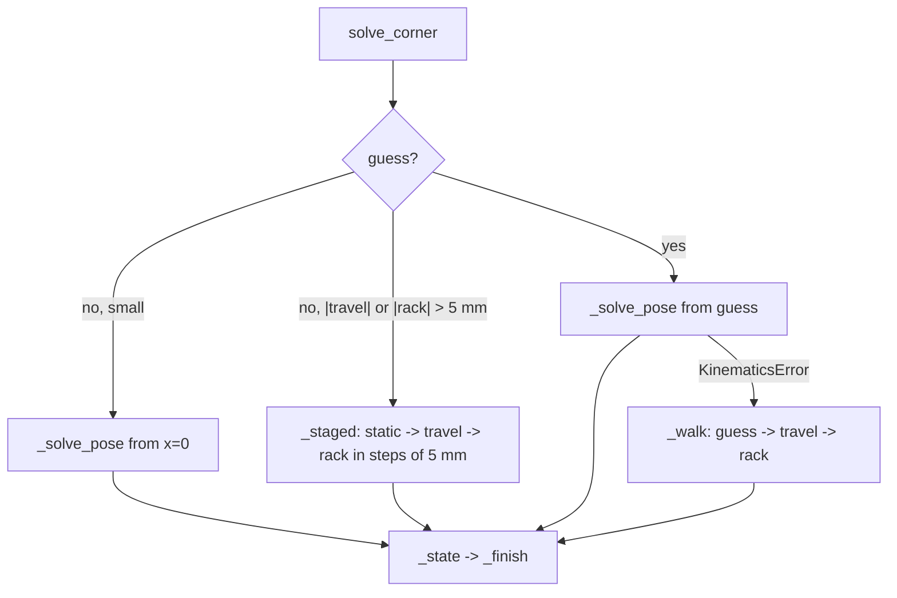

# Corner kinematics

This page explains how `suspkin` solves **one suspension corner**: given a wheel-centre
travel (and, on a steered axle, a rack displacement) it finds the position of every moving
hardpoint, the wheel spin axis, the pushrod/rocker motion and the coilover length. Everything
above this level (vehicle poses, anti-roll bar, metrics, sweeps, optimisation, surrogate) is
built on it.

Modules covered

| Module | Role |
|---|---|
| `suspkin.kinematics.corner` | the solver: `solve_corner`, `sweep_corner`, `sweep_rack`, `CornerState` |
| `suspkin.kinematics.rocker` | closed-form rocker/pushrod solve, `KinematicsError`, `side_sign` |
| `suspkin.kinematics._numba` | optional compiled fast path (same algorithm) |
| `suspkin.kinematics.batch`, `suspkin.kinematics.ic_arrays` | vectorised forward kinematics over many designs and states (surrogate) |

Prerequisites: the frame, units and sign conventions are in [conventions](conventions.md);
the hardpoint names, `Corner`, mirroring and the YAML schema are in
[vehicle model](vehicle-model.md). The vehicle-level layer (heave, roll, pitch, rack of the
whole car, ground contact) is in [vehicle kinematics](vehicle-kinematics.md).


---

## 1. Theory

### 1.1 Degrees of freedom of a double-wishbone corner

The chassis is fixed (the body frame is the ISO 8855 vehicle frame; the *ground* moves
relative to the body, see the module docstring of `suspkin.kinematics.corner`). Three bodies
move:

* the upper control arm (UCA), hinged to the chassis at two points `uca_front`, `uca_rear`:
  a revolute joint about the line `uca_front -> uca_rear`;
* the lower control arm (LCA), likewise about `lca_front -> lca_rear`;
* the upright (knuckle, carrying the wheel), a free rigid body connected to the arms by
  spherical (ball) joints at `uca_outer` (UBJ) and `lca_outer` (LBJ).

The tie rod is a link of fixed length between `tie_inner` (on the steering rack, fixed to the
chassis for a given rack position) and `tie_outer` (on the upright); its two ends are ball
joints so it can spin about its own axis freely, which is a motion that does not matter. It
therefore acts as one distance constraint.

Counting (rigid bodies in space have 6 DOF):

| Item | DOF |
|---|---|
| UCA + LCA + upright, free | 3 x 6 = 18 |
| two revolute joints (5 constraints each) | -10 |
| two ball joints UBJ, LBJ (3 each) | -6 |
| **after arms and upright** | **2** |
| tie rod distance constraint | -1 |
| **mobility of the corner, rack fixed** | **1** |

One degree of freedom remains: the wheel can go up and down ("travel"). Moving the rack
changes the tie-rod end position and so selects a different one-parameter family (steer).
The corner is therefore driven by **two inputs, travel and rack**.

The pushrod and rocker add a body (the rocker, one revolute joint) and one distance
constraint (the pushrod). They add no freedom: the rocker angle is fully determined by the
pushrod outer point and is solved in closed form *after* the upright (section 1.5). The
spring/damper and the ARB droplink are read off the rocker and do not feed back.

### 1.2 Unknowns

The pose of the whole mechanism is described by three scalars:

| Unknown | Meaning |
|---|---|
| $\theta_u$ (`theta_uca`) | rotation of the UCA about its chassis axis |
| $\theta_l$ (`theta_lca`) | rotation of the LCA about its chassis axis |
| $\psi$ (`psi`) | spin of the upright about its own UBJ-LBJ axis |

Why these three. Rotating each arm about its axis puts the two ball joints on known circles,
so **UBJ and LBJ depend on $(\theta_u,\theta_l)$ only**. A rigid upright whose two ball
joints are at known places still has one freedom left: spinning about the line through them.
That is $\psi$. The upright's orientation is therefore parametrised as

$$
R = Q(\mathbf n,\phi)\,M(\mathbf u_0\to\mathbf n),\qquad \phi = s\,\psi,
$$

where

* $\mathbf u_0$ is the unit vector $\widehat{\mathrm{UBJ}_0-\mathrm{LBJ}_0}$ of the static pose
  (`_Ctx.d0_hat`) and $\mathbf n$ is the unit vector $\widehat{\mathrm{UBJ}-\mathrm{LBJ}}$ of
  the current pose;
* $M$ is the **minimal rotation** taking $\mathbf u_0$ to $\mathbf n$ (no twist about $\mathbf n$);
* $Q$ is a rotation by $\phi$ about the new axis $\mathbf n$ (the spin);
* $s=\pm1$ is the per-side sign (`suspkin.kinematics.rocker.side_sign`): $+1$ for a left
  corner, $-1$ for a right corner. Right corners are mirror images of left corners, and a
  reflection reverses the sense of a rotation. All reported angles are therefore equal for a
  mirrored motion and the physical rotation is $s\cdot\text{angle}$.

Any rotation of a rigid body that maps $\mathbf u_0$ to $\mathbf n$ is $Q M$ for some $\phi$,
so the parametrisation is complete. Note that $\psi$ is a spin relative to the minimal
rotation, *not* the steer angle; steer angle, toe, camber, etc. are derived from the final spin
axis (see [metrics](metrics.md)).

**Rodrigues' rotation formula.** Rotating a vector $\mathbf v$ about a unit axis $\mathbf k$
by angle $\alpha$ ($\cos\alpha=c$, $\sin\alpha=\sigma$):

$$
\mathbf v' = \mathbf v\,c + (\mathbf k\times\mathbf v)\,\sigma + \mathbf k\,(\mathbf k\cdot\mathbf v)(1-c).
$$

This is `suspkin.kinematics.corner._rodrigues(k, cs, sn, v)`. No rotation matrices are
built; cos/sin are computed once per angle.

**Minimal rotation.** For unit vectors $\mathbf u,\mathbf n$ let
$\mathbf w=\mathbf u\times\mathbf n$, $c=\mathbf u\cdot\mathbf n$, $K=[\mathbf w]_\times$. The
rotation by $\angle(\mathbf u,\mathbf n)$ about $\mathbf w/|\mathbf w|$ is

$$
M = I + K + \frac{K^2}{1+c}
$$

(Rodrigues with $\sin\theta=|\mathbf w|$ and $(1-c)/\sin^2\theta = 1/(1+c)$). It is singular
only at $c=-1$, i.e. when the upright is turned upside down. The code tests
`cc < -1 + 1e-12` and treats it as "upright axis flipped" (`ValueError` in the Python
path, status 1 in the kernel); the Newton line search simply halves the step when it meets
this. `_min_rot(w, ik, r)` applies $M$ with `ik` $=1/(1+c)$.

### 1.3 Constraint equations

Let `uca_front`, `lca_front` be the chassis points $\mathbf a_u,\mathbf a_l$, the arm axes
$\hat{\mathbf e}_u,\hat{\mathbf e}_l$ the unit vectors `uca_front -> uca_rear` and
`lca_front -> lca_rear` (`_Ctx.uca_hat`, `lca_hat`), and $\mathbf r_u=\mathrm{UBJ}_0-\mathbf a_u$,
$\mathbf r_l=\mathrm{LBJ}_0-\mathbf a_l$ (`r_ubj`, `r_lbj`). The ball joints are

$$
\mathrm{UBJ}=\mathbf a_u+\mathrm{Rot}(\hat{\mathbf e}_u,\,s\theta_u)\,\mathbf r_u,\qquad
\mathrm{LBJ}=\mathbf a_l+\mathrm{Rot}(\hat{\mathbf e}_l,\,s\theta_l)\,\mathbf r_l .
$$

With $\mathbf d=\mathrm{UBJ}-\mathrm{LBJ}$, $\mathbf n=\mathbf d/|\mathbf d|$ and the static
lever arms $\mathbf r_t=\mathrm{tie\_outer}_0-\mathrm{LBJ}_0$ (`r_tie`),
$\mathbf r_c=\mathrm{wheel\_center}_0-\mathrm{LBJ}_0$ (`r_wc`), any upright-fixed point is
carried as $\mathrm{LBJ}+R\,\mathbf r$. So

$$
\mathbf p_t = R\,\mathbf r_t,\quad \mathbf p_w = R\,\mathbf r_c,\qquad
\mathrm{tie\_outer}=\mathrm{LBJ}+\mathbf p_t,\quad
\mathrm{wheel\_center}=\mathrm{LBJ}+\mathbf p_w .
$$

The three closing equations (the residual vector $\mathbf F$, all in metres) are:

$$
\begin{aligned}
F_1 &= |\mathbf d| - L_{ubj}, && L_{ubj}=|\mathrm{UBJ}_0-\mathrm{LBJ}_0| \quad\text{(upright rigid: ball-joint distance)}\\
F_2 &= |\mathrm{tie\_outer}-\mathrm{tie\_inner}(\rho)| - L_{tie}, && L_{tie}=|\mathrm{tie\_outer}_0-\mathrm{tie\_inner}_0|\quad\text{(tie rod length)}\\
F_3 &= z_{\mathrm{LBJ}}+(\mathbf p_w)_z - z_{wc,0} - \tau &&\text{(prescribed wheel-centre height)}
\end{aligned}
$$

where $\tau$ is the travel (bump positive) and
$\mathrm{tie\_inner}(\rho)=\mathrm{tie\_inner}_0+\rho\,\hat{\mathbf r}_{\mathrm{rack}}$ is the
inner tie-rod point shifted by the rack displacement $\rho$ along the steering `rack_axis`
(`_tie_inner`). With no steering (`rack_axis is None`) $\rho$ must be 0, otherwise
`ValueError("rack must be 0 on an axle without steering")`.

Because the arms rotate rigidly about fixed axes, the arm lengths (UBJ and LBJ distances to
the chassis pivots) hold *by construction*; $F_1$ is the only place where the two arms
"talk" to each other through the upright.

The "wheel travel" is the vertical displacement of the **wheel centre** in the body frame.
The ground contact is *not* used at this level; the contact patch is a derived point
(section 1.7). The vehicle layer re-parametrises travel so that the contact patch touches
the ground (see [vehicle kinematics](vehicle-kinematics.md)).

### 1.4 Newton iteration

Unknown vector $\mathbf x=(\theta_u,\theta_l,\psi)$; solve $\mathbf F(\mathbf x)=\mathbf 0$ by
damped Newton with the **analytic Jacobian** $J=\partial\mathbf F/\partial\mathbf x$ (3x3).

**Jacobian.** The rows are the constraints, the columns the unknowns. A column needs the
velocity of UBJ/LBJ and the angular velocity $\boldsymbol\omega$ of the upright for a unit
change of one unknown:

* $\partial\mathrm{UBJ}/\partial\theta_u = s\,\hat{\mathbf e}_u\times(\mathrm{UBJ}-\mathbf a_u)$,
  $\partial\mathrm{LBJ}/\partial\theta_l = s\,\hat{\mathbf e}_l\times(\mathrm{LBJ}-\mathbf a_l)$
  (`da`, `db` in `_eval`);
* for a change $\delta\mathbf d$ of $\mathbf d$, $\mathbf n' = (\delta\mathbf d-\mathbf n(\mathbf n\cdot\delta\mathbf d))/|\mathbf d|$ and the
  spatial angular velocity of the upright is
  $\boldsymbol\omega = \sin\phi\,\mathbf n' + (1-\cos\phi)\,\mathbf n\times\mathbf n' + Q\,\mathbf w_M$,
  with $\mathbf w_M=\mathbf u\times\mathbf n' - \mathbf w\,(\mathbf u\cdot\mathbf n')/(1+c) + \mathbf w\times(\mathbf u\times\mathbf n')/(1+c)$
  (the derivative of the minimal rotation; derived in the docstring of
  `suspkin.kinematics.corner._eval`). Changing $\psi$ adds $s\,\mathbf n$;
* with $\dot{\mathrm{LBJ}}$ and $\boldsymbol\omega$ the three rows are
  $\dot F_1=\mathbf n\cdot\delta\mathbf d$,
  $\dot F_2=\mathbf e\cdot(\dot{\mathrm{LBJ}}+\boldsymbol\omega\times\mathbf p_t)/|\mathbf e|$
  ($\mathbf e=\mathrm{tie\_outer}-\mathrm{tie\_inner}$) and
  $\dot F_3=(\dot{\mathrm{LBJ}}+\boldsymbol\omega\times\mathbf p_w)_z$.

So the $\psi$-column is $(0,\ \mathbf e\cdot(s\mathbf n\times\mathbf p_t)/|\mathbf e|,\ (s\mathbf n\times\mathbf p_w)_z)$.
`tests/unit/test_corner_jacobian.py` checks the analytic Jacobian against finite differences
at solved and perturbed points, for every corner, travel and rack.

**Step.** Solve $J\,\Delta\mathbf x=-\mathbf F$ by Cramer's rule (`_solve3`); if
$|\det J|<10^{-30}$ the iteration gives up. At the static pose of FL on `fs_reference`, $J$ has
condition number about 7.2 (a well-conditioned problem).

**Damping (backtracking line search).** Try $\lambda=1$, accept the first
$\lambda\in\{1,\tfrac12,\tfrac14,\dots\}$ (at most `_MAX_BACKTRACKS` = 10 trials) for which
$|\mathbf F(\mathbf x+\lambda\Delta\mathbf x)|^2$ is strictly smaller than $|\mathbf F(\mathbf x)|^2$.
A trial that raises the "upright axis flipped" `ValueError` also halves $\lambda$. If no trial
is accepted the Newton solve returns "failed" (`None`).

**Constants** (`suspkin.kinematics.corner`; the same values are duplicated in
`suspkin.kinematics._numba`, and `tests/unit/test_fast_kernel.py::test_kernel_constants_match_solver`
asserts that they stay equal):

| Constant | Value | Role |
|---|---|---|
| `_NEWTON_MAX_ITER` | 30 | iteration cap |
| `_NEWTON_F_TOL` | 1e-12 m | converged when $\max_i|F_i|<$ this |
| `_NEWTON_X_TOL` | 1e-14 | step size below which the iteration is "stalled" |
| `_NEWTON_STALL_F_TOL` | 1e-10 m | a stalled iteration is still accepted if $\max|F_i|<$ this |
| `_MAX_BACKTRACKS` | 10 | line-search halvings |
| `_RESIDUAL_TOL` | 1e-9 m | after convergence, `check` rejects a result with worse residual |
| `_MAX_ANGLE_STEP` | 0.05 rad | largest allowed change of $(\theta_u,\theta_l,\psi)$ from the guess; larger means a branch jump |

The step size tested against `_NEWTON_X_TOL` is $\lambda\max_i|\Delta x_i|$.

**Convergence behaviour.** Newton is quadratically convergent near the root. A worked trace,
undamped, from the static pose to 10 mm bump on FL (reproduced in the worked example below):

| iteration | $\theta_u$ [deg] | $\theta_l$ [deg] | $\psi$ [deg] | $\max\lvert F\rvert$ [m] |
|---:|---:|---:|---:|---:|
| 0 | 0 | 0 | 0 | 1.0e-02 |
| 1 | -2.117783 | -1.554004 | -0.015781 | 2.7e-05 |
| 2 | -2.118265 | -1.553232 | 0.004227 | 1.5e-10 |
| 3 | -2.118265 | -1.553232 | 0.004227 | 5.6e-17 |

### 1.5 Rocker and pushrod

The pushrod is a rigid link of length $L_p$ (static length, `RockerCtx.length`) from
`pushrod_outer` to `pushrod_inner`. The outer end rides on the **upright** (default), the
**LCA** or the **UCA** (`axle.pushrod_mount`, `_Ctx.mount`). Its position is taken after the
Newton solve:

* `upright`: $\mathrm{LBJ}+R\,(\mathrm{po}_0-\mathrm{LBJ}_0)$;
* `lca`: $\mathbf a_l+\mathrm{Rot}(\hat{\mathbf e}_l,s\theta_l)(\mathrm{po}_0-\mathbf a_l)$;
* `uca`: the same with the UCA axis and $\theta_u$.

(`fs_reference` uses `uca`.) The inner end is on the rocker, which turns about a fixed axis
$\hat{\mathbf a}$ (`corner.rocker_axis`, unit) through `rocker_pivot`. With the physical
angle $\alpha=s\cdot\text{rocker\_angle}$, decompose the static inner point relative to the
pivot as $\mathbf r_{in}=\mathbf v_\parallel+\mathbf w$ with
$\mathbf v_\parallel=(\mathbf r_{in}\cdot\hat{\mathbf a})\hat{\mathbf a}$ and $\mathbf w$ perpendicular to the axis. Then

$$
\mathrm{pushrod\_inner}(\alpha) = \mathrm{pivot} + \mathbf v_\parallel + \mathbf w\cos\alpha + (\hat{\mathbf a}\times\mathbf w)\sin\alpha .
$$

Put $\mathbf r=\mathrm{po}-\mathrm{pivot}-\mathbf v_\parallel$. The constraint
$|\mathrm{po}-\mathrm{pushrod\_inner}(\alpha)|=L_p$ expands (using $|\hat{\mathbf a}\times\mathbf w|=|\mathbf w|$ and
$\mathbf w\perp\hat{\mathbf a}\times\mathbf w$) to

$$
A\cos\alpha + B\sin\alpha = C,\qquad
A=\mathbf r\cdot\mathbf w,\ \ B=\mathbf r\cdot(\hat{\mathbf a}\times\mathbf w),\ \
C=\tfrac12\left(|\mathbf r|^2+|\mathbf w|^2-L_p^2\right).
$$

With $\text{amp}=\sqrt{A^2+B^2}$ and $\beta=\mathrm{atan2}(B,A)$, the two roots are
$\alpha=\beta\pm\arccos(C/\text{amp})$ (`solve_tuple`: `ca`, `cb`, `cc`, `amp`, `half`,
`base`). They correspond to the two sides of the circle swept by the inner end. The code picks
the root nearest (modulo $2\pi$) to the **guess**, i.e. the rocker angle of the neighbouring
solution (0 for a cold solve), so the rocker follows its branch continuously through a sweep.

There is no solution when `amp < 1e-12` or `|C| > amp (1 + 1e-12)`: the pushrod cannot reach
the rocker circle and `KinematicsError("pushrod cannot reach the rocker circle (no rocker solution)")`
is raised (the corner solver appends `" at travel ... m"`).

Then the spring and ARB attachment points on the rocker are rotated by the same $\alpha$
(`rocker_spring`, and `rocker_arb` when the axle has an ARB).

**Toggle margin.** With the lever $\mathbf l=\mathrm{pushrod\_inner}-\mathrm{pivot}$ and the
pushrod direction $\mathbf q=\mathrm{po}-\mathrm{pushrod\_inner}$, both projected onto the plane
normal to the rocker axis, let $a$ be the angle between them. The reported
`toggle_margin` is $\min(a,\pi-a)$ [rad]: $\pi/2$ is the best force transmission,
0 means the pushrod is in line with the lever (toggle lock-up, zero mechanical advantage). Near toggle the motion ratio and wheel rate diverge, so a small margin means a very stiff, not a soft, wheel rate.
It is 85.15 deg for FL at the static pose of `fs_reference`.

**Coilover.** `coilover_length` is $|\mathrm{rocker\_spring}-\mathrm{spring\_chassis}|$;
`coilover_in_range` is `length_min <= length <= length_max` of the `Coilover`
component. This is a flag, never an error.

`CornerState.max_residual` is $\max(\max_i|F_i|,\ |L_{push}-L_{push,0}|)$, where
$L_{push}$ is the pushrod length recomputed from the rebuilt points (a self-check of the
rocker solution).

### 1.6 Steering rack effect on the tie rod

The rack enters only through the tie-rod inner point, which translates along the steering
`rack_axis` by $\rho$ (section 1.3). It does not move any other hardpoint directly; $F_2$
changes, and the Newton solve rotates the upright (mostly $\psi$) to restore the tie-rod
length. For FL on `fs_reference` (`rack_axis = (0, 1, 0)`) a +20 mm rack gives
$\psi\approx+15.04$ deg, -20 mm gives $-15.01$ deg: the small asymmetry between the two directions comes from the geometry (the
mechanism is nonlinear in the rack), not from a sign error. Rack travel limits live in
`steering.rack_travel` (here $\pm30$ mm) but nothing enforces them: callers (`metrics/vehicle.py`, `report/studies.py`, the app) only use
`rack_travel` to choose sweep ranges, and `solve_corner` happily accepts a rack of $\pm80$ mm. Only
beyond mechanical reach does the solve fail (section 4).

### 1.7 Contact patch and tyre model

The tyre is a rigid thin disc of radius `tyre_radius` $R_t$ whose axis is the wheel spin axis
$\mathbf s$:

* the static axis $\mathbf s_0$ comes from `suspkin.geometry.vectors.wheel_spin_axis(side, static_camber, static_toe)`;
* the current axis is $\mathbf s=\widehat{R\,\mathbf s_0}$ (`CornerState.spin_axis`);
* the "up" vector in the wheel plane is $\mathbf z_w = \widehat{\hat{\mathbf z}-s_z\mathbf s}$
  (the vertical projected onto the wheel plane);
* the contact patch is $\mathrm{CP}=\mathrm{wheel\_center}-R_t\,\mathbf z_w$ (`_finish`).

No tyre width, crown, deflection or slip is modelled. Consequently with static camber
$\gamma$ the contact patch is not at $z=0$ at travel 0 but at $R_t(1-\cos\gamma)$
(0.035 mm on `fs_reference` FL, which has about 1 deg camber). The vertical stiffness
`tyre_vertical_stiffness` only enters later, through the ride-rate metric
(see [metrics](metrics.md)).

### 1.8 Why continuation (several solutions exist)

The closing equations are nonlinear and have several isolated solutions: the arms can
assemble "folded", the upright can flip, the rocker has two roots. Only one is the real
mechanism, the one connected to the static pose. A Newton solve from a bad start can
converge to another one. The solver therefore always works by **continuation**: start from the
known static solution (or a neighbour's solution) and advance in small steps, using each
result as the start of the next. A change of $(\theta_u,\theta_l,\psi)$ larger than
`_MAX_ANGLE_STEP` = 0.05 rad between neighbours is declared a branch jump and rejected.

---

## 2. How the code does it

### 2.1 Data flow



### 2.2 The context `_Ctx`

`suspkin.kinematics.corner._Ctx(corner)` precomputes, once per corner, all static data as
plain Python floats/tuples (`_V3`) so the inner loops avoid numpy: `sign`, `uca_front`,
`lca_front`, `uca_hat`, `lca_hat`, `r_ubj`, `r_lbj`, `d0_hat`, `len_ubj`, `len_tie`,
`r_tie`, `r_wc`, `wc0_z`, `spin0`, `radius`, `mount`, `rack_axis`, `rocker`
(`suspkin.kinematics.rocker.RockerCtx`), `r_po`, `static_push`, `spring_chassis`. It also
caches the packed arrays for the numba path in `fast_arrays` (lazily, by `_numba.arrays`).
`sweep_corner` builds one context and reuses it for the whole sweep; `solve_corner` accepts
a private `_ctx` for the same reason (used by the vehicle solver).

### 2.3 Residual and Jacobian: `_eval`

`_eval(c, a, b, psi, travel, ti, jac)` returns `(F, J)` for $a=\theta_u$, $b=\theta_l$ and
$ti$ = inner tie-rod point, with $J$ `None` when `jac=False`. It follows the equations of
sections 1.2 to 1.4 exactly (`_rodrigues`, `_min_rot`, then `column(dd, dl)` for the arm
columns and a direct formula for the $\psi$ column). `_residuals` and `_jacobian` are thin
numpy wrappers used by the SciPy fallback.

### 2.4 One solve: `_solve_pose`

`_solve_pose(c, travel, rack, guess, x_pred)` does this:

1. $\rho\to$ `tie_inner` (`_tie_inner`).
2. **Start list.** No guess: `[(0,0,0)]`, rocker guess $\phi_0=0$. With a guess: `[x_pred, guess angles]`
   (the predictor is optional) and $\phi_0$ = guess rocker angle.
3. For each start, run `_newton`. If it returns a result, apply `check`:
   residual $\le$ `_RESIDUAL_TOL` (else `KinematicsError("no convergence at travel ... m, rack ... m (residual ...e... m)")`) and, with a guess, angle change $\le$ `_MAX_ANGLE_STEP`
   (else `KinematicsError("branch jump at travel ... m, rack ... m (angle change ... rad from the guess)")`).
   The first start that passes is accepted. If some start converged but all failed the check,
   the last error is raised.
4. If **no** start converged, fall back to `_hybr`: SciPy's MINPACK `hybr` with the analytic
   Jacobian and `tol=1e-14`, starting from the last start (set to the origin if $|\mathbf x_0|<10^{-4}$,
   since `hybr` bounds its first step by $|\mathbf x_0|$). A non-finite result gives
   `KinematicsError("solver diverged at travel ... m")`, an exception inside gives
   `KinematicsError("solver failed at travel ... m: ...")`; otherwise `check` again.
5. `_pose` rebuilds the geometry: UBJ, LBJ, tie outer, wheel centre, pushrod outer (by mount),
   solves the rocker (`RockerCtx.solve_tuple`, wrapping failures as `"... at travel ... m"`)
   and the spin axis, and returns a `_Pose` (plain tuples, no point table).

`_finish(c, pose)` turns a `_Pose` into the public `CornerState`: it copies the corner's
static point dict, replaces the moved points (`uca_outer`, `lca_outer`, `tie_outer`,
`tie_inner`, `wheel_center`, `pushrod_outer`, `pushrod_inner`, `rocker_spring`,
`contact_patch`, and `rocker_arb` if present) with new read-only arrays, and computes
`coilover_length`, `coilover_in_range`, `toggle_margin`, `max_residual`. Splitting `_pose`
from `_finish` lets the vehicle solver iterate on cheap poses and build the table only for the
converged one (`solve_corner` uses `_solve_light` for the same reason: it returns a `_Pose`
on the direct path and a `CornerState` when continuation was needed).

Points not listed above (the chassis hardpoints, `rocker_pivot`, `spring_chassis`) are
shared with the corner and are read-only.

### 2.5 `CornerState`

Frozen dataclass `suspkin.kinematics.corner.CornerState`; lengths in m, angles in rad.

| Field | Meaning |
|---|---|
| `corner_id` | `"FL"`, `"FR"`, `"RL"`, `"RR"` |
| `travel`, `rack` | the inputs, $\tau$ and $\rho$ [m] |
| `theta_uca`, `theta_lca`, `psi` | the solved unknowns (side-signed, equal left/right for mirrored motion) |
| `rocker_angle` | rocker rotation (side-signed) |
| `points` | mapping `name -> (3,) array` of all hardpoints in the body frame, moved ones updated |
| `spin_axis` | unit wheel spin axis `(3,)` |
| `coilover_length` | [m] |
| `toggle_margin` | $\min(a,\pi-a)$ [rad] |
| `max_residual` | worst closing residual [m] |
| `coilover_in_range` | flag against the coilover length limits |

### 2.6 Continuation

**Cold solve** (`solve_corner` without guess). If $|\tau|$ and $|\rho|$ are both
$\le$ `_COLD_LIMIT` = 5 mm, a direct Newton from $\mathbf x=\mathbf 0$ is used. Otherwise
`_staged`: solve the static pose, then `_walk` in travel at rack 0, then `_walk` in rack at the
target travel. This makes a cold solve land on the same branch as a sweep.

**`_walk(adv, state, target)`** splits the interval into $n=\lceil|\text{target}-\text{start}|/\text{\_STAGE\_STEP}\rceil$ equal steps
(`_STAGE_STEP` = 5 mm, at least 1) and calls `_reach` for each.

**`_reach(adv, state, target, prior, depth)`** solves at `target` from `state`; on
`KinematicsError` it **halves the step**: solve at the midpoint, then from the midpoint to the
target, recursively up to `_MAX_HALVINGS` = 6 times (so down to 1/64 of the step), then re-raises.

**Predictor.** `_Advance._predict` linearly extrapolates the three angles from the two
previous solutions: $\mathbf x_{pred}=\mathbf x_k+r(\mathbf x_k-\mathbf x_{k-1})$, $r=(v-v_k)/(v_k-v_{k-1})$ (the
independent variable $v$ is travel or rack). It is skipped if $|v_k-v_{k-1}|<10^{-12}$ or
$|r|>4$. `_solve_pose` tries the predictor first, then the plain guess.

**Sweeps.**

* `sweep_corner(corner, travels, rack=0.0)` -> `list[CornerState]`, one per requested travel, in
  **input order**. The start index is the value of smallest $|\tau|$ (usually the static
  pose); it is solved cold (or from the static pose with `_reach` if that fails), then the
  sweep continues outward in both directions, each point from its neighbour with the predictor.
* `sweep_rack(corner, racks, travel=0.0)`: same, over rack at a fixed travel. A nonzero travel is
  first reached at rack 0 from the static pose with `_walk`.
* `solve_corner(corner, travel, rack, guess=state)`: tries a direct solve from the neighbour
  `guess`; if that raises `KinematicsError` (far guess, branch jump) it walks from the guess
  to the target (travel first, then rack).

The user-facing sweep functions in `suspkin.sweeps` and the studies build on these (see
[sweeps and reports](sweeps-and-reports.md)).

---

## 3. Fast path: `suspkin.kinematics._numba`

An optional **numba** (JIT) implementation of the hot loops. It is an *accelerator of the same
algorithm*: the results match the pure-Python path to rtol 1e-9
(`tests/unit/test_fast_kernel.py` sweeps corner, vehicle and standard-study outputs in both
modes).

**What is compiled.** The kernels (registered with `@_kernel`) are scalar ports of the
functions above: `_rod`, `_minrot`, `_column`, `_eval` (residual + Jacobian),
`_solve3`, `newton_kernel` (= `corner._newton`), `_rocker` (= `RockerCtx.solve_tuple`
without the points), `_iterate` (one pose + contact height) and `ground_kernel` (the secant
iteration of `suspkin.kinematics.vehicle._solve_corner_ground`, see
[vehicle kinematics](vehicle-kinematics.md)). Only `newton_kernel` and `ground_kernel` are
entered from Python. `_compile` rebinds every kernel to `numba.njit(cache=True, error_model="numpy")`,
so kernels calling each other resolve to compiled dispatchers. `error_model="numpy"` makes
division by zero return inf/nan instead of raising, which is why kernels never raise: failures
are **status codes** (`ground_kernel`: 0 ok, 1 travel out of range, 2 Newton failed, 3 residual
too large, 4 branch jump, 5 flipped upright, 6 rocker unreachable, 7 non-finite, 8 no
convergence) and the wrappers map them back to the Python behaviour.

**Data packing.** `pack_geom(c)` flattens a `_Ctx` into **45 floats** and `pack_rocker(c)` the rocker into
**15 floats** (`arrays(c)` caches both on the context):

| `geom` index | content |
|---|---|
| 0 | side sign $s$ |
| 1-3, 4-6 | `uca_front`, `lca_front` |
| 7-9, 10-12 | `uca_hat`, `lca_hat` |
| 13-15, 16-18 | `r_ubj`, `r_lbj` |
| 19-21 | `d0_hat` |
| 22-24, 25-27 | `r_tie`, `r_wc` |
| 28, 29, 30 | `len_ubj`, `len_tie`, `wc0_z` |
| 31-33 | static spin axis |
| 34-36 | `r_po` (pushrod outer relative to LBJ) |
| 37-39, 40-42 | pushrod outer relative to `lca_front`, `uca_front` |
| 43, 44 | mount code (0 upright, 1 lca, 2 uca), tyre radius |

`rocker` = sign, pivot (3), $\mathbf v_\parallel$ (3), $\mathbf w$ (3), $\hat{\mathbf a}\times\mathbf w$ (3), $|\mathbf w|^2$, $L_p$.

**Availability.** `_numba.available()` is True if numba imports and compiles *and* the
environment variable `SUSPKIN_NO_NUMBA` is unset, empty or `0`; any other value disables the
fast path. The decision is cached (`_numba.reset()` clears it, used by tests). `numba` is the
optional `fast` extra (`uv sync --extra fast` / `pip install suspkin[fast]`); it is imported
lazily on first use and never at `import suspkin`. A missing numba is silent. Any other failure
(import, compile, warm-up, or a kernel call raising) disables the path for the process and emits
one `RuntimeWarning("suspkin: numba fast path disabled, using pure Python (...)")`.

**Fallback semantics.**

* `corner._newton` calls `_numba.newton`. A *failed* Newton (status 0) is returned as `None`, exactly
  as the Python body does, so the caller continues to the next start / `_hybr`. Only an exception
  in the kernel call disables the fast path and re-runs the Python body.
* `_numba.ground` returns `None` on any non-zero status so `vehicle._solve_corner_ground` runs
  the pure-Python secant and the error behaviour is unchanged.
* `_hybr`, the rocker point table, `_pose` and `_finish` stay in Python on both paths.

**Caching and warm-up.** `cache=True` stores compiled machine code on disk (numba's cache, in a
`__pycache__` beside the module by default), so the compile cost is paid once per
checkout/Python version. `kernels()` compiles on first use and calls `_warmup`, which runs both
entry kernels on dummy zero inputs (they return a failure status) so that all specialisations are
compiled before real work. Measured one-off cost (kernel load + first vehicle sweep, see
section 6): 0.91 s with a warm disk cache, versus 0.002 s for pure Python. This pays off in
long-lived processes (web app, optimiser, surrogate dataset generation) and not for a
single short command; set `SUSPKIN_NO_NUMBA=1` there.

---

## 4. Edge cases and failure modes

All solver failures raise `suspkin.kinematics.rocker.KinematicsError` (a `RuntimeError`),
also exported from `suspkin.kinematics`.

| Message (start) | Cause |
|---|---|
| `no convergence at travel T m, rack R m (residual X m)` | Newton (and `hybr`) finished with residual $>10^{-9}$ m; typically a position that is mechanically unreachable (tie rod or arms at full extension). The reported $T,R$ are those of the failing *sub-step* when raised from a halving chain. |
| `branch jump at travel T m, rack R m (angle change A rad from the guess)` | converged, but more than 0.05 rad away from the neighbour: another assembly mode. In a sweep this triggers step halving. |
| `pushrod cannot reach the rocker circle (no rocker solution) at travel T m` | no real rocker angle gives the static pushrod length. |
| `solver diverged at travel T m` / `solver failed at travel T m: ...` | `hybr` fallback returned non-finite values or raised. |

Also: `ValueError("rack must be 0 on an axle without steering")` for a rear (unsteered) corner
with $\rho\ne0$; `ValueError("upright axis flipped")` is internal to `_eval`: in Newton it halves the line-search step;
on the `_hybr` fallback path it is wrapped as `KinematicsError("solver failed at travel ... m: upright axis flipped")`.

Examples on `fs_reference` FL (pure-Python path):

```text
solve_corner(fl, -0.2)             -> pushrod cannot reach the rocker circle (no rocker solution) at travel -0.092734 m
solve_corner(fl, 0.0, rack=0.2)    -> no convergence at travel 0.000000 m, rack 0.084609 m (residual 5.46e-05 m)
solve_corner(fl, 0.0, rack=0.08)   -> ok, max_residual 5.6e-17
solve_corner(rl, 0.0, rack=0.01)   -> ValueError: rack must be 0 on an axle without steering
```

Note that the "travel/rack" in the messages is that of the last sub-step reached
after up to six halvings, i.e. roughly the edge of the reachable range, not the requested
value. Other things to know:

* Other sub-solutions are found only if the start is on their branch; a cold solve of a large
  value is staged from the static pose precisely to avoid this.
* The solver does **not** check coilover or rack limits (`coilover_in_range` is a flag;
  `rack_travel` is not enforced anywhere, only used by callers to pick sweep ranges).
* In a sweep, a failure in the middle raises for the whole call (no partial results).
* `max_residual` is $10^{-16}$ to $10^{-13}$ m on healthy solutions, i.e. the equations are
  satisfied to machine precision, well inside `_RESIDUAL_TOL`.

---

## 5. Batched path: `suspkin.kinematics.batch` and `suspkin.kinematics.ic_arrays`

**Purpose.** The scalar solver solves one corner at one pose by iteration. The **surrogate**
(`suspkin.surrogate.evaluate`, see [surrogate](surrogate.md)) predicts, with a neural network,
the four solved *angles* (`theta_uca`, `theta_lca`, `psi`, `rocker_angle`) as curves over travel
for many candidate designs at once. It then needs every geometric metric (camber, instant
centres, roll centre, ...) for thousands of designs x sweep points, and these follow from the
*points* by exact formulas. The batch module provides that:

`suspkin.kinematics.batch.rebuild(st, th_u, th_l, psi, guess)` is a **vectorised forward
kinematics**: the vectorised twin of `corner._pose` + `_finish` at rack 0. Given the angles
(shape `(B, K)`: $B$ designs, $K$ states) it rebuilds all moved points, the spin axis, the
coilover length and the toggle margin with the same equations as sections 1.2 to 1.7, using
`suspkin.geometry.vectors` row helpers (`rodrigues_rows`, `cross_rows`, ...). The rocker is
solved in closed form with the predicted rocker angle (`guess`) as branch selector.

How it differs from the scalar solver:

| | scalar (`corner`) | batch (`batch`) |
|---|---|---|
| Unknowns | solved by Newton | **given** (predicted) |
| Checks | residual, branch jump | none (`max_residual` column is 0); invalid states (flipped upright, pushrod unreachable, non-finite) give **NaN** |
| Rack | yes | **0 only** |
| Input | one `Corner` | `CStatic` (`make_static(corners)`: per-design side-resolved hardpoints, `(B, 3)`) |
| Output | `CornerState` | `Rebuilt` (`moved` points `(B, K, 3)`, `spin`, `coil`, `toggle`, `rocker`, angles) |
| Speed | iterative, per pose | numpy only, no iteration, no numba |

The rebuilt table reports the UCA-side `uca_outer` ($=$ UBJ); if the predicted angles are slightly
off, the upright ball-joint distance is not guaranteed to equal $L_{ubj}$ (the exact solve
enforces it through $F_1$). The surrogate accepts this since the angles come from a model
validated against the exact solver.

`suspkin.kinematics.batch.corner_columns(rb, travel)` computes every corner metric column and
the travel gradients (`GRADIENTS` maps metric -> gradient column per sweep variable:
travel -> `camber_gain`, `bump_steer`, `caster_change`, `track_change_rate`, `rc_migration_rate`;
rack -> `steer_gain`; `corner_columns` itself computes only the travel gradients, since rack is 0 there) plus spring force, motion ratio, wheel rate and ride rate, as `(B, K)`
arrays. The formulas are those of `suspkin.metrics.arrays` (see [metrics](metrics.md));
`tests/unit/test_kinematics_batch.py::test_batch_matches_scalar` asserts agreement with the
scalar solver.

`suspkin.kinematics.ic_arrays` holds the vectorised **instant-centre** helpers shared by
`suspkin.metrics.arrays` and `batch`: `ic_arrays(pts, axis, cut)` (plane method; `axis` 0 =
front view, 1 = side view), `swing_angle(ic, ref_h, ref_z, sign)` and
`roll_line_arrays(cp_y, cp_z, ic)`, all returning arrays over $N$ states. They are the numpy
twins of `suspkin.metrics.corner._ic`, `_angle`, `_roll_line`; `_PARALLEL_TOL` = 1e-9 detects
parallel arm planes (an infinite instant centre, for which direction cosines are returned).
Their theory (what an instant centre is and why the plane method works) is in
[metrics](metrics.md).

---

## 6. Performance

Measured with `python -m uv run python scripts/bench_kinematics.py` and
`... --no-numba` on `configs/vehicles/fs_reference.yaml` (median of repeats, single process,
2026-11-20, numba installed; the table is machine dependent, the ratios are what matter).
One-off numba load + first vehicle sweep: 0.910 s (numba path) vs 0.002 s (pure Python).

| Case | pure Python [ms] | numba [ms] | speed-up |
|---|---:|---:|---:|
| corner solve, 1 pose (FL, 10 mm bump, 5 mm rack) | 0.273 | 0.144 | 1.9x |
| corner sweep FL travel, 31 | 1.258 | 0.740 | 1.7x |
| corner sweep FL travel, 61 | 2.271 | 1.368 | 1.7x |
| corner sweep FL travel, 121 | 4.425 | 2.684 | 1.6x |
| vehicle sweep heave, 31 | 13.975 | 6.179 | 2.3x |
| vehicle sweep heave, 61 | 27.280 | 11.941 | 2.3x |
| vehicle sweep heave, 121 | 52.182 | 23.271 | 2.2x |
| vehicle sweep roll, 31 | 13.767 | 6.130 | 2.2x |
| vehicle sweep roll, 61 | 26.804 | 12.028 | 2.2x |
| vehicle sweep roll, 121 | 51.830 | 23.016 | 2.3x |
| vehicle sweep rack, 31 | 11.002 | 6.065 | 1.8x |
| vehicle sweep rack, 61 | 21.472 | 11.731 | 1.8x |
| vehicle sweep rack, 121 | 41.974 | 22.870 | 1.8x |
| `run_standard_studies`, 31 | 118.658 | 66.650 | 1.8x |
| `run_standard_studies`, 61 | 165.629 | 93.737 | 1.8x |
| `run_standard_studies`, 121 | 273.126 | 149.712 | 1.8x |

Reading the table: a corner solve is a few tenths of a millisecond; the cost per sweep point is
nearly constant (about 22 microseconds with numba, 37 microseconds without, per corner sweep point)
because each point is a 3-iteration Newton from the neighbour. Vehicle sweeps cost more because
each pose solves four corners and, for each, a secant iteration on travel so that the contact
patch lies on the ground plane. After the kernels, the remaining time is in Python (`_pose`,
`_finish`, ARB, table building). The batch path avoids all of this for the surrogate by
not iterating at all.

---

## 7. Worked example

Commands (pure-Python path so the counts of `_eval` calls are meaningful; the numbers are the
same with numba to the printed digits):

```bash
SUSPKIN_NO_NUMBA=1 python -m uv run python - <<'EOF'
import numpy as np
from suspkin.geometry import build_corners, load_vehicle
from suspkin.kinematics.corner import solve_corner, sweep_corner
v = load_vehicle("configs/vehicles/fs_reference.yaml")
fl = build_corners(v)["FL"]
for s in sweep_corner(fl, np.linspace(-0.03, 0.03, 7)):
    print(s.travel, s.coilover_length, np.degrees(s.rocker_angle), s.max_residual)
EOF
```

Static constants of FL on `fs_reference`: $s=+1$, $L_{ubj}=221.635$ mm, $L_{tie}=435.018$ mm,
static pushrod length 189.743 mm, `pushrod_mount = uca`, $R_t=228$ mm, `rack_axis = (0, 1, 0)`,
rack travel $\pm30$ mm, coilover free length 216.4 mm, `length_min`/`length_max` 160/240 mm,
$k=35\,000$ N/m.

Cold solves at several wheel travels (angles in degrees, "evals" = calls to `_eval`; the number
grows with the staging in steps of 5 mm):

| travel [mm] | $\theta_u$ | $\theta_l$ | $\psi$ | rocker | coilover [mm] | toggle [deg] | `max_residual` [m] | evals |
|---:|---:|---:|---:|---:|---:|---:|---:|---:|
| 0 | 0 | 0 | 0 | 0 | 200.000 | 85.15 | 0 | 1 |
| 2 | -0.4236 | -0.3108 | -0.0024 | 1.4340 | 198.036 | 83.94 | 2.4e-13 | 3 |
| 10 | -2.1183 | -1.5532 | 0.0042 | 7.2287 | 190.123 | 79.12 | 5.6e-17 | 9 |
| -10 | 2.1182 | 1.5552 | 0.0359 | -7.1129 | 209.721 | 88.74 | 1.7e-16 | 9 |
| 30 | -6.3659 | -4.6586 | 0.1323 | 22.3717 | 170.224 | 67.07 | 0 | 21 |

Reading it: positive bump rotates both arms "up" (negative angle about the left corner's
axis), the arms rotate by similar angles (the mechanism is nearly a parallelogram, hence the
small camber change), and the rocker rotates about 0.72 deg per mm of bump, compressing the
coilover by about 0.99 mm per mm (installation motion ratio close to 1). The 10 mm solve used
9 evaluations because it is staged as static + two 5 mm steps; with a neighbour as guess it takes
3 to 4 (`solve_corner(fl, 0.010, guess=static)`: 4 evaluations, residual 5.6e-17 m).

A 7-point travel sweep, $\pm30$ mm in 10 mm steps (wheel centre z and coilover):

| travel [mm] | coilover [mm] | rocker [deg] | contact patch z [mm] | wheel centre z [mm] |
|---:|---:|---:|---:|---:|
| -30 | 228.589 | -21.309 | -29.989 | 198.000 |
| -20 | 219.254 | -14.188 | -19.983 | 208.000 |
| -10 | 209.721 | -7.113 | -9.976 | 218.000 |
| 0 | 200.000 | 0.000 | 0.035 | 228.000 |
| 10 | 190.123 | 7.229 | 10.049 | 238.000 |
| 20 | 180.158 | 14.655 | 20.067 | 248.000 |
| 30 | 170.224 | 22.372 | 30.091 | 258.000 |

The wheel centre follows $\tau$ exactly (that is $F_3$); the contact patch differs by up to
about 0.09 mm because camber changes with travel (section 1.7), and the coilover is within
its 160-240 mm range everywhere.

Rack sweep at zero travel (FL): `tie_inner = (0.085, 0.13, 0.154)` m at rack $-20$ mm,
`(0.085, 0.15, 0.154)` at 0 and `(0.085, 0.17, 0.154)` at $+20$ mm, with $\psi=-15.008$, 0,
$+15.045$ deg.

---

## 8. Where it is tested

* `tests/unit/test_corner_solver.py`, `tests/unit/test_corner_sweeps.py`: solver, sweeps, continuation, errors.
* `tests/unit/test_corner_jacobian.py`: analytic Jacobian vs finite differences; `hybr` fallback gives the same solution.
* `tests/property/test_corner_invariants.py`: (hypothesis) rigid-body and length invariants for random travel/rack on every corner.
* `tests/unit/test_rocker.py`: static pose is angle 0, recovers a prescribed angle, root nearest the guess, unreachable pushrod raises.
* `tests/unit/test_fast_kernel.py`: numba parity with the Python path, status codes, fallbacks, `SUSPKIN_NO_NUMBA`, warm-up failure, constants equal.
* `tests/unit/test_kinematics_batch.py`: batch vs scalar, importable without numba.

## See also

* [Conventions](conventions.md): frame, signs, units.
* [Vehicle model](vehicle-model.md): hardpoints, `Corner`, mirroring, YAML.
* [Vehicle kinematics](vehicle-kinematics.md): heave/roll/pitch/rack poses, ground contact, ARB.
* [Metrics](metrics.md): camber, toe, instant centres, motion ratio, etc. computed from `CornerState`.
* [Surrogate](surrogate.md): the consumer of the batched path.
