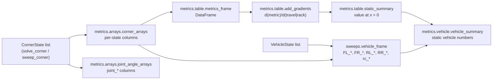

# Metrics: every column `suspkin` computes

A solved corner (or vehicle) pose is just a table of hardpoint coordinates. The **metrics
layer** turns those coordinates into the numbers a suspension designer reasons about:
camber, toe, caster, instant centres, roll centre, motion ratio, wheel rate, anti-dive,
roll stiffness, Ackermann and so on. This page defines every one of them: what it means,
its sign, the exact formula as implemented, where the code lives, its unit (SI internally,
display unit for humans) and a typical value on the reference car
`configs/vehicles/fs_reference.yaml`.

Frame, units and signs are those of [Conventions](conventions.md) (ISO 8855: x forward, y
left, z up; SI internally). The poses come from [Corner kinematics](corner-kinematics.md)
(one corner) and [Vehicle kinematics](vehicle-kinematics.md) (heave / roll / pitch / rack).
How the columns are written to CSV, plotted and put into reports is in
[Sweeps and reports](sweeps-and-reports.md).

## 1. Position in the pipeline



| Layer | Module | Produces |
|---|---|---|
| per-state columns | `suspkin.metrics.arrays.corner_arrays`, `corner_metric_arrays` | the 36 per-state columns of section 3 |
| frame | `suspkin.metrics.table.metrics_frame` | `DataFrame`, one row per state |
| gradients | `suspkin.metrics.table.add_gradients` | gradient and rate columns (section 11) |
| static values | `suspkin.metrics.table.static_summary` | one number per column at $x = 0$ |
| joint angles | `suspkin.metrics.arrays.joint_angle_arrays`, `suspkin.metrics.corner.joint_angles_frame` | `joint_*` columns |
| scalar helpers | `suspkin.metrics.corner` | `steer_angle`, `front_view_ic`, `side_view_ic`, `sv_swing_angle`, `sv_wc_angle`, `roll_centre_pair`, wheel/ride rate functions, `body_rotations`, `kabsch`, `angle_between`, `joint_angle` |
| vehicle formulas | `suspkin.metrics.vehicle` | anti-features, roll stiffness, load transfer, Ackermann, pitch centre, `vehicle_summary` |
| ARB | `suspkin.metrics.arb` | `arb_metrics`, `arb_rates` |
| array IC kernels | `suspkin.kinematics.ic_arrays` | `ic_arrays`, `swing_angle`, `roll_line_arrays` |
| batched twin | `suspkin.kinematics.batch.corner_columns`, `GRADIENTS` | the same 36 columns plus the travel gradients for many designs at once (optimiser); see section 16 |

The vectorised arrays are the production path. Scalar per-state reference
implementations of the same formulas live only in the test suite
(`tests/unit/_scalar_oracles.py`); the tests check that both agree to round-off, including
the degenerate cases (instant centre at infinity returns `nan` / `inf`, never an
exception).

Every number on this page was produced with:

```bash
python -m uv run suspkin summary configs/vehicles/fs_reference.yaml
python -m uv run suspkin vehicle configs/vehicles/fs_reference.yaml
python -m uv run suspkin sweep configs/vehicles/fs_reference.yaml --corner FL \
    --travel -30 30 --steps 7 --metrics --out sw.csv
```

`suspkin summary` prints FL and RL (front-left, rear-left) at zero travel in display units;
`suspkin vehicle` prints the vehicle summary; `suspkin sweep ... --metrics` writes the
full per-state table in **SI** (m, rad, N, N/m). "FL" values below are the front-left
corner, "RL" the rear-left.

## 2. Column index

Display unit = the unit used by `suspkin summary` / figures
(`suspkin.cli.vehicle._display`, `suspkin.plotting.units`). "Section" says where the
column is defined.

### 2.1 Per-state columns of `metrics_frame` (and `vehicle_frame`, prefixed `FL_` ...)

| Column | Meaning | SI | Display | FL static | Section |
|---|---|---|---|---|---|
| `travel` | wheel travel (input), bump positive | m | mm | 0 | 3.1 |
| `rack` | steering rack offset (input) | m | mm | 0 | 3.1 |
| `camber` | wheel camber, top-out positive | rad | deg | -1.000 | [Camber](#camber) |
| `toe` | toe angle, toe-in positive | rad | deg | 0.000 | [Toe](#toe) |
| `steer_angle` | road-wheel heading, ISO yaw sign | rad | deg | 0.000 | [Steer angle](#steer-angle) |
| `caster` | caster angle of the kingpin axis | rad | deg | 4.936 | [Caster](#caster) |
| `kpi` | kingpin inclination | rad | deg | 4.936 | [Kingpin inclination](#kingpin-inclination) |
| `scrub_radius` | ground offset patch to kingpin intercept | m | mm | 17.79 | [Scrub radius](#scrub-radius) |
| `mechanical_trail` | longitudinal offset kingpin intercept to patch | m | mm | 20.19 | [Mechanical trail](#mechanical-trail) |
| `kingpin_offset_wc` | lateral kingpin offset at wheel-centre height | m | mm | 33.50 | [Kingpin offset at the wheel centre](#kingpin-offset-at-the-wheel-centre) |
| `spindle_length` | wheel centre to kingpin axis distance | m | mm | 33.38 | [Spindle length](#spindle-length) |
| `half_track` | $|y|$ of the contact patch | m | mm | 613.98 | [Half track and track change](#half-track-and-track-change) |
| `half_track_change` | change of `half_track` from static | m | mm | 0 | same |
| `contact_patch_dx` | patch x displacement from static | m | mm | 0 | [Contact patch motion](#contact-patch-motion) |
| `contact_patch_dy` | patch y displacement, outboard positive | m | mm | 0 | same |
| `wheel_center_recession` | wheel-centre x displacement from static | m | mm | 0 | [Wheel-centre recession](#wheel-centre-recession) |
| `wheelbase_change_contribution` | this axle's effect on the wheelbase | m | mm | 0 | [Wheelbase change contribution](#wheelbase-change-contribution) |
| `fvic_y`, `fvic_z` | front-view instant centre | m | mm | -2671.8, 180.3 | [Front-view instant centre](#front-view-instant-centre) |
| `fvsa` | front-view swing-arm length | m | mm | 3285.7 | [Swing-arm lengths](#swing-arm-lengths) |
| `fv_swing_angle` | angle of patch -> FVIC line | rad | deg | 3.140 | [Swing angles](#swing-angles) |
| `svic_x`, `svic_z` | side-view instant centre | m | mm | nan (at infinity) | [Side-view instant centre](#side-view-instant-centre) |
| `svsa` | side-view swing-arm length | m | mm | inf | [Swing-arm lengths](#swing-arm-lengths) |
| `sv_swing_angle` | angle of patch -> SVIC line | rad | deg | 0.000 | [Swing angles](#swing-angles) |
| `sv_wc_angle` | angle of wheel centre -> SVIC line | rad | deg | 0.000 | same |
| `rc_height` | single-corner roll-centre height | m | mm | 33.72 | [Roll centre height (one corner)](#roll-centre-height-one-corner) |
| `pushrod_angle` | pushrod elevation angle | rad | deg | 64.74 | [Pushrod angles](#pushrod-angles) |
| `pushrod_angle_fv` | pushrod angle in the front view | rad | deg | 64.87 | same |
| `rocker_rotation` | rocker rotation from static | rad | deg | 0 | [Rocker rotation](#rocker-rotation) |
| `coilover_compression` | static length minus current length | m | mm | 0 | [Coilover compression and stroke](#coilover-compression-and-stroke) |
| `bump_stroke_remaining` | length minus `length_min` | m | mm | 40.0 | same |
| `droop_stroke_remaining` | `length_max` minus length | m | mm | 40.0 | same |
| `spring_force` | spring force | N | N | 574.0 | [Spring force](#spring-force) |
| `spring_rate` | spring rate (constant column) | N/m | N/mm | 35.0 | same |
| `tyre_stiffness` | tyre vertical stiffness (constant column) | N/m | N/mm | 100.0 | [Ride rate](#ride-rate) |

That is 36 columns including `travel` and `rack`.

### 2.2 Gradient and rate columns added by `add_gradients`

| Column | Definition | SI | Display | FL static | Section |
|---|---|---|---|---|---|
| `camber_gain` | $d\,\text{camber}/dz$ | rad/m | deg/mm | -0.0175 | [Gradients](#gradients) |
| `bump_steer` | $d\,\text{toe}/dz$ | rad/m | deg/mm | 0.0001 | [Bump steer](#bump-steer) |
| `caster_change` | $d\,\text{caster}/dz$ | rad/m | deg/mm | 0.0001 | [Gradients](#gradients) |
| `track_change_rate` | $d(\text{half\_track\_change})/dz$ | m/m | mm/mm | 0.0550 | same |
| `rc_migration_rate` | $d(\text{rc\_height})/dz$ | m/m | mm/mm | -0.3379 | same |
| `steer_gain` | $d(\text{steer\_angle})/d\,\text{rack}$ (rack sweeps only) | rad/m | deg/mm | 12.9 rad/m | [Steer gain](#steer-gain) |
| `mr_spring` | $-dL/dz$ (spring motion ratio) | m/m | - | 0.9807 | [Motion ratio](#motion-ratio) |
| `mr_progression` | $d\,\text{MR}/dz$ | 1/m | 1/mm | 0.0016 | same |
| `wheel_load_spring` | $F_s \cdot \text{MR}$ | N | N | 562.9 | [Wheel rate](#wheel-rate) |
| `wheel_rate_linear` | $k\,\text{MR}^2$ | N/m | N/mm | 33.66 | same |
| `wheel_rate` | $k\,\text{MR}^2 + F_s\,d\text{MR}/dz$ | N/m | N/mm | 34.57 | same |
| `ride_rate` | wheel rate in series with the tyre | N/m | N/mm | 25.69 | [Ride rate](#ride-rate) |

### 2.3 Joint-angle columns (`joint_angles_frame`)

`joint_tie_inner`, `joint_tie_outer`, `joint_pushrod_outer`, `joint_pushrod_inner`,
`joint_spring_chassis`, `joint_rocker_spring`, `joint_uca_outer`, `joint_lca_outer`
(rad; display deg). See [Joint angles](#13-joint-angles).

### 2.4 Vehicle-sweep extras (`sweeps.vehicle_frame`)

`heave`, `roll`, `pitch`, `rack`; per corner `<id>_<column>` for every column of 2.1 except
`rack`; `<id>_cp_x/_y/_z`; `<id>_camber_ground`, `<id>_steer_ground`; `rc_front_y`,
`rc_front_z`, `rc_rear_y`, `rc_rear_z`; `arb_front_elastic`, `arb_rear_elastic`. See
[Vehicle-frame columns](#vehicle-frame-columns).

### 2.5 Vehicle summary fields (`vehicle_summary`)

Per axle (`front.*`, `rear.*`): `track`, `wheel_rate`, `arb_wheel_rate_roll`,
`roll_stiffness_springs`, `roll_stiffness_arb`, `roll_stiffness_tyres`, `roll_stiffness`,
`rc_height`, `roll_camber`, `roll_steer`, `rc_migration`, `rc_height_curvature`. Vehicle:
`wheelbase`, `sprung_mass`, `sprung_cg_height`, `roll_axis_height_at_cg`,
`roll_stiffness_total`, `roll_gradient`, `ay_ref`, `load_transfer_front`,
`load_transfer_rear`, `tlltd_front`, `anti_dive_front`, `anti_lift_rear`,
`anti_squat_rear`, `anti_lift_front_accel`, `pitch_centre_x`, `pitch_centre_z`,
`max_steer_inner`, `max_steer_outer`, `ackermann_5deg`, `ackermann_10deg`,
`ackermann_15deg`, `steering_ratio`, `turning_radius`. See [Vehicle summary](#14-vehicle-summary).

### 2.6 Solver columns in sweep CSVs (not metrics)

`suspkin.sweeps.states_to_frame` also writes the solver state: `corner`, `theta_uca`,
`theta_lca`, `psi` (rad, solved link angles), `rocker_angle` (rad, solved absolute
rocker angle), `coilover_length` (m), `toggle_margin` (rad), `max_residual`,
`spin_x/y/z`, `<hardpoint>_x/_y/_z` and `coilover_in_range` (bool). These are defined in
[Corner kinematics](corner-kinematics.md).

## 3. Common notation and inputs

All per-state formulas are evaluated by `suspkin.metrics.arrays.corner_arrays` over $N$
states at once. They read, per state:

- the hardpoints (`contact_patch`, `wheel_center`, `lca_outer`, `uca_outer`,
  `pushrod_inner`, `pushrod_outer`, plus the chassis points for the instant-centre planes);
- the unit wheel spin axis $\mathbf n$ (`state.spin_axis`, pointing outboard);
- the scalars `travel`, `rack`, `coilover_length` ($L$), `rocker_angle`;
- the **static** state (default `solve_corner(corner, 0.0)`): the reference for every
  "change from static" column. It is *not* the first row of the sweep.

Notation used below:

| Symbol | Meaning |
|---|---|
| $o$ | outboard sign: $+1$ left corner, $-1$ right corner (`o` in the code) |
| $\mathbf p_{cp}$, $\mathbf p_{wc}$ | contact patch, wheel centre |
| $\mathbf u = \mathbf p_{ubj} - \mathbf p_{lbj}$ | kingpin axis vector, lower to upper ball joint (`uca_outer - lca_outer`) |
| $\mathbf n$ | unit wheel spin axis, outboard |
| $z$ | wheel travel (bump positive) |
| subscript $s$ | value in the static pose |

### 3.1 `travel` and `rack`

`travel` $z$ is the vertical wheel travel input [m], bump (wheel moves up relative to the
chassis) positive; `rack` is the rack displacement [m] (see
[Conventions](conventions.md#5-signs-in-detail) for the rack sign). They are copied from
`CornerState.travel/.rack` and are the abscissae of every gradient. The `static_summary`
function skips them. `rack` is dropped from `vehicle_frame` per corner because the vehicle
frame has one shared `rack` column.

### 3.2 Contact patch

The contact patch is defined by the solver (`suspkin.kinematics.corner`): with the
in-wheel-plane "up" vector $\hat{\mathbf e} = \operatorname{unit}(-n_z n_x,\, -n_z n_y,\,
1 - n_z^2)$ it is

$$\mathbf p_{cp} = \mathbf p_{wc} - R_{tyre}\,\hat{\mathbf e}$$

i.e. the lowest point of the tyre circle *in the wheel plane*, a distance $R_{tyre}$ below
the wheel centre. Because the wheel is cambered, this point is slightly outboard or
inboard of the point directly under the wheel centre: on FL, $y_{cp} = 613.98$ mm while the
wheel centre is at $y = 610$ mm; check: $228\sin(1^\circ) = 3.98$ mm. In vehicle sweeps
(`vehicle_frame`) the contact patch is replaced by the **ground contact point** of the
state (tilted ground, see [Vehicle kinematics](vehicle-kinematics.md)), passed through the
`contact_patch=` argument of `corner_arrays`.

## 4. Wheel alignment

All alignment metrics are in `suspkin.metrics.arrays.corner_arrays`; the batched twin is
`suspkin.kinematics.batch.corner_columns`. Signs follow
[Conventions section 5.2](conventions.md#52-wheel-alignment).

### Camber

**Definition.** Inclination of the wheel plane from vertical, seen from the front. Positive
= top of the wheel leaning *away* from the car (top outboard); negative = top inboard.
Equal on left and right for mirrored motion (a per-side sign is built in).

**Why it matters.** A tyre produces its peak lateral force near a small negative camber
relative to the *ground*. Camber against chassis (this column) is what the linkage gives;
the camber to the ground (which also includes body roll) is `<id>_camber_ground`
([Vehicle-frame columns](#vehicle-frame-columns)). Designers choose static camber
(here -1 deg front, -1.5 deg rear) and **camber gain** ([Gradients](#gradients)) so the
loaded outer tyre stays near its optimum in a corner.

**Formula (as implemented).**

$$\text{camber} = -\arcsin(\operatorname{clip}(n_z,\,-1,\,1))$$

A spin axis that rises toward the outboard end ($n_z > 0$) is a wheel with its top
inboard, hence negative camber.

**Code.** `out["camber"]` in `suspkin.metrics.arrays.corner_arrays`. **Unit.** rad;
display deg. **Typical (fs_reference).** FL -1.000 deg, RL -1.500 deg at zero travel.
FL sweep table: -0.01459 rad (-0.836 deg) at -10 mm, -0.02069 rad (-1.185 deg) at +10 mm,
so the wheel gains negative camber in bump.

### Toe

**Definition.** Angle between the wheel's heading and the car's x axis, seen from above.
Positive = **toe-in** (front of the wheel pointing toward the centreline), same sign on
both sides.

**Why it matters.** Static toe sets straight-line stability versus turn-in response and
tyre wear; its change with travel is **bump steer** ([Bump steer](#bump-steer)).

**Formula.**

$$\text{toe} = \operatorname{atan2}(n_x,\; o\,n_y)$$

For the left wheel $n \approx (n_x, +1, \cdot)$: $n_x > 0$ means the outboard end of the
axle is forward, so the wheel front points inboard: toe-in. Relation to the steer angle:
$\text{steer} = \text{toe}$ on right corners, $-\text{toe}$ on left corners
([Steer angle](#steer-angle)).

**Code.** `out["toe"]`. **Unit.** rad; deg. **Typical.** FL 0.000 deg, RL +0.100 deg
(static toe-in). FL sweep table: toe $-0.00151$ rad at -20 mm and $-0.00143$ rad at +20
mm (-0.086 / -0.082 deg): a nearly symmetric, parabola-like curve whose slope at 0 is almost
zero.

### Steer angle

**Definition.** Heading of the road wheel in the ISO yaw sense: positive = the wheel
points to the **left** (counter-clockwise from above), independent of the side. This is
the quantity that enters Ackermann geometry and `max_steer_*`.

**Formula.**

$$\delta = \operatorname{atan2}(-o\,n_x,\; o\,n_y)$$

so $\delta = -\text{toe}$ on the left and $\delta = +\text{toe}$ on the right (verified in
the table above: RL toe +0.1 deg, steer -0.1 deg).

**Code.** `out["steer_angle"]` in `corner_arrays`; scalar helper
`suspkin.metrics.corner.steer_angle(state, corner)` (used by the vehicle steering sweep).
**Unit.** rad; deg. Not zero at static if there is static toe (the vehicle summary
subtracts the straight-ahead value, see [Steering](#12-steering-vehicle-level)).

### Caster

**Definition.** Rearward lean of the steering axis (kingpin axis, the line through the two
ball joints) seen from the side. Positive when the top ball joint is *behind* the bottom
one.

**Why it matters.** Caster gives self-aligning torque and, with KPI, camber gain in steer
(the outer wheel gains negative camber when the wheel is steered). It adds to mechanical
trail.

**Formula.**

$$\text{caster} = \operatorname{atan2}(-u_x,\; u_z)$$

**Code.** `out["caster"]`. **Unit.** rad; deg. **Typical.** FL 4.936 deg, RL 1.042 deg.
The caster changes only 0.00014 rad (about 0.008 deg) over $\pm 30$ mm of travel on FL
(0.086099 -> 0.086238 rad), see `caster_change` in [Gradients](#gradients).

### Kingpin inclination

**Definition.** KPI (also SAI, steering-axis inclination): inclination of the kingpin axis
from vertical, seen from the front. Positive when the top ball joint is *inboard* of the
bottom one.

**Formula.**

$$\text{KPI} = \operatorname{atan2}(-o\,u_y,\; u_z)$$

**Code.** `out["kpi"]`. **Unit.** rad; deg. **Typical.** FL 4.936 deg, RL 4.677 deg. It
happens to equal the caster on FL in this design.

### Scrub radius

**Definition.** Lateral distance on the ground between the tyre contact patch and the
point where the kingpin axis pierces the ground plane ($z = z_{cp}$). Positive when the
patch is *outboard* of the intercept (positive scrub).

**Why it matters.** It is the lever arm of braking-force and rolling-resistance
disturbances about the kingpin: large scrub transmits road shock and brake pull to the
steering; negative scrub makes braking self-correcting. Formula Student cars use small
values (here 18 mm).

**Formula.** The kingpin line meets the plane $z = z_{cp}$ at
$\mathbf g_{cp} = \mathbf p_{lbj} + t\,\mathbf u$ with $t = (z_{cp} - z_{lbj}) / u_z$:

$$\text{scrub} = o\,(y_{cp} - y_{g})$$

**Code.** `out["scrub_radius"]` (helper `ground(cp_z)` inside `corner_arrays`; divisions
guarded by `np.errstate`, so a horizontal $u_z = 0$ gives inf/nan, not an exception).
**Unit.** m; mm. **Typical.** FL 17.79 mm, RL 11.32 mm.

### Mechanical trail

**Definition.** Longitudinal distance on the ground from the contact patch back to the
kingpin intercept; positive when the intercept is *ahead* of the patch (the wheel
trails behind the axis, like a caster wheel). Sometimes called caster offset.

**Formula.** $\text{trail} = x_g - x_{cp}$ with $\mathbf g$ the intercept at $z_{cp}$
(as for the scrub radius).

**Code.** `out["mechanical_trail"]`. **Unit.** m; mm. **Typical.** FL 20.19 mm, RL 2.13 mm.
Self-aligning torque from lateral force is proportional to
$\text{trail} + \text{pneumatic trail}$.

### Kingpin offset at the wheel centre

**Definition.** Lateral distance between the wheel centre and the kingpin axis,
measured in the plane $z = z_{wc}$. Positive when the wheel centre is outboard of the axis.
Drives the steering moment arm of the lateral tyre force at the hub (and with the brake
caliper packaging, the "spindle offset" you would measure on the upright).

**Formula.** With $\mathbf g_{wc}$ the kingpin line at $z_{wc}$:
$\text{kingpin\_offset\_wc} = o\,(y_{wc} - y_{g,wc})$.

**Code.** `out["kingpin_offset_wc"]`. **Unit.** m; mm. **Typical.** FL 33.50 mm, RL
24.00 mm.

### Spindle length

**Definition.** Perpendicular 3-D distance from the wheel centre to the kingpin axis.

**Formula.**

$$\mathbf r = \mathbf p_{wc} - \mathbf p_{lbj},\quad \hat{\mathbf u} = \mathbf u/|\mathbf u|,\quad
\text{spindle} = \left|\mathbf r - (\mathbf r\cdot\hat{\mathbf u})\hat{\mathbf u}\right|$$

**Code.** `out["spindle_length"]`. **Unit.** m; mm. **Typical.** FL 33.38 mm, RL 24.00 mm
(33.38 vs 33.50 mm on FL, 24.0006 vs 24.0000 mm on RL). `kingpin_offset_wc` is a y-only
difference at height $z_{wc}$ while `spindle_length` is a perpendicular 3-D distance; they
are equal only for a vertical axis with no x offset.

## 5. Wheel position

These columns say where the tyre goes. All are relative to the **static** pose.

### Half track and track change

**Definition.** `half_track` is $|y_{cp}|$, the lateral distance of the contact patch from
the car centreline (not the wheel-centre track given in the YAML). `half_track_change` is
$|y_{cp}| - |y_{cp,s}|$: positive = the patch moves outboard (track widens). A track
change means a lateral scrub of the tyre on the ground and shifts roll-centre geometry.

**Formula.** $\text{ht} = |y_{cp}|$, $\Delta\text{ht} = \text{ht} - |y_{cp,s}|$.

**Code.** `out["half_track"]`, `out["half_track_change"]`. **Unit.** m; mm. **Typical.**
FL 613.98 mm (RL 595.97 mm); change $-2.71$ mm at -30 mm travel, +0.60 mm at +30 mm (FL).
The full track of the axle is $2 \times$ `half_track` for a symmetric car.

### Contact patch motion

**Definition.** `contact_patch_dx` $= x_{cp} - x_{cp,s}$ (positive forward);
`contact_patch_dy` $= o\,(y_{cp} - y_{cp,s})$ (positive outboard, the same sign as
`half_track_change` when $y_{cp,s}$ keeps its sign). The y component is the
lateral tyre scrub, the x component a small longitudinal motion that, summed over the axle
and the opposite one, changes the wheelbase.

**Code.** `out["contact_patch_dx"]`, `out["contact_patch_dy"]`. **Unit.** m; mm.
**Typical.** 0 at static by definition; in `suspkin summary` they are exactly 0 because the
interpolation point is the static pose itself.

### Wheel-centre recession

**Definition.** Longitudinal displacement of the wheel centre from static,
$x_{wc} - x_{wc,s}$, **positive forward** as implemented (the name "recession" is the
traditional word for the wheel centre moving rearward in bump; a rearward motion appears
here as a *negative* value). Controls wheelbase change in bump and ride harshness over
bumps ("wheel recession" gives compliance to longitudinal impact).

**Code.** `out["wheel_center_recession"]`. **Unit.** m; mm. **Typical.** FL: $-0.11$ mm at
$\pm 30$ mm and $-0.05$ mm at $\pm 20$ mm (sweep table): the wheel centre moves rearward
slightly in both bump and droop.

### Wheelbase change contribution

**Definition.** Effect of this axle's contact-patch longitudinal motion on the wheelbase:
$+dx$ for a front corner (moving forward lengthens the wheelbase), $-dx$ for a rear corner
(moving forward shortens it). Add the front and rear values of the same travel to get the
wheelbase change.

**Code.** `out["wheelbase_change_contribution"]` $=$ `dx if corner.axle == "front" else -dx`.
**Unit.** m; mm. **Typical.** 0 at static.

## 6. Geometry centres

Instant centres (ICs) describe the instantaneous motion of the upright relative to the
chassis. The implementation is the **plane method** (`suspkin.kinematics.ic_arrays.ic_arrays`;
scalar twin `suspkin.metrics.corner._ic`):

1. Each wishbone plane passes through its two chassis pivots (`uca_front`, `uca_rear`, or
   `lca_front`, `lca_rear`) and its current outer ball joint. Normal
   $\mathbf n_w = (\mathbf p_{rear} - \mathbf p_{front}) \times (\mathbf p_{outer} - \mathbf p_{front})$, normalised.
2. Cut both planes with the *view plane*: $x = x_{cp}$ for the front view
   (`axis = 0`), $y = y_{cp}$ for the side view (`axis = 1`). Each cut is a 2-D line
   $\mathbf m \cdot \mathbf q = c$ with $\mathbf m$ the normal's two remaining components
   (normalised) and $c = \mathbf n_w\cdot\mathbf a - n_{w,\text{axis}}\,x_{cut}$.
3. Intersect the two lines: a $2\times2$ solve, giving $(h, z)$ ($h = y$ in front view,
   $x$ in side view).
4. If the lines are parallel ($|\det| < 10^{-9}|\mathbf m_1||\mathbf m_2|$, constant `_PARALLEL_TOL`)
   or a plane is degenerate (collinear points, or a plane parallel to the cut,
   $|\mathbf n| < 10^{-12}$) the IC is **at infinity**: `finite = False`, $h = z =$ nan, and
   the common line direction $(d_h, d_z) = (m_{1,z}, -m_{1,h})$ is kept in `Ic.d0/d1`.

The reference car has horizontal-ish, parallel side-view arms, so the **side-view IC is at
infinity** (nan / inf in the table) while the **front-view IC is finite but far away**
(2.7 m for FL).

### Front-view instant centre

`fvic_y`, `fvic_z`: coordinates $(y, z)$ of the FVIC [m]. The FVIC is the point about
which the wheel/upright rotates instantaneously in the front view; its height above the
contact patch gives the **jacking** and **roll-centre** height, and its distance the
camber gain (short swing arm, large camber gain). Located by the plane method with
the cut $x = x_{cp}$. `nan` for IC at infinity. **Unit.** m; mm.
**Typical.** FL $(-2671.8,\ 180.3)$ mm, RL $(-1890.1,\ 166.6)$ mm: for the left wheel the IC
lies at negative y, i.e. **across the car centreline** (the arms converge on the opposite
side). At +30 mm bump FL: $y = -1672.6$ mm, $z = +7.2$ mm (SI -1.67258 m, +0.007157 m).

### Side-view instant centre

`svic_x`, `svic_z`: $(x, z)$ of the SVIC, cut by $y = y_{cp}$. Its position determines the
anti-features ([Anti-features](#7-anti-features-and-pitch-centre)) and the pitch centre. At infinity for the
reference car: `svic_x`, `svic_z` = nan, `svsa` = inf (displayed `nan`, `inf` in `suspkin
summary`). **Unit.** m; mm.

### Swing-arm lengths

`fvsa` $= |y_{IC} - y_{cp}|$ and `svsa` $= |x_{IC} - x_{cp}|$ [m]: the horizontal distance
from the contact patch to the IC in each view (the swing-arm length of the equivalent
single-pivot swing arm), `inf` if the IC is at infinity (the code uses
`np.where(finite, ..., math.inf)`). A longer arm means less camber change per metre of
bump. **Unit.** m; mm. **Typical.** FL `fvsa` 3285.7 mm, RL 2486.1 mm; `svsa` inf.

### Swing angles

The **swing angle** is the signed angle of the line from a reference point to the IC,

$$\theta = \operatorname{atan2}\!\bigl(z_{IC} - z_{ref},\; s\,(h_{IC} - h_{ref})\bigr),\qquad \theta\in(-\pi,\pi]$$

(`suspkin.kinematics.ic_arrays.swing_angle`; scalar `suspkin.metrics.corner._angle`).
$s$ picks the positive horizontal direction so that **positive angle = IC above the
reference on the "anti" or "inboard" side**. For an IC at infinity the line direction is
used instead, oriented to the $s$ side; so a horizontal infinite swing arm gives
$\theta = 0$ rather than nan.

| Column | Reference point | View | $s$ |
|---|---|---|---|
| `fv_swing_angle` | contact patch $(y_{cp}, z_{cp})$ | front | $-1$ left, $+1$ right (inboard positive) |
| `sv_swing_angle` | contact patch $(x_{cp}, z_{cp})$ | side | $-1$ front axle, $+1$ rear axle (anti side) |
| `sv_wc_angle` | wheel centre $(x_{wc}, z_{wc})$ | side | same as above |

**Why it matters.** $\tan\theta$ is the slope of the swing arm: `sv_swing_angle` feeds the
anti-dive / anti-lift of outboard brakes, `sv_wc_angle` the anti-squat and inboard-brake
anti-features. `fv_swing_angle` is the slope used for the roll centre height.

**Code.** `out["fv_swing_angle"]`, `out["sv_swing_angle"]`, `out["sv_wc_angle"]`;
scalar `suspkin.metrics.corner.sv_swing_angle`, `sv_wc_angle`. **Unit.** rad; deg.
**Typical.** FL `fv_swing_angle` 3.140 deg, RL 3.832 deg; both side-view angles 0.000 deg.
Check on FL: $\operatorname{atan2}(0.1803,\ 3.286) = 3.14^\circ$.

### Roll centre height (one corner)

`rc_height`: height at the car centreline ($y = 0$) of the line from the contact patch
through the FVIC (the "roll-centre line" of this wheel):

$$z_{rc} = z_{cp} + \frac{d_z}{d_y}\,(0 - y_{cp})$$

with $(d_y, d_z)$ the unit direction patch -> FVIC (`roll_line_arrays`; for an IC at
infinity the common line direction). `nan` if $|d_y| < 10^{-12}$ (a vertical line never
reaches $y = 0$). For a **symmetric** car the roll centre of the axle is exactly this
value (the left and right lines cross on the centreline), so `rc_height` is the
single-corner roll-centre height used in the optimiser and in the `rc_migration_rate`
gradient. **Unit.** m; mm. **Typical.** FL 33.72 mm, RL 40.00 mm. The roll centre of the
*pair* (which also gives the lateral position and works in rolled, asymmetric poses) is
`suspkin.metrics.corner.roll_centre_pair` and the `rc_front_*` columns of
[Vehicle-frame columns](#vehicle-frame-columns). Roll-centre **migration** (how the
height moves) is `rc_migration_rate` ([Gradients](#gradients)) in the corner sweep and
`rc_migration` / `rc_height_curvature` in the vehicle summary.

**Heights and why designers care.** The roll-centre height sets the geometric share of
lateral load transfer (`geometric = m_s a_y z_{rc} / t`) and the jacking force; see
[Load transfer](#load-transfer-and-tlltd).

## 7. Anti-features and pitch centre

Anti-features measure how much of the brake or drive load transfer is reacted through the
suspension links rather than the springs. They are **vehicle-level** numbers computed in
`suspkin.metrics.vehicle` from the side-view angles of FL (front) and RL (rear) at the
static pose, with the total-CG height $h_{cg}$ (YAML `cg_height`), wheelbase $L$ and the
brake / drive split.

**Which angle governs** (`suspkin.metrics.vehicle.anti_angle_for`): braking with
outboard brakes uses the contact-patch angle `sv_swing_angle`; inboard brakes use the
wheel-centre angle `sv_wc_angle`; drive always uses `sv_wc_angle` (inboard drive with
halfshafts). The reference car has outboard brakes and rear-wheel drive.

### Anti-dive

$$\text{anti-dive}_f = \tan\theta_f \cdot \beta_f \cdot \frac{L}{h_{cg}} \cdot 100\ [\%]$$

$\beta_f$ = `brake_bias_front` (0.6 on fs_reference), $\theta_f$ = side-view angle of the
front axle (positive = SVIC rearward of and above the patch). 100 % means the front
suspension carries all the front brake load transfer through the links, so no front
pitch-down from the springs. **Code.** `suspkin.metrics.vehicle.anti_dive_front`.
**Unit.** % (display %). **Typical.** 0.0 % (SVIC at infinity, horizontal arms). Worked
formula with a hypothetical $\theta = 3^\circ$: $\tan 3^\circ \cdot 0.6 \cdot 1.55/0.28
\cdot 100 = 17.4\ \%$.

### Anti-lift (rear, braking)

$\text{anti-lift}_r = \tan\theta_r\,(1-\beta_f)\,L/h_{cg}\cdot 100$ with $\theta_r$ the
rear side-view angle (positive = SVIC forward of and above). `anti_lift_rear`. **Typical.**
0.0 %.

### Anti-squat (rear, driving)

$\text{anti-squat}_r = \tan\theta_{wc,r}\,(1-\sigma_f)\,L/h_{cg}\cdot 100$ with $\sigma_f$
the front drive split (`effective_drive_split_front`, 0 for RWD) and $\theta_{wc,r}$ the
rear `sv_wc_angle`. `anti_squat_rear`. **Typical.** 0.0 %.

### Anti-lift under acceleration (front)

$\text{anti-lift}_{f,accel} = \tan\theta_{wc,f}\,\sigma_f\,L/h_{cg}\cdot 100$.
`anti_lift_front_accel`. It is `None` (printed `n/a`, `nan` in figures) for rear-wheel
drive (split 0), which is the reference car. It is not in `SUMMARY_ROWS`, so figures and
reports do not show it; only `suspkin vehicle` prints it (`n/a` when `None`).

**Signs.** Positive = anti-geometry in all four. The summary tables print `%`; the
fractions are multiplied by 100 inside the formulas.

### Pitch centre

`pitch_centre_x`, `pitch_centre_z` [m; display mm]: intersection of the front side-view
line and the rear side-view line, each from the contact patch through its SVIC
(direction taken from the IC at infinity if needed), in the $(x, z)$ plane
(`suspkin.metrics.vehicle.pitch_centre`, `_sv_line`). Returns nan if the lines are
parallel ($|d_1\times d_2| < 10^{-12}|d_1||d_2|$). **Typical.** nan for fs_reference
(both lines horizontal).

## 8. Actuation and rates

The actuation chain is wheel -> pushrod -> rocker -> coilover (-> ARB). The solver
([Corner kinematics](corner-kinematics.md)) gives the rocker angle and the coilover
length; these metrics express them for design.

### Pushrod angles

`pushrod_angle` $= \operatorname{atan2}(r_z,\ \sqrt{r_x^2 + r_y^2})$ and
`pushrod_angle_fv` $= \operatorname{atan2}(r_z,\ |r_y|)$ with $\mathbf r = \mathbf p_{pushrod,inner} - \mathbf p_{pushrod,outer}$. The first is the true elevation of the rod
(positive when the inner end, at the rocker, is higher than the outer end); the second is
the angle seen in the front view. A steep pushrod (near 90 deg) transmits wheel
motion with little motion-ratio loss; a flat rod carries a high axial load (force $\propto 1/\sin$ of the elevation); the elevation also sets the motion ratio.
**Unit.** rad; deg. **Typical.** FL 64.74 deg / 64.87 deg, RL 67.64 deg / 67.67 deg.

### Rocker rotation

`rocker_rotation` $=\varphi - \varphi_s$: rocker rotation from static (the solver's
`rocker_angle` minus its static value, right-hand rotation about the rocker axis in the
corner's own sign convention, see [Corner kinematics](corner-kinematics.md)). In bump it
is positive on the reference car: +0.126 rad (7.2 deg) at +10 mm, -0.124 rad at -10 mm
(FL, sweep table). **Unit.** rad; deg. The solver column `toggle_margin`
(see [Corner kinematics](corner-kinematics.md)) tells how far the rocker is from its
dead-centre geometry.

### Coilover compression and stroke

$$\text{compression} = L_s - L,\quad \text{bump\_stroke\_remaining} = L - L_{min},\quad
\text{droop\_stroke\_remaining} = L_{max} - L$$

$L$ is the current spring/damper length (`coilover_length`, from `rocker_spring` to
`spring_chassis`), $L_s$ the static length, $L_{min}, L_{max}$ the coilover's limits
(`coilover.length_min/max` in the YAML). Positive compression = shorter than static
(bump). Remaining stroke is the clearance to the bump stop / droop limit: negative means
the coilover is out of range (also flagged by `coilover_in_range`). **Unit.** m; mm.
**Typical.** FL static: 0 mm compression, 40.0 mm bump stroke and 40.0 mm droop stroke
($L_s = 200$ mm, limits 160 and 240 mm). At +30 mm wheel travel the bump stroke left is
10.2 mm (sweep table).

### Spring force

$$F_s = F_{pre} + k\,(L_{free} - L)$$

(`coil.preload + coil.spring_rate * (coil.free_length - length)`); positive = spring
pushing, i.e. compressive load on the strut. **Unit.** N. **Typical.** FL static 574.0 N
(preload 0, $k = 35$ kN/m, $L_{free} - L_s = 16.4$ mm: $35000\times 0.0164 = 574$ N).
`spring_rate` and `tyre_stiffness` are **constant columns** ($k$ in N/m and the tyre
vertical stiffness in N/m, here 35 and 100 N/mm for FL) carried so that
`add_gradients` can compute wheel and ride rate from the table alone.

### Motion ratio

**Definition.** $\text{MR} = -dL/dz$: the rate at which the spring shortens per unit of
wheel travel (here 0.98, almost 1:1). Equals `d(coilover_compression)/dz` because
$L_s$ is constant.

**Why it matters.** The spring's effect at the wheel is reduced by $\text{MR}^2$, and the
damper velocity is $\text{MR}\cdot v_{wheel}$. **Progression** $d\text{MR}/dz$ tells how
the ratio changes through travel: positive (rising rate) is the common FS target to avoid
bottoming.

**Formulas** (`suspkin.metrics.table.add_gradients`):

$$\text{MR} = \frac{d\,\text{compression}}{dz},\qquad \text{mr\_progression} = \frac{d\,\text{MR}}{dz}$$

(both with `np.gradient`, see [Gradients](#gradients)). **Unit.** `mr_spring` is
dimensionless; `mr_progression` is 1/m (display 1/mm). **Typical.** FL static
`mr_spring` 0.9807, `mr_progression` 0.0016 1/mm in `suspkin summary` (21 points over
$\pm 10$ mm); the 7-point $\pm 30$ mm sweep gives 0.9799 at the same pose, a direct
illustration of the finite-difference spacing effect (section 11).

### Wheel rate

Virtual work (principle: the work done by the wheel force over $dz$ equals the spring work
over $dL$): wheel load of the spring $F_w = F_s\,\text{MR}$ and

$$K_w = \frac{dF_w}{dz} = k\,\text{MR}^2 + F_s\,\frac{d\text{MR}}{dz}$$

| Column | Formula | Code |
|---|---|---|
| `wheel_load_spring` | $F_s \cdot \text{MR}$ | `suspkin.metrics.corner.wheel_load_spring` |
| `wheel_rate_linear` | $k\,\text{MR}^2$ | `wheel_rate_linear` |
| `wheel_rate` | $k\,\text{MR}^2 + F_s\,d\text{MR}/dz$ | `wheel_rate` |

The linear form ignores the force-times-progression term and is exact only at zero
spring force or constant MR. **Unit.** N, N/m, N/m (display N, N/mm). **Typical.** FL
static: 562.9 N, 33.66 N/mm, 34.57 N/mm; RL 691.0 N, 39.43 N/mm, 40.95 N/mm. At
$\pm 30$ mm the FL wheel rate varies between 30.1 and 35.1 N/mm (sweep table:
30 078 N/m at -30 mm, 34 276 N/m at +30 mm).

### Ride rate

The wheel rate in series with the vertical tyre stiffness $k_t$ (`tyre_stiffness`):

$$K_r = \frac{K_w\,k_t}{K_w + k_t}$$

(`suspkin.metrics.corner.ride_rate`). The wheel rate and the tyre stiffness act in series. It is the stiffness the chassis sees on a
frictionless-wheel model, used for ride frequency
$f = \tfrac{1}{2\pi}\sqrt{K_r/m_{corner}}$. **Unit.** N/m (display N/mm). **Typical.** FL
static 25.69 N/mm (wheel rate 34.57 N/mm, tyre 100 N/mm); RL 29.05 N/mm.

## 9. Roll

Roll metrics are **vehicle level** (axle, then total). They use the per-axle wheel rate,
the ARB and the tyre stiffness in a roll model; formulas in
`suspkin.metrics.vehicle` (`roll_stiffness_springs`, `roll_stiffness_arb`,
`roll_stiffness_tyres`, `axle_roll_stiffness`, `roll_gradient`).

### Roll stiffness

**Definition.** Moment per unit body roll angle [N m/rad] resisted by one axle. With
$t$ the (wheel-centre) track and $K_w$ the per-wheel rate, rolling by $\phi$ compresses
one wheel by $+z = \phi t/2$ and extends the other by the same amount; the opposing wheel
forces form a couple $K_w z\cdot t = K_w t^2\phi/2$:

$$K_{\phi,springs} = \tfrac12 K_w t^2,\qquad
K_{\phi,ARB} = \tfrac12 K_{w,roll}\,t^2,\qquad
K_{\phi,tyres} = \tfrac12 k_t\,t^2$$

($K_{w,roll}$ is the ARB roll-mode wheel rate of
[Anti-roll bar](#anti-roll-bar)). Springs + ARB act in parallel, and that sum is in
**series** with the tyres:

$$K_\phi = \frac{(K_{\phi,springs} + K_{\phi,ARB})\,K_{\phi,tyres}}{K_{\phi,springs}+K_{\phi,ARB}+K_{\phi,tyres}}$$

(`axle_roll_stiffness`; the series connection with the tyres is the roll analogue of the
ride rate). `roll_stiffness_total` $= K_{\phi,f} + K_{\phi,r}$.

**Why it matters.** Axle roll stiffness sets body roll and the **elastic** share of lateral
load transfer; the front/rear ratio (see TLLTD) sets the understeer balance.

**Code.** `AxleSummary.roll_stiffness_*` via `vehicle_summary` / `_axle_static`;
the wheel rate is the static `wheel_rate` of the corner sweep $\pm 10$ mm (21 points).
**Unit.** N m/rad; display N m/deg (the factor $\pi/180$). **Typical (fs_reference).**

| | springs | ARB | tyres | axle $K_\phi$ |
|---|---|---|---|---|
| front (t = 1220 mm) | 449.0 | 419.4 | 1298.9 | **520.4** N m/deg |
| rear (t = 1180 mm) | 497.6 | 266.9 | 1215.1 | **469.2** N m/deg |

Total 989.7 N m/deg. Check front springs: $\tfrac12\cdot 34567\cdot 1.22^2 = 25\,724$
N m/rad $= 449.0$ N m/deg.

### Roll gradient

**Definition.** Body roll angle per unit lateral acceleration (deg/g), including the
destabilising weight moment of the sprung mass about the roll axis:

$$\frac{\phi}{a_y/g} = \frac{m_s\,g\,d}{K_{\phi,f}+K_{\phi,r} - m_s\,g\,d},\qquad d = h_s - h_{ra}$$

$m_s$ sprung mass, $h_s$ sprung CG height, $h_{ra}$ the roll-axis height at the sprung CG
(linear between the front and rear roll centres, `roll_axis_height_at`). Raises
`ValueError` if the denominator is not positive (the car would roll over on its own
springs). **Code.** `suspkin.metrics.vehicle.roll_gradient`. **Unit.** rad per g;
display deg/g. **Typical.** 0.6292 deg/g: $m_s = 250$ kg, $h_s = 288.3$ mm,
$h_{ra} = 37.08$ mm, $m_s g d = 616.0$ N m/rad and $K_\phi$ total $= 56\,704$ N m/rad,
giving $616/(56704-616) = 0.01098$ rad/g $= 0.6292$ deg/g.

### Sprung mass and sprung CG

`sprung_mass` $= M - 2(m_{u,f} + m_{u,r})$ with `unsprung_mass` per corner. The sprung CG
height and position follow from removing the unsprung masses at the wheel centres
(heights `unsprung_cg_height`, default the tyre radius):
$h_s = (M h - \sum m_u h_u)/m_s$ and $x_s = (M x - \sum m_u x_u)/m_s$ with total CG at
$x = -a$, $a = L(1 - \text{front\_mass\_ratio})$ from the front axle.
**Code.** `suspkin.metrics.vehicle.sprung_mass`, `vehicle_summary`. **Typical.**
`sprung_mass` 250.0 kg (290 kg total, 4 x 10 kg unsprung), `sprung_cg_height` 288.32 mm
(total CG 280 mm).

### Roll-axis height at the CG

`roll_axis_height_at_cg` $= h_{ra}(x_s)$, linear interpolation between the front roll
centre (at $x = 0$) and the rear roll centre (at $x = -L$) evaluated at the sprung CG x
(`roll_axis_height_at`). **Typical.** 37.08 mm.

### Load transfer and TLLTD

`lateral_load_transfer` decomposes the load shift per wheel $dW$ (the outside wheel gains
$dW$, the inside loses $dW$) at the reference acceleration $a_y$ = `ay_ref` (9.81 m/s$^2$):

$$\phi = \frac{m_s a_y d}{K_f + K_r - m_s g d},\quad
\text{elastic}_i = \frac{K_i\phi}{t_i},\quad
\text{geometric}_i = \frac{m_{s,i}\,a_y\,z_{rc,i}}{t_i},\quad
\text{unsprung}_i = \frac{m_{u,i}\,a_y\,h_{u,i}}{t_i}$$

with $m_{s,f} = m_s(L-a)/L$, $m_{s,r} = m_s a/L$ ($a$ = sprung CG to front axle).
`load_transfer_front/rear` are the sums per axle [N] (336.7 N front, 332.7 N rear on the
reference). The **front TLLTD** $= \Delta W_f/(\Delta W_f + \Delta W_r)$ (nan if the total
is zero) is the key balance number: 50.30 % on fs_reference; a larger front share
reduces front grip relative to rear (more understeer).
**Code.** `LoadTransfer`, `lateral_load_transfer`, `tlltd_front`. **Unit.** N, ratio
(display N, %).

## 10. Roll and ARB details

### Anti-roll bar

`suspkin.metrics.arb.arb_rates(corner_left, corner_right, axle_cfg, travel=0, h=1e-5)`
returns an `ArbRates` by **central differences of the elastic coordinate** $q$ (bar twist
[rad] or beam deflection [m]; `suspkin.kinematics.arb.solve_arb`) around `travel`, step
$h = 10^{-5}$ m:

| Field | Formula | Meaning |
|---|---|---|
| `stiffness` $k$ | `arb_stiffness` | bar stiffness of $q$: N m/rad (twist) or N/m (beam) |
| `motion_ratio_roll` | $[q(z{+}h,\,z{-}h) - q(z{-}h,\,z{+}h)]/2h$ | $dq/dz$ with left $+z$, right $-z$ |
| `motion_ratio_single` | $[q(z{+}h, z) - q(z{-}h, z)]/2h$ | $dq/dz$ with the other wheel fixed |
| `wheel_rate_roll` | $\tfrac12 k\,\text{MR}_{roll}^2$ | per-wheel ARB rate in roll [N/m] |
| `wheel_rate_single` | $k\,\text{MR}_{single}^2$ | per-wheel rate, single-wheel bump [N/m] |
| `heave_coupling` | $[q(z{+}h,z{+}h) - q(z{-}h,z{-}h)]/2h$ | $dq/dz$ in symmetric heave (0 for a symmetric bar) |

Energy $E = \tfrac12 k q^2$; the roll-mode per-wheel force $F = \tfrac12 dE/dz$ because two
wheels carry equal and opposite forces. The term $q\,d^2q/dz^2$ (MR progression) is
neglected; it vanishes at the static and symmetric-heave poses where `arb_rates` is
evaluated. **Typical (front, fs_reference).** $k = 148.97$ N m/rad, $\text{MR}_{roll} =
20.82$ rad/m, `wheel_rate_roll` = 32.29 N/mm (the `arb_wheel_rate_roll` in the summary),
`wheel_rate_single` = 16.15 N/mm (exactly half of the roll value on this layout),
`heave_coupling` = 0.

`suspkin.metrics.arb.arb_metrics(axle_cfg, left, right, static_arb)` evaluates one pose:
`arb_elastic` (q), `arb_beta_left/right` (bar arm angles), `arb_heave`, `arb_energy` (J),
`arb_residual`, `drop_link_angle_left/right` (angle of the droplink from vertical
[rad]). Example: FL +10 mm, FR -10 mm: $q = 0.2084$ rad, energy 3.236 J, drop-link angles
0.0129 / 0.0125 rad. `arb_metrics` is a standalone helper (used in `tests/unit/test_arb.py`); vehicle sweeps
expose only `arb_front_elastic` / `arb_rear_elastic` (NaN without ARB).
Details of the ARB model are in [Vehicle kinematics](vehicle-kinematics.md).

### Vehicle-frame columns

`suspkin.sweeps.vehicle_frame` adds, on top of the corner columns (prefixed `FL_`, `FR_`,
`RL_`, `RR_`, using the ground contact point of the state):

| Column | Meaning | Unit |
|---|---|---|
| `heave`, `roll`, `pitch`, `rack` | the pose inputs | m, rad, rad, m |
| `<id>_cp_x/_y/_z` | contact point, body frame | m |
| `<id>_camber_ground` | camber to the **ground** normal: $-\arcsin(n'_z)$ with $\mathbf n' = R\,\mathbf n$ the spin axis rotated by the body rotation | rad |
| `<id>_steer_ground` | wheel heading in the ground plane, ISO yaw sign: $\operatorname{atan2}(-o\,n'_x,\ o\,n'_y)$ | rad |
| `rc_front_y`, `rc_front_z`, `rc_rear_y`, `rc_rear_z` | roll centre of the axle: y relative to the centreline (body frame), z height above ground | m |
| `arb_front_elastic`, `arb_rear_elastic` | ARB elastic coordinate $q$ | rad or m |

Roll centre of the pair: the two lines (patch -> FVIC of the left and right wheel) are
intersected (`suspkin.metrics.corner.roll_centre_pair`; array version
`suspkin.sweeps._roll_centre_pair_arrays`). Coincident lines (e.g. parallel horizontal
arms) give the point at $y = 0$; parallel distinct lines or undefined IC give nan. The z
value is then rotated to the ground frame about the pivot and shifted by heave
(`einsum(rot[:, 2, :], v - pivot) + pivot_z + heave`). Typical: with roll +2.0 deg
(0.035 rad) `rc_front_y` = +130.4 mm (the roll centre moves toward the left = the
side that is going up, for left-up roll), `rc_front_z` = 32.5 mm; at 0 roll 33.72 mm.

`roll_camber` $= d(\text{camber\_ground of the outer wheel})/d\,\text{roll}$ (the right
wheel for positive roll, since positive roll is left side up, the roll of a left turn).
A *negative* value means the outer wheel gains negative camber relative to the ground,
which is what a designer wants. A rigid body would give $+1$ deg/deg; the linkage camber
gain subtracts from it. fs_reference gives $+0.813$ (front) and $+0.760$ (rear) deg/deg,
i.e. the linkage recovers only about 19 % to 24 % of the body roll, so the outer tyre
still ends up with more positive camber relative to the road as the car rolls (the
static -1 deg / -1.5 deg offsets it). `roll_steer` $= d(\text{mean of
the left and right `steer_ground`})/d\,\text{roll}$ [rad/rad] (front 0.0009, rear 0.0030
deg/deg). `rc_migration` $= d(rc_y)/d\,\text{roll}$ [m/rad] (front 65.92, rear 51.23
mm/deg; positive = toward the left) and `rc_height_curvature` $= d^2(rc_z)/d\,\text{roll}^2$
[m/rad$^2$] (front -0.592, rear -0.403 mm/deg$^2$; the first derivative vanishes by symmetry). All
four slopes are the **derivative at roll = 0 of a cubic least-squares fit** over the
roll sweep `roll_range = 0.035` rad (default, $\pm 2$ deg) with `n = 15` points forced odd
(`n | 1`): `suspkin.metrics.vehicle._slope0` takes the linear coefficient of
`np.polyfit(roll, y, 3)`, `_curv0` takes twice the quadratic coefficient. Any nan in the
data returns nan.

## 11. Gradients

### Gradients

`suspkin.metrics.table.add_gradients(df, x="travel")` returns a copy of the metrics frame
with columns $d\,\text{metric}/dx$, computed with **`numpy.gradient`** against the sweep
variable. The mapping lives in `suspkin.kinematics.batch.GRADIENTS`:

| `x` | metric | new column | SI |
|---|---|---|---|
| `travel` | `camber` | `camber_gain` | rad/m |
| `travel` | `toe` | `bump_steer` | rad/m |
| `travel` | `caster` | `caster_change` | rad/m |
| `travel` | `half_track_change` | `track_change_rate` | m/m |
| `travel` | `rc_height` | `rc_migration_rate` | m/m |
| `rack` | `steer_angle` | `steer_gain` | rad/m |

Note: `rc_migration_rate` is the rate of the roll-centre **height** with wheel travel
(the "height migration" in bump), not the lateral migration `rc_migration` of the vehicle
summary. With `x="travel"` and the actuation columns present (`coilover_compression`,
`spring_force`, `spring_rate`, `tyre_stiffness`) it also adds `mr_spring`, `mr_progression`,
`wheel_load_spring`, `wheel_rate_linear`, `wheel_rate`, `ride_rate` ([Motion
ratio](#motion-ratio) to [Ride rate](#ride-rate)).

**How it is computed.** `np.gradient(y, x)` on a (possibly non-uniform) grid: second-order
accurate central differences in the interior, first-order one-sided differences at the
two ends (default `edge_order=1`). **Spacing matters**: central differences have an error
$\propto h^2 y'''$, so the 21-point $\pm 10$ mm sweep of `suspkin summary` (1 mm step)
and a 7-point $\pm 30$ mm sweep (10 mm step) give slightly different static values
(`mr_spring` 0.9807 vs 0.9799 on FL). The sweep range of `_axle_static` in the vehicle
summary is $\pm 10$ mm with 21 points as well. Use enough points: the optimiser uses
the same functions on its own grid. Requirements (`_check_axis`): at least 3 rows,
$x$ strictly monotonic (increasing or decreasing), and $x$ must be in the table for a
rack gradient (`x="rack"` needs a rack sweep). `static_summary` then returns the
value of each float column at $x = 0$ by **linear interpolation**
(`np.interp`), raising if 0 is outside the sweep range.

**Typical (FL static, `suspkin summary`).** `camber_gain` -0.0175 deg/mm (camber moves
more negative in bump: check the table, -0.01459 rad at -10 mm to -0.02069 rad at +10 mm
gives -0.0175 deg/mm); `caster_change` 0.0001 deg/mm; `track_change_rate` 0.0550 mm/mm
(the patch moves outboard 55 um per mm of bump); `rc_migration_rate` -0.3379 mm/mm.

### Bump steer

`bump_steer` $= d\,\text{toe}/dz$ [rad/m, display deg/mm]: toe change per unit of bump
(toe-in positive, per the toe convention). It is the single most important tie-rod
placement check: the tie rod must be at the right height and angle so that the toe
curve stays flat. **Typical.** FL 0.0001 deg/mm at zero, but the toe curve is
parabolic: $-0.00151$ rad (-0.086 deg) at -20 mm and $-0.00143$ rad (-0.082 deg) at +20 mm, i.e. a toe-out in both bump and
droop (sweep table). The summary prints 0.0001 and 0.0003 deg/mm (FL, RL).

### Steer gain

`steer_gain` $= d(\text{steer\_angle})/d\,\text{rack}$ [rad/m]: road-wheel angle per metre
of rack (inverse of the rack travel per degree). Only produced when sweeping rack
(`suspkin sweep ... --rack-sweep`, `add_gradients(df, "rack")`). **Typical.** FL
12.898 rad/m at zero rack (0.0129 rad per mm $=0.739$ deg/mm), rising to 13.15 rad/m at
$\pm 15$ mm and 13.23 rad/m at the ends (`sweep_rack`, $\pm 20$ mm, 9 points). The
value depends on the grid: a $\pm 30$ mm 7-point grid gives 12.925 at zero and 13.66 / 13.61
at the ends. The overall steering ratio of the vehicle summary
combines this with the pinion `c_factor`: $0.09$ m/rev gives
$4.0^\circ$ handwheel per mm rack, so $4.0/0.739 \approx 5.4$ deg/deg.

## 12. Steering (vehicle level)

`suspkin.metrics.vehicle._steering` (called by `vehicle_summary`) sweeps the rack over its
full travel (41 points, `n_rack = 41`) at zero heave/roll/pitch, then takes angles
relative to the straight-ahead pose: $\delta_{L,R}(r) = \delta(r) - \delta(0)$ (so static
toe does not appear). The **lock side** is the rack end with the larger mean steer
$\bar\delta = \tfrac12(\delta_L+\delta_R)$ (its sign $s$); angles are mirrored by $s$ so a
turn is positive. `inner_outer` assigns inner/outer: with $\delta_L + \delta_R \ge 0$ (left
turn) the left wheel is the inner one.

### Max steer

`max_steer_inner`, `max_steer_outer`: inner and outer road-wheel angle at the lock end of
the rack [rad, display deg]. **Typical.** 22.74 deg / 22.77 deg (inner / outer).
Note the outer is *larger* than the inner by 0.02 deg: the reference
geometry is near parallel steer (see Ackermann below).

### Ackermann

$$A = \frac{\delta_i - \delta_o}{\delta_{i,ideal} - \delta_o}\cdot 100\ [\%],\qquad
\cot\delta_o - \cot\delta_{i,ideal} = \frac{t}{L}$$

with $t$ = `vehicle.front_track` (wheel-centre track; the code takes the steering-axis spacing equal to it) and
$L$ the wheelbase (the figure `plotting.figures._steering_frame` instead uses the static contact-patch spacing `FL_cp_y - FR_cp_y`, so the figure and the summary can differ slightly); $\delta_{i,ideal} = \operatorname{atan2}(1,\ \cot\delta_o - t/L)$. 100 % =
true Ackermann, 0 % = parallel steer, negative = anti-Ackermann. `nan` if
$|\delta_o| < 10^{-4}$ rad. `ackermann_5deg`, `ackermann_10deg`, `ackermann_15deg`: the
value interpolated (`np.interp`, sorted by outer angle) at 5, 10, 15 deg of outer steer on
the lock side (nan if that outer angle is not reached). **Code.**
`suspkin.metrics.vehicle.ackermann_percent`. **Unit.** % (display %). **Typical.**
0.36 %, 0.25 %, 0.09 % at 5, 10, 15 deg: essentially parallel steer.

### Steering ratio

$$i = \frac{\text{handwheel angle}}{\text{mean road-wheel angle}} = \frac{(r / c)\,2\pi}{\bar\delta}$$

evaluated by a central difference at a rack step of $1$ mm around the straight-ahead
pose (the rack points $\{-10^{-3}, 0, 10^{-3}\}$ m, so $r = 10^{-3}$ m and
$\bar\delta = \tfrac12(\bar\delta(+1\,\text{mm}) - \bar\delta(-1\,\text{mm}))$), with $c$ the
YAML `c_factor` [m/rev]. nan if $|\bar\delta| < 10^{-9}$. **Unit.** dimensionless
(deg of handwheel per deg of wheel). **Typical.** 5.416. **Code.**
`suspkin.metrics.vehicle.steering_ratio`.

### Turning radius

$R = L/\tan\!\big(\tfrac12(\delta_i + \delta_o)\big)$ at the lock end (bicycle model,
measured to the rear-axle centre), `inf` for zero steer. **Unit.** m. **Typical.**
3.696 m. **Code.** `suspkin.metrics.vehicle.turning_radius`.

## 13. Joint angles

Misalignment angles of the spherical joints (rod ends) relative to the static pose,
for the design of bearing misalignment limits (every rod end has a maximum misalignment
before the housing binds). `suspkin.metrics.arrays.joint_angle_arrays` produces one
`joint_<name>` column per joint of `suspkin.metrics.corner.JOINTS` (rad; display deg),
with the **static pose** defined as the state with $|z| < 10^{-12}$ and $|r| < 10^{-12}$
if there is one in the list, else `solve_corner(corner, 0.0)`.

| Joint | Kind | Link / axis | Housing body |
|---|---|---|---|
| `tie_inner` | rod end | tie rod | chassis |
| `tie_outer` | rod end | tie rod | upright |
| `pushrod_outer` | rod end | pushrod | body named by `axle_cfg.pushrod_mount` (upright, lower arm or upper arm; fs_reference uses the upper arm `uca`) |
| `pushrod_inner` | rod end | pushrod | rocker |
| `spring_chassis` | rod end | spring/damper | chassis |
| `rocker_spring` | rod end | spring/damper | rocker |
| `uca_outer` | ball joint | kingpin axis | upper wishbone |
| `lca_outer` | ball joint | kingpin axis | lower wishbone |

**Algorithm.** (1) Body rotations from the static pose to each state: for each of
`upright` (`uca_outer`, `lca_outer`, `tie_outer`, `wheel_center`), `uca`, `lca` and
`rocker` (plus `rocker_arb` if present) a **Kabsch fit** gives the proper rotation $R$
minimising $|R(\mathbf p_0 - \bar{\mathbf p}_0) - (\mathbf p - \bar{\mathbf p})|$:
$H = A^T B$, $H = U\Sigma V^T$ (batched `np.linalg.svd`), $R = V\,\mathrm{diag}(1,1,d)\,U^T$
with $d = \operatorname{sign}\det(VU^T)$ so $R$ is a proper rotation. A degenerate point set
($\sigma_2 < 10^{-9}\sigma_1$ or $\sigma_1 \le 0$) raises `ValueError`. The chassis
rotation is the identity. (2) Rod ends: with the static direction
$\mathbf d_0 = \operatorname{unit}(\mathbf b_s - \mathbf a_s)$ carried by the housing and the
current direction $\mathbf d_1 = \operatorname{unit}(\mathbf b - \mathbf a)$,
$\text{angle} = \operatorname{angle}(\mathbf d_1,\ R_{housing}\,\mathbf d_0)$ (a zero-length
link raises `ValueError`). (3) Ball joints: the stud axis $\mathbf a_0$ = static kingpin
direction $\operatorname{unit}(\mathbf p_{uca,outer} - \mathbf p_{lca,outer})$ is carried by
the upright, so the angle is $\operatorname{angle}(R_{upright}\mathbf a_0,\ R_{wishbone}\mathbf a_0)$.
Here $\operatorname{angle}(\mathbf a,\mathbf b) = \operatorname{atan2}(|\mathbf a\times\mathbf b|, \mathbf a\cdot\mathbf b)$
(`suspkin.metrics.corner.angle_between`); the result is in $[0,\pi]$, never negative.

**Scalar twins.** `suspkin.metrics.corner.joint_angle(state, static, corner, joint,
axis=None)` evaluates one joint; its optional `axis` argument replaces the stud/bore axis
(approximate for rod ends: minimal-rotation carrier convention, no spin about the link);
`body_rotations`, `kabsch`, `kabsch_batch` are public.

**Typical (FL, rad, 7-point $\pm 30$ mm sweep).** At -30 mm: tie_inner 0.0686 (3.9 deg),
tie_outer 0.0612, pushrod_outer 0.0688, pushrod_inner 0.3294 (18.9 deg), spring_chassis
0.0235, rocker_spring 0.3484 (20.0 deg), uca_outer 0.1035, lca_outer 0.0741; all exactly 0
at the static pose; at +30 mm: 0.0685, 0.0577, 0.0362, 0.3152, 0.0347, 0.4252, 0.0996,
0.0699. The rocker joints dominate, as expected from a rocker with a 20 deg working
angle.

## 14. Vehicle summary

`suspkin.metrics.vehicle.vehicle_summary(vehicle, *, roll_range=0.035, n=15, ay_ref=9.81,
pivot=None)` assembles `VehicleSummary` (nested frozen dataclasses `AxleSummary` for
`front` and `rear`; `to_dict()` for JSON). Steps: (1) a roll sweep
$\pm$`roll_range` rad with `n | 1` points via `suspkin.sweeps.sweep_vehicle` and
`vehicle_frame` (for roll camber / steer / roll-centre migration and curvature);
(2) per axle a corner travel sweep $\pm 10$ mm with 21 points for the static wheel rate;
(3) the arb rates; (4) axle and total roll stiffness, sprung CG, roll gradient,
load transfer at `ay_ref`; (5) the static anti-features and pitch centre from the
side-view lines; (6) the steering sweep of section 12. The default pivot is the total CG.

Display units (`suspkin.plotting.units.SUMMARY_ROWS` for figures/reports,
`VEHICLE_CLI_UNITS` for `suspkin vehicle`; the CLI keeps its own unit spelling such as
`N*m/deg`):

| Field | SI | Display | fs_reference |
|---|---|---|---|
| `wheelbase` | m | mm | 1550 |
| `sprung_mass` | kg | kg | 250.0 |
| `sprung_cg_height` | m | mm | 288.3 |
| `roll_axis_height_at_cg` | m | mm | 37.08 |
| `front/rear.track` | m | mm | 1220 / 1180 |
| `front/rear.wheel_rate` | N/m | N/mm | 34.57 / 40.95 |
| `front/rear.arb_wheel_rate_roll` | N/m | N/mm | 32.29 / 21.96 (0 without an ARB) |
| `front/rear.rc_height` | m | mm | 33.72 / 40.00 |
| `front/rear.roll_stiffness_springs/_arb/_tyres/` | N m/rad | N m/deg | section 9 |
| `front/rear.roll_stiffness` | N m/rad | N m/deg | 520.4 / 469.2 |
| `roll_stiffness_total` | N m/rad | N m/deg | 989.7 |
| `roll_gradient` | rad/g | deg/g | 0.629 |
| `ay_ref` | m/s$^2$ | m/s$^2$ | 9.81 |
| `load_transfer_front/rear` | N | N | 336.7 / 332.7 |
| `tlltd_front` | ratio | % | 50.30 |
| `front/rear.roll_camber` | rad/rad | deg/deg | 0.813 / 0.760 |
| `front/rear.roll_steer` | rad/rad | deg/deg | 0.0009 / 0.0030 |
| `front/rear.rc_migration` | m/rad | mm/deg | 65.92 / 51.23 |
| `front/rear.rc_height_curvature` | m/rad$^2$ | mm/deg$^2$ | -0.592 / -0.403 |
| `anti_dive_front`, `anti_lift_rear`, `anti_squat_rear` | % | % | 0, 0, 0 |
| `anti_lift_front_accel` | % or `None` | % | n/a (RWD) |
| `pitch_centre_x/z` | m | mm | nan |
| `max_steer_inner/outer` | rad | deg | 22.74 / 22.77 |
| `ackermann_5/10/15deg` | % | % | 0.36 / 0.25 / 0.09 |
| `steering_ratio` | - | - | 5.416 |
| `turning_radius` | m | m | 3.696 |

The figures and reports read these through `SUMMARY_ROWS` (label, path, SI -> display
factor, unit, format); `plotting.units.format_value` avoids printing negative zero.

## 15. Edge cases and failure modes

- **Instant centre at infinity** (parallel arms): IC coordinates nan, `fvsa`/`svsa` inf,
  swing angles computed from the common line direction, anti-features evaluate to 0 %
  for a horizontal direction, pitch centre nan. Never an exception.
- **Degenerate planes** (collinear wishbone points): IC treated as at infinity with nan
  direction; the angle becomes nan.
- **Vertical kingpin** ($u_z = 0$): scrub, trail and offset become inf/nan.
- **Gradients** need $\ge 3$ strictly monotonic rows; `static_summary` needs $x = 0$ inside
  the range. Both raise `ValueError`.
- **Roll centre** for a pair: parallel distinct lines or undefined IC give (nan, nan).
- **Ackermann / steering ratio** return nan below $10^{-4}$ rad outer steer / $10^{-9}$ rad
  mean steer. `roll_gradient` and `lateral_load_transfer` raise `ValueError` if the roll
  stiffness does not exceed the destabilising moment.
- **Kabsch** raises on a degenerate (collinear) body point set; rod-end angle raises on a
  zero-length link.

## 16. The batched twin

`suspkin.kinematics.batch.corner_columns` evaluates the same formulas as
`corner_arrays` for all 36 columns, for many designs and states at once, plus the five
`GRADIENTS["travel"]` columns and the six actuation-gradient columns (`mr_spring`,
`mr_progression`, `wheel_load_spring`, `wheel_rate_linear`, `wheel_rate`, `ride_rate`).
Differences: only `GRADIENTS["travel"]` is applied, so `steer_gain` is never produced;
`rack` is hard-coded to 0; no `joint_*` columns (the surrogate computes those in
`suspkin.surrogate.evaluate`); `rocker_rotation` is set to the solved `rocker_angle`
(valid because the static solved rocker angle is 0 by construction); and it adds the
solver columns `theta_uca`, `theta_lca`, `psi`, `rocker_angle`, `coilover_length`,
`toggle_margin`, `max_residual`, `spin_*`.

## 17. Where it is tested

`tests/unit/test_alignment.py`, `test_centres.py`, `test_actuation.py`, `test_arb.py`,
`test_joints.py`, `test_metrics_table.py`, `test_metrics_batch.py` (array vs scalar oracle
parity), `test_kinematics_batch.py` (shape and finiteness only),
`test_surrogate_problem.py::test_columns_match_fom_tables` (batched columns vs the
per-state tables for FL/RL/FR, every float column except `max_residual`, tolerance 1e-8, plus
`_check_rebuild` for lower-arm/upright pushrod mounts), `test_reference_vehicle.py` (the
reference vehicle summary), `tests/unit/_scalar_oracles.py` (scalar reference
implementations) and the property tests under `tests/property/`.

## See also

[Conventions](conventions.md) (signs and units), [Corner
kinematics](corner-kinematics.md) (solver, batched path), [Vehicle
kinematics](vehicle-kinematics.md) (poses, ARB model), [Sweeps and
reports](sweeps-and-reports.md) (tables, figures, display units in reports).
