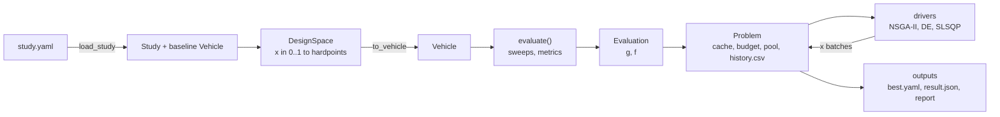

# Optimisation (`suspkin.optimize`)

!!! warning "Experimental"
    The Python API of `suspkin.optimize` may change in minor releases. The study file format
    (schema 1) is stable. The study file itself is documented key by key in the
    [study YAML reference](../guides/study-yaml.md); this page explains what the code does
    with it.

## 1. Purpose and position in the pipeline

The kinematics solver answers "given this hardpoint geometry, how does the wheel move?"
([corner kinematics](corner-kinematics.md), [vehicle kinematics](vehicle-kinematics.md)) and the
[metrics](metrics.md) turn the answer into numbers (camber, bump steer, roll-centre height, ...).
The optimiser inverts the question: **given requirements on those numbers, which hardpoint
positions are best?**

A *study* is a YAML file with four ingredients:

| Ingredient | Meaning | Code |
|---|---|---|
| variables | hardpoints that may move, each inside a region (its *domain*) | `suspkin.optimize.spec.variables.Variable` |
| sweeps | named, repeatable kinematic experiments (bump sweep, roll sweep, ...) | `CornerSweep`, `VehicleSweep` |
| constraints | hard requirements (`g <= 0`) | `suspkin.optimize.spec.criteria` |
| objectives | soft goals to be made small (`f`) | `suspkin.optimize.spec.criteria` |



Package layout (module -> responsibility):

| Module | Responsibility |
|---|---|
| `suspkin.optimize.spec.variables` | units parsing helpers, regions, `Variable`, sweeps, `Frozen` base class |
| `suspkin.optimize.spec.criteria` | constraint and objective models, `Optimizer`, `Budget`, scales |
| `suspkin.optimize.spec.study` | `Study`, cross-checks, `load_study`, `check_against_vehicle`, `check_grid` |
| `suspkin.optimize.spec.surrogate` | surrogate block of the study (see [surrogate](surrogate.md)) |
| `suspkin.optimize.registry` | metric name -> physical dimension |
| `suspkin.optimize.regions` | hexahedron map and inverse, signed distances, grid snapping |
| `suspkin.optimize.design` | `DesignSpace`: unit-cube vector `x` <-> hardpoints <-> `Vehicle` |
| `suspkin.optimize.evaluate` | the full-order-model (FOM) evaluator: `Evaluation` of one design |
| `suspkin.optimize.problem` | `Problem`: batch evaluation with cache, budget, workers, history |
| `suspkin.optimize.pool` | worker count and the spawn process pool |
| `suspkin.optimize.drivers` | NSGA-II, DE, SLSQP, trust-constr, DE + SLSQP; `run_optimization` |
| `suspkin.optimize.history` | `EvalCache`, `HistoryWriter`, `history.csv` columns |
| `suspkin.optimize.outputs` | selection of the best design, run folder files, study hash |

"FOM" (full-order model) means the real kinematic solver, as opposed to the neural
[surrogate](surrogate.md) that can stand in for it.

## 2. Theory

### 2.1 Constrained and multi-objective optimisation

Let $x\in[0,1]^n$ be the design vector (section 4.2). A study defines

- constraints $g_j(x)\le 0$, $j=1\dots m$ (negative or zero = satisfied), and
- objectives $f_i(x)$, $i=1\dots k$, all **minimised** (a goal to maximise is encoded as $-f$).

A design is *feasible* when every $g_j\le 0$. Among feasible designs one wants small $f$.
With $k>1$ objectives that conflict (for example, less bump steer may cost a worse motion
ratio) there is generally no single best design. Design $a$ **dominates** $b$ when

$$f_i(a)\le f_i(b)\ \ \forall i \quad\text{and}\quad f_i(a)<f_i(b)\ \text{for at least one } i .$$

The **Pareto set** is the set of feasible designs that no other feasible design dominates; its
image in objective space is the **Pareto front**. Every point on the front is a different
trade-off, and moving along it improves one objective only by worsening another. The code
needs a single "recommended" point; it uses the **knee**: each objective is min-max normalised
over the front to $[0,1]$ and the front point closest (Euclidean) to the origin, the ideal
point, is chosen (`suspkin.plotting.optimization.knee_index`).

Two modes exist (`optimizer.mode`):

- `weighted` (scalarisation): minimise one number $f_{total}=\sum_i w_i f_i$ with weights
  $w_i\ge 0$. Simple and works with any single-objective algorithm. A weighted sum can only
  reach points on convex parts of the front, and the weights must be chosen up front.
- `pareto`: keep the objectives separate and let NSGA-II approximate the whole front; the
  weights are not used in selection.

### 2.2 Why constraints are normalised

Raw constraint values have different units (mm, deg, a dimensionless motion ratio, N). A
single formula turns each into a dimensionless margin $g$ with $g\le 0$ meaning satisfied:

$$g=\max\!\left(\frac{v-v_{max}}{s},\ \frac{v_{min}-v}{s}\right),$$

using only the limits that exist. $v$ is the constraint's value in SI, $s>0$ its *scale* (same
unit as $v$). Dividing by $s$ makes $g$ a margin in "natural-size" units (1 mm, 0.1 deg, ...),
which keeps the finite-difference gradients and the SLSQP linear algebra reasonably
conditioned and lets a driver compare violations. It is **only** a margin: constraints stay hard
(`g <= 0`) and never enter the cost, so changing a scale cannot change which designs are
feasible. The values are *not* comparable across constraints of different dimensions;
`max_g` (the largest $g$) is therefore a convenient scalar for "how close to infeasible" but
not a physical quantity. Objectives are normalised the same way, $f=\text{raw}/s$ (section 4.5),
so that the weights compare "one scale unit of error" across objectives.

### 2.3 Why a hexahedron domain map

Optimisers are simplest on a box $[0,1]^n$. A chassis mounting zone is rarely an axis-aligned
box: tubes are inclined, faces are tapered. The *hexahedron* domain describes any
(not twisted) 8-vertex solid, and a trilinear map $p(u,v,w)$ sends the unit cube onto it:

$$p(u,v,w)=\sum_{i=0}^{7} N_i(u,v,w)\,P_i,\qquad
N_i=\prod_{k\in\{u,v,w\}}\begin{cases}k & c_{ik}=1\\ 1-k & c_{ik}=0\end{cases}$$

where $P_i$ are the vertices and $c_{i}\in\{0,1\}^3$ the unit-cube corner of vertex $i$. Every
$(u,v,w)\in[0,1]^3$ lands inside the solid, so the driver never proposes a point outside the
domain and needs no domain constraint. Axis-aligned boxes and baseline-relative offsets are
the simple special cases.

### 2.4 Why quantise to a manufacturing grid

A continuous optimum is usually a position like $x=130.3936$ mm, which nobody can drill. The
default grid is 0.5 mm (`DEFAULT_RESOLUTION = 5e-4` m): every free hardpoint coordinate is
rounded to an integer multiple of the resolution, in absolute vehicle-frame coordinates,
**before** evaluating. The optimiser then sees (and reports) only producible designs. Costs:
the objective becomes a staircase in $x$ (section 4.6 explains how finite differences deal with
it) and many nearby $x$ map to the same design, which the cache exploits.

## 3. Conventions

- Frame ISO 8855 ([conventions](conventions.md)); SI inside; units strings (`"30 mm"`,
  `"-1.5 deg"`, `"0.5 deg/deg"`) are converted on load.
- Variable regions are on the **left** side ($y>0$). For an asymmetric right-side variable the
  region is on the right ($y<0$), see 4.2.
- Bump is positive travel; sweep inputs and metric signs follow [metrics](metrics.md).
- $g\le 0$ feasible; $f$ minimised; `maximize` objectives are sign-flipped.
- Failure markers: `G_FAIL = F_FAIL = 1e3` (section 4.5).

## 4. How the code does it

### 4.1 The study model (`suspkin.optimize.spec`)

All models derive from `suspkin.optimize.spec.variables.Frozen` (pydantic, `frozen=True`,
`extra="forbid"`: unknown keys are errors). The package re-exports `Study`, `Optimizer`,
`load_study`, `check_against_vehicle` and `StudyConfigError`.

**`variables`** holds the building blocks:

- Parse helpers. `parse_scalar(v, dim, factor)` turns a number or a unit string into SI
  (`factor` scales bare numbers, used for a block-level `units: mm`). `parse_pair`,
  `parse_resolution` (positive length or `None`), `parse_point_ref("front.uca_front")` ->
  `("front", "uca_front")` (unknown names get a `difflib` "did you mean" hint) and
  `parse_coord_ref("front.uca_front.z")` -> `("front", "uca_front", 2)`. The valid point names
  are `POINT_NAMES` = all `HARDPOINT_NAMES` plus `rocker_arb`.
- Regions: `BoxRegion(lo, hi)`, `HexahedronRegion(vertices)` (8 vertices, validated by
  `check_hexahedron`), `OffsetRegion(x, y, z)` (box relative to the baseline point, variables
  only; an axis with `min == max` is rejected, omit the axis instead), `SphereRegion`,
  `CylinderRegion` (finite, capped; endpoints `p0`, `p1`). In the YAML the shorthand
  `{box: {min, max, units: mm}}` is rewritten by `_region_raw` into the canonical
  `kind`-tagged form. A *domain* (for variables) may be hexahedron, box or offset; a *region*
  (for `inside`/`outside` constraints) may be hexahedron, box, sphere or cylinder.
- `Variable`: `point`, `domain`, `asymmetric`, `side` (`left`/`right`, only with
  `asymmetric: true`), `resolution` override (explicit `null` = continuous). An asymmetric
  right-side region must lie at $y<0$ (checked for box and hexahedron).
- Sweeps: `CornerSweep(corner, travel, steps>=3)` and `VehicleSweep(input in heave|roll|pitch|rack,
  range, steps>=3, base)`. `range: full` is only allowed for `rack` and means the steering
  rack travel of the vehicle. Helpers `sweep_range`, `sweep_input_dim`, `sweep_metric_dim`.
- `default_scale(dim)`: the per-dimension normalisation scale (table in 4.5) and
  `RANGE_TOL = 1e-12`.

**`criteria`** holds the constraint types (discriminated by `type`), the objective types,
`Budget` and `Optimizer`. Constraint fields common to all: `name` (unique, non-empty),
`enabled`, `scale`, `note`. Types:

| `type` | Fields | Meaning |
|---|---|---|
| `band` | sweep, metric, `where`, min/max | metric stays inside the limits over the window |
| `slope` | sweep, metric, `where`, min/max | least-squares slope $d(\text{metric})/d(\text{input})$ |
| `value` | sweep, metric, `at`, min/max | metric at one input value |
| `reach` | corner, travel, `min_toggle_margin`, `stroke`, `toggle_scale`, `stroke_scale` | the corner solves over the travel, rocker toggle margin and coilover stroke are OK |
| `summary` | metric, min/max | scalar of the vehicle summary (`roll_gradient`, `front.rc_height`, ...) |
| `inside` / `outside` | point, region, `over` | point stays inside / outside a region |
| `distance` | a, b, `over`, min/max | distance between two points |
| `relation` | lhs, op (`>=`/`<=`), rhs, offset | `lhs op rhs + offset` between coordinates |
| `joint_angle` | corner, joint, sweep, `axis`, min/max | joint articulation over a corner sweep |

At least one of `min`/`max` is required where limits apply and `min <= max`. A hexahedron
region of an `inside`/`outside` constraint must be **convex** (`is_convex_hexahedron`), because
its signed distance is computed from the convex hull (section 4.4); a *variable* domain only has
to be non-twisted.

Objective types: `curve` (RMS error of a sweep metric to a piecewise-linear target curve
`target: {x, y}`, `x` strictly increasing, at least 2 points), `target` (`|value - target|`
of a sweep metric at `at`, or of a summary metric without sweep), `minimize`/`maximize` (a
statistic `of`: `value` at `at`, `slope`, `max`, `min`, `max_abs`, `mean`, over `where`, or a
summary metric with `of: value`), `linearity` (RMS residual of a least-squares line).
`weight >= 0` (default 1) and `scale > 0`.

The unit-carrying fields of a constraint or objective depend on the metric's dimension, so they
cannot be parsed independently. `prep_constraint(raw, sweeps)` and `prep_objective(raw, sweeps)`
run as a `mode="before"` validator of `Study`: they look up the sweep, ask the
[registry](#43-the-metric-registry) for the metric dimension (for a slope the dimension of
metric/input via `slope_dim`) and convert `min`, `max`, `scale`, `at`, `where`, `target`, `travel`,
`offset` accordingly. This is why `"0.02 deg/mm"` works for a slope limit and `"20 deg"` for a
toggle margin; errors are prefixed `constraint 'name', field 'key': ...`. A `reach` constraint
rejects the plain `scale` key (it has two terms with different units; use `toggle_scale` and
`stroke_scale`).

`Optimizer` fields: `mode` (`weighted` default | `pareto`), `method` (`nsga2 | de | slsqp |
trust-constr | de+slsqp`, default `de+slsqp`, and `nsga2` automatically when `mode: pareto` and
no method is given; `pareto` with any other method is an error), `seed` (default 0), `workers`
(int >= 1 or `auto`), `budget` (`evaluations` > 0 and/or `time` > 0 seconds, default 2000
evaluations; `prep_optimizer` parses `"15 min"`), `start` (`baseline | best`) and a free-form
`options` dict.

**`study`**: `Study` has `schema` (alias of `schema_version`, must be 1), `vehicle` (path
relative to the study file), `resolution` (default 0.5 mm, `null` = continuous), `variables`,
`sweeps`, `constraints`, `objectives`, `optimizer`, `surrogate`. Its `_cross_check` validator
rejects

- duplicate constraint or objective names, or an objective named like a constraint;
- `pareto` mode with fewer than 2 objectives, `weighted` with none (when an optimizer block exists);
- duplicate variable points (a symmetric variable and an asymmetric one on the same point
  also clash; the left and right variable of one point are allowed);
- unknown sweep references, a `joint_angle` whose sweep is not a corner sweep of the same
  corner, an `over` that is not a corner sweep, a point on another axle than the `over`
  sweep, an `inside`/`outside` region whose centroid is on the wrong side for the sweep's
  corner (centroid $y$ zero or of the wrong sign);
- `at`/`where` outside the sweep range (`_check_ranges`, tolerance `RANGE_TOL`) and a curve
  objective whose target $x$ range does not overlap the sweep;
- constraints/objectives on a dimension without a default scale that have no usable scale
  (`_check_scales`, `_check_objective_scales`; a zero limit cannot serve as a scale).

`check_against_vehicle(study, vehicle)` adds the checks that need the vehicle: every referenced
point exists (optional points such as `rocker_arb` may be undefined), a `rack` sweep needs
steering, `range: full` resolves, and `check_grid` verifies that each gridded variable's
domain contains at least one grid node (`has_grid_node` for hexahedra, `node_range` for boxes
and offsets). `load_study(path)` reads the YAML, builds the `Study`, loads the vehicle (relative
to the study file), runs `check_against_vehicle` and converts every I/O, YAML, pydantic,
vehicle or value error into `StudyConfigError("<path>: ...")`. It returns `(Study, Vehicle)`.

### 4.2 The design space (`suspkin.optimize.design`)

`DesignSpace(study, vehicle)` fixes the parameterisation around the baseline vehicle. For each
`Variable` it creates a *slot* with its parameters in $[0,1]$:

- hexahedron or box: three parameters `<label>.u`, `.v`, `.w`;
- offset: one parameter per axis that was given (`<label>.x`, ...). Axes not given stay at the
  baseline and are not part of `x`.

The label is the point reference (`front.uca_front`), with `@right` appended for an asymmetric
right-side variable. `space.n` is the total parameter count, `space.names` the parameter names,
`space.bounds` is `[0, 1]` for every parameter.

Decoding a vector (`DesignSpace.points`, `points_batch`):

- box: $p=\text{lo}+u\,(\text{hi}-\text{lo})$ per axis;
- hexahedron: $p=$ `hex_map(vertices, (u, v, w))`;
- offset: $p=p_{base}+\text{lo}_a+u_a(\text{hi}_a-\text{lo}_a)$ on each free axis $a$.

Then, unless the variable's resolution is `None` or `quantise=False`, the point is snapped to
the grid (4.4). `x` outside $[0,1]$ by more than $10^{-12}$ is an error; smaller excursions
are clipped.

`to_vehicle(x)` writes the points into a dump of the baseline and re-validates it as a
`Vehicle` (`vehicle_from_points`). Symmetric variables move the left point (the right side
mirrors it). An asymmetric **left** variable moves the left point and pins the right one: the
mirrored baseline right point is written into `right_overrides` unless an override already
exists. An asymmetric **right** variable writes `right_overrides` directly (its region is in
right-side coordinates). Left-side writes happen before right overrides. A symmetric variable
on a point that already has a right override is rejected. If the resulting vehicle fails
validation, `InfeasibleDesign` (a `ValueError`) is raised.

Inverse direction: `from_vehicle(v=None, clip=False)` finds the parameters of a vehicle (default:
the baseline, cached). Box and offset are closed form; a hexahedron uses `hex_inverse`
(Newton). A point outside the domain raises `InfeasibleDesign` unless `clip=True`, in which case
the nearest parameters are found by bounded least squares and clipped to $[0,1]$.

Grid helpers: `quantise_x(x)` decodes, snaps and re-encodes (idempotent; accepts `(n,)` or
`(m, n)`), `grid_step_z()` gives, per parameter, the unit-cube length of one grid step (0 where
continuous): `res / (hi - lo)` for boxes and offsets and `res / ||column of the Jacobian at the
centre||` for a hexahedron.

### 4.3 The metric registry

`suspkin.optimize.registry` maps a metric name to its dimension so that unit strings can be
parsed and display units chosen. Three namespaces:

- `corner_metric_dim(name)`: columns of a corner sweep table (state columns such as `travel`,
  `toggle_margin`; metrics such as `camber`, `toe`, `mr_spring`; gradients such as
  `camber_gain`, `bump_steer`; point columns like `uca_outer_x` -> length);
- `vehicle_metric_dim(name)`: columns of a vehicle sweep (`heave`, `roll`, `rc_front_z`,
  `arb_front_elastic`, `wheelbase`, and corner metrics prefixed `FL_`/`FR_`/`RL_`/`RR_`, e.g.
  `FL_camber_ground`);
- `summary_metric_dim(name)`: fields of the vehicle summary, dotted per axle
  (`front.rc_height`, `rear.roll_stiffness`) or global (`roll_gradient`, `tlltd_front`).

Dimensions are canonical names from `suspkin.units` (`length`, `angle`, `ratio`, `force`,
`stiffness`, `angle/length`, ...). An unknown name raises `MetricNameError` listing close
matches. Columns that mix units (`arb_*_elastic`: rad or m) are `ratio` (plain SI). The
meaning, sign and formula of each metric are in [metrics](metrics.md).

### 4.4 Regions, signed distances, snapping (`suspkin.optimize.regions`)

Hexahedron vertex order: bottom face 0-1-2-3 counter-clockwise seen from $+z$, top face 4-5-6-7
above 0-1-2-3 (FEM convention); vertex $i$ sits at the unit-cube corner `_CORNERS[i]`.

- `hex_map(vertices, uvw)` evaluates the trilinear map; `hex_jacobian` its $3\times3$
  Jacobian $\partial p/\partial(u,v,w)$.
- `check_hexahedron(vertices)` raises unless $\det J>0$ at the 8 corners and the centre
  (a sampled check of "not degenerate or twisted", not a proof of injectivity).
- `hex_inverse(vertices, points, tol=1e-10, max_iter=50)`: Newton from $(\tfrac12,\tfrac12,\tfrac12)$,
  $\mathbf{uvw}\leftarrow\mathbf{uvw}-J^{-1}(p(\mathbf{uvw})-p_{target})$; raises `ValueError` if it does not
  converge or the result is outside the unit cube by more than `tol`.
- `hex_locate` / `hex_contains` do the same but never raise: they return the clipped `uvw` and
  an `inside` mask (Newton converged with residual $\le10^{-9}\times$ the hexahedron size, and `uvw` in
  $[-10^{-9},1+10^{-9}]$). Used for the grid and for inside tests.
- Signed distances (negative inside, positive outside, exact Euclidean outside for all four
  shapes): `sd_box`, `sd_sphere`, `sd_cylinder` (closed form with the axis projection) and
  `sd_hexahedron` (convex hull via `scipy.spatial.ConvexHull`, cached per vertex set: inside it is
  minus the distance to the nearest face plane, outside the exact distance to the boundary
  triangles). `is_convex_hexahedron(vertices)` checks that all 8 vertices are extreme and the hull
  volume equals the hexahedron volume (relative tolerance $10^{-6}$).

Grid snapping (all in absolute vehicle-frame coordinates, `res` in metres):

- `node_range(lo, hi, res)`: integer index range $k_{min}=\lceil lo/res-10^{-9}\rceil$,
  $k_{max}=\lfloor hi/res+10^{-9}\rfloor$ of the nodes inside $[lo,hi]$ (the $10^{-9}$ grid-step
  slack lets a bound that lies exactly on a node count).
- `snap_interval(p, lo, hi, res)`: per axis `clip(rint(p/res), kmin, kmax) * res`, rounded to
  12 decimals so YAML values stay clean (`np.rint` rounds half to even). Raises if an axis has
  no node.
- `snap_hexahedron(p, vertices, res)`: round to the nearest node; if that node is outside the
  hexahedron, search cubes of growing radius $n=1,2,\dots$ of integer offsets around it (offsets
  sorted by distance, in chunks of 400 000 candidates) and take the inside node closest to
  `p`. The search is over a cube, so "closest in the cube", which for the first cube that holds any
  inside node is the nearest node up to cube-versus-ball effects. Raises if none is found.
- `has_grid_node(vertices, res)`: tries the neighbourhood of the centroid first, then
  enumerates the bounding box unless it holds more than 3 million nodes (then it answers yes).

### 4.5 The evaluator (`suspkin.optimize.evaluate`)

`evaluate(space, x=None, *, vehicle=None, ctx=None, infeasible=False) -> Evaluation` is the FOM
evaluation of one design. Give `x` **or** `vehicle` (or neither = baseline). It does:

1. Build the vehicle (`space.to_vehicle(x)`; `InfeasibleDesign` marks everything infeasible).
2. Create a context `_Ctx` that **memoises** every kinematic run by key, so a sweep used by
   several constraints and objectives is solved once per call; a failure is cached too and
   re-raised for each user.
3. For each enabled constraint run `_eval_one`; for each objective `_eval_objective`.

What is actually solved, per sweep type:

- corner sweep: `sweep_corner(corner, linspace(travel, steps))`, then
  `add_gradients(states_to_frame(states, corner, metrics=True))`. The table has the columns of
  [metrics](metrics.md); its input column is `travel`.
- vehicle sweep: `sweep_vehicle(vehicle, input=linspace(range, steps), base=base)` and
  `vehicle_frame`, plus `wheelbase` and `steer_c_factor` columns; the input column is the swept
  input.
- `reach`: its own corner run with 13 evenly spaced travels (`_REACH_STEPS`), keyed apart from the
  named sweeps.
- `summary`: `suspkin.metrics.vehicle.vehicle_summary(vehicle)`, dotted attribute access.
- `joint_angle`: `body_rotations` and `joint_angle` of every state against the static state.
- `inside`, `outside`, `distance`, `relation`: need no sweep unless `over` is given.

Window handling (`_window`): samples with $x$ strictly inside `where` plus linear interpolations
at the two ends, so the window ends count even if they are not samples. Sorted by $x$ first.

Per-constraint arithmetic ($s$ = scale from `_scale`, below):

| Type | Value $v$ | $g$ |
|---|---|---|
| `band` | every sample of the window | worst (largest) $g$ of the normalised formula |
| `slope` | least-squares slope of metric vs input over the window | formula with the slope's own scale |
| `value` | interpolation at `at` | formula |
| `reach` | see below | largest active term |
| `summary` | `getattr` chain of the summary; `None` -> unsolved | formula |
| `inside` | worst signed distance $sd$ (largest) | $sd/s$ |
| `outside` | worst $sd$ (smallest) | $-sd/s$ |
| `distance` | $\lVert a-b\rVert$, worst over the sweep if `over` | formula |
| `relation` | `lhs` | $(rhs+offset-lhs)/s$ for `>=`; $(lhs-rhs-offset)/s$ for `<=` |
| `joint_angle` | worst angle over the sweep | formula |

`reach`: with `min_toggle_margin` the term is $(m_{req}-\min(\text{toggle\_margin}))/s_t$
($s_t$ = `toggle_scale`, default 0.1 deg); with `stroke: true` two terms
$-\min(\text{bump\_stroke\_remaining})/s_s$ and $-\min(\text{droop\_stroke\_remaining})/s_s$
($s_s$ = `stroke_scale`, default 1 mm). $g$ is the largest term, and `value` and `detail`
describe that term. With no active term the constraint only demands that the solve succeeds
($g=-1$).

For `inside`/`outside` without `over`, the static point is the left corner's point, or the right
corner's if the region's centroid has $y<0$. With `over` it comes from the solved states of that
corner sweep (so a keep-out zone is checked over the whole travel).

**Scale** (`_scale`) for limit constraints, in order: user `scale`; else $v_{max}-v_{min}$ if both
limits exist and differ; else the dimension default; else $|\text{limit}|$ (a zero limit has no
usable scale and is rejected at load). Region, distance (with one limit), relation and reach
terms use the user scale or the length / angle default directly. Dimension defaults
(`default_scale`, SI): length 1 mm, angle 0.1 deg, ratio 0.01, percent 1, force 10 N, stiffness
(force/length) 1000 N/m = 1 N/mm. Other dimensions (for example `angle/length`) have none.

Objective value (`_eval_objective`): $\text{raw}$ by type, then
$f=(\pm\text{raw})/s_{obj}$ with the sign $-$ for `maximize`. $s_{obj}$ is the user `scale`, else
the dimension default, else $|target|$ of a `target` objective (`objective_scale`).

| Type | raw |
|---|---|
| `curve` | $\sqrt{\operatorname{mean}((y-y_{target}(x))^2)}$ over the window (default: overlap of target $x$ range and sweep), target linearly interpolated |
| `target` | $\lvert v-\text{target}\rvert$, $v$ at `at` of a sweep or a summary metric |
| `minimize`/`maximize` | `of`: `value` at `at`; `slope` (least squares); `max`; `min`; `max_abs`; `mean` (trapezoidal over the window); summary metric |
| `linearity` | RMS residual of the least-squares line through the window |

`Evaluation` holds `results` (tuple of `ConstraintResult`: `name, type, value, min, max, g,
status, dim, detail`) and `objectives` (tuple of `ObjectiveResult`: `name, type, raw, f, weight,
status, dim, detail`). Properties and methods: `feasible` (every enabled $g\le0$), `max_g`
(largest $g$, $-\infty$ with no enabled constraint), `g_vector()` (enabled constraints, YAML order),
`f_vector()`, `f_total` ($\sum w_i f_i$), `frame()` and `objectives_frame()` (SI),
`display_frame()` and `objectives_display_frame()` (display units + `unit` column).
`ConstraintResult.status` is `pass | fail | unsolved | infeasible | disabled`.

**Failure handling.** A `KinematicsError`, `ValueError` or `KeyError` inside a memoised run, a
non-finite value, a missing column, or an undefined point becomes the internal `_Unsolved`:
the constraint gets status `unsolved`, `g = G_FAIL = 1e3`, `value = nan`, and objectives get
`f = F_FAIL = 1e3` with raw `nan` and status `unsolved`. An `InfeasibleDesign` marks *every*
enabled constraint and objective `infeasible` with the same fail values. A disabled constraint
has status `disabled` and `g = nan` and is skipped in `g_vector`. `failed_evaluation(space, detail)`
builds an all-`unsolved` evaluation (used when the evaluation itself raises, see 4.6). The large
$10^3$ plateau makes failed designs lose every comparison, but it is a cliff for gradient
methods (4.8).

### 4.6 The problem (`suspkin.optimize.problem`)

`Problem(study_path, run_dir, *, resume=False, workers=None, evaluations=None, time=None)` wraps a
`DesignSpace` and `evaluate` into a batch function with a cache, a budget, optional parallelism and
a history file. `workers`, `evaluations` and `time` override the study's optimizer block.

`evaluate_batch(X, source="eval") -> (F, G, f_total, max_g, feasible)` (arrays with one row per
input row):

1. **Quantise** every row (`DesignSpace.quantise_x`): the evaluation, cache and history belong
   to the producible design.
2. Cache lookup by key (`cache_keys`, `x` rounded to 12 decimals). Duplicates inside the batch are
   evaluated once. The raw (un-snapped) `x` is stored as an alias of the snapped result so a
   later lookup with the raw point is free.
3. If any row needs evaluating and the budget is already used up when the batch **starts**:
   `BudgetExhausted`. A fully cached batch never raises. A batch that crosses the limit runs
   to completion (budgets are checked per batch, so the count can overshoot, see the example).
4. Evaluate the misses: serially with `_eval_with`, or via the process pool (`pool.map`,
   `chunksize=1`, results in input order). An exception inside `evaluate` is caught and turned
   into `failed_evaluation(space, "<ExceptionType>: message")`, so one crashing design never
   aborts a run.
5. Decode the new points in one `points_batch` call and append every new row to `history.csv`
   in input order (one flush per batch). Ids increase from `next_id`.
6. Return the arrays (`F` is `(m, k)`, `G` is `(m, n_enabled_constraints)`).

`n_evals` counts new evaluations only; on `resume` the budget counts only evaluations made after
the restart. `exhausted()` is true if `n_evals >= max_evals` or `elapsed >= max_time`
(`time.perf_counter` since creation). `evaluate_one` is a single-row wrapper.

`fd_jacobian(x, source="fd", step=None)` returns forward-difference gradients in the unit cube.
The base point and the $n$ perturbed points form one batch (parallelisable). The step per
parameter is $h_i=\max(h,\ \text{one grid step of that parameter})$ with $h=$ `FD_STEP = 1e-3`
(or the `fd_step` option): on a 0.5 mm grid a smaller step would see only the staircase. If
$x_i+h_i>1$ a backward step is used. It returns the gradient of $f_{total}$ (`(n,)`), the
Jacobian of $g$ (`(m, n)`), that of $f$ and the base values.

**Pool** (`suspkin.optimize.pool`). `resolve_workers("auto")` is `max(1, cpu_count - 1)`; an int is
used as given. `make_pool(workers, init, initargs)` builds a `ProcessPoolExecutor` with the
`spawn` context (portable; the only start method on Windows) and an initialiser. Each worker
runs `_init_worker(study_path)` once: it loads the study and builds its own `DesignSpace`, then
`_eval_worker(x)` evaluates one vector and returns `(Evaluation, seconds)` (picklable
frozen dataclasses). With one worker no pool is created. The pool is created lazily and shut down in
`Problem.close()` (also on `with` exit).

### 4.7 History and cache (`suspkin.optimize.history`)

`history.csv` has one row per **new** evaluation and these columns in order (`history_columns`):

| Group | Columns |
|---|---|
| id | `eval_id` |
| design vector | `x_<name>` for each parameter name |
| decoded points | `p_<label>_x/y/z` for each variable (SI metres; `nan` for infeasible designs) |
| objectives | `f_<objective>`, `f_total` |
| constraints | `g_<constraint>` (enabled ones), `max_g` |
| status | `feasible`, `status` (`ok | unsolved | infeasible`), `seconds`, `source` |

`source` tells which method generated the row (`de`, `nsga2`, `slsqp`, `fd`, ...). `status` is
`infeasible` if any result is, else `unsolved` if any is, else `ok` (`evaluation_status`).

`HistoryWriter(path, space, study, resume=False)` writes the header on create and appends (no
header) on resume of a non-empty file. `read_history(path)` returns a DataFrame.

`EvalCache` is a `dict[tuple[float, ...], CacheEntry]` keyed by `cache_key(x)` =
`tuple(np.round(x, 12))`; `CacheEntry` stores `f_vector, g_vector, f_total, max_g, feasible`.
`EvalCache.from_history(df, space, study)` rebuilds the cache from a history table and raises
`HistoryError` if the columns differ from the study's expected columns (i.e. variables,
objectives or enabled constraints changed). Because the key is the quantised `x`, resuming
reuses every design that was already evaluated.

### 4.8 Drivers (`suspkin.optimize.drivers`)

Every method works in the unit cube through a `Problem`. A method that hits `BudgetExhausted`
just stops; the result is then taken from the **history**, not from the algorithm's internal
state. `run_optimization(study_path, out_dir=None, *, resume, workers, evaluations, time, method,
report, echo) -> RunResult` is the entry point used by `suspkin optimize`.

Common pieces:

- Initial population (`_initial_population`): a Latin hypercube sample (`scipy.stats.qmc`, seeded
  with `optimizer.seed`) whose first row is replaced by the baseline vector, so the baseline is
  always evaluated. On resume the best distinct history rows (ranked as below) fill the
  population first, the rest is LHS.
- Ranking of history rows (`ranked_rows`): feasible rows with status `ok` by `f_total`, then
  infeasible rows by `max_g`; `nan` counts as $+\infty$. `best_row` is the first.
- Seeds: LHS, scipy DE and pymoo all use `optimizer.seed`; batches are returned in input order, so
  a run is reproducible for a given seed regardless of `workers` (wall-time budgets are not
  reproducible).

**`nsga2`** (pymoo NSGA-II). `pop_size = options.pop_size`, default $\max(20,4n)$. Number of
generations $\max(1,\lfloor \text{evaluations}/\text{pop\_size}\rfloor)$ (10 000 with no evaluation
budget). In `pareto` mode it minimises the objective vector $F$ (`n_obj = k`); in `weighted` mode a
single objective $f_{total}$. The constraints $g$ are given as `n_ieq_constr`; pymoo's
constraint domination ranks any feasible design above any infeasible one and compares infeasible
ones by violation. Duplicates are eliminated. `source = "nsga2"`.

**`de`** (scipy `differential_evolution`, `polish=False`, `vectorized=True`,
`updating="deferred"`, so each generation is one `evaluate_batch`). The constraints are passed as
`NonlinearConstraint(g, -inf, 0)`, which scipy handles with Lampinen's feasibility rules (a
feasible trial beats an infeasible one; two infeasible ones are compared by violation). The
objective is $f_{total}$ (`weighted` only). Population: `popsize` option, else
$\operatorname{clip}(\lceil \text{evals}/8/n\rceil,\,2,\,15)$ with `evals` the evaluation budget
(15 if none); the actual population is $\max(8,\,\text{popsize}\cdot n)$ (the LHS above is passed as
`init`). `maxiter`: option, else $\max(1,\lfloor \text{evals}/\text{pop}\rfloor-1)$, or 1000 with
no evaluation budget. Passed through if present in `options`: `mutation`, `recombination`,
`strategy`, `tol`, `atol`. `source = "de"`.

**`slsqp`** and **`trust-constr`** (scipy `minimize`, local, gradient-based). The cost is
$f_{total}$, bounds $[0,1]^n$, gradients and constraint Jacobians from `Problem.fd_jacobian`
(memoised for the last point in `_FdCache`, so SLSQP's cost and constraint calls share one
Jacobian batch of $n+1$ evaluations). SLSQP gets `{"type": "ineq", "fun": -g, "jac": -J}`
(SciPy's convention is $\ge0$ = feasible); `trust-constr` gets `NonlinearConstraint(g, -inf, 0)`
and a BFGS Hessian approximation. Options: `maxiter` (default 100), `ftol` (SLSQP), `xtol`, `gtol`
(trust-constr), `fd_step`. The start point is the baseline or, with `start: best`, the best
history row (`slsqp`/`trust-constr` only).

**`de+slsqp`** (default). Differential evolution gets 80 % of the budget
(`DE_SHARE = 0.8` of the remaining evaluations and, if set, of the remaining time), then SLSQP polishes
from the best point in the history with the original budget restored (`source = "slsqp"`). `start`
is ignored (the polish always starts from the best history point).

!!! note "The finite-difference cliff"
    Gradients from finite differences are unreliable next to the $10^3$ failure plateaus of
    unsolved or infeasible designs, and the staircase of the grid adds noise. The local methods
    are meant as a polish from a feasible start; use `de` or `nsga2` for exploration.

Unknown keys in `options` are not validated: they are silently ignored by the method that
does not use them.

**Run flow** of `run_optimization`: load the study (`StudyConfigError` if it has no objectives);
apply the `method` override and check the mode/method pair (`RunError`); for `resume` require an
explicit folder with a `history.csv`; create the run folder and copy the study and vehicle in
(`copy_inputs`, with `vehicle:` rewritten to `vehicle.yaml`); open the `Problem`; `_prepare`
(below); evaluate the baseline once (not counted); run the method; absorb `BudgetExhausted`
(any other error, such as a broken pool or Ctrl-C, is remembered, the outputs are still written
without report, and the error is re-raised afterwards); select the best design and write the
outputs.

**Resume and `_prepare`.** `_prepare(problem, resume, old_meta, echo)` hashes the study
(`study_hash`, 4.9). On resume it reads `valid_from_eval_id` and `study_hash` from the old
`meta.json`; if the hash differs, `valid_from` becomes `problem.next_id`, a warning is echoed
("constraints/objectives changed ... cached results are dropped"), and the cache is rebuilt from
history rows with `eval_id >= valid_from`. Older rows stay in `history.csv` but are ignored for
caching and for selecting the best design (`_history`); the old designs are simply re-evaluated if
requested again. Because `_prepare` makes no random draws, a resumed run with the same seed
draws the same LHS as the first run.

### 4.9 Outputs (`suspkin.optimize.outputs`)

Selection (`_finish`): in `pareto` mode the Pareto rows (`pareto_rows`: feasible, status `ok`,
non-dominated by `pareto_mask`, de-duplicated on `x`) and their knee; otherwise `best_row`. The
best design is then **re-evaluated** with `evaluate(space, best_x)` for the report. With an empty
history the baseline vector is used.

Run folder (default `results/opt/<study stem>_<YYYYmmdd-HHMMSS>`):

| File | Content |
|---|---|
| `study.yaml`, `vehicle.yaml` | copies of the inputs; the study points at `vehicle.yaml` |
| `history.csv` | every new evaluation (4.7) |
| `best.yaml` | the best (or knee) vehicle, via `save_vehicle` |
| `result.json` | `mode`, `best_eval_id`, `knee_eval_id`, `n_pareto`, and `baseline` / `best` blocks with `x` (name -> value), `feasible`, `f_total`, `f`, `g`, `constraints` (rows of `Evaluation.frame()`, SI) and `objectives` (rows of `objectives_frame()`); non-finite numbers are `null` |
| `meta.json` | `suspkin_version`, `git_hash`, `seed`, `method`, `mode`, `start`, `end`, `n_evals`, `n_evals_total`, `workers`, `resumed`, `study_hash`, `valid_from_eval_id` |
| `pareto.csv`, `pareto/pareto_<k>.yaml` | `pareto` mode: one row and one vehicle per Pareto design; `knee` column marks the knee |
| `figures/` | PNG: `convergence`, `parallel`, `constraint_margins`; `pareto` if there is a Pareto set |
| `report/` | with the report on: baseline and optimised vehicle through the standard studies (`build_report`, 2D), see [sweeps and reports](sweeps-and-reports.md) |

`study_hash(study)` is the SHA-256 of the canonical JSON of the **constraint and objective
definitions only** (variables, sweeps, resolution, vehicle and optimizer are not included).
`git_hash` is `git rev-parse HEAD` in the study's directory or `null`.

## 5. Edge cases and failure modes

- **Study errors** raise `StudyConfigError` with the path in the message; the CLI exits with code 2.
- **Baseline outside a variable domain**: `from_vehicle()` raises `InfeasibleDesign`; the check
  command warns and `--strict` fails. `from_vehicle(clip=True)` is what drivers use for the start.
- **Twisted or concave domain**: a twisted hexahedron fails `check_hexahedron` at load. A
  non-convex hexahedron is fine as a variable domain but rejected as an `inside`/`outside` region.
- **Region with no grid node**: `check_grid` raises at load (a domain thinner than the grid).
- **Solver failure for some designs**: they get `G_FAIL`/`F_FAIL` rows with status `unsolved`, are
  never selected as best (selection needs status `ok`), and just cost one evaluation.
- **No feasible design found**: `best` falls back to least `max_g`; the CLI prints
  `feasible: ... no` and exits with 1.
- **Budget overshoot**: the budget is checked at the start of a batch; a DE generation, an NSGA-II
  generation or a Jacobian batch always completes.
- **Cache aliasing**: two different raw vectors that snap to the same design are evaluated once.
- **Resume with a changed variable set**: `HistoryError` (columns differ). Changed constraints or
  objectives: cache dropped with a warning. Changed sweeps, domains or vehicle: **not detected**
  (see the note below).

!!! note "Stale-cache gap on resume"
    `study_hash` covers only constraints and objectives (4.9). Editing a sweep definition
    (for example its travel), a variable domain, the grid resolution or the vehicle file between
    a run and its `--resume` does not change the hash, so cached results from the old definition
    are reused. Start a new run folder after such a change.

## 6. Worked example

All commands are run from the repository root on `configs/vehicles/fs_reference.yaml`.

### 6.1 `suspkin check`

```console
$ suspkin check configs/studies/fs_reference_constraints.yaml
name               type           value      min     max  unit           g  status  detail
camber_band_f      band          -0.629   -4.000   0.000  deg       -0.629  PASS
toe_band_f         band          -0.135   -0.500   0.500  deg       -3.654  PASS
camber_gain_f      slope         -0.017   -0.050   0.000  deg/mm    -0.350  PASS
bump_steer_r       slope          0.000   -0.020   0.020  deg/mm    -0.493  PASS
roll_camber_f      slope         -0.813   -1.100  -0.500  -         -0.478  PASS
mr_front           value          0.980    0.900   1.100  -         -0.402  PASS
mr_rear            value          0.993    0.900   1.100  -         -0.464  PASS
travel_f           reach         10.224    0.000       -  mm       -10.224  PASS    bump stroke remaining
travel_r           reach          9.581    0.000       -  mm        -9.581  PASS    bump stroke remaining
ubj_angle          joint_angle    5.931        -  25.000  deg     -190.687  PASS
rc_height_f        summary       33.721   10.000  80.000  mm        -0.339  PASS
roll_gradient      summary        0.629        -   1.200  deg/g     -0.476  PASS
tlltd_front        summary        0.503    0.450   0.600  -         -0.353  PASS
uca_front_keepout  outside      138.003    0.000       -  mm      -138.003  PASS
tie_inner_tube     outside       54.630    0.000       -  mm       -54.630  PASS
uca_front_zone     inside       -40.000        -   0.000  mm       -40.000  PASS
uca_rear_zone      inside       -40.000        -   0.000  mm       -40.000  PASS
tie_len            distance     435.018  400.000       -  mm       -35.018  PASS
uca_base           distance     260.000  200.000       -  mm       -60.000  PASS
uca_above_lca      relation     325.000  225.000       -  mm      -100.000  PASS
20/20 constraints pass, feasible: yes
```

`check` loads the study, builds the `DesignSpace`, evaluates the **baseline** and prints the
`display_frame()` (display units). The `g` column follows the formulas of 4.5; for example

- `mr_front`: limits $[0.9,1.1]$ without a user scale, so $s=0.2$ and
  $g=\max\big((0.98-1.1)/0.2,\ (0.9-0.98)/0.2\big)=-0.4$ (printed $-0.402$: the unrounded value is 0.9804);
- `rc_height_f`: $s=70$ mm and $g=(10-33.721)/70=-0.339$;
- `camber_gain_f`: user scale absent, limits $[-0.05,0]$ deg/mm, $s=0.05$ deg/mm:
  $g=\max(-0.017/0.05,\ (-0.05+0.017)/0.05)=-0.35$;
- `uca_front_zone`: the point is 40 mm from the nearest face of the box, so $sd=-40$ mm
  and $g=sd/1\text{ mm}=-40$;
- `travel_f`: the smallest remaining bump stroke is 10.224 mm, so $g=-10.224\text{ mm}/1\text{ mm}$.

Exit code 0; `--strict` would exit 1 on any non-pass.

### 6.2 The design space

A short snippet (`DesignSpace` on `fs_reference_optimize.yaml`, 11 parameters):

```python
study, veh = load_study("configs/studies/fs_reference_optimize.yaml")
sp = DesignSpace(study, veh)
sp.n            # 11
sp.names        # 'front.uca_front.u', ..., 'front.tie_inner.w', 'rear.pushrod_outer.x', '...z'
x0 = sp.from_vehicle()   # baseline: [0.5, 0.4167, 0.5, 0.5556, 0.4444, 0.5, 0.5, 0.5, 0.5, 0.5, 0.5]
```

The baseline of `front.uca_front` sits at $(u,v,w)=(0.5,0.4167,0.5)$ of its skewed
hexahedron, not at the cube centre (which maps to $(130,303,325)$ mm): the baseline $y=300$
mm is found by `hex_inverse`. Perturbing $u$ of `front.uca_front` by $0.0123$ and the $z$ parameter of
`rear.pushrod_outer` by $0.0321$:

| Point | continuous (mm) | snapped to 0.5 mm (mm) |
|---|---|---|
| `front.uca_front` | (130.3936, 300, 325) | (130.5, 300, 325) |
| `rear.pushrod_outer` | (-1552.858, 507.5, 337.4) | (-1553.0, 507.5, 337.5) |

`quantise_x` of the snapped vector is unchanged (idempotent). `grid_step_z()` gives 0.0156 for
`front.uca_front.u` (0.5 mm over the 32 mm-wide $u$ edge of the hexahedron) and 0.025 for
`rear.pushrod_outer.x` (0.5 mm over the 20 mm offset range). The baseline evaluation:

```text
feasible True, max_g -0.339, f_total 11.350
camber_curve  curve     raw 0.870 deg    f 8.702  (scale 0.1 deg)
rc_f          target    raw 6.279 mm     f 1.256  (scale 5 mm)
bump_steer_f  minimize  raw 0.0108 deg/mm f 1.076 (of max_abs)
mr_linearity  linearity raw 0.0063       f 0.633, weight 0.5
```

$f_{total}=8.702+1.256+1.076+0.5\times0.633=11.350$.

### 6.3 `suspkin optimize` (weighted, 40 evaluations)

```console
$ suspkin optimize configs/studies/fs_reference_optimize.yaml --out <tmp>/run \
      --evaluations 40 --workers 1 --no-report
optimize: method de+slsqp, mode weighted, 11 variables, 12 constraints, 4 objectives, 1 workers, budget 40 evaluations / 900 s
done: 44 new evaluations (44 in history), 2.8 s, 1 workers

objectives
objective     baseline   best  unit    f base  f best
camber_curve     0.870  0.931  deg      8.702   9.314
rc_f             6.279  1.021  mm       1.256   0.204
bump_steer_f     0.011  0.013  deg/mm   1.076   1.275
mr_linearity     0.006  0.006  -        0.633   0.604
f_total: baseline 11.350 -> best 11.095
...
feasible: baseline yes, best yes
```

Why 44 and not 40? `--evaluations 40` replaces the study's evaluation budget but the study's
15 min time budget stays (the header shows both). With `de+slsqp` DE gets $\lfloor0.8\cdot40\rfloor=32$
evaluations. $n=11$ gives `popsize` $=\operatorname{clip}(\lceil32/8/11\rceil,2,15)=2$,
population $\max(8,22)=22$ and `maxiter` $=\max(1,\lfloor32/22\rfloor-1)=1$. DE evaluates the
initial population (22, baseline included), is still under 32, evaluates one generation (22 more),
and the batch crossing the limit completes: 44. The budget is then used up, so the SLSQP
polish stops at its first evaluation. A realistic budget is hundreds to thousands of evaluations.

The run folder (`--no-report`: no `report/`):

```text
best.yaml  history.csv  meta.json  result.json  study.yaml  vehicle.yaml  figures/
figures/: constraint_margins.png  convergence.png  parallel.png
```

`history.csv` row 0 is the baseline LHS row (`source = de`):
`eval_id=0`, `x_front.uca_front.u=0.5`, `p_front.uca_front_x=0.13`, ..., `f_total=11.350...`,
`max_g=-0.3389`, `feasible=True`, `status=ok`. `result.json` has the keys `mode`, `best_eval_id`
(20 here), `knee_eval_id` (`null`), `n_pareto` (0), `baseline`, `best`. `meta.json` (abridged):

```json
{"suspkin_version": "1.1.0", "seed": 1, "method": "de+slsqp", "mode": "weighted",
 "n_evals": 44, "n_evals_total": 44, "workers": 1, "resumed": false,
 "study_hash": "dbcc2d87...fef", "valid_from_eval_id": 0}
```

### 6.4 `pareto` mode

Switching the same study to `mode: pareto`, `method: nsga2` and `--evaluations 80`: the default
`pop_size` is $\max(20,44)=44$ and $\lfloor80/44\rfloor=1$ generation, so only the initial population
is evaluated (44 evaluations). The result was a Pareto set of 23 designs (`pareto.csv` with the
knee marked, `pareto/pareto_0.yaml` ... `pareto_22.yaml`). Use a budget of at least a few
hundred evaluations for a meaningful front.

## 7. Where it is tested

- `tests/unit/test_study_spec.py`: schema, units parsing, cross-checks, errors of `load_study`.
- `tests/unit/test_regions.py`: hexahedron map and inverse, signed distances, grid snapping.
- `tests/unit/test_design_space.py`, `tests/property/test_design_roundtrip.py`: `DesignSpace`
  encoding/decoding and round trips.
- `tests/unit/test_evaluate.py`, `tests/unit/test_evaluate_fast.py`: constraint and objective
  evaluation.
- `tests/unit/test_problem.py`, `tests/unit/test_history.py`: cache, budget, history, resume.
- `tests/unit/test_drivers.py`: methods and run folder.
- `tests/unit/test_cli_optimize.py`: the `check` and `optimize` commands.
- `tests/regression/test_reference_study.py`: the reference study on the reference vehicle.

## See also

- [Study YAML reference](../guides/study-yaml.md): every key of the file.
- [Metrics](metrics.md): the metric columns constraints and objectives refer to.
- [Vehicle model](vehicle-model.md): hardpoints, mirroring and `right_overrides`.
- [Surrogate](surrogate.md): replacing `evaluate` by neural networks inside this machinery.
- [Sweeps and reports](sweeps-and-reports.md): the report written at the end of a run.
