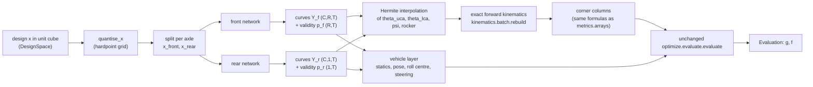
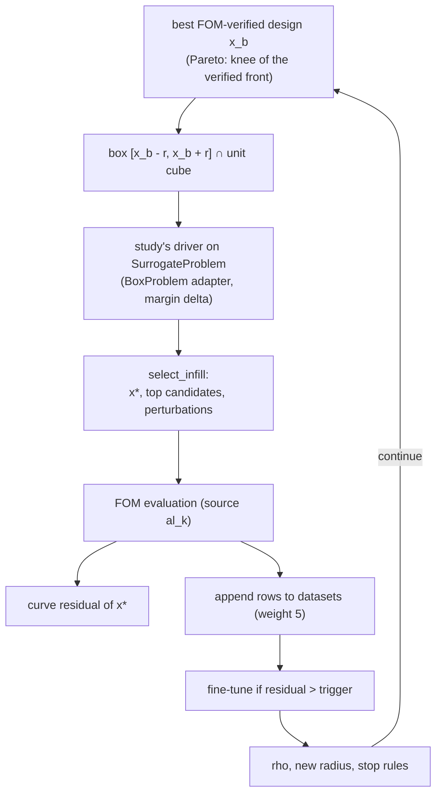

# Neural surrogate and active learning

This page explains the experimental **surrogate** package `suspkin.surrogate`: how a pair of
small neural networks replaces the full-order kinematics model (FOM) inside the optimiser, how
the networks are sampled, trained and searched, how an analytic vehicle layer turns their
output into the same constraints and objectives the FOM produces, and how the active-learning
loop keeps the whole thing honest. It assumes you have read
[corner kinematics](corner-kinematics.md) (what one corner solve returns),
[metrics](metrics.md) (what the columns mean) and [optimisation](optimization.md) (study
specification, `Problem`, drivers).

!!! warning "Experimental"
    `suspkin.surrogate` is not part of `suspkin.__all__` and its API may change in a minor
    release (see the [stability guide](../guides/stability.md)). The design decisions are in
    [ADR 0007](../adr/0007-surrogate-model.md); how to run the workflow step by step is in the
    [surrogate guide](../guides/surrogate.md). This page is the reference for the maths and the
    code.

## 1. Purpose and position in the pipeline

One FOM evaluation of the reference study costs about 240 ms (two axles, all sweeps). A global
search over all hardpoints of both axles (90 design parameters in the benchmark study) needs
tens of thousands of evaluations, hours of compute. The kinematics are smooth functions of the
hardpoints, so a network can learn them.

The surrogate does **not** predict the final objectives. That would tie the network to one study.
Instead it predicts only **left-corner curves on a fixed grid**: for each channel (camber, toe,
coilover length, ...) a function of wheel travel (and, on the front axle, rack displacement). Everything
that follows (sweep tables, roll centre, roll stiffness, anti-dive, constraints, objectives) is
computed from these curves by deterministic, vectorised code. Only the corner curves carry
network error; the vehicle layer is exact up to interpolation (section 9).



The surrogate is used in three places:

1. `suspkin surrogate sample / train / validate` build and check the networks (section 12).
2. `suspkin.surrogate.problem.SurrogateProblem` is an `optimize.problem.Problem` that evaluates on
   the networks, so every optimiser driver runs on it unchanged.
3. `suspkin optimize --surrogate DIR` runs the active-learning loop
   `suspkin.surrogate.active.run_active_learning`, which alternates surrogate search and FOM
   verification. **Every design that is reported is a FOM result**; the networks only propose.

### Which modules need torch

| Module | Needs torch / optuna | Role |
|---|---|---|
| `suspkin.surrogate.channels`, `.data`, `.dataset` | no | registry, extraction, sampling, shards |
| `suspkin.surrogate.normalise`, `.report` | no | standardisation / POD, HPO markdown report |
| `suspkin.surrogate.vehicle_layer`, `.evaluate`, `.problem` | no (torch imported lazily only to load a network) | evaluation |
| `suspkin.surrogate.active_steps`, `.active` | lazy: torch only when a network is loaded or fine-tuned | active learning |
| `suspkin.surrogate.model`, `.train` | torch | network, training, prediction |
| `suspkin.surrogate.hpo`, `.workflow` | torch and optuna | architecture search, train/validate workflows |

The extra is `pip install "suspkin[surrogate]"` (`torch>=2.5,<2.7`, `optuna>=4.0`). Importing
`suspkin.surrogate` and every module in the "no" and "lazy" rows works without torch and optuna
(verified by blocking both packages at import time); only `model`, `train`, `hpo` and `workflow`
fail. `scipy` (Latin hypercube) is always required.

## 2. Axle split and the unit-cube design vector

`suspkin.optimize.design.DesignSpace` maps the study variables to a vector $x\in[0,1]^n$
([optimisation](optimization.md)). The surrogate works **per axle**: `suspkin.surrogate.data.AxleSpace`
selects the slots whose point reference is on that axle (`idx`, `names`) and requires every such
variable to be **symmetric** (`mode == "sym"`): the network models the left corner and the
right corner is its mirror image. An asymmetric variable raises
`StudyConfigError`. The other axle stays at the baseline.

- `AxleSpace.baseline()` is the baseline's axle vector (clipped to the cube).
- `AxleSpace.to_full(x_axle)` builds the full $n$-vector (other axle at baseline).
- The network input is $x_{axle}$ only. Vehicle data (mass, CG, wheelbase, spring rates) are
  **not** inputs: they enter in the vehicle layer. A model is therefore valid for exactly one
  baseline vehicle, design space and grid, and this is enforced by hashes (section 5).

Consequence of the split: front and rear networks are trained, stored and loaded independently,
the benchmark study has $15\text{ points}\times3 = 45$ parameters per axle, and a study without
variables on one axle uses `BaselineAxle` (its curves computed once from the baseline) instead
of a network.

## 3. Study block: `surrogate:` and `optimize.spec.surrogate`

The study YAML gets a `surrogate:` section, parsed by `suspkin.optimize.spec.surrogate.SurrogateSpec`
(frozen pydantic models, SI units; time values accept `"90 min"`, lengths `"30 mm"`).

| Model | Field (default) | Meaning |
|---|---|---|
| `GridSpec` | `travel: AxisGrid`, `rack: AxisGrid` (optional) | output grid. `AxisGrid(min, max, points>=3)`, uniform, **must contain 0** (static pose). `rack` only for the front axle (without it the front grid is `rack=[0]`). |
| `DatasetSpec` | `n_initial=20000`, `seed=1`, `shard_size=500`, `lhs_optimization="auto"` | initial LHS size per axle, RNG seed, rows per shard, `auto`/`random-cd`/`none` |
| `TrainingSpec` | `device="auto"`, `max_epochs=2000`, `patience=100`, `num_threads=None`, `finetune_lr_factor=0.1` | final training and fine-tune learning-rate factor |
| `HpoSpec` | `n_trials=100`, `timeout=4 h`, `parallel="auto"`, `max_epochs=300`, `subsample=None` | Optuna search budget. Effective trial cap = $\min(\texttt{hpo.max\_epochs},\texttt{training.max\_epochs})$ |
| `ActiveLearningSpec` | `max_iterations=50`, `fom_evaluations=2000`, `time=None`, `surrogate_evaluations=20000`, `margin=0.05`, plus the three sub-blocks below | active-learning loop |
| `InfillSpec` | `top=0`, `perturb=4` | extra FOM points per iteration |
| `FinetuneSpec` | `epochs=60`, `weight=5.0`, `replay=2048`, `patience=30`, `trigger=1.0`, `skip_after=2`, `skip_for=2`, `stall_override=3.0`, `on_cpu="skip"` | fine-tuning schedule |
| `TrustRegionSpec` | `initial=0.2`, `min=0.01`, `max=0.5` | trust-region radius in the unit cube (`min <= initial <= max`) |
| `StopSpec` | `eps_f=0.01`, `patience=5` | stopping tolerance (relative) and consecutive-iteration count |

The committed benchmark study `configs/studies/fs_reference_surrogate.yaml` sets
`travel: -30..30 mm, 41 points`, `rack: -30..30 mm, 21 points`, `n_initial: 20000`,
`training: {max_epochs: 600, patience: 600}`, `hpo: {n_trials: 60, timeout: 90 min,
max_epochs: 300, subsample: 5000}`. Note that `TrainConfig` (the dataclass in `train.py`) has its own
defaults (`max_epochs=200`, `patience=30`); in the workflow `suspkin.surrogate.workflow._train_config`
always overwrites them from `TrainingSpec`.

## 4. Channels: what the network predicts

`suspkin.surrogate.channels.CHANNELS` is the registry: a tuple of `Channel(name, source,
encoding, tol, axles)`.
`source` is a column of the metric tables (or a solver coordinate), `tol` the engineering
tolerance in SI (m or rad), `encoding` either `"value"` (as is) or `"line_angle"`.
`channels_for("front")` has 29 channels and `channels_for("rear")` 28 (`steer_angle` is front only).

| Group | Channels (source column if different) | Tolerance |
|---|---|---|
| alignment | `camber`, `toe` | 0.02 deg |
| steering | `steer_angle` (front only) | 0.02 deg |
| kingpin | `caster`, `kpi` | 0.05 deg |
| lengths | `scrub_radius`, `mechanical_trail`, `half_track_change`, `contact_patch_dx`, `contact_patch_dy`, `wheel_center_recession` | 0.1 mm |
| swing angles | `fv_swing_angle`, `sv_swing_angle`, `sv_wc_angle` (line angle) | 0.05 deg |
| actuation | `coilover_length` | 0.05 mm |
| | `rocker_angle` (source `rocker_rotation`), `pushrod_angle`, `toggle_margin` | 0.05 deg |
| joints | `joint_<j>` for each name in `suspkin.metrics.corner.JOINTS` | 0.1 deg |
| solver state | `theta_uca`, `theta_lca`, `psi` | 0.01 deg |

**Deliberately absent**: the ARB drop-link displacement (the point follows rigidly from the
rocker angle, so the vehicle layer rebuilds it) and the wheel-centre height (it equals the static
height plus the travel by definition).

### Line-angle encoding

The metric tables give a swing angle as a *direction* (from the reference point to the
instant centre, IC). When the IC moves from one side of the reference point to the other
(nearly parallel wishbones), the direction jumps by $\pi$; the cosine of it jumps from $+1$ to
$-1$, a step a network cannot fit. All consumers (roll centre, anti-features, pitch centre)
need only the **line**, so the channel stores the angle modulo $\pi$ wrapped to
$(-\pi/2,\pi/2]$:

$$
\operatorname{wrap}(a) = \frac{\pi}{2} - \Big( \big(\tfrac{\pi}{2}-a\big) \bmod \pi \Big),
\qquad \operatorname{wrap}(a)=\operatorname{wrap}(a+\pi).
$$

(`suspkin.surrogate.channels.wrap_line_angle`; NaN stays NaN.) 0 is a horizontal line. The value is
continuous in the design, also through the parallel-arms case (IC at infinity); it jumps only
for a vertical line (zero-length swing arm), which is physically irrelevant. This encoding
replaced an earlier $(\cos,\sin)$ one that made the rear network plateau at a score of about 15
([training report](../reports/surrogate-training.md), ADR 0007).

### Solver coordinates as channels

`theta_uca`, `theta_lca` (the two wishbone rotation angles) and `psi` (upright spin about the
ball-joint axis) are the three unknowns of the corner solve ([corner kinematics](corner-kinematics.md)),
side-signed like `CornerState`. They are predicted so that the evaluator can **rebuild every
hardpoint position with the exact forward kinematics** instead of predicting each metric. A
tolerance of 0.01 deg makes them the tightest channels and, with `toggle_margin` and
`coilover_length`, the hardest to learn (section 8, benchmark numbers).

### Extraction

`extract_corner(vehicle, axle, grid) -> CornerSample` builds the corners of the vehicle,
takes the left one (`FL` for the front, `RL` for the rear) and fills the tensor:

1. `solve_corner(corner, 0.0)`; if the static pose does not assemble, the sample is all invalid.
2. For every rack node $r$, `_solve_line` calls `sweep_corner` along the travel grid. If a
   `KinematicsError` is raised it restarts at the travel node nearest 0 and walks outwards in both
   directions with the previous state as the Newton guess, stopping at the first failure. Unsolved
   nodes stay `None`.
3. `_metric_arrays` calls the vectorised `corner_metric_arrays` and `joint_angle_arrays`
   ([metrics](metrics.md)), adds the solver's `coilover_length`, `toggle_margin`, and the three
   solver coordinates.
4. Swing angles go through `wrap_line_angle`. A node is **valid** iff it solved and all its
   channel values are finite.

`CornerSample.Y` is `(C, R, T)` (NaN where invalid), `mask` is `(R, T)`, `feasible = mask.all()`.
Kinematic failures never raise; programming errors do. The coilover range and the toggle margin
are *not* masked: the evaluator checks them as constraints.

## 5. Data: `AxleDataset`, sampling, grid, shards

### Dataset container

`suspkin.surrogate.data.AxleDataset` (frozen) holds $N$ samples of one axle with $d$ parameters,
$C$ channels, $R$ rack and $T$ travel nodes:

| Field | Shape / dtype | Meaning |
|---|---|---|
| `X` | `(N, d)` float64 | design in the axle unit cube |
| `Y` | `(N, C, R, T)` float32 | channel curves (NaN where invalid), SI |
| `mask` | `(N, R, T)` bool | kinematic validity |
| `feasible` | `(N,)` bool | `mask.all()` |
| `split` | `(N,)` uint8 | `SPLIT_TRAIN=0`, `SPLIT_VAL=1`, `SPLIT_TEST=2` |
| `source` | `(N,)` str | `"lhs"` or `"al_<k>"` |
| `weight` | `(N,)` float64 | training weight (1 for LHS) |
| `channels`, `param_names`, `travel`, `rack`, `meta` | | order of axes, grids, hashes |

`subset(which)` selects an int split code or a boolean row mask.

### Grid

`axle_grids(spec.grid)` returns `{"front": AxleGrid, "rear": AxleGrid}`: `travel =
linspace(min, max, points)` for both; the front rack is `linspace(rack.min, rack.max, rack.points)`
(or `[0]`), the rear rack is always `[0]`. `AxleGrid.grid_hash()` is the SHA-256 of the axle name and the
values rounded to $10^{-9}$ (`-0.0` folded to `0.0`).

### Latin hypercube sampling

`lhs(n, d, seed, optimization)` wraps `scipy.stats.qmc.LatinHypercube`: stratified in every
coordinate (one point in each of $n$ equal bins), optionally improved by `random-cd`
(random-restart minimisation of the centred $L_2$ discrepancy). `resolve_lhs_optimization("auto", n)`
is `random-cd` for $n\le 5000$ (`AUTO_RANDOM_CD_MAX`) and plain LHS above, because the
optimisation cost grows quickly with $n$. The matrix is deterministic in
$(n,d,\text{seed},\text{optimisation})$; **row 0 is replaced by the baseline** so the static pose is
always in the data.

### Split

`suspkin.surrogate.dataset.assign_split(seed, rows)` assigns train/val/test = 80/10/10 per LHS
row by a splitmix64 hash of `(seed, row)`: with $z = \text{row} + (\text{seed}+1)\cdot\text{0x9E3779B97F4A7C15}$,
two xor-shift-multiply rounds and a final xor-shift, $u=(z\gg 11)/2^{53}$; val if $u\ge0.8$, test if
$u\ge0.9$. The split of a row depends only on `(seed, row)`, never on the dataset size, so more
samples can be added without moving existing rows between splits. Rows appended by active
learning have `row=-1` and are always train.

### Sharded storage and `sample_axle`

Layout under the surrogate root `DIR`:

```text
DIR/dataset/<axle>/meta.json      axle, channels, param_names, travel, rack, hashes, seed, ...
DIR/dataset/<axle>/lhs.npy        the LHS matrix (row 0 = baseline), written once
DIR/dataset/<axle>/shard_00000.npz  row, X, Y, mask, feasible, split, source, weight
```

`sample_axle(study_path, out_dir, axle, *, n, workers, resume, echo) -> SampleReport`:

1. Load the study, build `DesignSpace`, `AxleSpace`, the grid and the channel list. `n` defaults
   to `surrogate.dataset.n_initial`. Zero axle variables raise `NoAxleVariablesError`.
2. Build the meta dict: axle, channels, parameter names, grids, `grid_hash`, `design_space_hash`
   (variables, hardpoints and right-hand overrides of this axle; the grid *resolution* is excluded),
   `vehicle_hash` (SHA-256 of the vehicle JSON), `seed`, `n_initial`, `shard_size`, resolved
   `lhs_optimization`.
3. Refuse a non-empty directory unless `resume`; with `resume`, `check_dataset_matches` and a
   comparison of the stored sampling meta keys must pass.
4. Load or create `lhs.npy` (resume checks it against the baseline and shape).
5. Shards of `shard_size` rows are solved **in order**; shard $k$ is written atomically
   (`.tmp` then `os.replace`) only when complete, and an existing shard is never recomputed. So
   a resumed run equals an uninterrupted run.
6. `workers`: `None`/1 in process; an integer or `"auto"` spawns a process pool
   (`optimize.pool.make_pool`), each worker re-loading the study.
7. Each row is `space.to_vehicle(aspace.to_full(x), quantise=False)` (**training data is
   continuous**: the 0.5 mm hardpoint grid is not applied) then `extract_corner`. An
   `InfeasibleDesign` or `KinematicsError` yields an all-invalid row (kept, flagged: the validity
   head needs them).
8. `SampleReport` returns counts, feasible fraction, seconds, expected bytes, and a warning when the
   feasible fraction is below 30 %.

`bytes_per_sample(d, channels, grid)` is $4CRT + RT + 8d + 30$ (about 101 kB per front sample).

`check_dataset_matches(study_path, out_dir, axle)` recomputes the three hashes and the channel
list from the current study and registry and raises `DatasetError` naming the first difference;
`check_model_matches` does the same for a saved model's `meta` (copied from its dataset) and
`channels`. `append_rows` adds a new shard of extra rows (`row=-1`, split train, a given `source` other than
`lhs` and per-row `weight`). `load_dataset(out_dir, axle)` concatenates the shards in order and checks
shapes against `meta.json` and that LHS row indices are unique.

## 6. Normalisation and POD compression

`suspkin.surrogate.normalise` (numpy only).

### Channel standardisation

`ChannelScaler.fit(Y, mask)` computes, per channel $c$, over the valid points only,

$$
\mu_c = \frac{1}{M}\sum_{i,r,t:\,m=1} Y_{icrt}, \qquad
\sigma_c = \sqrt{\frac{1}{M}\sum_{i,r,t:\,m=1}(Y_{icrt}-\mu_c)^2},
$$

with $M$ the number of valid points (at least 1) and $\sigma_c=1$ for a constant channel
($\sigma_c<10^{-12}$). `transform` maps to $z=(Y-\mu_c)/\sigma_c$ as float32 and sets **masked or
non-finite entries to 0 = the channel mean**, so invalid nodes inject no signal. `inverse`
undoes it for `(..., C, R, T)` arrays. The loss and the score work in standardised space and are
converted back with $\sigma_c$.

### POD (proper orthogonal decomposition)

Flatten each standardised curve to $z_i\in\mathbb{R}^D$, $D=C R T$ (24 969 on the front grid:
$29\cdot21\cdot41$), and stack them into $A\in\mathbb{R}^{N\times D}$. The thin SVD

$$
A = U\,\operatorname{diag}(s)\,V^\top
$$

gives orthonormal rows $v_j$ of $V^\top$ (the *modes*) ordered by singular value. With
$\lambda_j=s_j^2$ the explained variance ratio is $\lambda_j/\sum_l\lambda_l$. Keeping $k$ modes
(`PodBasis.fit(Z, k)`; $k$ is clipped to the rank and at least 1; at most `max_rows=4000` random
rows enter the SVD to bound memory):

$$
a_i = V_k^\top z_i \;\;(\text{encode: } z\,V_k^\top),\qquad
\hat z_i = V_k\, a_i \;\;(\text{decode: } a\,V_k).
$$

The network then predicts the $k$ coefficients $a$ instead of $D$ outputs; the decode is a fixed
matrix product by `components` of shape `(k, D)`. This only helps when the curves are
low-dimensional (smooth in travel and rack), and the reconstruction $\hat z$ cannot beat
the POD floor: even 124 modes left a mean ratio of 2.39 on the old (cos, sin) rear data
([training report](../reports/surrogate-training.md)). In the HPO search `output` is `raw` or
`pod`; the committed benchmark models both chose `raw`.

## 7. Network

`suspkin.surrogate.model` (torch). `MLPConfig(n_layers=4, width=256, activation="silu",
residual=True, layernorm=False, dropout=0.0, output="raw", pod_k=32)`. `SurrogateMLP(d, n_out,
n_valid, cfg)` maps `(B, d)` to two heads:

$$
h_0 = x,\qquad h_{l} = \operatorname{Drop}\!\big(\operatorname{Norm}(\sigma(W_l h_{l-1}+b_l))\big)
\;[\,+\,h_{l-1}\text{ if residual and widths equal}\,],
$$

for $l=1\dots L$ (the first block maps $d\to$ `width`, so it never has a skip; the others do when
`residual`), then

$$
\text{reg} = W_r h_L + b_r\in\mathbb{R}^{n_{out}},\qquad
\text{logits} = W_v h_L + b_v\in\mathbb{R}^{R T}.
$$

$\sigma\in$ {SiLU, GELU, ReLU, tanh}; Norm is `LayerNorm` or identity. $n_{out}=CRT$ for
`output="raw"` and $k$ (the POD coefficient count) for `"pod"`; the validity head always has one
logit per grid node $(r,t)$. Activation is applied **before** the norm and dropout, and the skip
adds the block input to the post-norm result.

The two heads are one network because validity and geometry share what they need to know
about the design (assemblability). The sigmoid of the validity logits is $p_{valid}\in(0,1)$ per node.

## 8. Training

`suspkin.surrogate.train` (torch).

### Config and device

`TrainConfig(lr=1e-3, weight_decay=1e-5, batch_size=512, max_epochs=200, patience=30,
warmup_epochs=5, lam_feas=0.1, seed=0, device="auto", finetune_lr_factor=0.1,
num_threads=None)`. `resolve_device("auto")` returns CUDA when available (the `surrogate` extra
resolves to the CUDA 12.4 wheels on Windows, which also run on CPU-only machines), else CPU; `"cuda"`
without a device raises `RuntimeError`. `train()` sets `torch.manual_seed(seed)` and
`torch.use_deterministic_algorithms(True, warn_only=True)` (process-wide, not restored);
`CUBLAS_WORKSPACE_CONFIG` is set at import.

### Loss

For a batch, with standardised targets $z$ (flattened `(C, R*T)`), mask $m_{rt}$, sample
weights $w_i$, and prediction $\hat z$ (decoded through POD if used):

$$
\mathrm{MSE}_i = \frac{\sum_{c}\sum_{r,t} m_{rt}\,(\hat z_{icrt}-z_{icrt})^2}{C\sum_{r,t}m_{rt}},\qquad
\mathrm{BCE}_i = \frac{1}{RT}\sum_{r,t}\mathrm{BCE}(\ell_{irt},\,m_{irt}),
$$

$$
\mathcal{L} = \frac{\sum_i w_i\,\big(\mathrm{MSE}_i + \lambda_{feas}\,\mathrm{BCE}_i\big)}{\sum_i w_i}.
$$

(`masked_loss`; the denominator of $\mathrm{MSE}_i$ is clamped to at least 1.) Masked nodes
contribute neither value nor gradient to the regression term (they are zeroed with `torch.where`),
while the validity term uses all nodes. The weights give active-learning rows (default 5)
more influence than LHS rows (1).

### Score and early stopping

The validation score (the HPO objective) is

$$
\text{score} = \frac1C\sum_{c}\frac{\mathrm{RMSE}_c}{\mathrm{tol}_c},\qquad
\mathrm{RMSE}_c=\sigma_c\sqrt{\frac{\sum_{i,r,t}m\,(\hat z_{c}-z_{c})^2}{\sum_{i,r,t}m}},
$$

computed on the complete validation split (`_channel_ratios`, `_score_split`). 1.0 means the average channel
is exactly at its tolerance; the mean can hide one bad channel, so the per-channel ratios of the
restored best weights are stored in `meta["val_channel_ratio"]`.

Per epoch: set the learning rate (below), one pass over shuffled mini-batches with AdamW
(`weight_decay` decoupled), evaluate the score; keep the best weights; a `stale` counter counts
epochs without a new best; stop at `stale >= patience`. A non-finite loss raises
`FloatingPointError`. The final model is the best-score weights, not the last.

Learning rate at epoch $e$ with $W$=`warmup_epochs`, $E$=`max_epochs`, base $\eta$:

$$
\eta_e=\begin{cases}\eta\,\dfrac{e+1}{W}, & e<W\\[2mm]
\eta\,\max\!\Big(\tfrac12\big(1+\cos\pi\tfrac{e-W}{\max(1,E-W)}\big),\;0.01\Big), & e\ge W\end{cases}
$$

(`_lr_at`; linear warm-up, cosine decay to a floor of 1 % of $\eta$). In fine-tuning
$\eta\leftarrow\eta\cdot$`finetune_lr_factor` and there is no warm-up.

### Fine-tuning from `init`

`train(ds, mcfg, tcfg, init=model, extra_val=..., cache=...)` reuses the weights, architecture,
scaler and POD of `init` (not refitted). The initial score is the starting `best`, so the result is
**never worse than `init` on the validation score**; if no epoch beats it, the init weights are
returned with `meta["kept_init_weights"]=True` and `history[0]["epoch"] == -1`. `extra_val` (the
active-learning rows) makes the early-stopping score $\tfrac12(\text{val}+\text{extra})$, so an
update cannot ignore the new points. With `init`, patience counts epochs without a new best of
**this run** (`run_best`), so a slow start still gets its patience. `FinetuneCache` keeps the
validation split, a fixed set of replayed train rows and the growing active-learning rows as
tensors on the device, avoiding per-iteration re-assembly.

### `TrainedModel`, prediction, persistence

`TrainedModel` bundles `axle`, `mcfg`, `tcfg`, `scaler`, optional `pod`, `state_dict`, `channels`,
`param_names`, `travel`, `rack`, `history` (per epoch `train`/`val`), `val_score`, `meta`.
`save(dir)` writes `model.pt` (weights), `model.json` (configs, history, meta) and `norm.npz`
(scaler, grids, POD). `TrainedModel.load(dir, device)` uses `torch.load(..., weights_only=True)`.

`predict_physical(model, X, ...)` returns `(Y, p)` with $Y$ `(B, C, R, T)` in physical units
(`scaler.inverse` of the standardised output; for POD the coefficients are first multiplied by the components) and
$p$ `(B, R, T)` the sigmoid of the validity logits. `SurrogatePredictor(model, device,
batch_size=8192).predict(X)` does this in batches with a cached network and checks that `X` is
`(B, d)` (and optionally the `param_names`). `evaluate(model, ds, split)` returns an `EvalReport`
(per-channel RMSE in SI, ratio, score, worst sample indices, validity accuracy at $p>0.5$ and
ROC AUC by rank statistic).

## 9. Architecture search (HPO) and the report

`suspkin.surrogate.hpo` (torch + optuna). `search(ds, out_dir, n_trials, timeout_s, ...)` runs an
Optuna study named `suspkin_<axle>` stored in `out_dir/optuna.db` (SQLite), with the TPE sampler
(`seed + n_prev`) and a Hyperband pruner (`min_resource=3`, `max_resource=max(cap,4)`).
`suggest` samples:

| Parameter | Range |
|---|---|
| `n_layers` | int 2..8 |
| `width` | int 64..1024 (log) |
| `activation` | silu, gelu, relu, tanh |
| `residual`, `layernorm` | bool |
| `dropout` | 0..0.2 |
| `lr` | $10^{-4}$..$3\cdot10^{-3}$ (log) |
| `weight_decay` | $10^{-6}$..$10^{-3}$ (log) |
| `batch_size` | int 128..2048 (log) |
| `output` | raw, pod (with `pod_k` int 8..128) |
| `lam_feas` | 0.01..1 (log) |

Trials are **screening runs**, not full trainings (`trial_budget`): epoch cap
$=\min(\text{trial\_max\_epochs},\text{base.max\_epochs})$, patience $=\min(\text{base.patience},
\max(10,\lfloor\text{cap}/10\rfloor))$, and `subsample` train rows (`subsample_train`, seeded,
validation and test splits stay complete). Each epoch reports its score to the pruner; an OOM
or a diverged loss prunes the trial. Resuming with a different budget raises `DatasetError`
(scores would not be comparable), and trials left `RUNNING` by a killed process are marked
`FAIL`. After the search, `retrain_best` trains the **best trial's configuration on the full
train split with the full `base` schedule** and saves it to `out_dir/model`, and writes
`trials.csv` and `hpo_result.json`. `retrain_best` also runs alone (`suspkin` has no CLI
command for this; `workflow.retrain_surrogate` is the Python entry) when the search is finished
and only the final training needs repeating.

`search_axles` runs both axles: in parallel spawn processes if `parallel` is true or (`None` and the device
is CUDA), else sequentially (two processes would compete for CPU cores).

`suspkin.surrogate.report.write_hpo_report(models_dir, axles)` (no torch) reads `optuna.db`
**read-only** (SQLite `mode=ro`, safe while a search runs) and writes `hpo_report.md`: dataset and
budget table, trial counts, best trial, top-10 table with worst channels, pruned trials, final
model score and its five worst channels.

### The committed benchmark models

`results/benchmark_surrogate/surrogate/models/{front,rear}/` holds the models trained on the
benchmark study (`optuna.db`, `trials.csv`, `hpo_result.json`, `model/` and `hpo_report.md`):

| | front | rear |
|---|---|---|
| Rows train / val / test | 15 957 / 2 058 / 1 985 | same |
| Trials | 28 (10 complete, 18 pruned; stopped by the 90 min timeout) | 60 (14 complete, 46 pruned) |
| Best architecture | 7 layers, width 639, silu, residual, `raw` | 6 layers, width 943, silu, residual, `raw` |
| Final validation score | 0.864 | 0.473 |
| Median / max channel ratio | 0.42 / 4.52 | 0.27 / 3.56 |
| Worst channels | `toggle_margin`, `psi`, `coilover_length` | `toggle_margin`, `coilover_length` |

These are validation, not test, numbers. `toggle_margin` has a kink at $a=\pi/2$
($\min(a,\pi-a)$) and `coilover_length` / `psi` have very tight tolerances, so both stay 2.6 to 4.5
tolerances off on average. In this checkout the front `model.pt` is a Git LFS pointer (not
downloaded, 133 bytes); run `git lfs pull` before loading it. The rear model loads and passes
`check_model_matches` (worked example in section 13).

## 10. The evaluator: curves to constraints

`suspkin.surrogate.evaluate` is the heart of the "replace the FOM" idea. `SurrogateEvaluator(space,
predictors, chunk=2048).evaluate(X)` returns the same `optimize.evaluate.Evaluation` objects as the
FOM evaluator, for a batch of design vectors.

### Predictors

An `AxlePredictor` (Protocol) has `channels`, `travel`, `rack` and `predict(X) -> (Y, p_valid)`.
Three implementations:

- `NetworkPredictor(SurrogatePredictor)`: the trained network.
- `OraclePredictor(space, axle, grid)`: the FOM channels of `extract_corner` as the "prediction",
  `p_valid` = the kinematic mask (0 or 1). A test double that makes surrogate-minus-FOM
  differences purely the layer's interpolation error.
- `BaselineAxle(space, axle, grid)`: an axle without variables; the baseline curves repeated.

### Chunk evaluation steps

1. **Quantise.** `space.quantise_x(xm)`: decode, snap to the hardpoint grid, re-encode. The network
   sees the *producible* design (the training data is continuous, the evaluation is on the grid).
2. **Vehicles.** `space.points_batch` decodes the whole chunk, `vehicle_from_points` builds each
   `Vehicle`. `InfeasibleDesign` gives an infeasible `Evaluation`; any other exception a failed
   one; a bad design never aborts the batch.
3. **Predict.** Each axle's predictor gets `x[:, asp.idx]`. Validity is `p >= P_VALID_MIN = 0.5`.
   Curves become an `AxleBatch(Y, mask, channels, grid)`.
4. **Vehicle layer** (section 11) if the study uses a summary or a vehicle sweep.
5. **Context.** For each design a `_SurrogateCtx` (a subclass of the evaluator's sweep context
   `optimize.evaluate._Ctx`) serves tables from the batch instead of solving; then the
   **unchanged** `optimize.evaluate.evaluate(space, vehicle=veh, ctx=ctx)` computes
   constraints and objectives.

The `timers` attribute accumulates seconds per stage (`vehicles`, `predict`, `layer`, `rebuild`,
`evaluator`). The cyclic garbage collector is disabled during a batch (about 10 % faster for many
short-lived objects) and re-enabled afterwards.

### Corner level: Hermite interpolation + exact forward kinematics

A corner sweep in the study (say `bump_f`, 13 steps over $\pm30$ mm) generally uses travel values
that are not grid nodes. The evaluator therefore does **not** interpolate each metric. It
interpolates only the four state channels `theta_uca`, `theta_lca`, `psi`, `rocker_angle`
(`_STATE_CHANNELS`) with `vehicle_layer.travel_curves(ab, _STATE_CHANNELS)` at rack 0, evaluates
them at the sweep's travel values, and calls `kinematics.batch`:

```text
make_static(corners of all designs)         # CStatic: side-resolved hardpoints, static contact patch, ...
rebuild(st, theta_uca, theta_lca, psi, rocker_guess)   # Rebuilt: all moved points, spin, coil, toggle, rocker
corner_columns(rb, travel)                  # every metric column, (B, K)
```

`suspkin.kinematics.batch.rebuild` is the vectorised twin of the corner solve's final pose step
([corner kinematics](corner-kinematics.md)): it rotates the wishbones about their axes by $\theta_{uca}$ and
$\theta_{lca}$ to get the ball joints, builds the upright rotation about the ball-joint axis by
$\psi$, places the wheel centre, tie-rod end and pushrod end, solves the rocker in closed form
with the **branch nearest the predicted rocker angle** (so a rocker-angle error does not flip
the branch), then computes the spring length and the toggle margin. A state that cannot
assemble gives NaN. `corner_columns` then applies the same formulas as `metrics.arrays`
(camber, toe, centres, gradients, joint angles, point coordinates). The result is that **every
corner column is exactly consistent with a real mechanism**; the only approximation is the error
of the four interpolated angles. Corner-level joint angles come from `_joint_angles`, a vectorised
twin of `joint_angle_arrays`.

A design is valid in a sweep only if all its needed nodes are valid and finite; otherwise the dependent
constraints and objectives are `unsolved` (FOM semantics, `G_FAIL`). Sweep and reach ranges must lie inside the
model's travel grid (`StudyConfigError` at construction otherwise), and the model grid must equal
`surrogate.grid` of the study. A vehicle-sweep column the layer does not provide makes its constraint
`unsolved`. A `base` block in a vehicle sweep and `range: full` without steering rack are reported as
errors.

### Hermite interpolation

`vehicle_layer.Hermite(y, x)` is a local **cubic Hermite spline**, $C^1$, slopes from
`np.gradient(y, x)` (central differences on the possibly non-uniform grid in the interior,
first-order one-sided at the two ends).
For a query $q$ in interval $[x_i,x_{i+1}]$ with $h=x_{i+1}-x_i$, $t=(q-x_i)/h$, node values $y_i,y_{i+1}$
and slopes $m_i,m_{i+1}$:

$$
y(q) = (2t^3-3t^2+1)\,y_i + (t^3-2t^2+t)\,h\,m_i + (3t^2-2t^3)\,y_{i+1} + (t^3-t^2)\,h\,m_{i+1}.
$$

Why cubic Hermite and not linear: wheel rate, ARB rate and the roll-centre curvature need smooth
first and second differences. Why local: a masked node spoils only its neighbourhood (the four
nodes $i-1\dots i+2$ that enter $y_i,y_{i+1},m_i,m_{i+1}$). A query outside $[x_0,x_{-1}]$ (with a
$10^{-9}$ tolerance) or touching a masked node (NaN `y`) gives **NaN, never an extrapolation**. A grid with a
single node (`x.size == 1`) returns the value only at that node. `travel_curves(batch, names,
rack=0)` first masks invalid nodes to NaN, then selects the rack row (or interpolates along the rack
if it is not a node) and returns a `Hermite` over the travel axis. Queries may be shared `(N,)`
or per design `(B, N)`.

## 11. The vehicle layer

`suspkin.surrogate.vehicle_layer.vehicle_layer(samples, statics, *, roll_range=0.035, n=15,
ay_ref=9.81, sweeps=None, columns=None) -> LayerResult` turns the curves of $B$ designs into the
same quantities as `metrics.vehicle.vehicle_summary` (every `VehicleSummary` field, flattened as
`front.rc_height`, `tlltd_front`, ...) and a subset of the `vehicle_frame` sweep columns. It
requires travel 0 and rack 0 to be grid nodes (the static pose; rates and statics are read there)
and at least three travel nodes.

**Statics.** `vehicle_statics(vehicles) -> VehicleStatics` collects the per-design constants that
are not network outputs: static contact patch and wheel centre, tyre radius and vertical
stiffness, spring rate / free length / preload, unsprung mass and CG height, brake placement,
ARB geometry and stiffness, rocker pivot/axis/ARB point, wheelbase, mass, CG height, mass
distribution, brake bias, drive split, rotation pivot (`cg_pivot`), rack travel and the steering
c-factor. All designs in a batch must have the same ARB type per axle. If no study variable
moves a point that enters the statics (`wheel_center`, `rocker_pivot`, `rocker_arb`,
`rocker_axis`), the evaluator computes the baseline statics once and tiles them.

**Right corner = mirrored left corner** (the right wheel at rack $r$ is the mirrored left wheel at
$-r$). Overrides of right-hand hardpoints cannot be represented.

### Pose solve: body pose to wheel travel

For a body heave $h$, roll $\phi$ and pitch $\theta$ about the pivot $\mathbf p_v$ (`cg_pivot`),
the ground normal in the body frame is $R^\top e_z$ for $R=R_y(\theta)R_x(\phi)$:

$$
\mathbf n=\big(-\sin\theta,\; \cos\theta\sin\phi,\; \cos\theta\cos\phi\big).
$$

For each wheel, the wheel centre and spin axis are rebuilt from the channels at the unknown travel $s$
(left wheel; the right is mirrored, $y\to-y$):

$$
\mathbf s=(\cos\gamma\sin\delta,\ \cos\gamma\cos\delta,\ -\sin\gamma)\ \ (\gamma=\text{camber},\ \delta=\text{toe}),
$$

$$
\mathbf w=\Big(x_{wc,0}+\Delta x_{rec},\ \ y_{cp,0}+\Delta y_{cp}-r\,\frac{s_z s_y}{\nu_0},\ \ z_{wc,0}+s\Big),
\quad \nu_0=\sqrt{s_z^2(s_x^2+s_y^2)+(1-s_z^2)^2},
$$

where $\Delta x_{rec}$ is the `wheel_center_recession` channel and $\Delta y_{cp}$ the `contact_patch_dy`
channel, $y_{cp,0}$ the static contact-patch $y$, and $r$ the tyre radius. The tyre is modelled as a circle of radius $r$ in the wheel plane; its lowest point along
$-\mathbf n$ is
$\mathbf c = \mathbf w - r(\mathbf n - (\mathbf n\!\cdot\!\mathbf s)\mathbf s)/\nu$ with
$\nu=\sqrt{1-(\mathbf n\!\cdot\!\mathbf s)^2}$. "Contact height equals static contact height" is
the scalar equation

$$
g(s)=\mathbf n\!\cdot\!\mathbf w - r\,\nu + \Big(p_{v,z}-\mathbf n\!\cdot\!\mathbf p_v+h\Big) - z_{cp,static} = 0
$$

(the bracket is the ground-plane offset), as in `kinematics.vehicle.solve_vehicle`. It is solved
for all wheels, poses and designs at once by a **secant iteration** (`_solve_pose`): start from
$s_0=0$, first step $s_1=s_0-g(s_0)/n_z$ (the derivative is about $n_z$ because $\mathbf w$ moves by
$s$ along $z$), then secant steps, at most `_POSE_ITERS = 8`, stopping when all $|g|\le10^{-13}$.
The result is accepted only if $|g(s)|\le$ `_POSE_TOL = 1e-9` m, else the travel is **NaN** (no silent last iterate).
Camber and toe at the converged travel come from the interpolated channels; then

$$
\text{camber\_ground}=-\arcsin(\mathbf n\!\cdot\!\mathbf s),\qquad
\text{steer\_ground}=\operatorname{atan2}(-\varsigma\,(R\mathbf s)_x,\ \varsigma\,(R\mathbf s)_y),
$$

with $\varsigma=+1$ left, $-1$ right, and the contact point $\mathbf c$ in the body frame.
The curves used (`_POSE_FULL`) are camber, toe, `contact_patch_dy`, `contact_patch_dx`,
`wheel_center_recession` and `fv_swing_angle`; the iteration uses the first four.

### Roll centre

The front-view roll centre is the intersection of two lines, one per wheel: through the contact
point $(c_y,c_z)$ with direction $(\mp\cos a,\ \sin a)$ ($a$ = the `fv_swing_angle` line angle,
inboard direction $-y$ for the left, $+y$ for the right). With unit normals $(-d_z, d_y)$ the
2x2 system is solved by Cramer's rule. Parallel lines give NaN unless they are coincident (then
$y=0$). The height above ground is $\mathbf n\cdot(\mathbf x_{mid}-\mathbf p_v)$ with $x_{mid}$ the mean contact $x$,
plus $p_{v,z}+h$. Because the instant centre itself is not a channel, a line whose swing angle was
taken at the vertical contact patch differs slightly under roll (error of the order patch
shift / FVSA).

### Summary: formulas

Roll derivatives use `n | 1` (odd) roll angles on $[-\phi_{max},\phi_{max}]$ and the weights of a cubic least-squares
polynomial fit, equivalent to `np.polyfit(x, y, 3)`:
`_poly_weights(x)` gives $w_1,w_2$ with $y\!\cdot\!w_1=p'(0)$ and $y\!\cdot\!w_2=p''(0)$ for the cubic
$p$ fitted to $y(\phi)$ (from the pseudo-inverse of the scaled Vandermonde matrix). Then per axle:

- `roll_camber` $=\mathrm d\,(\text{camber\_ground of the right wheel})/\mathrm d\phi$, `roll_steer` = slope
  of the mean steer-ground, `rc_migration` $=\mathrm d y_{rc}/\mathrm d\phi$,
  `rc_height_curvature` $=\mathrm d^2 z_{rc}/\mathrm d\phi^2$, `rc_height` $=z_{rc}(\phi=0)$.
- **Wheel rate** from the coilover length $L(s)$ on the grid: $MR=-\mathrm dL/\mathrm ds$ by
  `np.gradient`, $\mathrm d MR/\mathrm ds$ likewise, spring force $F=F_{pre}+k(L_{free}-L(0))$, and
  $$k_w = k\,MR_0^2 + F\,\frac{\mathrm d MR}{\mathrm ds}\Big|_0
  \quad\Big(\text{from } \frac{\mathrm d}{\mathrm ds}(F\,MR)\Big).$$
- **Roll stiffness**: $K_s=k_w t^2/2$, $K_a=k_{w,arb}\,t^2/2$, $K_t=k_{t}\,t^2/2$,
  $K_{susp}=K_s+K_a$, and $K_\phi=\dfrac{K_{susp}K_t}{K_{susp}+K_t}$ (springs and ARB in parallel,
  in series with the tyres).
- **ARB roll-mode wheel rate** $k_{w,arb}=\tfrac12 k_{arb}\,MR_{arb}^2$. The drop-link point is the
  rocker ARB point rotated rigidly by the interpolated rocker angle at travel $\pm\delta$
  ($\delta = $ `_ARB_DELTA` $=2\cdot10^{-4}$ m). For a torsional or blade bar the arm angle is solved
  in closed form (circle intersection, branch nearest zero); $MR_{arb}=(\beta_+-\beta_-)/\delta$ is
  the twist per wheel travel in roll mode. For a beam $MR_{arb}=(z_+-z_-)/(2\delta)$, the elastic
  coordinate. Without ARB it is 0. (See [vehicle kinematics](vehicle-kinematics.md) for `kinematics.arb`.)
- **Load transfer and roll gradient** follow `metrics.vehicle`: sprung mass
  $m_s=m-m_{u,f}-m_{u,r}$ (with $m_u=2\times$ the per-wheel unsprung mass), sprung CG height $h_s$
  and longitudinal position $x_s$, roll-axis height at the CG $h_{ra}$ (linear interpolation of
  the front and rear roll-centre heights at $x_s$), moment $M=m_s\,g\,(h_s-h_{ra})$. With
  $D=K_f+K_r-M$ (non-positive gives NaN) the roll angle at the reference lateral acceleration is
  $\phi=m_s a_y (h_s-h_{ra})/D$ and `roll_gradient` (per g) is $M/D$. The lateral load
  transfer of an axle is $LT=K\phi/t+m_{s,axle}\,a_y\,z_{rc}/t+m_u a_y h_u/t$ with
  $m_{s,f}=m_s(L-a)/L$, $m_{s,r}=m_s a/L$ ($a=-x_s$), and `tlltd_front` $=LT_f/(LT_f+LT_r)$.
- **Anti-dive / anti-lift / anti-squat**: $\tan(\text{swing angle})\times\text{share}\times\frac{L}{h_{cg}}\times100$ using the static `sv_swing_angle`
  (contact patch) or `sv_wc_angle` (wheel centre, per `brakes` inboard/outboard), the brake bias and
  the drive split.
- **Pitch centre**: intersection of the static side-view lines of the front and rear contact patches.
- **Steering** (`_steering`): the travel-0 row of the front `steer_angle` curve versus rack at 41 rack
  samples, inner and outer wheel angle, lock side and maximum angles, Ackermann percentage at 5, 10,
  15 deg by interpolation over the outer angle, turning radius $L/\tan\!\big(\tfrac12(\delta_i+\delta_o)\big)$,
  steering ratio from the $\pm1$ mm rack samples $\dfrac{(h/c)\,2\pi}{m}$ with $m$ the mean road-wheel
  angle per mm of rack ($c$ = `c_factor`). If **any** of the 41 rack samples (or the $\pm1$ mm ones) is NaN every
  steering output of that design is NaN (a partial sweep is never used silently).

### Sweeps

`supported_sweep_columns(kind)` lists the `vehicle_frame` columns the layer provides:
for `heave`/`roll`/`pitch` the four input columns and per corner `travel`, `camber`, `toe`, `steer_angle`,
`camber_ground`, `steer_ground`, `cp_x/y/z`, plus `rc_front_y/z`, `rc_rear_y/z`; for `rack`, the
input columns and, for `FL` and `FR`, `camber`, `toe`, `steer_angle`, `camber_ground`, `steer_ground`
(travel-0 row, no ground re-solve). All others (scrub radius, caster, instant-centre coordinates,
elastic ARB, ...) raise `UnsupportedColumnError`.

### Layer error

`layer_error(vehicles, grids)` feeds the layer with **FOM** curves (`extract_axles` +
`stack_samples`) and returns, per vehicle, the absolute difference to `vehicle_summary` and
`vehicle_frame` (summary fields and `sweep.<kind>.<column>`; heave $\pm20$ mm, roll $\pm0.035$ rad,
pitch $\pm0.02$ rad, rack $\pm30$ mm). It measures the layer's own error (interpolation, Hermite
slopes, polynomial fit) separately from the network error. ADR 0007 reports it far below the
tolerances (roll-centre height about $10^{-13}$ mm).

## 12. `SurrogateProblem` and the training workflow

### `SurrogateProblem`

`suspkin.surrogate.problem.SurrogateProblem(study_path, model_root, run_dir, *, device, margin,
evaluations, time, resume, predictors)` subclasses `optimize.problem.Problem` (single process, no
pool, `workers` not accepted). For each axle it loads `<model_root>/<axle>/model` (after
`check_model_matches`, and checking that the model parameter names equal the study's axle variable names), or
uses an injected predictor, or `BaselineAxle` if the axle has no variable. All cache misses of a
batch are evaluated together by `SurrogateEvaluator`. The history `source` is always `"surrogate"`.

**Constraint margin.** Every constraint that evaluated (`pass`/`fail`) reports $g+\delta$
(`_shifted`, $\delta=$ `margin`, default 0.05), so a surrogate-feasible design has a predicted
$g\le-\delta$. Unsolved and infeasible constraints keep `G_FAIL`; the raw values are stored in `raw_g`.
This is a safety margin against network error: the optimiser must find designs that pass with
room to spare.

### Command line

| Command | Options | Does |
|---|---|---|
| `suspkin surrogate sample STUDY` | `--root DIR` (required; `--out` is a hidden alias), `--axle front/rear/both` (default both), `--n N`, `--workers N/auto`, `--resume` | `sample_axle` per axle; with `both`, an axle without variables is skipped |
| `suspkin surrogate train STUDY` | `--root DIR`, `--axle`, `--trials N`, `--timeout "2 h"`, `--device auto/cpu/cuda` | `workflow.train_surrogate`; with `both`, an axle without a dataset is skipped, with a named axle it is an error |
| `suspkin surrogate validate STUDY` | `--root DIR`, `--axle`, `--device` | `workflow.validate_surrogate`, prints one table per axle |
| `suspkin optimize STUDY --surrogate DIR` | `--device`, plus the optimise options (`--evaluations` is then the FOM budget) | `run_active_learning` |

Exit code 2 on a study, argument or data error; `validate` exits 1 when any channel ratio exceeds
1 (printed as `OVER`). The folder layout under `DIR` is

```text
DIR/dataset/<axle>/         shards + meta.json + lhs.npy                     (surrogate sample)
DIR/models/<axle>/          optuna.db, trials.csv, hpo_result.json, model/   (surrogate train)
DIR/models/hpo_report.md    search report
DIR/models/<axle>/pre_al/, al_<k>/                                           (active learning)
DIR/validation/<axle>/      validation.csv, worst.csv, parity.csv, worst_curves.csv, summary.json, figures/
```

### `workflow`

`suspkin.surrogate.workflow` (torch + optuna) wires the CLI to the pieces:

- `train_surrogate(study, root, axles, n_trials, timeout, device, echo)`: checks each axle's dataset
  against the study (`check_dataset_matches`), builds a `TrainConfig` from `surrogate.training`
  (seed = `dataset.seed`), and runs `search_axles` into `root/models`. Trials, timeout and device override the
  study. Result: `root/models/<axle>/{optuna.db, trials.csv, hpo_result.json, model/}` and
  `models/hpo_report.md`.
- `retrain_surrogate(study, root, axle=..., device=...)`: `retrain_best` only.
- `validate_surrogate(study, root, axles, device, echo)`: evaluates the saved model on the **test**
  split (after checking that the model and dataset hashes agree) and writes
  `root/validation/<axle>/{validation.csv, worst.csv, parity.csv, worst_curves.csv, summary.json,
  figures/}`. `validation_table(report)` is in display units (`display_unit`: mm for the length-type
  channels and `coilover_length`, deg otherwise), with `passed = ratio <= 1`.

## 13. Active learning

`suspkin.surrogate.active.run_active_learning(study_path, surrogate_root, out_dir, *, resume,
workers, evaluations, time, method, device, report, echo, finetune, predictors) -> ActiveResult`
is `suspkin optimize --surrogate DIR`. The rules are small pure functions in
`suspkin.surrogate.active_steps`.



Each iteration $k$:

1. **Inner search on the networks.** `box_bounds(x_b, r)` $=[\operatorname{clip}(x_b-r),\operatorname{clip}(x_b+r)]$. A
   `BoxProblem` lets the unchanged drivers (NSGA-II, DE, local, DE+SLSQP) search the box in
   coordinates $z\in[0,1]^n$, evaluated at $x=\text{lo}+z(\text{hi}-\text{lo})$, with its own
   history copy in $z$. Budget `surrogate_evaluations` (default 20 000).
2. **Infill selection** (`select_infill`): $x^\ast$ is the best surrogate-feasible `f_total`
   (else the least infeasible); in Pareto mode the knee of the predicted front. Then `top` further
   candidates (next best distinct designs, or largest NSGA-II **crowding distance** in Pareto mode)
   and `perturb` points uniform in a box of radius $r/4$ around $x^\ast$ clipped to the trust
   box. All are snapped by `quantise_x` and de-duplicated against each other and the known FOM cache.
   If every point is already known the loop stops with `no_candidates`.
3. **FOM verification** of the infill (source `al_<k>`) within the remaining FOM budget; $x^\ast$
   must fit (else stop `fom_budget`).
4. **Residual and dataset growth.** The FOM curves of every new point and axle are extracted;
   the **residual** of $x^\ast$ is `curve_residual` $=\frac1C\sum_c\mathrm{RMSE}_c/\mathrm{tol}_c$ over the valid
   nodes (the same units as the validation score). New rows are appended
   (`append_rows`) as a shard with weight `finetune.weight`.
5. **Fine-tune** (`_finetune`, per axle, only if `finetune_decision` allows): copy the starting model
   to `models/<axle>/pre_al` once, train from the current weights on all active-learning rows plus
   `replay` earlier train rows (drawn once) with `lr * finetune_lr_factor`, `epochs` cap and
   `patience`; save to `models/<axle>/al_<k>` and `models/<axle>/model`.
6. **Trust ratio, radius, stop state.**

### Rules

**Trust ratio** (`trust_ratio`), with $f_b$ the best verified `f_total`, $f_{NN}$ the predicted and
$f_{FOM}$ the verified value of $x^\ast$:

$$
\rho=\begin{cases}
\dfrac{f_b-f_{FOM}}{f_b-f_{NN}} & \text{feasible best, feasible FOM, predicted gain}>0\\
\text{NaN} & \text{no predicted gain (the caller shrinks)}\\
0 & \text{FOM finds }x^\ast\text{ infeasible}
\end{cases}
$$

with no feasible verified design yet: $\rho=1$ if $x^\ast$ is feasible, $0.5$ if its `max_g` is smaller
than the best's, else 0. In Pareto mode $\rho=1$ if the new $x^\ast$ is feasible and not dominated by
the verified front, else 0.

**Radius** (`update_radius`): $\rho$ NaN or $<0.25$: $r\leftarrow\max(r/2,r_{min})$; $\rho>0.75$ **and** the step
reached the boundary (`hits_boundary`, with half a grid step of slack on a hardpoint grid): $r\leftarrow\min(2r,r_{max})$;
else unchanged. The minimum radius is raised to one hardpoint grid step per variable
(`grid_step_z`), since a smaller box cannot contain a different design.

**Stopping** (`StopState`, `advance_stop`, `stop_reason`): with $p=$ `stop.patience`,
`agree` counts consecutive iterations with $|f_{NN}-f_{FOM}|/f_{scale}<\varepsilon_f$ and equal feasibility
($f_{scale}=\max(|f_{baseline}|,1)$); `stale` counts iterations without improvement, where
improved means: a newly feasible best, or a feasible best whose `f` decreased by more than
$0.1\,\varepsilon_f f_{scale}$, or, while infeasible, a `max_g` decrease; `at_min` counts iterations with the radius at its minimum
and no improvement. Order of checks: `agreement` ($\ge p$), `stagnation`, `radius_min`, `max_iterations`,
`fom_budget` (rows in the history, baseline and resumed rows included), `time_budget`. Other
reasons from the loop: `no_candidates`, `error`.

**Fine-tune decision** (`finetune_decision(resid, state, ft, device_type)`): not on CPU when
`on_cpu == "skip"` (reason `cpu`); a non-finite residual always trains; a residual $\le$ `trigger`
skips (`trigger`); while a skip window is open (`state.skip_left > 0`) a residual up to
`stall_override * trigger` skips (`stall`); else train. `advance_finetune`: a skip consumes one
window iteration; a fine-tune that kept the init weights counts towards `skip_after`, after which
`skip_for` skips start; an improving fine-tune resets the count. `replay_finetune_state` rebuilds
this from an earlier `al.csv` on resume (CPU and no-dataset skips are ignored).

### Outputs and resume

The run folder (default `results/opt/<study>_<timestamp>`) is the optimiser's
([optimisation](optimization.md)): `history.csv`, `best.yaml`, `result.json`, figures, report, and in
addition

- `al.csv` with columns `AL_COLUMNS` (iteration, radius, $f_{NN}$, $f_{FOM}$, feasibility,
  $\rho$, best, counts, residuals, validation scores, skip reasons, agree/improved/at_min, and
  timings `sec_*`),
- `al/iter_<k>/surrogate_history.csv` (the inner search),
- `meta.json` extended with `surrogate` (root, device, SHA-256 of the current and pre-AL
  weights) and `active_learning` (iterations, stop reason, budgets, config),
- `figures/` from `plotting.surrogate.write_surrogate_figures`.

With `resume`, the rows of `al.csv`, the stop counters and the fine-tune state are replayed;
`active-learning` rows of the history missing from the dataset (an interrupted run) are
appended by `_recover_dataset`. A resume refuses a study whose constraints or objectives changed.
`finetune=False` leaves datasets and models untouched; injected `predictors` (for example oracles)
need `finetune=False`. Without `DIR/dataset/<axle>` the model is used but never fine-tuned
(`no_dataset`).

## 14. Edge cases and failure modes

- **Variable on neither axle / asymmetric**: `NoAxleVariablesError` / `StudyConfigError`.
- **Static pose does not assemble** or `InfeasibleDesign`: the sample is all-invalid; below 30 %
  feasible `sample_axle` warns that the variable domains are probably too large.
- **Stale data or model**: any change of grid, design space, vehicle or channel registry changes a
  hash or the channel list; `DatasetError` says which. Resample (and retrain).
- **Grid without 0, a travel range outside the grid, a single travel node**: errors (see 3, 10, 11).
- **Hermite NaN propagation**: a masked node makes sweep values NaN near it, and the constraint
  becomes `unsolved`, not a wrong number.
- **Validity threshold**: $p<0.5$ at any node a sweep needs marks the design unsolved there; a
  network that is too optimistic about validity is caught by the FOM verification.
- **Network error on a tight channel**: `psi`, `coilover_length` and `toggle_margin` dominate the
  error budget. Constraints near zero margin may flip; the margin $\delta$ and the trust region
  bound the damage, and the FOM always has the last word.
- **CPU-only**: fine-tuning is skipped by default (minutes per iteration); the networks stay as trained.
- **Torch missing**: the numpy-only modules still import and `OraclePredictor` works (section 15);
  loading a network raises `ImportError`, which `suspkin optimize --surrogate` turns into exit
  code 2.

## 15. Worked example

All commands are run in the repository root on `configs/studies/fs_reference_surrogate.yaml`
(vehicle `configs/vehicles/fs_reference.yaml`).

### Sample a tiny dataset

```bash
suspkin surrogate sample configs/studies/fs_reference_surrogate.yaml --root DIR --n 8 --workers 1
```

```text
front: 8 samples, about 809016 bytes uncompressed (101127 per sample)
front: rows 8/8
front: 8 samples (8 new), feasible 100.0 %, 1.4 s
rear: 8 samples, about 40184 bytes uncompressed (5023 per sample)
rear: rows 8/8
rear: 8 samples (8 new), feasible 100.0 %, 0.1 s
```

A front sample is $4\cdot29\cdot21\cdot41=99\,876$ bytes for `Y` plus the mask and small arrays,
101 127 bytes in total, against 5 023 bytes for the rear (28 channels, one rack node). Files created:
`DIR/dataset/{front,rear}/{lhs.npy, meta.json, shard_00000.npz}`.

### Load, scale, compress

```python
from suspkin.surrogate.dataset import load_dataset
from suspkin.surrogate.normalise import ChannelScaler, PodBasis

ds = load_dataset("DIR", "front")
sc = ChannelScaler.fit(ds.Y, ds.mask)
Z = sc.transform(ds.Y, ds.mask)
pod = PodBasis.fit(Z, 5)
```

Output (8 rows, 45 parameters):

```text
front X (8, 45) Y (8, 29, 21, 41) mask (8, 21, 41) split [7 1 0] sources {'lhs'}
row 0 equals the baseline: True
Z (8, 29, 21, 41) float32; camber mean -0.01535 rad, std 0.02529 rad
POD k 5, explained [0.7061 0.1053 0.0813 0.0474 0.0344], total 0.9744, D 24969
reconstruction rms in standardised units: 0.1599
```

Five modes of eight samples keep 97.4 % of the variance of this tiny set (the rank is at most 8).
The split `[7 1 0]` is the hash rule of section 5 for rows 0..7.

### Oracle evaluation versus the FOM

The oracle predictor returns the FOM curves, so the evaluator output differs from the FOM
evaluator only by the layer's interpolation:

```python
from suspkin.optimize.spec import load_study
from suspkin.optimize.design import DesignSpace
from suspkin.optimize.evaluate import evaluate
from suspkin.surrogate import OraclePredictor, SurrogateEvaluator, axle_grids

study, veh = load_study("configs/studies/fs_reference_surrogate.yaml")
space = DesignSpace(study, veh)
grids = axle_grids(study.surrogate.grid)
preds = {a: OraclePredictor(space, a, grids[a]) for a in ("front", "rear")}
ev = SurrogateEvaluator(space, preds)
e_sur = ev.evaluate(space.from_vehicle(clip=True)[None])[0]
e_fom = evaluate(space)
```

```text
oracle-surrogate f_total 11.35039636584316   FOM f_total 11.350351418784   feasible True True
  camber_band_f  pass   g_sur=-0.62921 g_fom=-0.62921 |d|=1.46e-11
  toe_band_f     pass   g_sur=-3.65439 g_fom=-3.65439 |d|=4.56e-07
  bump_steer_r   pass   g_sur=-0.49269 g_fom=-0.49269 |d|=5.63e-10
  mr_front       pass   g_sur=-0.40289 g_fom=-0.40240 |d|=4.96e-04
  mr_rear        pass   g_sur=-0.46405 g_fom=-0.46356 |d|=4.93e-04
  travel_f       pass   g_sur=-10.22253 g_fom=-10.22444 |d|=1.91e-03
  ubj_angle      pass   g_sur=-190.68693 g_fom=-190.68693 |d|=4.02e-10
  rc_height_f    pass   g_sur=-0.33887 g_fom=-0.33887 |d|=1.61e-15
  tlltd_front    pass   g_sur=-0.35351 g_fom=-0.35350 |d|=1.22e-05
  uca_front_zone pass   g_sur=-40.00000 g_fom=-40.00000 |d|=0.00e+00
  tie_len        pass   g_sur=-35.01839 g_fom=-35.01839 |d|=0.00e+00
  uca_above_lca  pass   g_sur=-100.00000 g_fom=-100.00000 |d|=0.00e+00
```

Constraints that depend on the exact rebuilt corner (camber, joint angle, roll centre) agree to
$10^{-9}$ or better; the ones built from finite differences of interpolated curves (motion ratio,
`mr_front` $5\cdot10^{-4}$, reach with a coilover stroke $2\cdot10^{-3}$) show the Hermite error, which is the layer's
floor. (The 0.9 s of the `predict` stage in `ev.timers` is the oracle running the FOM extraction itself;
the `layer`, `rebuild` and `evaluator` stages took 0.004 s, 0.002 s and 0.003 s for this one design.)

### The committed rear network at the baseline

```python
from suspkin.surrogate.train import SurrogatePredictor, TrainedModel
m = TrainedModel.load("results/benchmark_surrogate/surrogate/models/rear/model", device="cpu")
```

```text
rear model matches study
rear mcfg MLPConfig(n_layers=6, width=943, activation='silu', residual=True, layernorm=False, dropout=0.09726902218740636, output='raw', pod_k=32) has_pod False params 5616754 val_score 0.4726 epochs 600
rear baseline Y (1, 28, 1, 41) p_valid min 1.0 ratio mean 0.157 max 2.36 toggle_margin 1.6 ms
```

At the baseline the network is within 0.16 tolerance on average (worst: `toggle_margin`, 2.4 tolerances),
well below its validation mean of 0.47, because the baseline is the centre of the training distribution (row 0 is
always in the data). A forward pass for one design takes about 1.6 ms on CPU (first call).

## 16. Where it is tested

| Behaviour | Tests |
|---|---|
| channel registry, line angle, extraction | `tests/unit/test_surrogate_channels.py`, `test_surrogate_extract.py`, `test_surrogate_grid.py` |
| dataset, sampling, split, resume, hashes | `tests/unit/test_surrogate_dataset.py`, `test_surrogate_sampling.py` |
| model, training, fine-tune cache and schedule | `tests/unit/test_surrogate_model.py`, `test_surrogate_train.py`, `test_surrogate_finetune_cache.py`, `test_surrogate_finetune_schedule.py` |
| HPO, budget, report | `tests/unit/test_surrogate_hpo.py`, `test_surrogate_hpo_budget.py`, `test_surrogate_report_ratios.py` |
| vehicle layer vs FOM | `tests/unit/test_surrogate_vehicle_layer.py`, `tests/regression/test_surrogate_layer_error.py` |
| oracle evaluator vs FOM | `tests/regression/test_surrogate_oracle.py` |
| problem, active learning, workflow, CLI | `tests/unit/test_surrogate_problem.py`, `test_surrogate_active.py`, `test_surrogate_workflow.py`, `test_cli_surrogate.py` |
| behaviour lock | `tests/regression/behaviour/test_surrogate_lock.py` |

## See also

- [Optimisation](optimization.md): `DesignSpace`, `Problem`, drivers, history and budgets that the
  surrogate reuses.
- [Metrics](metrics.md): the columns that become channels and that the vehicle layer reproduces.
- [Corner kinematics](corner-kinematics.md): the solver coordinates and the batched rebuild.
- [Vehicle kinematics](vehicle-kinematics.md): poses, pivot and ARB geometry.
- [Surrogate guide](../guides/surrogate.md), [ADR 0007](../adr/0007-surrogate-model.md),
  [training report](../reports/surrogate-training.md).
