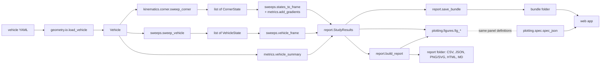

# Sweeps, result tables, reports and figures

This page follows the data from the solver to the files a user opens: sweeps produce
tidy tables, tables feed figures, the report builder and the result bundle. It explains
how each stage works; the physics of the solver is in
[corner kinematics](corner-kinematics.md) and [vehicle kinematics](vehicle-kinematics.md),
and the meaning of every metric column is in [metrics](metrics.md).

## 1. Position in the pipeline



Rules that shape the design (see [conventions](conventions.md)):

- Everything up to and including the tables is in SI (m, rad, N, N/m) and pure: no
  file is written.
- Plotting reads tables only and never calls the solver.
- mm and deg appear only in figures, the HTML/Markdown summary and the CLI summary
  table. CSV and JSON files are always SI.

## 2. Sweeps

A sweep solves the kinematics at many values of one input. All sweeps use
**continuation**: the solution at one point is the starting guess of the next, which is
fast and keeps the solution on the same assembly branch. The sweep starts at the
requested value closest to 0 (the static pose when 0 is in range) and walks outward in
both directions, so the first solve always starts near the design position.

### 2.1 Corner sweeps

`suspkin.kinematics.corner.sweep_corner(corner, travels, rack=0.0)` solves one corner for
an array of wheel travels $z$ [m] at a fixed rack displacement.
`suspkin.kinematics.corner.sweep_rack(corner, racks, travel=0.0)` does the converse: an
array of rack displacements at a fixed travel (a non-zero travel is first reached at
rack 0 from the static pose, then the rack is swept). Both return a
`list[CornerState]`, one state per requested value **in input order**, whatever the walk
order was.

If a step does not converge the step is halved (up to 6 times, so down to 1/64 of the
requested step) before `suspkin.kinematics.rocker.KinematicsError` is raised. A sweep
therefore either returns every point or raises; it never returns partial results.

### 2.2 Vehicle sweeps

`suspkin.sweeps.sweep_vehicle(vehicle, *, heave=, roll=, pitch=, rack=, base=, pivot=)`
sweeps exactly one body input (heave, roll, pitch or steering rack) while `base` sets
the others (default 0), and returns a `list[VehicleState]`. The four corners are solved
together with the body pose; the theory (body rotation about a pivot, tilted ground,
ARB) is in [vehicle kinematics](vehicle-kinematics.md). The continuation logic mirrors
the corner one, with the same halving rule:
`suspkin.sweeps._reach` halves the step *in input space* (all four of
heave/roll/pitch/rack, not only the swept one) up to `_MAX_HALVINGS = 6` times and then
re-raises `KinematicsError`. If even the first (nearest-to-zero) point fails directly, it
is reached from the static pose by the same stepping.

## 3. Result tables

### 3.1 Corner table: `states_to_frame`

`suspkin.sweeps.states_to_frame(states, corner=None, metrics=False)` turns a list of
`CornerState` into a `pandas.DataFrame` with one row per state and a default
`RangeIndex` (`0 .. n-1`, the sweep order). Columns, in this order:

| Group | Columns | Unit |
|---|---|---|
| id | `corner` (`"FL"`, ...) | - |
| scalars | `travel`, `rack`, `theta_uca`, `theta_lca`, `psi`, `rocker_angle`, `coilover_length`, `toggle_margin`, `max_residual` | m, m, rad, rad, rad, rad, m, rad, solver residual |
| spin axis | `spin_x`, `spin_y`, `spin_z` | unit vector |
| every point | `<point>_x`, `_y`, `_z` for each hardpoint of the state (`uca_outer`, `tie_outer`, `wheel_center`, `contact_patch`, ...) | m |
| health | `coilover_in_range` | bool |

With `metrics=True` and a `corner`, the columns of
`suspkin.metrics.table.metrics_frame` are appended (the duplicated `travel`/`rack` are
dropped from the metric block): alignment (`camber`, `toe`, `caster`, `kpi`, ...),
centres (`fvic_y`, `rc_height`, `svic_x`, ...), actuation (`coilover_compression`,
`spring_force`, `wheel_rate` after gradients, ...). Angles are radians, lengths metres.
The meaning of each is in [metrics](metrics.md).

`suspkin.metrics.table.add_gradients(df, x="travel")` adds the derivative columns
`camber_gain`, `bump_steer`, `caster_change`, `track_change_rate`, `rc_migration_rate`
and the motion-ratio family (`mr_spring`, `mr_progression`, `wheel_load_spring`,
`wheel_rate_linear`, `wheel_rate`, `ride_rate`) via `np.gradient`; it needs a strictly
monotonic `x` and at least 3 rows. `suspkin.metrics.table.static_summary(df, x)` is the
corner-level "static summary": every float column interpolated linearly at `x == 0`; it
raises `ValueError` if 0 is outside the sweep range.

### 3.2 Vehicle table: `vehicle_frame`

`suspkin.sweeps.vehicle_frame(states, vehicle)` makes one row per `VehicleState`:

- Inputs: `heave` [m], `roll` [rad], `pitch` [rad], `rack` [m].
- Per corner (prefix `FL_`, `FR_`, `RL_`, `RR_`): all metric columns, e.g. `FL_camber`,
  `FL_toe`, `FL_travel`, `FL_rc_height`, `FL_coilover_compression`. The corner `rack`
  column is dropped because the shared `rack` is stored once. The metrics are
  evaluated from the ground contact point of the state (tilted ground), computed by
  `suspkin.metrics.arrays.corner_arrays(..., contact_patch=cp)`, not from the
  body-vertical lowest point.
- `<id>_cp_x/_y/_z`: contact point in the body frame [m].
- `<id>_camber_ground` [rad]: wheel camber relative to the true ground normal
  (negative = top toward the centreline); `<id>_steer_ground` [rad]: wheel heading in
  the ground plane (ISO yaw sign). Computed in `suspkin.sweeps._ground_arrays` by
  rotating the spin axis with `body_rotation_batch(roll, pitch)`:
  $\text{camber}=-\arcsin(s_z)$, $\text{steer}=\operatorname{atan2}(-o\,s_x,\;o\,s_y)$
  with $o=+1$ left, $-1$ right.
- `rc_front_y/_z`, `rc_rear_y/_z` [m]: roll centre per axle, $y$ in the body frame
  (relative to the car centreline), $z$ height above ground. They come from the
  intersection of the two wheels' roll lines (`_roll_centre_pair_arrays`, a vectorised
  copy of `roll_centre_pair`).
- `arb_front_elastic`, `arb_rear_elastic`: ARB elastic coordinate (rad or m depending
  on the bar type); NaN without an ARB.

### 3.3 Units, index and NaN

- Index: always a fresh `RangeIndex`; the x axis of a study is a column (`travel`,
  `roll`, `heave`, `pitch`, `rack`), not the index.
- Units: SI. Angles in radians even though figures show degrees.
- **NaN means "undefined", never "failed".** A solver failure raises
  `KinematicsError` for the whole sweep. NaN appears where a quantity does not exist:
  an instant centre at infinity (parallel links) or a roll centre of two parallel roll
  lines, and ARB columns without ARB. Plots drop non-finite points as gaps and, on
  panels with `ic=True`, annotate the count as "IC at infinity (n pts dropped)".
- In the CSV exports a NaN is an empty field. The reference vehicle has 31 NaN in each
  of `svic_x`, `svic_z` (the side-view instant centre is at infinity at every point of this design), none in
  `fvic_y`.

## 4. The static summary and the vehicle summary

There are two "static" notions:

1. **Corner static summary**: `static_summary` above, values of a corner table at zero
   travel.
2. **Vehicle summary**: `suspkin.metrics.vehicle.vehicle_summary(vehicle, *, roll_range=0.035,
   n=15, ay_ref=9.81, pivot=None)` returns a `VehicleSummary` (nested `front` and `rear`
   `AxleSummary`, then scalars such as `wheelbase`, `roll_gradient`, `tlltd_front`,
   `anti_dive_front`, `ackermann_5deg`, `turning_radius`). Its flow: a small roll sweep
   ($\pm 0.035$ rad, `n | 1` points so the static pose is included) through
   `sweep_vehicle` and `vehicle_frame`; the roll-slope quantities (`roll_camber`,
   `roll_steer`, `rc_migration`, `rc_height_curvature`) are finite-difference slopes at
   roll 0 of that table; axle stiffnesses, load transfer and anti-features follow from
   statics and a static solve. Each field and its formula is in [metrics](metrics.md).

`VehicleSummary.to_dict()` gives the nested SI dictionary used by `summary.json`, the
bundle and the CLI. Optional or undefined values are `None` (JSON `null`).

## 5. Standard studies: `suspkin.report.studies`

`suspkin.report.studies.run_standard_studies(vehicle, *, travel=0.030, rack=None,
roll_deg=2.0, heave=0.025, pitch_deg=1.5, steps=31)` runs the six standard studies and
returns a frozen `StudyResults`:

| Table | Sweep | Range | Builder |
|---|---|---|---|
| `front_corner` | FL corner travel | $\pm$ `travel` = $\pm$ 30 mm | `sweep_corner` + `states_to_frame(metrics=True)` + `add_gradients` |
| `rear_corner` | RL corner travel | $\pm$ `travel` | same |
| `rack` | steering rack | $\pm$ `rack`, default the full `steering.rack_travel` of the front axle; empty if no steering | `sweep_vehicle(rack=)` + `vehicle_frame`; constants `wheelbase` and `steer_c_factor` added |
| `heave` | body heave | $\pm$ 25 mm | `sweep_vehicle` + `vehicle_frame` |
| `roll` | body roll | $\pm$ 2 deg | same |
| `pitch` | body pitch | $\pm$ 1.5 deg | same |

plus `summary` (a `VehicleSummary`), `vehicle` and `params` (the call arguments).
`steps` must be at least 3; odd values include the static pose. Corner tables use the
left corners (FL, RL) only; the right side is its mirror. `StudyResults.tables()`
returns only the non-empty tables keyed by file stem (`front_corner`, ..., `pitch`);
this is what the CSV export and the bundle write.

## 6. Reports: `suspkin.report.builder`

`suspkin.report.builder.build_report(results, out_dir, *, formats=("png", "svg"),
include_3d=True, vehicle_for_3d=None)` takes a list of `(label, StudyResults)` pairs
(**compare mode**: more than one pair overlays the designs on every axes, one colour per
design) and returns the path of `report.html`.

Behaviour:

- At least one design is required (`ValueError` otherwise). Labels are slugified for
  file names (`[^A-Za-z0-9._-]+` becomes `_`); two labels with the same slug raise
  `ValueError`.
- `data/<design>_<study>.csv`: each non-empty table, pandas default float formatting
  (SI).
- `summary.json`: `{label: summary dict}` via `json_safe` (SI, NaN becomes `null`).
- `bundles/<design>/`: one result bundle per design (section 7).
- `figures/`: every `FIGURE_SET` figure in each requested format (`png`, `svg`, or any
  extension matplotlib supports) at 200 dpi (`save_figure`). The set: corner alignment,
  position, centres and actuation for the front and the rear corner (8 figures),
  `steering` (only if some design has a rack table), `roll`, `heave_pitch`, and one
  `summary_table_<design>` per design.
- With `include_3d=True`: `geometry_3d.png` (static 3D view) and `roll_sweep.gif`
  (9-frame roll sweep $\pm 2$ deg at 8 fps) of `vehicle_for_3d`, default the first
  design. These sections are placed first.
- `report.html`: self-contained (all images base64-embedded as PNG, GIF for the
  animation), meta table (version, date, designs, units), summary comparison table, one
  section per figure. `report.md`: same structure, linking the saved figure files
  (the first written format of each).

The summary comparison table is `_summary_rows`: for each row of
`suspkin.plotting.units.SUMMARY_ROWS` it looks up the value in every design, drops the
row if all are missing, shows `-` for missing/non-finite and otherwise
`format_value(fmt, value * factor)`.

CLI: `suspkin report VEHICLE_YAML --out DIR [--compare YAML ...] [--no-3d]
[--formats png,svg] [--steps 31]`. Designs are labelled by YAML file stem (a numeric
suffix is added on clashes). Failures print `error: ...` and exit non-zero.

## 7. Result bundles: `suspkin.report.bundle`

A bundle is the **data contract** between the Python package and the web app: a
portable, versioned folder of one design's studies.

```text
<bundle>/
    manifest.json      schema, kind, label, suspkin_version, created, source, params
    vehicle.yaml       the vehicle (geometry.io.save_vehicle)
    tables/<study>.csv SI units, floats written as %.17g (lossless), LF line endings
    summary.json       VehicleSummary as nested dict (SI, NaN -> null)
```

- `save_bundle(results, out_dir, *, label, source=None, params=None, overwrite=False,
  created=None)` writes into a sibling temporary folder and then moves it into place, so
  a crash never leaves a half-written bundle. A non-empty `out_dir` raises `BundleError`
  unless `overwrite=True`, and even then only an existing bundle (`is_bundle`) is
  replaced, never an unrelated folder. `created` can be injected for reproducible
  bundles; the default is the current UTC time. Empty studies (rack of a vehicle
  without steering) are not written.
- `is_bundle(path)`: true if the folder has a `manifest.json` whose `kind` is
  `"suspkin-bundle"`.
- `load_bundle(path)` returns a frozen `Bundle(label, manifest, vehicle, tables,
  summary)`. It raises `BundleError` (a `ValueError`) for a non-bundle, a schema other
  than `BUNDLE_SCHEMA` (currently 1), or a missing/malformed file, always naming the
  path. Unknown CSV stems in `tables/` are ignored; empty CSV fields read back as NaN;
  `summary` is the dict with `None` for null.
- `json_safe(obj)`: recursive JSON-safe copy (mappings, lists, tuples, arrays; numpy
  scalars to Python scalars; NaN and inf to `None`).

Manifest of the worked example below:

```json
{
  "schema": 1, "kind": "suspkin-bundle", "label": "fs_reference",
  "suspkin_version": "1.1.0", "created": "2026-11-20T02:03:47+00:00", "source": null,
  "params": {"travel": 0.03, "rack": null, "roll_deg": 2.0, "heave": 0.025,
             "pitch_deg": 1.5, "steps": 31}
}
```

`build_report` passes `source=None`, hence the `null`; `save_bundle` called directly can
record the YAML path there.

## 8. Plotting: `suspkin.plotting`

### 8.1 Matplotlib figures: `plotting.figures`

Every `fig_*` function takes `datasets`, a sequence of `(label, DataFrame)` pairs (colour
= design, N designs overlay) and returns a `matplotlib.figure.Figure` created without
pyplot (never shown, safe in servers). `suspkin.plotting.figures.FIGURE_SET` maps the
group name to the function:

| Key | Function | Input table | Layout columns |
|---|---|---|---|
| `corner_alignment` | `fig_corner_alignment(datasets, axle)` | corner | 3 (camber, toe, caster, KPI, scrub radius, mechanical trail) |
| `corner_position` | `fig_corner_position` | corner | 2 |
| `corner_centres` | `fig_corner_centres` | corner | 3 |
| `actuation` | `fig_actuation` | corner | 3 |
| `steering` | `fig_steering(datasets, *, wheelbase, track, c_factor)` | rack | 2 |
| `roll` | `fig_roll` | roll | 3 |
| `heave_pitch` | `fig_heave_pitch(heave_sets, pitch_sets)` | heave and pitch | 2 |
| `summary_table` | `fig_summary_table(summary, title)` | `VehicleSummary` or dict | table |

**Panel definitions** are module-level data (`_PANELS`, `_ROLL_PANELS`,
`_STEERING_PANELS`, `_HEAVE_PANELS`, `_PITCH_PANELS`): each `_Panel` has a title, a tuple of
`_Series(col, label, kind, side)` and flags (`ic`, `ylabel`). `kind` selects the display
unit from `_KINDS` (`mm` = 1e3, `m`, `deg` = 180/pi, `N`, `N/mm` = 1e-3, `1/mm` = 1e-3,
`pct`, `ratio`, `raw`).

**Panel selection** (`_keep`): a series is drawn if its column exists in at least one
dataset; a panel is drawn if at least one series survives and its x column exists. So
partial tables (for example a rear corner without ARB columns, or a rack table without
`steer_c_factor`) give smaller figures rather than errors. If no panel survives,
`ValueError`. Non-finite values become gaps.

**Steering** is derived in `_steering_frame` from the rack table: steer angle relative to
the static pose (`d_left`, `d_right`), mean steer, the inner/outer angles
(`metrics.vehicle.inner_outer`), `outer` (signed, NaN below 1e-4 rad), Ackermann percent
(`ackermann_percent`, needs wheelbase and track; `wheelbase` and `steer_c_factor` are read
per dataset from the constant columns so designs of different wheelbase overlay
correctly), and the mean steer gain $g=\mathrm{d}\delta/\mathrm{d}\,\text{rack}$. The last
panel is the steering ratio $\frac{2\pi/c}{g}$ ($c$ the `steer_c_factor` in m/rev) when a
`c_factor` is known, else the steer gain in deg/mm.

**Styling** (`plotting.style`): colour encodes the design (`PALETTE`, the Okabe-Ito
colour-blind-safe set, `design_color(i)` wraps around), line style encodes the series
within a panel (`SIDE_LINESTYLES`: solid = left/front, dashed = right/rear, then dotted,
dash-dot). Panel legends appear only with more than one series, a design legend only with
more than one design. `use_style()` applies `RC_PARAMS` through `rc_context` and never
mutates global `rcParams`; `figure_size(preset, rows)` gives inches (`a4_landscape`
10 x 6.5, or $2.3\,\text{rows}+0.6$ in height); `zero_lines` draws the reference lines
through the static pose.

`save_figure(fig, path, formats=("png","svg"), dpi=200)` writes one file per format and
returns the paths.

### 8.2 Declarative figure spec: `plotting.spec`

The same panels are exposed as data so a non-matplotlib renderer (the browser in the
[web app](web-app.md)) can draw identical figures without re-implementing physics. The
spec is built *from* the `figures.py` panel definitions at import time, so the two cannot
drift apart.

`suspkin.plotting.spec.FIGURES` is a tuple of 12 `FigureSpec` (one per figure **and
study**): `corner_alignment_front/_rear`, `corner_position_*`, `corner_centres_*`,
`actuation_*`, `steering`, `roll`, `heave_pitch_heave`, `heave_pitch_pitch`. Each has an
x `Axis`, `columns`, and `Panel`s of `Series`. Display factor and unit are resolved from
the quantity's dimension (`suspkin.units`, via `suspkin.optimize.registry`); where
`figures.py` shows a series in another unit (for example FVIC in m) the series carries a
`display` override.

`suspkin.plotting.spec.spec_json()` returns the JSON dict served at `/api/v1/figures` and
embedded in snapshots (`SPEC_SCHEMA = 1`): `schema`, `palette`, `linestyles`, `figures[]`
(id, group, title, study, columns, x axis, panels with series, `factor`, `unit`, `ic`,
`requires`, `alternative_to`) and `summary_rows[]` (label, path, dim, factor, unit,
`decimals`). The dimensionless unit is normalised to `""`.

`suspkin.plotting.spec.derived_columns(study, df)` returns a copy of the `rack` table with
the extra curve columns `d_left`, `d_right`, `outer`, `ackermann`, `ratio` (other studies
unchanged), using `figures._steering_frame`. The web app calls it when loading
datasets (`suspkin.app.datasets`) and serves the spec through `suspkin.app.routes`; the
renderer then overlays N bundles on each panel. The renderer rules (palette per dataset,
line style per series, legends, panel selection by columns present, gaps for
non-finite values) are listed in the `suspkin.plotting.spec` module docstring.

Two points to be aware of: the steering figure's last panel is encoded in the spec as two
panels (`steering_ratio` with `requires=("ratio",)` and `steer_gain` with
`alternative_to="steering_ratio"`), which a spec renderer must resolve; `figures.py`
does the same choice inside `fig_steering` rather than through those fields.

### 8.3 Display units: `plotting.units`

`suspkin.plotting.units.SUMMARY_ROWS` is a tuple of `(label, path, factor, unit, fmt)`
for the 31 rows of the vehicle summary, for example
`("Front roll stiffness", ("front", "roll_stiffness"), pi/180, "N m/deg", "{:.0f}")`:
the displayed value is `summary[path] * factor` formatted with `fmt`. It is the single
source for the summary-table figure, the report comparison table and the spec
`summary_rows`. `suspkin.plotting.units.VEHICLE_CLI_UNITS` maps a summary leaf name to
`(scale, unit)` for the `suspkin vehicle` command; it keeps its own unit spellings
(`N*m/deg`) and extra fields (`rc_migration`, `load_transfer_front`, ...) because that CLI
output is a locked contract. `suspkin.plotting.units.format_value(fmt, value)` formats
and removes a negative zero (`-0.0` is shown as `0.0`).

### 8.4 3D views

All three views consume one pure scene builder,
`suspkin.plotting.geometry3d.vehicle_segments(vehicle, state=None)`, which turns the
vehicle (static, or at a solved `VehicleState`) into a `VehicleScene` of segments by
group (`GROUP_COLORS`: wishbones, tie rod, upright, pushrod, rocker, coilover, ARB,
wheel), wheel circles and markers. The body frame stays fixed; with a state the ground
plane is drawn tilted through the contact points.

- `plotting.geometry3d.plot_vehicle_3d(vehicle, ax=None, *, state=None,
  show_labels=False)` returns a matplotlib `Figure`.
- `plotting.animation.animate_sweep(vehicle, states, path, *, fps=15, view=(22, -60))`
  writes a `.gif` (Pillow) or `.mp4` (needs ffmpeg on PATH; `RuntimeError` otherwise)
  with limits fixed over the whole sweep. Empty `states` or another suffix raise
  `ValueError`.
- `plotting.interactive.interactive_view(vehicle, state=None, path="vehicle_3d.html", *,
  inline=False)` writes a plotly HTML; `interactive_figure` returns the plotly `Figure`.
  plotly is the optional `viz` extra; without it an `ImportError` explains how to
  install it. `inline=True` embeds plotly.js (about 4 MB) for offline use, otherwise it
  loads from a CDN.

The report uses only the matplotlib view and the GIF; `--no-3d` /
`include_3d=False` skips them (for speed and when matplotlib 3D or Pillow is
unavailable).

## 9. Worked example

```text
python -m uv run suspkin report configs/vehicles/fs_reference.yaml --out <tmp>/rep
```

It prints the path of `report.html` and takes about 11 s (including 3D and the GIF).
Produced files (6.9 MB):

```text
rep/
  report.html  report.md  summary.json
  data/        fs_reference_{front_corner,rear_corner,rack,heave,roll,pitch}.csv
  figures/     {corner_alignment,corner_position,corner_centres,actuation}_{front,rear}.{png,svg}
               steering, roll, heave_pitch, summary_table_fs_reference  (.png, .svg)
               geometry_3d.png  roll_sweep.gif
  bundles/fs_reference/
               manifest.json  vehicle.yaml  summary.json  tables/*.csv (same six)
```

Table shapes: `front_corner` 31 x 107, `rack` 31 x 172, `roll`/`heave`/`pitch` 31 x 170.
Excerpt of `data/fs_reference_front_corner.csv` at the first, middle (static) and last
row (SI):

```text
 corner  travel  rack    camber           toe  rc_height  coilover_length  coilover_in_range  max_residual
 FL      -0.03   0.0  -0.009962  -3.382645e-03   0.044158         0.228589               True  1.1e-16
 FL       0.00   0.0  -0.017453   6.352854e-18   0.033721         0.200000               True  0.0
 FL       0.03   0.0  -0.028301  -3.245540e-03   0.023929         0.170224               True  8.3e-17
```

The static camber is $-0.017453$ rad $=-1.00^{\circ}$, the static roll-centre height is
33.7 mm, and the coilover shortens as the wheel moves up (bump) as expected. Excerpt of
`roll.csv` (roll $\pm 0.0349$ rad $=\pm 2^{\circ}$):

```text
 roll       FL_travel  FL_camber_ground  rc_front_y   rc_front_z  arb_front_elastic
 -0.034907   0.021257    0.010125        -0.130022    0.032536     0.447574
  0.000000   0.000000   -0.017453         0.0         0.033721     0.0
  0.034907  -0.021532   -0.046649         0.130022    0.032536    -0.447574
```

Negative roll (left side of the body down; positive roll is left up) puts the FL wheel in
bump (+21.3 mm relative to the body), and the roll centre shifts to $-130$ mm in y. `steer_c_factor` is 0.09 m/rev and `wheelbase` 1.55 m in
every `rack.csv` row. The bundle manifest is shown in section 7; `spec_json()` for this
version holds 12 figures and 31 summary rows, and `derived_columns("rack", df)` adds
`d_left`, `d_right`, `outer`, `ackermann`, `ratio`.

Compare mode: `suspkin report a.yaml --compare b.yaml --out DIR` overlays both designs,
adds a column per design to the summary table and one `summary_table_<label>` figure per
design.

## 10. Edge cases and failure modes

- Sweep does not converge after 6 halvings: `KinematicsError`; the CLI prints
  `error: ...` and nothing is written (the report is built only after all studies ran).
- Vehicle without steering: `rack` table is empty, so there is no `rack.csv`, no
  steering figure, and the bundle has no `tables/rack.csv`.
- `steps < 3`: `ValueError`. Strictly monotonic x is required for gradients.
- Duplicate design labels (or labels that slugify identically): `ValueError`.
- Bundle folder exists and is non-empty: `BundleError` unless `overwrite=True` and it is
  already a bundle. `build_report` passes `overwrite=True` for `bundles/<design>/`.
- Missing columns degrade figures gracefully (panels omitted); NaN becomes gaps.
- Figures without any usable panel raise `ValueError`.

## 11. Where it is tested

Under `tests/unit/`: `test_corner_sweeps.py` and `test_vehicle_sweeps.py` (sweeps and
tables), `test_report.py` (report builder), `test_bundle.py` (bundle round trip, overwrite
refusal), `test_figures.py` (panel selection, figure content), `test_spec.py` (spec
against `figures.py`), `test_geometry3d.py`, `test_animation.py`, `test_interactive.py`
(3D views). Regression: `tests/regression/test_reference_vehicle_sweeps.py` and
`tests/regression/test_golden.py`.

## See also

- [Metrics](metrics.md): meaning, sign and formula of every table column.
- [Vehicle kinematics](vehicle-kinematics.md): heave, roll, pitch, rack and the ARB behind
  the vehicle sweeps.
- [Corner kinematics](corner-kinematics.md): the solver and the continuation it shares.
- [Web app](web-app.md): consumes bundles and `spec_json()`.
