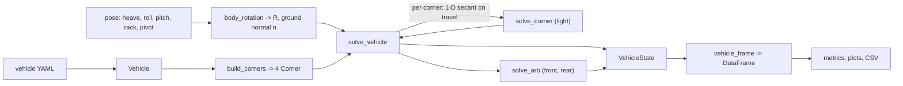

# Vehicle kinematics: body poses and the anti-roll bar

This page explains how `suspkin` goes from one corner to the whole car. The corner solver
([Corner kinematics](corner-kinematics.md)) answers "given a wheel travel (and a rack
position), where is every hardpoint?". The vehicle layer answers the question a driver or
a setup engineer actually asks: "given that the *chassis* has heaved, rolled, pitched
and/or been steered, what travel does each of the four wheels see, and how far is each
anti-roll bar twisted?".

Modules covered:

| Module | Role |
|---|---|
| `suspkin.geometry.vectors` (`body_rotation`, `body_rotation_batch`) | rotation of the chassis |
| `suspkin.kinematics.vehicle` | `solve_vehicle`, `VehicleState`, ground contact per wheel |
| `suspkin.kinematics.arb` | `solve_arb`, `arb_stiffness`, `arb_energy`, `ArbState` |
| `suspkin.metrics.arb` | `arb_metrics`, `arb_rates` (motion ratios, wheel rates) |
| `suspkin.sweeps` | `sweep_vehicle`, `vehicle_frame` (vehicle sweeps and their table) |

Frame, units and signs are those of [Conventions](conventions.md): ISO 8855 (x forward,
y left, z up), SI units internally (m, rad, N, N/m), origin on the ground below the
middle of the front axle. Hardpoint definitions are in [Vehicle model](vehicle-model.md);
the columns written by `vehicle_frame` are defined in [Metrics](metrics.md).

## 1. Position in the pipeline



`solve_vehicle` solves **one pose**. `sweep_vehicle` calls it repeatedly with continuation
(each solution is the starting guess of its neighbour) and returns a list of
`VehicleState`. `vehicle_frame` turns that list into a tidy table.

## 2. Theory

### 2.1 Rigid chassis over fixed ground

In reality the chassis is pushed around and the ground stays where it is. The model keeps
exactly that picture and prescribes the **chassis pose relative to the ground**; the four
wheels stay on the ground, and each suspension corner has to find the wheel travel that
lets this happen. This is *kinematic* (geometric): no forces, no tyre deflection, no
compliance. Every wheel is assumed to keep contact with the (flat) ground, so wheel lift
is not modelled.

The pose has four inputs:

| Input | Symbol | Unit | Sign (ISO 8855) | Applies to |
|---|---|---|---|---|
| `heave` | $h$ | m | positive = body **up** (so wheels droop, travel $<0$) | all corners |
| `roll` | $\varphi$ | rad | right-hand rotation about $+x$; positive lifts the $+y$ (**left**) side | all corners |
| `pitch` | $\theta$ | rad | right-hand rotation about $+y$; positive = nose **down** | all corners |
| `rack` | $r$ | m | rack displacement along the rack axis | **front corners only** |

Heave is a vertical rigid translation. Roll and pitch are rigid rotations of the body about
a **pivot** point (section 2.3). Rack is not a body motion: it is the steering input, passed
straight to the front corner solvers; rear corners always get `rack = 0`.

Wheel travel $z$ (corner solver convention, see [Conventions](conventions.md)) is positive
in bump (wheel moves up relative to the body). A body that rises by $h$ above fixed wheels
therefore sees travel $z \approx -h$ at every wheel. In roll, the lifted side droops
(travel $<0$), the other side bumps; in pitch (nose down), the front bumps and the rear
droops.

### 2.2 Rotation and order

A body point $\mathbf{x}_b$ maps to the world as

$$
\mathbf{x}_w = \mathbf{R}\,(\mathbf{x}_b - \mathbf{p}) + \mathbf{p} + h\,\mathbf{e}_z,
\qquad
\mathbf{R} = \mathbf{R}_y(\theta)\,\mathbf{R}_x(\varphi),
$$

with pivot $\mathbf{p}$. `suspkin.geometry.vectors.body_rotation(roll, pitch)` returns
$\mathbf{R}$ as a $3\times3$ matrix built from `axis_angle_matrix` (Rodrigues'
formula, right-hand rule). `body_rotation_batch(roll, pitch)` does the same for arrays of
shape `(N,)` and returns `(N, 3, 3)`; it is used by the vectorised ground-frame columns
of `vehicle_frame`.

The **order** is: roll first (about $x$), then pitch about the fixed $y$ axis. The product
is not commutative, so a combined roll and pitch is not the same as the other order; for
the small angles of a race car (a few degrees) the difference is second order. Written
out,

$$
\mathbf{R}_x(\varphi)=\begin{pmatrix}1&0&0\\0&\cos\varphi&-\sin\varphi\\0&\sin\varphi&\cos\varphi\end{pmatrix},\quad
\mathbf{R}_y(\theta)=\begin{pmatrix}\cos\theta&0&\sin\theta\\0&1&0\\-\sin\theta&0&\cos\theta\end{pmatrix}.
$$

Check of the signs: $\mathbf{R}_y(\theta)$ sends a point on $+x$ (the nose) to
$(\cos\theta,0,-\sin\theta)$, i.e. downward for $\theta>0$ (nose down). $\mathbf{R}_x(\varphi)$
sends a point on $+y$ (left) to $(0,\cos\varphi,\sin\varphi)$, i.e. upward for $\varphi>0$
(left side up).

### 2.3 Pivot choice

Roll and pitch rotate about the pivot $\mathbf{p}$. The default is the vehicle CG,
`suspkin.kinematics.vehicle.cg_pivot`:

$$
\mathbf{p}_\text{CG} = \bigl(-a,\; 0,\; h_\text{cg}\bigr),
\qquad a = L\,(1-f_f),
$$

with wheelbase $L$ and front static mass fraction $f_f$ (`front_mass_ratio`);
$a$ is the distance of the CG behind the front axle (x is negative rearward of the origin).
For `fs_reference`: $L=1.550$ m, $f_f=0.47$, $h_\text{cg}=0.28$ m, so
$\mathbf{p}=(-0.8215, 0, 0.28)$ m.

Why this matters: the ground is an infinite flat plane, so only the **height** of each body
point above it matters. The height offset of section 3.1 is $o=p_z-\mathbf{n}\cdot\mathbf{p}+h$:
for pure roll ($n_x=0$, $n_y=\sin\varphi$, $n_z=\cos\varphi$) it is
$o=h+p_z(1-\cos\varphi)-p_y\sin\varphi$. The pivot x position is irrelevant in pure roll.
Lowering the pivot from the CG to the ground adds a small heave (0.17 mm for $2^\circ$,
see the worked example). A lateral offset $p_y$ acts as a heave of $-p_y\sin\varphi$, which is
a left/right asymmetry: at $2^\circ$ roll a pivot at $(0,\,0.2,\,0.28)$ m gives front travels
$-14.576$ / $+28.224$ mm (FL/FR) instead of $-21.532$ / $+21.257$ mm, and rear
$-13.930$ / $+27.564$ mm instead of $-20.878$ / $+20.607$ mm. For pitch the pivot x position enters through $n_x=-\sin\theta$. Another pivot (for example a
point on the roll axis) can be given with `pivot=` (Python) or `--pivot X Y Z` (CLI, mm).

### 2.4 Small versus large angles

The code uses **finite rotations**: no small-angle approximation anywhere in the
ground-contact solve. This costs nothing and matters in two places:

* The ground normal in the body frame is $\mathbf{n} = \mathbf{R}^{\mathsf T}\mathbf{e}_z$, the
  third row of $\mathbf{R}$:

$$
\mathbf{n} = \bigl(-\sin\theta,\;\; \cos\theta\sin\varphi,\;\; \cos\theta\cos\varphi\bigr).
$$

  For $\varphi=2^\circ,\theta=0$ the code gives $\mathbf{n}=(0,\,0.0348995,\,0.9993908)$, which is exactly this.
* The wheel is kept on the ground along $-\mathbf{n}$, so the contact point slides around
  the tyre as the body tilts (section 3.2).

The small-angle intuition still helps to sanity-check results: for pure roll the front
wheel travel is about $\pm\frac{t}{2}\varphi$ (half track times roll angle), for pure pitch
it is about $\mp$ (distance from pivot to axle)$\cdot\theta$. The solved values differ from
these by the real, non-linear kinematics (section 7.1).

## 3. How the code does it: `solve_vehicle`

Signature (keyword-only pose arguments):

```python
solve_vehicle(vehicle, corners=None, *, heave=0.0, roll=0.0, pitch=0.0, rack=0.0,
              pivot=None, guess=None) -> VehicleState
```

`corners` is the output of `build_corners(vehicle)` (built on demand if omitted). `guess` is
a neighbouring `VehicleState` for continuation. Heave and rack in m, roll and pitch in rad.

### 3.1 Algorithm

1. Pivot: `pv = cg_pivot(vehicle)` if `pivot is None` else the given 3-vector.
2. $\mathbf{R}$ = `body_rotation(roll, pitch)`, ground normal in the body frame
   $\mathbf{n}=\mathbf{R}^{\mathsf T}\mathbf{e}_z$.
3. Height offset $o = p_z - \mathbf{n}\cdot\mathbf{p} + h$. With it the world height of any
   body-frame point $\mathbf{x}_b$ is

$$
z_w(\mathbf{x}_b) = \mathbf{n}\cdot\mathbf{x}_b + o ,
$$

   which follows from $z_w=\mathbf{e}_z\cdot\mathbf{x}_w$ and $\mathbf{e}_z\cdot\mathbf{R}=\mathbf{n}\cdot$.
   This is the point of working in the body frame: the corner solver never has to rotate
   anything; the **ground** is what is expressed in the body frame.
4. For each corner in the fixed order FL, FR, RL, RR: solve the corner for the travel that
   puts the tyre on the ground (section 3.2). Rack is passed as `rack` for front corners and
   `0.0` for rear corners.
5. For each axle that has an ARB, solve the bar from the two solved corner states with
   `solve_arb` (section 4). Axles without an ARB store `None`.
6. Collect everything into the frozen dataclass `VehicleState`.

### 3.2 Ground contact of one wheel

The tyre is modelled as a circle of radius $R_t$ (`tyre_radius`) in the wheel plane, centred
at the wheel centre $\mathbf{c}$, with unit spin axis $\mathbf{s}$ (`spin_axis`). The contact
point is the point of that circle that is lowest along $-\mathbf{n}$, i.e. the circle point
furthest in direction $-\mathbf{n}$. That is the projection of $\mathbf{n}$ onto the wheel
plane, normalised:

$$
\mathbf{u} = \mathbf{n} - (\mathbf{n}\cdot\mathbf{s})\,\mathbf{s},
\qquad
\mathbf{c}_p = \mathbf{c} - R_t\,\frac{\mathbf{u}}{\lVert\mathbf{u}\rVert}.
$$

(`suspkin.kinematics.vehicle.contact_point`.) This is a rigid circle on a plane (no tyre
deflection, no finite patch). With a tilted body or a cambered wheel the contact point
moves sideways around the tyre; this is why `FL_cp_*` columns are provided in the table.

**Static reference.** The ground height under wheel $k$ is **not** simply 0. It is the
height of that wheel's *static* contact point,
`_static_contact(...)`, evaluated at static camber and toe with the same formula:

$$
z_{\text{static},k} = \bigl[\mathbf{c}_{0} - R_t\,\mathbf{u}_0/\lVert\mathbf{u}_0\rVert\bigr]_z,
\qquad \mathbf{u}_0 = \mathbf{e}_z - s_z\mathbf{s}_0 .
$$

Using the wheel's own static value guarantees that the static pose (all inputs 0) has
travel exactly 0, even if the hardpoint set puts the static contact point a few
micrometres off $z=0$ (a camber-dependent effect; for `fs_reference` it is 35 $\mu$m,
visible in the first worked example as `FL_cp_z`).

**Equation per corner.** Find the travel $t$ such that

$$
g(t) = \mathbf{n}\cdot\mathbf{c}_p(t) + o - z_{\text{static},k} = 0 ,
$$

where $\mathbf{c}_p(t)$ is the contact point of the solved corner at travel $t$.

**Solver** (`_solve_corner_ground`): a 1-D secant iteration on $t$.

* Start value: with a `guess` the guess's travel; otherwise the linearisation
  $t = -g_0/n_z$, where $g_0$ is $g$ evaluated at the static contact point.
* First slope: $n_z$ (the derivative if the contact point moved purely vertically with the
  wheel). If a neighbouring pose supplies its converged slope and it is within a factor
  0.5 to 2 of $n_z$, that is used instead.
* Each iterate solves the corner for the new travel (`_solve_light`, no point table) warm
  started from the previous iterate. Secant slope $=\Delta g/\Delta t$, falling back to
  $n_z$ if $|\Delta t|\le10^{-15}$ or $|\Delta g|\le10^{-18}$.
* Shortcut: if the `guess` already has the requested rack and `guess.max_residual < 1e-12`
  (`_NEWTON_F_TOL`), it is reused instead of re-solving the corner at its own travel.
* Converged when $|g| < 10^{-11}$ m (`_G_TOL`); at most 30 iterations (`_MAX_ITER`). Only the
  converged iterate is turned into a full `CornerState`.
* Failure: `KinematicsError` if $|t|>0.25$ m (`_MAX_TRAVEL`, "wheel cannot reach the
  ground") or if 30 iterations do not converge. Corner-level failures (link geometry
  cannot be closed) also surface as `KinematicsError`.
* If numba is available and a `guess` is given, a compiled version of the same iteration is
  tried first; any failure falls back to the Python path from the same inputs. The results
  agree to solver tolerance (see [Corner kinematics](corner-kinematics.md) for the fast path).

### 3.3 `VehicleState`

Frozen dataclass; lengths in m, angles in rad, **body frame**.

| Field | Type | Meaning |
|---|---|---|
| `heave`, `roll`, `pitch`, `rack` | float | the prescribed pose, echoed back |
| `corners` | `dict[CornerId, CornerState]` | keys `"FL","FR","RL","RR"`; each carries `travel`, points, spin axis, etc. |
| `contact_points` | `dict[CornerId, ndarray(3)]` | tyre contact point per wheel, body frame (read-only arrays) |
| `ground_normal` | `ndarray(3)` | $\mathbf{n}=\mathbf{R}^{\mathsf T}\mathbf{e}_z$ (read-only) |
| `arb` | `dict[str, ArbState or None]` | keys `"front"`, `"rear"`; `None` if the axle has no ARB |
| `max_residual` | float | worst of: corner residuals, ground residual $|g|$, ARB residual |
| `pivot` | `ndarray(3)` | pivot actually used |

A private field carries the converged secant slopes per corner as a warm start for the next
pose.

## 4. Anti-roll bar

### 4.1 Physical picture

An ARB couples the two wheels of an axle so that they must move *differently* (roll, or one
wheel hitting a bump) before the bar stores energy, while equal motion (heave) leaves it
unstressed. In the model the **static pose (travel 0) is the stress-free state**: elastic
coordinate $q=0$.

Each side has a **drop link** (a rigid two-ball-joint rod) from the rocker point
`rocker_arb` (a hardpoint on the rocker) to the end of the bar arm, `arm_end`. The drop
link has fixed length $\ell$ = static distance between these two points (for the right side,
`right_overrides["rocker_arb"]` is honoured if present, `_drop_length`). As a wheel moves,
the rocker moves `rocker_arb` and the drop link forces the bar arm to follow. Three bar types exist
(configured by the `arb.type` YAML field, see [Vehicle model](vehicle-model.md)):

* `torsional`: torsion tube along `bar_axis` through `bar_pivot` with two stiff arms (round
  solid arms of optional bending compliance `arm_diameter`).
* `blade`: same tube, but the arms are flat blades (width, thickness, orientation
  `blade_angle`): `0` = flat, bends about the thin direction (soft), $\pi/2$ = edge-on (stiff).
* `beam`: a transverse beam with a central vertical slider on the centreline and two
  cantilevered halves; the drop links lift the beam ends.

All hardpoints in the YAML are given for the **left** side; the right side is the $y$-mirror
(`mirror_y`).

### 4.2 Kinematics: `solve_arb`

```python
solve_arb(axle_cfg, left, right, *, guess=None) -> ArbState
```

`left`, `right` are the solved `CornerState` of the axle; `points["rocker_arb"]` drives the
drop links. `guess` is a neighbouring `ArbState` used to select the correct branch of a
two-valued solution. `ArbState` fields: `type`, `beta_left`, `beta_right` [rad], `heave` [m],
`elastic` ([rad] twist or [m] deflection), `arm_end_left`, `arm_end_right`, `max_residual`
[m] (worst drop-link length error).

**Torsional and blade bars.** Each arm rotates rigidly about the bar axis line (through
`bar_pivot`, direction `bar_axis`) by an angle $\beta$ chosen so that the drop link keeps its
length $\ell$. Let the arm tip rotated by angle $\vartheta$ be

$$
\mathbf{e}(\vartheta)=\mathbf{p}_b + f\,\mathbf{a} + \mathbf{w}\cos\vartheta + (\mathbf{a}\times\mathbf{w})\sin\vartheta,
$$

with bar axis unit vector $\mathbf{a}$, $f=\mathbf{a}\cdot(\mathbf{e}_0-\mathbf{p}_b)$ and
$\mathbf{w}$ the component of $\mathbf{e}_0-\mathbf{p}_b$ perpendicular to the axis. The
condition $\lVert\mathbf{r}-\mathbf{e}(\vartheta)\rVert=\ell$ with $\mathbf{r}$ the rocker
point, expanded, is a sinusoid

$$
A\cos\vartheta + B\sin\vartheta = C,
\quad
A=\mathbf{r}'\cdot\mathbf{w},\;
B=\mathbf{r}'\cdot(\mathbf{a}\times\mathbf{w}),\;
C=\tfrac12\bigl(\lVert\mathbf{r}'\rVert^2+\lVert\mathbf{w}\rVert^2-\ell^2\bigr),
$$

where $\mathbf{r}'=(\mathbf{r}-\mathbf{p}_b)-f\mathbf{a}$. It has the closed-form solutions

$$
\vartheta=\operatorname{atan2}(B,A)\pm\arccos\!\bigl(C/\sqrt{A^2+B^2}\bigr)
$$

(`_circle_angle`). Of the two roots the one nearest to the guess (modulo $2\pi$) is taken,
so the continuation never jumps to the other circle intersection. Failure (the drop link
cannot reach the arm's circle: $\sqrt{A^2+B^2}<10^{-12}$ or $|C|>\sqrt{A^2+B^2}(1+10^{-12})$)
raises `KinematicsError`.

For the right side the arm tip, pivot and axis are mirrored and the solve is repeated. The
reported angles follow the **rocker convention**: physical rotation $=\text{side sign}\times\beta$
about the stored (side-mirrored) axis, so a symmetric heave gives $\beta_L=\beta_R$. The
elastic coordinate is the **twist**

$$
q = \beta_L - \beta_R \quad[\text{rad}],
$$

zero in pure heave and non-zero when the two wheels move differently. (The sign of $q$ is
whatever the geometry gives: with `fs_reference` and positive roll, left up, $q<0$.)

**Beam bar.** The beam ends move **vertically only** (small deflection of the bending
beam). Left end: $\mathbf{e}_{0}+(c+\delta)\mathbf{e}_z$; right end: mirrored $\mathbf{e}_{0}+(c-\delta)\mathbf{e}_z$.
For each side, with $\mathbf{d}=\mathbf{r}-\mathbf{e}_0$ and drop link length $\ell$, the
vertical offset $e$ solves $d_x^2+d_y^2+(d_z-e)^2=\ell^2$:

$$
e=d_z\pm\sqrt{\ell^2-d_x^2-d_y^2},
$$

(nearest to the guess; no real root raises `KinematicsError`). Then the heave of the central
slider is $c=\tfrac12(e_L+e_R)$ [m] and the elastic coordinate is the deflection
$\delta=\tfrac12(e_L-e_R)$ [m]. `ArbState.heave` is $c$; `beta_*` are 0.

**Acceptance.** After the solve the residual is $\max_{\text{sides}}\bigl|\lVert\mathbf{r}-\mathbf{e}\rVert-\ell\bigr|$.
If it exceeds `_TOL` $=10^{-9}$ m, `KinematicsError` is raised. A corner state without a
`rocker_arb` point also raises. Calling it on an axle with `arb=None` raises `ValueError`.

### 4.3 Stiffness: `arb_stiffness`

The elastic coordinate $q$ stores energy $E=\tfrac12 k q^2$. `arb_stiffness(axle_cfg)` returns
$k$: N m/rad for twist bars, N/m for the beam. `arb_energy(axle_cfg, arb_state)` returns
$E=\tfrac12 k q^2$ [J].

**Torsional.** The tube and the two arms are in series (same torque $T$, twist angles add):

$$
\frac{1}{k}=\frac{L_b}{G J}+\frac{2\,r}{3\,E_a I_a},
\qquad J=\frac{\pi}{32}\bigl(D^4-d^4\bigr),
\qquad I_a=\frac{\pi d_a^4}{64}.
$$

* $L_b$ = `bar_length` (m), $D,d$ = tube outer/inner diameter, $G$ = `shear_modulus`.
* $r$ = arm length: distance from `arm_end` to the bar axis line (`arm_length`).
* Each arm is a cantilever of length $r$ with tip stiffness $3E_aI_a/r^3$; a torque $T$ is a
  tip force $T/r$, tip deflection $T r^2/(3E_aI_a)$, twist contribution $T r/(3E_aI_a)$.
  Two arms give the factor 2.
* If `arm_diameter` is `None` the arms are rigid and the second term is omitted.

**Blade.** Same equation, with the arm second moment of area of a rectangle of width $w$
and thickness $t_b$ loaded along a direction tilted by `blade_angle` $\alpha$ from the flat
direction:

$$
I_\text{eff}=\frac{1}{\dfrac{\cos^2\alpha}{I_\text{flat}}+\dfrac{\sin^2\alpha}{I_\text{edge}}},
\quad I_\text{flat}=\frac{w\,t_b^3}{12},\;
I_\text{edge}=\frac{t_b\,w^3}{12}.
$$

This harmonic (compliance) combination is exact at $\alpha=0$ (flat, soft) and
$\alpha=\pi/2$ (edge-on, stiff): the tip force is along the load direction, the lateral
deflection is free. Young's modulus: `blade_youngs_modulus`.

**Beam.** Each half is a cantilever of length $a$ (projection of `arm_end - beam_center` on
`beam_axis`) with tip stiffness $k_\text{end}=3EI/a^3$; both ends deflect by $\pm\delta$, so
$E=2\cdot\tfrac12 k_\text{end}\delta^2$ and

$$
k = 2k_\text{end}=\frac{6\,E\,I}{a^3}\quad[\text{N/m}].
$$

All of this is a lumped, linear-elastic model: no stress limits, no tube-end effects, no
bearing friction, and the stiffness is independent of pose.

### 4.4 ARB metrics: `suspkin.metrics.arb`

**Per pose: `arb_metrics(axle_cfg, left, right, static_arb)`** solves the bar (using the
static bar state as the root-branch guess) and returns a dict of floats:

| Key | Meaning | Unit |
|---|---|---|
| `arb_elastic` | $q$: twist (tube/blade) or deflection (beam) | rad or m |
| `arb_beta_left`, `arb_beta_right` | arm angles (0 for beam) | rad |
| `arb_heave` | beam slider heave $c$ (0 for tube/blade) | m |
| `arb_energy` | $\tfrac12 k q^2$ | J |
| `arb_residual` | drop-link length error | m |
| `drop_link_angle_left`, `drop_link_angle_right` | angle between the drop link and vertical, $\arccos(|\Delta z|/\lVert\Delta\mathbf{x}\rVert)$ | rad |

The drop-link angle matters because an inclined link transmits less vertical force and
introduces a progressive motion ratio.
**Rates: `arb_rates(corner_left, corner_right, axle_cfg, travel=0.0, h=1e-5)`** returns the
frozen dataclass `ArbRates`. It differentiates $q$ with respect to wheel travel $z$ by
central differences with step $h=10^{-5}$ m around `travel`, solving the **corner**
(`solve_corner`) at the given travels (this is a corner-travel quantity, not a body pose):

$$
\text{MR}_\text{roll}=\frac{q(z+h,\,z-h)-q(z-h,\,z+h)}{2h},
\quad
\text{MR}_\text{single}=\frac{q(z+h,\,z)-q(z-h,\,z)}{2h},
$$

$$
\text{heave coupling}=\frac{q(z+h,z+h)-q(z-h,z-h)}{2h}.
$$

($q(z_L,z_R)$: bar elastic coordinate for left travel $z_L$ and right travel $z_R$.) Units
rad/m for twist bars, m/m for beams. By **virtual work** with $E=\tfrac12kq^2$:

* Roll mode (left $+z$, right $-z$, equal and opposite wheel forces $F$): $q=\text{MR}_\text{roll}\,z$,
  $2F\,\mathrm dz=\mathrm dE$, so $F=\tfrac12\,\mathrm dE/\mathrm dz$ and the per-wheel rate
  is

$$
k_{w,\text{roll}}=\tfrac12\,k\,\text{MR}_\text{roll}^2 \quad[\text{N/m}].
$$

* Single-wheel mode (left $+z$, right fixed): $F=\mathrm dE/\mathrm dz$ and
  $k_{w,\text{single}}=k\,\text{MR}_\text{single}^2$.

The term $q\,\mathrm d^2q/\mathrm dz^2$ (motion ratio progression) is neglected: it vanishes
where $q=0$, which holds at the static pose and in any pure-heave pose, which is where
`arb_rates` is evaluated (the default `travel=0`).

Fields: `stiffness`, `motion_ratio_roll`, `motion_ratio_single`, `wheel_rate_roll`,
`wheel_rate_single`, `heave_coupling`. In a symmetric heave configuration `heave_coupling`
is zero.

**Roll stiffness link.** `suspkin.metrics.vehicle._axle_static` takes
`arb_rates(...).wheel_rate_roll` and forms the axle roll stiffness from the bar as

$$
K_{\varphi,\text{ARB}} = k_{w,\text{roll}}\,\frac{t^2}{2}\quad[\text{N m/rad}],
$$

($t$ = axle track), the same expression used for springs and tyres (see
[Metrics](metrics.md#roll-stiffness)). This is how the ARB "resists roll": in roll the two
wheels move by $\pm z$ with $z\approx\varphi t/2$, the bar twists, and the wheel forces $F=k_w z$
produce a restoring moment $F t$ about the roll axis.

## 5. Vehicle sweeps: `suspkin.sweeps`

```python
sweep_vehicle(vehicle, *, heave=None, roll=None, pitch=None, rack=None,
              base=None, pivot=None) -> list[VehicleState]
vehicle_frame(states, vehicle) -> pandas.DataFrame
```

**`sweep_vehicle`** sweeps **exactly one** of heave, roll, pitch, rack (an array; otherwise
`ValueError`). `base` is a mapping with keys from `{"heave","roll","pitch","rack"}` giving
the fixed value of the others (default 0; unknown keys raise `ValueError`). `pivot` is passed to every
`solve_vehicle` call.

* Continuation starts at the sweep value nearest 0 and walks outward in both directions;
  every solve uses the previous `VehicleState` as `guess`. Results are returned in the
  input order.
* If a step fails with `KinematicsError`, the step is **halved in input space** (the midpoint
  of all four inputs between the previous state and the target), recursively up to 6 times
  (`_MAX_HALVINGS`); only then is the error re-raised. The start solve falls back to the
  static pose first, then walks to the start value the same way.
* Arrays and ranges are in SI (m, rad). The unit conversion is done by the **CLI**.

**`vehicle_frame`** produces one row per state (SI): `heave, roll, pitch, rack`; for every
corner id (`FL_`, `FR_`, `RL_`, `RR_`) the corner metric columns (`FL_travel`, and so on,
with the corner `rack` column dropped in favour of the shared `rack`); `<id>_cp_x/_y/_z`;
`<id>_camber_ground`, `<id>_steer_ground`; `rc_front_y/_z`, `rc_rear_y/_z`;
`arb_front_elastic`, `arb_rear_elastic` (NaN without an ARB). Per-corner metrics are computed
with the **ground contact point of the state**, not the body-vertical lowest point (the
distinction matters for a tilted ground). The columns added in the ground frame:

* `camber_ground`: $-\arcsin\bigl((\mathbf{R}\mathbf{s})_z\bigr)$, the wheel camber relative
  to the *ground* (the rotated spin axis $\mathbf{R}\mathbf{s}$), negative = top toward
  the centreline.
* `steer_ground`: $\operatorname{atan2}\bigl(-o\,(\mathbf{R}\mathbf{s})_x,\; o\,(\mathbf{R}\mathbf{s})_y\bigr)$
  with $o=+1$ left, $-1$ right: wheel heading in the ground plane, ISO yaw sign.
* `rc_*_y`: roll centre lateral position in the body frame (relative to the centreline).
  `rc_*_z`: height above ground, i.e. $z_w$ of the roll centre point per the map in section
  3.1: $\mathbf{R}_{3\cdot}\cdot(\mathbf{v}-\mathbf{p}) + p_z + h$; NaN if the left and right
  roll lines do not intersect.

The roll-centre pair intersection itself is covered in [Metrics](metrics.md).

### CLI: `suspkin vsweep`

```text
suspkin vsweep VEHICLE_YAML --out CSV  (exactly one of)
    --heave MIN MAX (mm)   --roll MIN MAX (deg)   --pitch MIN MAX (deg)   --rack MIN MAX (mm)
    [--steps N=21]  [--base-heave mm] [--base-roll deg] [--base-pitch deg] [--base-rack mm]
    [--pivot X Y Z (mm)]
```

Heave, rack and pivot are in **millimetres**, roll and pitch in **degrees** on the command
line (converted to SI by the CLI); the CSV is in SI (m, rad). The sweep values are
`linspace(MIN, MAX, steps)`; `--steps` must be at least 2. The `--base-*` options set the fixed pose of the other inputs.

## 6. Edge cases and failure modes

* **Wheel cannot reach the ground.** $|t|>0.25$ m during the secant iteration raises
  `KinematicsError("FL: wheel cannot reach the ground ...")`. Typical cause: an absurd pose
  (tens of degrees of roll) or a pivot far from the car.
* **No convergence.** 30 secant iterations without $|g|<10^{-11}$ m: `KinematicsError`.
  `sweep_vehicle` first tries step halving.
* **Corner infeasible.** If the link geometry cannot close at the travel the secant asks for,
  the corner solver's `KinematicsError` propagates.
* **ARB infeasible.** Drop link cannot reach the arm circle or beam end, or the final
  residual exceeds $10^{-9}$ m.
* **Wheel lift-off is not modelled.** A pose may be kinematically feasible while a real
  wheel would be unloaded; the code does not check loads.
* **Rack on rear corners is ignored**, even if you pass it (rear corners always get 0).
* **Roll centre undefined** (parallel roll lines): the roll-centre columns are NaN.
* **Not a constant-radius or load-transfer model:** no tyre deflection, no compliance, no
  dynamic effects.

## 7. Worked example (`configs/vehicles/fs_reference.yaml`)

### 7.1 Roll sweep from the CLI

```bash
python -m uv run suspkin vsweep configs/vehicles/fs_reference.yaml \
    --roll -2 2 --steps 5 --out roll.csv
```

Selected columns of `roll.csv` (SI: m, rad; 170 columns in total):

| roll | FL_travel | FR_travel | RL_travel | RR_travel | FL_camber_ground | FR_camber_ground | rc_front_y | rc_front_z | arb_front_elastic | arb_rear_elastic |
|---|---|---|---|---|---|---|---|---|---|---|
| -0.034907 (-2 deg) | 0.021257 | -0.021532 | 0.020607 | -0.020878 | 0.010125 | -0.046649 | -0.130022 | 0.032536 | 0.447574 | 0.445280 |
| -0.017453 | 0.010667 | -0.010736 | 0.010341 | -0.010409 | -0.003464 | -0.031846 | -0.065694 | 0.033420 | 0.223070 | 0.221817 |
| 0 | 0 | 0 | 0 | 0 | -0.017453 | -0.017453 | 0 | 0.033721 | 0 | 0 |
| +0.017453 | -0.010736 | 0.010667 | -0.010409 | 0.010341 | -0.031846 | -0.003464 | 0.065694 | 0.033420 | -0.223070 | -0.221817 |
| +0.034907 (+2 deg) | -0.021532 | 0.021257 | -0.020878 | 0.020607 | -0.046649 | 0.010125 | 0.130022 | 0.032536 | -0.447574 | -0.445280 |

Reading it:

* Positive roll lifts the left, so the left wheels droop (negative travel) and the right
  wheels bump. The small-angle estimate $\tfrac{t}{2}\sin\varphi=0.61\sin2^\circ=21.29$ mm at
  the front (half track 0.610 m) agrees to about 1 %; the actual 21.53 / 21.26 mm are not
  symmetric because wheel camber and contact patch shift with travel. Rear: 20.88 / 20.61 mm
  (half track 0.590 m gives 20.59 mm).
* Ground-frame camber (rad): static $-0.017453$ ($-1.00^\circ$). At $+2^\circ$ roll the left
  wheel goes to $-0.046649$ ($-2.67^\circ$) and the right to $+0.010125$ ($+0.58^\circ$).
* The front roll centre is at $z=33.7$ mm statically and moves to 32.5 mm and $\pm130$ mm
  laterally at $\pm2^\circ$.
* The front ARB twists by 0.4476 rad (25.6 deg) at $2^\circ$ roll; the elastic
  coordinate is antisymmetric in roll, zero in the static pose.

### 7.2 Heave and pitch

```bash
python -m uv run suspkin vsweep configs/vehicles/fs_reference.yaml \
    --heave -20 20 --steps 5 --out heave.csv
```

At $h=+20$ mm (body up) the travels are $-19.982$ mm (front) and $-19.963$ mm (rear):
close to $-h$, the 18 $\mu$m / 37 $\mu$m differences being the camber-dependent shift of the
tyre contact point. `arb_front_elastic` and `arb_rear_elastic` are 0 in all five rows
(pure heave does not twist the bar). `FL_cp_z` is $+3.5\times10^{-5}$ m at $h=0$: the static
contact point is 35 $\mu$m above $z=0$, which is why `z_static` is used rather than 0.

Pitch 1 deg nose down (Python below): front travel $+14.309$ mm, rear $-12.698$ mm. The
simple estimate: front lever arm $0.8215\sin1^\circ=14.34$ mm, rear lever arm
$0.7285\sin1^\circ=12.71$ mm.

### 7.3 Python: one pose, ARB numbers, pivot effect

```python
import numpy as np
from suspkin.geometry.io import load_vehicle
from suspkin.geometry.corners import build_corners
from suspkin.kinematics.vehicle import solve_vehicle, cg_pivot
from suspkin.kinematics.arb import arb_stiffness, arb_energy
from suspkin.metrics.arb import arb_rates

v = load_vehicle("configs/vehicles/fs_reference.yaml")
print(cg_pivot(v))                       # [-0.8215  0.      0.28  ]
s = solve_vehicle(v, roll=np.radians(2))
print(s.ground_normal, s.max_residual)   # [0. 0.0348995 0.99939083]  1.1e-12
for axle in ("front", "rear"):
    cfg, a = getattr(v, axle), s.arb[axle]
    print(axle, a.type, a.elastic, arb_stiffness(cfg), arb_energy(cfg, a))
corners = build_corners(v)
print(arb_rates(corners["FL"], corners["FR"], v.front))
```

Output (rounded):

| axle | type | twist $q$ [rad] | $k$ [N m/rad] | $E$ [J] |
|---|---|---|---|---|
| front | torsional | -0.44757 | 148.97 | 14.92 |
| rear | blade | -0.44528 | 96.34 | 9.55 |

Energy check: $\tfrac12\cdot148.97\cdot0.44757^2=14.92$ J.

Front `ArbRates`: $k=148.97$ N m/rad, $\text{MR}_\text{roll}=20.821$ rad/m,
$\text{MR}_\text{single}=10.411$ rad/m (half of the roll value, as expected for a bar twisted by
one wheel instead of two), $k_{w,\text{roll}}=32\,291$ N/m, $k_{w,\text{single}}=16\,146$ N/m,
heave coupling 0. Rear: $\text{MR}_\text{roll}=21.352$ rad/m, $k_{w,\text{roll}}=21\,962$ N/m.
Consistency check: $\tfrac12 k\,\text{MR}^2=\tfrac12\cdot148.97\cdot20.821^2=32\,291$ N/m.
Resulting front ARB roll stiffness $K=k_w t^2/2=32\,291\cdot1.22^2/2\approx24.0$ kN m/rad
($\approx419$ N m/deg).

Pivot effect (travels in mm for $2^\circ$ roll):

| pivot | FL | FR | RL | RR |
|---|---|---|---|---|
| CG (default) | -21.532 | 21.257 | -20.878 | 20.607 |
| ground origin (0, 0, 0) | -21.362 | 21.427 | -20.709 | 20.777 |
| (-0.8215, 0, 0) | -21.362 | 21.427 | -20.709 | 20.777 |

Both ground-level pivots give identical travels in pure roll (the x position of the
pivot is irrelevant for roll), and they differ from the CG pivot by a constant 0.170 mm
equal to $p_z(1-\cos\varphi)=0.28\,(1-\cos2^\circ)=0.17$ mm, the vertical offset of
section 2.3. A lateral pivot offset is different: it adds $-p_y\sin\varphi$ to the heave, so
the pivot $(0,\,0.2,\,0.28)$ m gives $-14.576/28.224/-13.930/27.564$ mm (FL/FR/RL/RR).

## 8. Where it is tested

* `tests/unit/test_vehicle_solver.py`: static pose, pure heave/roll/pitch, rack front only, out-of-travel error, contact on the ground plane (property test), default pivot, brute-force contact check, warm start versus cold solve.
* `tests/unit/test_vehicle_sweeps.py`, `tests/regression/test_reference_vehicle_sweeps.py`: `sweep_vehicle`, `vehicle_frame`.
* `tests/unit/test_arb.py`: `solve_arb`, `arb_stiffness`, `arb_energy`, `arb_metrics`, `arb_rates`.
* `tests/regression/test_reference_arb.py`: ARB values on the reference vehicle.
* `tests/regression/test_vectorised_equivalence.py`, `tests/regression/test_golden.py`: vectorised paths against the scalar solve; golden tables.
* `tests/unit/test_fast_kernel.py`: the numba fast path (uses `solve_vehicle`).

## See also

* [Conventions](conventions.md): frame, signs, units.
* [Vehicle model](vehicle-model.md): hardpoints, ARB fields in the YAML.
* [Corner kinematics](corner-kinematics.md): the per-corner solver used inside the ground-contact iteration.
* [Metrics](metrics.md): every column of `vehicle_frame`, the roll centre and roll stiffness.
