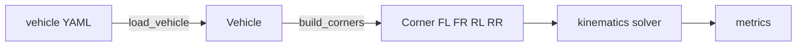
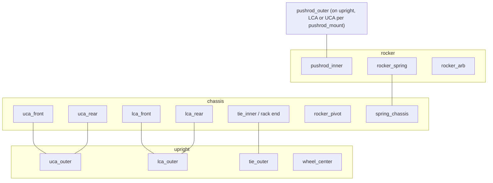
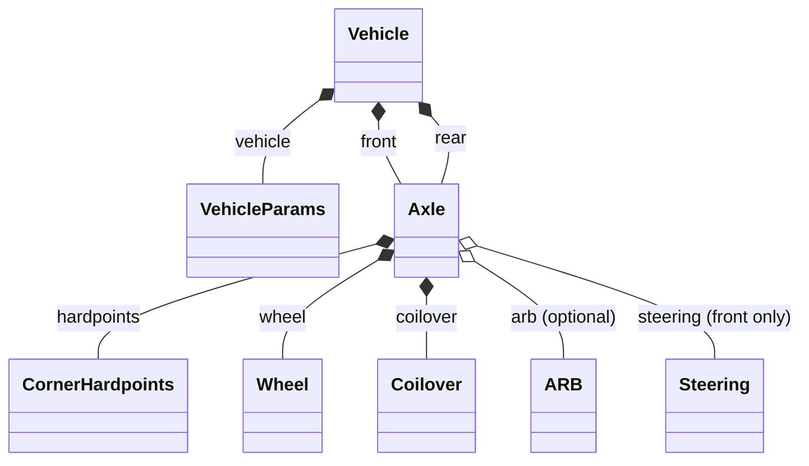

# Vehicle model

This page describes how `suspkin` represents a car: the data classes in `suspkin.geometry.model`, how four `Corner` objects are built from them (`suspkin.geometry.corners`), how YAML is loaded and validated (`suspkin.geometry.io`) and the small vector library everything else builds on (`suspkin.geometry.vectors`). Sign and frame conventions are defined once in [conventions.md](conventions.md); this page only restates what it needs.

## 1. Position in the pipeline



Everything downstream (kinematics, metrics, optimisation, the web app) starts from a validated, immutable `suspkin.geometry.model.Vehicle`. No solver code reads YAML, and no model code solves anything. The model layer is pure data plus validation.

Frame and units: ISO 8855 (x forward, y left, z up), SI units (m, rad, N, N/m, kg, Pa). The origin is on the ground plane at the middle of the front axle (static ride height). All angles in the model (`static_camber`, `static_toe`, `blade_angle`, `beam_angle`) are in radians. mm and degrees appear only in display output.

## 2. Theory: what a double-wishbone pushrod corner does

A wheel carrier (the **upright**) has six degrees of freedom. The corner restricts it to one (plus steering) with link constraints:

| Member | Constraint it imposes |
|---|---|
| Upper wishbone (UCA), two chassis pivots + one ball joint | The upper ball joint moves on a circle about the axis through `uca_front`/`uca_rear` (rigid-body rotation of a triangle about a line). |
| Lower wishbone (LCA), same layout | The lower ball joint moves on a circle about the `lca_front`/`lca_rear` axis. |
| Upright | The distance between the two ball joints is constant. The two wishbone angles and the upright spin about the ball-joint line are three unknowns tied by this one distance equation, so arms plus upright leave a 2-DOF mechanism. |
| Tie rod (steering link) | A fixed-length rod from the rack end `tie_inner` to the steering arm `tie_outer` couples all three unknowns and removes one more degree of freedom. With the rack locked the corner has exactly one degree of freedom (wheel travel). |
| Rack | Moving `tie_inner` along the rack axis adds the steering degree of freedom. |

Unknowns and equations of the solver are described in [corner-kinematics.md](corner-kinematics.md). What the model must supply is just the points and the static wheel orientation.

**Why the pushrod and rocker matter.** The coilover does not act on the wheel directly. A pushrod carries the wheel (or wishbone) motion to a **rocker**, a bell-crank pivoting on the chassis, and the rocker compresses the spring. The geometry of that chain sets:

- the **motion ratio** $MR = |d\ell_{spring}/dz_{wheel}|$ (how much the coilover moves per unit of wheel travel), hence the effective wheel rate $k_w = k_{spring}\,MR^2$;
- the **progression**, because the rocker angle changes the lever arms ($MR$ varies with travel). A pushrod roughly perpendicular to the rocker pickup arm gives a mild, near-linear ratio; near a toggle position (pushrod in line with the pickup arm) $MR$ diverges: the rocker spins fast per unit of wheel travel, the wheel rate $k\,MR^2$ blows up and the linkage locks (only the pushrod-to-rocker torque goes to zero). The reference car's pickup lever is about 85 degrees to the pushrod when static, far from toggle;
- the packaging (a transverse horizontal coilover on top of the chassis, as in the reference car) and the anti-roll bar drive, which is picked up at `rocker_arb`.

Because the rocker pivots about a fixed axis `rocker_axis`, all of its points move on circles about that axis and the pushrod end `pushrod_inner` constrains that rotation (exact mechanics in [corner-kinematics.md](corner-kinematics.md)).

## 3. Hardpoints

Hardpoints are stored in `suspkin.geometry.model.CornerHardpoints` for the **left** side (y > 0). Each is a `Vec3 = tuple[float, float, float]` in metres. The ordered tuple `suspkin.geometry.model.HARDPOINT_NAMES` lists the 14 mandatory ones; `rocker_arb` is optional.



Schematic front-view section (y-z plane) of the left corner; y grows to the right of the drawing, away from the car centreline:

```text
                 z
                 ^
   spring_chassis|   rocker_spring (on rocker)
        o========|===o   <- coilover (transverse, horizontal)
                 |   |  rocker_pivot  (rocker rotates about rocker_axis)
                 |   o--- pushrod_inner
                 |    \
                 |     \ pushrod (compression)
     uca_front/rear     \ pushrod_outer (here on the UCA, pushrod_mount: uca)
        o---------------o-------o uca_outer
                 |            |  \
                 |            |   o wheel_center
     lca_front/rear           |   |
        o---------------------o lca_outer
   -----+--------------------------+----> y (left)
      centre                   contact patch
```

| Name | Meaning | Belongs to |
|---|---|---|
| `uca_front`, `uca_rear` | Inboard pivots of the upper wishbone; the line through them is the UCA rotation axis. | chassis |
| `uca_outer` | Upper ball joint, wishbone to upright. | upright (and the UCA end of the link) |
| `lca_front`, `lca_rear` | Inboard pivots of the lower wishbone. | chassis |
| `lca_outer` | Lower ball joint. | upright |
| `tie_inner` | Inner tie-rod joint, on the steering rack. Fixed to the chassis when the rack is locked; moves along `rack_axis` with rack travel. | chassis (rack) |
| `tie_outer` | Outer tie-rod joint, the steering arm on the upright. | upright |
| `pushrod_outer` | Pushrod end at the wheel side. Its body is selected by `Axle.pushrod_mount`: `"upright"` (default), `"lca"` or `"uca"`. | upright, LCA or UCA |
| `pushrod_inner` | Pushrod end on the rocker (the pickup). | rocker |
| `rocker_pivot` | A point on the rocker rotation axis (the axis direction is `rocker_axis`). | chassis |
| `rocker_spring` | Coilover pin on the rocker. | rocker |
| `spring_chassis` | Coilover chassis bracket. | chassis |
| `wheel_center` | Wheel centre at the static ride-height pose. Its z is the loaded radius. | wheel (rigidly with the upright) |
| `rocker_arb` (optional) | Drop-link pickup on the rocker, for the anti-roll bar. | rocker |
| `rocker_axis` | Not a point: direction of the rocker rotation axis, normalised on validation (an `Axis`). | chassis |

Notes:

- The rocker is therefore defined by `rocker_pivot`, `rocker_axis`, `pushrod_inner`, `rocker_spring` and optionally `rocker_arb`. These points are treated as one rigid body.
- The coilover is a two-point spring: `rocker_spring` to `spring_chassis`. Its length is `|rocker_spring - spring_chassis|`.
- The wheel is rigid with the upright: its spin axis is built from `static_camber` and `static_toe` (section 6) and rotated with the upright.

## 4. Axle- and vehicle-level data



All models derive from `suspkin.geometry.model._Frozen`: `frozen=True` (immutable and hashable), `extra="forbid"` (an unknown YAML key is a validation error, so typos cannot pass silently).

### `Vehicle`

| Field | Meaning |
|---|---|
| `schema_version` (YAML key `schema`) | Must equal `SUPPORTED_SCHEMA = 1`. |
| `vehicle` | `VehicleParams`. |
| `front`, `rear` | `Axle`. |

Derived properties: `wheelbase = front.wheel_center.x - rear.wheel_center.x`; `front_track = 2 * front.wheel_center.y`; `rear_track = 2 * rear.wheel_center.y`. Tracks are wheel-centre tracks (not contact-patch tracks).

### `VehicleParams`

`name` (str); `mass` [kg, with driver, > 0]; `cg_height` [m, > 0]; `front_mass_ratio` (0 < r < 1, static front weight fraction); `drive` in `rwd|fwd|awd` (default `rwd`); `brake_bias_front` in [0, 1] (default 0.6); `drive_split_front` in [0, 1] or `None`; `unsprung_cg_height` [m, > 0] or `None`. The property `effective_drive_split_front` returns the explicit `drive_split_front`, else 0 for `rwd`, 1 for `fwd`, 0.5 for `awd`.

### `Axle`

| Field | Meaning |
|---|---|
| `brakes` | `outboard` (default) or `inboard`. |
| `pushrod_mount` | `upright` (default), `lca` or `uca`: the body that carries `pushrod_outer`. |
| `unsprung_mass` | Per corner [kg, > 0]. |
| `hardpoints` | `CornerHardpoints` (left side). |
| `wheel` | `Wheel`. |
| `coilover` | `Coilover`. |
| `arb` | Optional anti-roll bar, discriminated by `type`. |
| `steering` | `Steering` (mandatory on the front axle, forbidden on the rear). |
| `right_overrides` | `dict[str, Vec3]` of right-side points that replace the mirrored ones (section 5). |

### `Wheel`

`tyre_radius` [m, > 0]; `rim_width` [m, > 0]; `static_camber` [rad, within (-0.2, 0.2)]; `static_toe` [rad, within (-0.1, 0.1)]; `tyre_vertical_stiffness` [N/m, > 0].

### `Coilover`

`spring_rate` [N/m, > 0]; `free_length` [m, > 0]; `preload` [N, >= 0]; `length_min` [m, > 0]; `length_max` [m]. Static spring force is $F_0 = F_{preload} + k\,(\ell_{free} - \ell_{static})$ with $\ell_{static} = |rocker\_spring - spring\_chassis|$ (reference front: preload 0, $35000 \times 0.0164 \approx 574$ N).

### `Steering`

`c_factor` [m of rack per pinion revolution, > 0]; `rack_travel = (min, max)` [m] with `min < 0 < max`; `rack_axis` (an `Axis`, default `(0, 1, 0)`). Positive rack travel moves `tie_inner` along `+rack_axis`, toward +y. For a front-steer layout (tie rods ahead of the axle) that steers left, i.e. positive steer. The rack is one rigid part, so both corners use the same global `rack_axis` and it is **not** mirrored (see `suspkin.kinematics.corner`, which does `tie_inner + rack * rack_axis`).

### Anti-roll bars (`arb`)

A union of three types, selected by the `type` key: `torsional`, `blade`, `beam`. Points are left-side. The shared tube fields (`suspkin.geometry.model._TubeARB`) of `torsional` and `blade` are `arm_end`, `bar_pivot`, `bar_axis` (default `(0, 1, 0)`), `bar_length`, `outer_diameter`, `inner_diameter`, `shear_modulus`.

- `TorsionalARB`: round solid arms. `arm_diameter` (None means rigid arms) and `arm_youngs_modulus` (default 200 GPa) add cantilever bending in series with the tube torsion.
- `BladeARB`: flat blade arms from `bar_pivot` to `arm_end`; `blade_width`, `blade_thickness`, `blade_youngs_modulus`, `blade_angle` [rad] (0 is flat/soft, pi/2 is edge-on/stiff).
- `BeamARB`: a transverse bending beam on the centreline; `beam_center`, `beam_axis`, `arm_end`, `beam_width`, `beam_thickness`, `beam_youngs_modulus`, `beam_angle`.

How these produce a roll stiffness is covered in [vehicle-kinematics.md](vehicle-kinematics.md).

## 5. Building the corners

`suspkin.geometry.corners.build_corners(vehicle)` returns `dict[CornerId, Corner]` with the ids `"FL"`, `"FR"`, `"RL"`, `"RR"`. A `suspkin.geometry.corners.Corner` is a frozen dataclass:

| Field | Content |
|---|---|
| `id` | one of `"FL"`, `"FR"`, `"RL"`, `"RR"`. |
| `axle` | `"front"` or `"rear"` (first letter of the id). |
| `side` | `"left"` if the id ends with `L`, else `"right"`. |
| `points` | `Mapping[str, ndarray (3,)]`: every hardpoint after side resolution, read-only (`writeable=False`). Includes `rocker_arb` only when set. |
| `rocker_axis` | Unit vector (3,), read-only, side-resolved. |
| `axle_cfg` | The shared `Axle` (wheel, coilover, ARB, steering, `pushrod_mount`). |

Algorithm in `suspkin.geometry.corners._build`:

1. For every name in `HARDPOINT_NAMES` (plus `rocker_arb` if present), take the YAML point.
2. Left corner: use it as is. Right corner: `suspkin.geometry.vectors.mirror_y`, i.e. $(x, y, z) \to (x, -y, z)$.
3. Right corner: also mirror `rocker_axis` to $(x, -y, z)$. Mirroring is a reflection, so the sense of rotation about the mirrored axis flips relative to the left side. The solver accounts for that through `side_sign`.
4. Right corner: overwrite any point listed in `right_overrides` (already in right-side coordinates, no mirroring).
5. Copy every array and set it read-only.

The front and rear corners of one axle share a single `Axle`, so the front axle is entirely described once and mirrored by the loader. `suspkin.geometry.corners.arb_points(corner)` returns the ARB points (`arm_end` and `bar_pivot` for torsional and blade bars, `arm_end` and `beam_center` for the beam bar) mirrored for right-side corners; it returns an empty dict when there is no ARB. Note that `arb_points` always mirrors; it does not look at `right_overrides`. (`rocker_arb`, in contrast, is a hardpoint and follows the rules above.)

`right_overrides` allows asymmetric designs, e.g. a different right-hand tie-rod position, or an optimisation variable that is asymmetric (`suspkin.optimize.design`).

## 6. Wheel orientation

`suspkin.geometry.vectors.wheel_spin_axis(side, camber, toe)` returns the unit spin axis pointing outboard.

$$
\mathbf{n} = R_z(-\mathrm{toe})\,\begin{pmatrix}0\\ \cos\gamma\\ -\sin\gamma\end{pmatrix},\qquad
\mathbf{n}_{right} = (n_x, -n_y, n_z)
$$

Zero camber and toe give $(0, 1, 0)$ left and $(0, -1, 0)$ right. Negative camber (the top of the wheel leans in) gives $n_z > 0$ on both sides. Positive toe is toe-in; see [conventions.md](conventions.md) for the full convention.

## 7. YAML loading and saving

`suspkin.geometry.io`:

- `load_vehicle(path) -> Vehicle`: `yaml.safe_load` then `Vehicle.model_validate`. Any `OSError`, `yaml.YAMLError` or pydantic `ValidationError` is re-raised as `VehicleConfigError(f"{path}: {exc}")`, so the message always begins with the file path. `VehicleConfigError` subclasses `ValueError`.
- `vehicle_yaml(vehicle) -> str`: YAML text with the `schema` key, model key order and tuples converted to lists.
- `save_vehicle(vehicle, path)`: writes that text with LF line endings.

Field-by-field reference of the file format: [the vehicle YAML guide](../guides/vehicle-yaml.md).

## 8. Validation rules and messages

Validation happens when a `Vehicle` is constructed (pydantic). Every message below comes from the code; pydantic wraps them as `Value error, <message>`.

**Per hardpoint set (`CornerHardpoints`)**

| Rule | Message |
|---|---|
| `tie_inner`, `rocker_pivot`, `rocker_spring`, `spring_chassis`, `pushrod_inner` have `y >= 0` (inboard points may sit on the centreline) | `<name> must have y >= 0 (left side), got <y>` |
| every other mandatory point has `y > 0` | `<name> must have y > 0 (left side), got <y>` |
| `rocker_arb`, if set, has `y >= 0` | `rocker_arb must have y >= 0 (left side), got <y>` |
| each of the six links (UCA front/rear arms, LCA front/rear arms, tie rod, pushrod) longer than 0.01 m | `link <name> shorter than 0.01 m` |
| `uca_outer.z > lca_outer.z` | `uca_outer z must be above lca_outer z` |
| wishbone pivot spacing greater than 0.01 m | `uca_front and uca_rear closer than 0.01 m (degenerate axis)` (same for lca) |
| `pushrod_inner`, `rocker_spring`, `rocker_arb` each more than 0.01 m from the rocker axis | `<name> lies within 0.01 m of the rocker axis (degenerate rocker arm)` |
| `rocker_axis` non-zero | `rocker_axis must be non-zero` (norm < 1e-9) |

**Components**

- `Wheel`: radius, rim width and stiffness > 0; camber within (-0.2, 0.2) rad (about 11.5 deg); toe within (-0.1, 0.1) rad.
- `Coilover`: `length_max <= length_min` raises `length_max must be greater than length_min`.
- Tube ARBs: `inner_diameter must be smaller than outer_diameter`; `ARB arm shorter than 0.01 m (arm_end on the bar axis)`.
- `BeamARB`: `beam_center must lie on the centreline (|y| < 1 mm)`; `beam half-length (arm_end along beam_axis) must exceed 0.01 m`.
- `Steering`: `rack_travel must satisfy min < 0 < max`.

**Axle**

- ARB without `hardpoints.rocker_arb`: `an ARB requires hardpoints.rocker_arb to be set`.
- `right_overrides` keys must be hardpoint names (or `rocker_arb`): `right_overrides key '<k>' is not a hardpoint name`; values need `y <= 0` (`... must have y <= 0 (right side)`) and, for the outer points (`uca_outer`, `lca_outer`, `tie_outer`, `pushrod_outer`, `wheel_center`), `y < 0`. A `rocker_arb` override needs `hardpoints.rocker_arb`.
- Static coilover length inside the limits: `static coilover length 0.2000 m outside [0.16, 0.19]`.
- Torsional and blade ARBs: `|2 * bar_pivot.y - bar_length|` must be below 0.01 m (`<type> ARB: |2 * bar_pivot.y - bar_length| must be < 0.01 m (bar runs between the mirrored pivots), got <span>`).

**Vehicle**

- `unsupported vehicle schema <v>; this suspkin supports 1`.
- `front axle requires steering` / `rear axle must not have steering`.
- `front wheel_center x must be greater than rear wheel_center x`.
- `front wheel_center x must be 0 (origin at mid front axle)` (tolerance 5 mm).
- Per axle: `wheel_center z` within 20 mm of `tyre_radius`: `front wheel_center z (...) must match tyre_radius (...) within 20 mm`. `wheel_center.z` is the **loaded** radius and may be slightly below the unloaded radius.

Not validated: link-length feasibility over the travel range, spring toggle, and wheel/rim clearance. Those surface as solver errors or in metrics (see [corner-kinematics.md](corner-kinematics.md)).

## 9. The `Axis` type

`suspkin.geometry.model.Axis` is `Vec3` plus an after-validator that normalises to unit length and rejects (norm < 1e-9) a zero vector with `<field name> must be non-zero`. Used for `rocker_axis`, `bar_axis`, `beam_axis` and `rack_axis`. You may write unnormalised axes in YAML. They are stored unit length, so a round trip through `save_vehicle` writes the normalised form.

## 10. Vector helpers

`suspkin.geometry.vectors` is a pure-numpy toolbox (ISO 8855, SI, vectors of shape `(3,)` or `(N, 3)`):

- Points and lines: `mirror_y`, `unit`, `distance`, `plane_from_points`, `plane_section_2d`, `line_through_2d`, `line_direction_2d`, `intersect_lines_2d`. A 2D line is stored as `(unit normal, offset)` meaning $\mathbf n\cdot\mathbf q = c$; the intersection of two parallel lines returns `None` (never raises; tolerance `PARALLEL_TOL = 1e-9`).
- Rotations: `axis_angle_matrix` (Rodrigues, right-hand), `rotation_between` (minimal rotation between two directions, antiparallel case handled by a half-turn), `body_rotation(roll, pitch)` = $R_y(\mathrm{pitch})\,R_x(\mathrm{roll})$, and the batched `body_rotation_batch`, shape `(N, 3, 3)`.
- Row-wise array helpers (last axis is xyz): `dot_rows`, `norm_rows`, `cross_rows`, `unit_rows` (no zero-length check), `rodrigues_rows`, `wrap_angle` (to $[-\pi, \pi)$).
- `wheel_spin_axis` (section 6).
- Private `_*3` helpers are pure-Python tuple-arithmetic versions (only the `_as3` converter touches numpy) for the scalar solver hot path.

## 11. Worked example: `fs_reference.yaml`

The reference vehicle is fictional but self-consistent: 10-inch wheels (R = 0.228 m), outboard brakes, rwd, UCA-mounted pushrods on both axles, rockers above the UCA, a horizontal transverse coilover on top of the chassis, a torsional ARB at the front and a blade ARB at the rear.

```python
from suspkin.geometry.io import load_vehicle
from suspkin.geometry.corners import build_corners, arb_points
from suspkin.geometry.vectors import distance, wheel_spin_axis

v = load_vehicle("configs/vehicles/fs_reference.yaml")
print(v.wheelbase, v.front_track, v.rear_track)
cs = build_corners(v)
print(list(cs))
for k in ("FL", "FR"):
    c = cs[k]
    print(k, c.axle, c.side, c.points["uca_outer"], c.points["rocker_arb"], c.rocker_axis)
h = v.front.hardpoints
print(distance(h.rocker_spring, h.spring_chassis))          # static coilover length
print(distance(h.rocker_pivot, h.pushrod_inner))            # pushrod pickup lever
print(distance(h.rocker_pivot, h.rocker_spring))            # spring lever
print(v.front.coilover.free_length - distance(h.rocker_spring, h.spring_chassis))
print(wheel_spin_axis("left", v.front.wheel.static_camber, v.front.wheel.static_toe))
```

Run with `python -m uv run python <script>`; output:

```text
1.55 1.22 1.18
['FL', 'FR', 'RL', 'RR']
FL front left  [-0.009  0.567  0.338] [-0.09  0.26  0.479] [1. 0. 0.]
FR front right [-0.009 -0.567  0.338] [-0.09 -0.26  0.479] [ 1. -0. 0.]
0.2
0.060033324079214544
0.07850000000000001
0.016399999999999998
[0.         0.9998477  0.01745211]
```

Reading it:

- The right corner is the exact y-mirror of the left (`FR` has `y = -0.567` and the rocker axis becomes $(1, -0, 0)$).
- The static coilover length is 0.200 m, inside [0.16, 0.24]; the static compression of 0.0164 m at 35000 N/m gives about 574 N.
- The rocker pickup arm is 0.060 m and the spring arm 0.0785 m, as described in the YAML comments. Pushrod and rocker pickups are measured from `rocker_pivot`; the rocker axis is x, so the lever arms in the y-z plane are the real arms.
- Camber $-1^\circ$ ($-0.017453$ rad) produces $n_z = +\sin(0.017453) = 0.01745$ on the left wheel, i.e. the top of the wheel leans inward.
- Tracks are 1.22 m and 1.18 m, and the wheelbase is 1.55 m, exactly the "targets" in the file header.

Example of validation failures (generated by editing a copy of the loaded model in Python):

| Edit | Resulting error |
|---|---|
| `front.hardpoints.lca_outer` with `y = -0.586` | `Value error, lca_outer must have y > 0 (left side), got -0.586` |
| `front.steering = None` | `Value error, front axle requires steering` |
| `front.coilover.length_max = 0.19` | `Value error, static coilover length 0.2000 m outside [0.16, 0.19]` |
| `schema: 2` | `Value error, unsupported vehicle schema 2; this suspkin supports 1` |
| `load_vehicle("nope.yaml")` | `VehicleConfigError: nope.yaml: [Errno 2] No such file or directory: 'nope.yaml'` |

## 12. Edge cases and failure modes

- A hardpoint with a wrong sign of y (a right-side value pasted into the left block) fails fast with the y checks above rather than producing a mirrored-twice car.
- Because inboard points may have `y = 0`, a rocker or coilover bracket on the centreline is legal, but a rocker arm shorter than 0.01 m from its axis is rejected.
- `extra="forbid"` means YAML keys must match the field names exactly, including `schema` (alias) and the ARB `type` discriminator. An unknown `type` fails with a pydantic discriminator error.
- The validation only guarantees a well-formed static pose. Whether the linkage can actually move through the requested travel is checked by the solver ([corner-kinematics.md](corner-kinematics.md)).
- `vectors.unit` rejects norms below 1e-12 whereas the `Axis` validator rejects norms below 1e-9.

## 13. Where it is tested

`tests/unit/test_geometry_models.py` (validation rules and messages), `tests/unit/test_geometry_io.py` (YAML round trip, `VehicleConfigError`), `tests/unit/test_corners.py` (mirroring, `right_overrides`), `tests/unit/test_vectors.py`, `tests/unit/test_vector_rows.py` and `tests/unit/test_rotations.py` (vector helpers). The golden and behaviour-lock tests under `tests/regression/` load `configs/vehicles/fs_reference.yaml`.

## See also

- [conventions.md](conventions.md): frame, signs, units.
- [corner-kinematics.md](corner-kinematics.md): how `Corner` points drive the solver.
- [vehicle-kinematics.md](vehicle-kinematics.md): poses, body rotations, anti-roll bar.
- [Vehicle YAML guide](../guides/vehicle-yaml.md): field-by-field file format.
