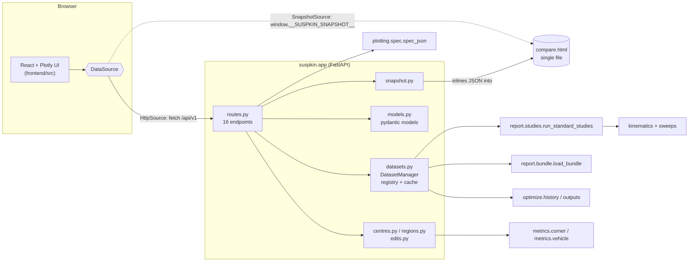
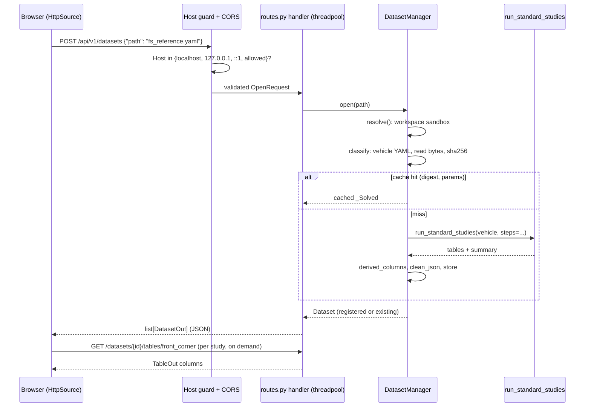

# Web app: backend, API and frontend contract

The web app (`suspkin app`) shows every study figure interactively, overlays several designs on
the same axes, lets you drag hardpoints and re-solve, and exports a shareable single-file
snapshot. It is **experimental** (no stability promise; see [Stability](../guides/stability.md)).
This page explains how the backend (`suspkin.app`) is built, every endpoint of `/api/v1`, and the
contract between the Python backend and the TypeScript frontend in `frontend/`. For how to use the
app, see the [app guide](../guides/app.md).

The central design rule: **the web app computes nothing new.** It calls the same solver, the same
metric tables and the same report-bundle loader as the CLI. The backend is a thin, stateful
wrapper (a registry of open datasets plus a cache), and the frontend only draws what the backend
sends. Physics lives in `suspkin.kinematics` and `suspkin.metrics`
(see [Metrics](metrics.md)); table layout and bundles in
[Sweeps and reports](sweeps-and-reports.md).

## 1. Architecture



Three contracts keep the two sides independent (ADR 0001):

1. **Result tables.** Each opened design is a set of pandas tables (one per study) in SI units.
   The backend never converts units in tables; it sends them as columns of numbers.
2. **Figure spec.** `suspkin.plotting.spec` describes every figure as data (panels, series,
   columns, display factor and unit). The frontend renders it generically, so adding a figure to
   `suspkin.plotting.figures` needs no frontend code.
3. **Versioned JSON API** `/api/v1`, whose OpenAPI schema generates the TypeScript types.

The frontend reaches the backend only through a `DataSource` interface with two
implementations: `HttpSource` (live server) and `SnapshotSource` (data embedded in one HTML file).
Which one is used is decided once at start-up (`pickSource` in `frontend/src/api/index.ts`): if
`window.__SUSPKIN_SNAPSHOT__` exists the snapshot source is used, otherwise HTTP.

### Module map of `suspkin.app`

| Module | Role |
|---|---|
| `suspkin.app.server` | `create_app` (FastAPI factory, middleware, error mapping, SPA fallback) and `run` (uvicorn) |
| `suspkin.app.routes` | `make_router(manager)`: the 16 endpoints, plus helper payload builders reused by the snapshot |
| `suspkin.app.models` | Pydantic request/response models (they define the OpenAPI schema) |
| `suspkin.app.datasets` | `DatasetManager`: workspace sandbox, opening, solve cache, revisions, save, browse |
| `suspkin.app.edits` | `apply_hardpoint_edits`: pure function that moves hardpoints and revalidates the vehicle |
| `suspkin.app.centres` | `scene_centres`: roll/instant/pitch centres at the 3D scene pose |
| `suspkin.app.regions` | `study_regions`: optimisation domains and constraint regions as wireframes |
| `suspkin.app.snapshot` | Static export into one self-contained HTML file |
| `suspkin.app.openapi` | `python -m suspkin.app.openapi OUT.json`: dumps the OpenAPI schema |

Install the extra with `uv sync --extra app` (FastAPI and uvicorn; the 3D scene additionally needs
the `viz` extra, i.e. plotly). The CLI imports `suspkin.app` lazily, so a base install is
unaffected.

## 2. The server (`suspkin.app.server`)

`suspkin.app.server.create_app(workspace, *, static_dir=None, preload=(), study_params=None,
allowed_hosts=())` builds the application:

1. Creates `FastAPI(title="suspkin app (experimental)", version=suspkin.__version__)`.
2. Creates one `DatasetManager(workspace, study_params=...)` and stores it as `app.state.manager`.
   The manager is the only state of the server.
3. Adds the **Host-header guard** (an HTTP middleware): the host name of the `Host` header
   (port and IPv6 brackets stripped, lower case) must be `localhost`, `127.0.0.1`, `::1` or one of
   `allowed_hosts`, otherwise the response is `400 {"detail": "invalid Host header"}`. `"*"`
   disables the check. This blocks DNS-rebinding attacks, where a malicious web page makes the
   browser talk to your local server under another name.
4. Adds **CORS** only for the Vite dev server origins `http://localhost:5173` and
   `http://127.0.0.1:5173` (used by `--dev`). The production build is served from the same origin,
   so it needs no CORS.
5. Maps exceptions to HTTP status codes (table below).
6. Mounts the router (`make_router(manager)`) and opens each `preload` path; a failing path is
   logged as a warning and skipped, it does not prevent start-up.
7. Serves the frontend (**SPA fallback**): if `static_dir/index.html` exists (default
   `src/suspkin/app/static`, built by `npm run build`), `/assets` is mounted as static files and a
   catch-all `GET /{full_path:path}` returns the requested file when it exists *inside* the static
   directory (`is_relative_to` check, so `..` cannot escape), else `index.html` (client-side routing).
   Paths starting with `api/` that match no route return `404 {"detail": "not found"}` instead of
   the HTML (only when the frontend is built; without a build an unknown `/api/...` path gets
   FastAPI's default `{"detail": "Not Found"}`). If the frontend is not built, `GET /` returns a small hint page with the build command
   and links to `/docs` and `/api/v1/figures`; the API still works.

`suspkin.app.server.run(workspace, *, host="127.0.0.1", port=8765, preload=(), open_browser=True,
static_dir=None, dev=False)` wraps uvicorn. Details:

- Binding to a non-loopback host prints a warning to stderr: anyone who can reach the machine can
  read every file under the workspace (there is no authentication).
- `allowed_hosts` is `["*"]` for wildcard binds (`0.0.0.0`, `::`, empty) else `[host]`.
- `dev=True` points `static_dir` to a deliberately missing folder (API only) and does not open a
  browser; it prints the Vite URL. The Vite dev server (port 5173) proxies `/api` to
  `http://127.0.0.1:8765` (`frontend/vite.config.ts`).
- The browser is opened after 1 s with `threading.Timer(1.0, webbrowser.open, ...)`.

### Exception to status code mapping

Exception handlers are registered in `create_app`; FastAPI picks the most specific class. Route
code additionally raises `HTTPException` for conditions it detects itself.

| Exception | Status | Meaning |
|---|---|---|
| `WorkspaceError` (a `PermissionError`) | 403 | path outside the workspace, UNC path, other drive, symlink pointing out |
| `FileNotFoundError` | 404 | path or directory does not exist (also: single-file frontend not built, see section 6) |
| `DatasetNotFoundError` | 404 | unknown dataset or run id |
| `DatasetTooLargeError` | 413 | vehicle file above `MAX_VEHICLE_BYTES` = 2 000 000 bytes |
| `DatasetError` (and `EditError`) | 400 | cannot be opened/solved as a dataset, bad edits, bad file name, duplicate label |
| `SolveFailedError` | 422 | the solver failed on an edited vehicle |
| `AlreadyExistsError` | 409 | save target exists and `overwrite` is false |
| pydantic validation | 422 | invalid request body or query (FastAPI default; `detail` is a list) |

Every error body is `{"detail": "<message>"}`, which `HttpSource` turns into an `ApiError` with
a message that is safe to show in the UI.

## 3. Workspace and path safety (`DatasetManager.resolve`)

The server may read and write only inside the **workspace** (default: the directory where you
started `suspkin app`, or `--workspace`). Every path in every request goes through
`DatasetManager.resolve`, which:

1. rejects strings starting with `\\` or `//` (UNC/network paths) **before touching the file
   system**, so no network access can happen;
2. rejects absolute paths and drive-letter paths on a different drive than the workspace (an absolute
   path on the same drive is accepted and checked in step 4; the CLI preloads absolute paths);
3. joins relative paths onto the workspace and calls `Path.resolve()` (this follows symlinks and
   collapses `..`);
4. requires the result to be inside the workspace (`is_relative_to`, with a case-insensitive
   fallback for Windows).

`DatasetManager._guard` additionally refuses *existing* files whose resolved target is outside the
workspace (a symlink inside the workspace pointing out); it is applied to every file a bundle, run
or vehicle open reads. `browse` hides dotfiles and entries that resolve outside the workspace.
Paths returned to clients are workspace-relative POSIX strings (`DatasetManager.rel`).

Worked example (see section 9): `GET /api/v1/browse?dir=../..` and
`POST /api/v1/datasets {"path": "C:/Windows/win.ini"}` both return 403.

## 4. Datasets: registry, caching, revisions

A **dataset** (`suspkin.app.datasets.Dataset`) is one open, solved design, shown as a "revision"
(A, B, C ...) in the UI. It holds the study tables (SI, including derived columns), the summary
dict, the `Vehicle`, study parameters and a few bookkeeping fields. `kind` is one of:

| kind | Created from | `resolution_fixed` |
|---|---|---|
| `vehicle` | a vehicle YAML (or a study YAML: the vehicle it points to) | false |
| `edited` | `POST .../derive` on another revision | false |
| `bundle` | a result bundle folder or the `bundles/` of a report folder | true |
| `run` | `baseline`, `best` and `knee` vehicles of an optimiser run folder | true |

### Detecting what a path is

`suspkin.app.datasets.classify(path)` returns `dir | vehicle | study | bundle | report | run |
other`. `DatasetManager.open` branches the same way:

- directory with a bundle manifest (`report.bundle.is_bundle`): `bundle`, loaded by
  `load_bundle` (stored tables, summary and vehicle; nothing is solved);
- directory with `history.csv` and `meta.json` or `result.json`: optimiser `run`;
- directory with a `bundles/` subfolder: `report`; all bundles load or none do;
- a YAML with `schema` and `variables` or `constraints` (`regions.is_study_data`): a **study**:
  the vehicle it references (must also be inside the workspace) is opened and labelled with the
  study stem, and the study path is attached so `/regions` works;
- anything else is treated as a vehicle YAML (`Vehicle.model_validate`, 2 MB limit).

An optimiser run opens up to three datasets labelled `<run> baseline`, `<run> best` and
`<run> knee` (the knee comes from `pareto.csv` and `pareto/pareto_<k>.yaml`, only if
`result.json` has `knee_eval_id`). The run's `history.csv`, `meta.json` and `result.json` are kept
in a `RunInfo` for `GET /runs/{run_id}/history`. The `run_id` embeds the history file's name, size
and mtime, so a re-run is never shown with stale history; closing the last dataset of a run
drops its `RunInfo`.

### The solve cache

Solving a vehicle YAML runs `suspkin.report.studies.run_standard_studies` (front and rear corner
sweeps, rack, heave, roll and pitch) and is the only expensive operation. The result (`_Solved`:
vehicle, tables with `plotting.spec.derived_columns` applied, summary, params, steps) is cached in
memory under the key

$$
\text{key} = \bigl(\operatorname{sha256}(\text{file bytes}),\ \text{sorted study parameters incl. steps}\bigr).
$$

Consequences:

- Re-opening an unchanged file is a cache hit (in the example below: 0.98 s the first time, 0.01 s
  again).
- Editing the file on disk changes the digest, so it is re-solved; the old entry stays until the
  process ends.
- The key is the *content*, not the path, so two identical files share one solve.

Further rules:

- **Identity.** A dataset id is a 10-character sha1 prefix. For `vehicle` and `run` datasets it hashes
  `kind | path | content` (content = file digest, resp. the history stat signature); for a `bundle`
  the content is a stat signature (`name:size:mtime` of its files); for a study YAML it hashes the
  study path, the study file digest and the vehicle digest. Opening the same thing twice
  returns the existing dataset instead of a duplicate. Labels are made unique (`name (2)`, ...) and
  each dataset gets the lowest unused colour index.
- **Thread safety.** Route handlers are plain `def`, so FastAPI runs them in its threadpool; the
  manager protects its dictionaries with an `RLock` and does the solving *outside* the lock.
  Two simultaneous requests for the same new file may both solve it (harmless duplicate work).
- **Browse cache.** `DatasetManager._kind` memoises `classify` by (path, mtime, size) so listing a
  folder stays cheap (cleared above 4096 entries).

### Resolution (steps)

"Steps" is the number of points per sweep (default 31, or `study_params["steps"]` given to `create_app`). It is part of the cache key.

- `PATCH /datasets/{id}` with `steps` (3..401) calls `DatasetManager.set_steps`, which re-solves
  the *same* dataset in place (same id; label and colour are unchanged) using the stored vehicle
  bytes. The solve is cached by (file, steps), so going back to a previous value is instant.
- For `edited` datasets the original study parameters (`travel`, `rack`, `roll_deg`, `heave`,
  `pitch_deg`) are carried over so the re-solve matches the parent's sweeps.
- Bundles and runs have `resolution_fixed = true`: their tables are stored, the resolution cannot
  change, and a `steps` patch returns 400. `steps` of a bundle is the length of its longest table.
- The frontend (`useSetResolution`) patches all vehicle-backed revisions, then invalidates the
  `datasets`, `table`, `summary` and `scene` query caches so everything is refetched.

### Revisions from hardpoint edits

`POST /datasets/{id}/derive` creates an `edited` dataset:

1. `suspkin.app.edits.apply_hardpoint_edits(vehicle, edits)` dumps the vehicle to a dict, changes
   the left `hardpoints` and/or the `right_overrides`, and validates again with
   `Vehicle.model_validate` (the same mechanism as `suspkin.optimize.design`). Rules per
   `HardpointEdit.side`: `both` moves the left point (right mirrors it) and drops any right
   override; `left` moves the left point only and keeps an existing right override; `right` writes
   `right_overrides` only, in right-side coordinates ($y \le 0$). Missing coordinates keep their
   current value. Unknown point names, edits with no coordinate and geometry that fails
   validation raise `HardpointEditError`, returned as 400 with a message naming the points.
2. The edited vehicle is serialised (`vehicle_yaml`), hashed, and solved through the same cache.
   The id is `sha1("edited" | digest | steps)[:10]`: it ignores the parent and the label, so the
   same edited YAML (from any parent, with any label) returns the first-created revision as is,
   with its original `parent_id` and label. The edited id is path-independent.
3. If the solver raises `KinematicsError`, `_failing_sweep` probes the standard sweeps at their end
   points (front/rear bump-droop, rack, heave, roll, pitch) to name the first one that fails; the
   response is 422 `"The solver failed in the <sweep> sweep: ... Check the edited points."`.

`POST /datasets/{id}/save` writes the revision's vehicle with `suspkin.geometry.save_vehicle`
(schema 1, LF line endings). The file name must end in `.yaml`/`.yml`, its folder must exist, and
an existing file is only replaced if it is already a loadable vehicle YAML **and** `overwrite` is
true (409 otherwise; 400 if the existing file is something else).

## 5. Endpoints of `/api/v1`

All handlers live in `suspkin.app.routes.make_router`. Tables and scenes are SI (m, rad, N,
N/m); the frontend multiplies by the `factor` of the figure spec for display. In `TableOut`, a
non-finite float becomes `null` (`routes._column`); a few label columns (for example `corner`) are
strings.

| # | Method and path | Request | Response model | Errors |
|---|---|---|---|---|
| 1 | `GET /health` | - | `HealthOut` (`status`, `version`, `workspace`, `pose`: list of `PoseInput` metadata for the 3D sliders) | - |
| 2 | `GET /figures` | - | JSON object from `plotting.spec.spec_json()` (typed `dict[str, Any]`) | - |
| 3 | `GET /datasets` | - | `list[DatasetOut]` in opening order | - |
| 4 | `POST /datasets` | `OpenRequest {path}` | `list[DatasetOut]` (one for a vehicle/bundle; up to 3 for a run; N for a report) | 403 outside workspace; 404 missing; 413 too large; 400 not openable |
| 5 | `PATCH /datasets/{id}` | `DatasetPatch {label?, color?, steps?}` (`steps` 3..401, `color` >= 0) | `DatasetOut` | 404 id; 400 fixed resolution / empty or duplicate label; 422 body |
| 6 | `POST /datasets/{id}/derive` | `DeriveRequest {edits (>= 1 `HardpointEdit`), label?, steps?}` | `DatasetOut` (new or existing `edited`) | 404; 400 bad edit; 422 solver failed |
| 7 | `POST /datasets/{id}/save` | `SaveRequest {path, overwrite=false}` | `SaveOut {path, size}` | 403; 404; 400 bad name/target; 409 exists |
| 8 | `DELETE /datasets/{id}` | - | 204, empty | 404 |
| 9 | `GET /datasets/{id}/tables/{study}` | - | `TableOut {columns: {name: [values]}}`; study is one of `front_corner`, `rear_corner`, `rack`, `heave`, `roll`, `pitch` (bundles may hold fewer) | 404 dataset or study |
| 10 | `GET /datasets/{id}/summary` | - | JSON object (the vehicle summary, `null` for non-finite) | 404 |
| 11 | `GET /datasets/{id}/scene?heave&roll&pitch&rack` | query in SI: heave and rack in m within +-0.2, roll and pitch in rad within +-0.35, all default 0, NaN/inf refused | Plotly 3D figure JSON plus `hardpoints` (posed positions by `"FL:uca_outer"`) and `centres` (`SceneCentres`) | 404; 422 pose out of range or not solvable; 501 plotly missing |
| 12 | `GET /datasets/{id}/hardpoints` | - | `list[HardpointOut]` (every point after mirroring; `overridden` marks `right_overrides`) | 404 |
| 13 | `GET /datasets/{id}/regions` | - | `list[RegionOut]` (wireframes of the attached study) | 404 no study; 422 invalid study |
| 14 | `GET /runs/{run_id}/history` | - | `HistoryOut` | 404 |
| 15 | `POST /export` | optional `ExportRequest {out?, overwrite=false}` | `ExportOut {path, size}` | 403 outside workspace; 400 name/no datasets/not a snapshot; 409 exists; 404 single-file build missing |
| 16 | `GET /browse?dir=` | `dir` workspace-relative, default root | `BrowseOut {dir, parent, entries: [{name, path, kind}]}` | 403; 404 not a directory |

Notes per endpoint:

- **`/scene`** is the only endpoint that solves a non-standard pose, and its result is never
  cached (`POST /datasets`, `PATCH steps` and `derive` also solve, but the standard studies, through
  the cache). If any of the four inputs is non-zero it
  calls `suspkin.kinematics.solve_vehicle(vehicle, heave=, roll=, pitch=, rack=)` (rotations about
  the CG); `KinematicsError`, `ValueError` or `ArithmeticError` become 422 `"pose not solvable: <exception text>"`.
  The figure comes from `suspkin.plotting.interactive.interactive_figure`. Because it is a
  rigid-body view the ground tilts and the body stays fixed (see
  [vehicle kinematics](vehicle-kinematics.md)). Ranges are enforced by pydantic `Query(ge=, le=)`
  limits, so out-of-range values return a FastAPI 422 with a list `detail`.
- **`/health`** `pose` entries (`PoseInput`) tell the UI, per input (heave, roll, pitch, rack),
  the SI unit, display unit and `factor` (display = SI x factor), which dataset parameter sets the
  slider range, the default maximum and the step. All come from `suspkin.units`, so the UI never
  hard-codes a unit.
- **`/regions`** is available when a study is attached (`DatasetOut.has_study`): runs (their
  `study.yaml`) and opened study YAMLs; an edited revision inherits its parent's study.
- **`/runs/{id}/history`** returns the history columns plus `meta`/`result` from the run folder and
  the analysis of `routes.analyse_history`: objective columns (`f_*` except `f_total`),
  `best_so_far` (running best feasible `f_total` ordered by `eval_id`), `pareto_all` (feasible and
  non-dominated in all objectives, needs >= 2), `pareto_pairs` (`"f_a|f_b"` keys, non-dominated in
  that pair only) and `knee_eval_id`. It reuses `suspkin.plotting.optimization.pareto_mask`,
  `knee_index` and `best_so_far`, the same helpers the static optimisation figures use. See
  [Optimisation](optimization.md).
- **`/export`** refuses to overwrite anything that is not already a suspkin snapshot (checked
  by the marker `<meta name="suspkin-snapshot" content="1">` in the first 8 KiB), and requires the
  file name to end in `.html` and at least one open dataset. The default name is
  `suspkin_snapshot_YYYYmmdd_HHMMSS.html`.

### Response models (`suspkin.app.models`)

All models are pydantic `BaseModel`s; they are what makes the OpenAPI schema precise. The
important ones:

- `DatasetOut`: `id`, `label`, `kind` (`vehicle|bundle|run|edited`), `source` (workspace-relative),
  `color` (palette index), `studies` (table names), `run_id`, `params` (study parameters in SI),
  `steps`, `resolution_fixed`, `parent_id`, `edits`, `has_study`. No tables (those are separate
  requests).
- `HardpointEdit`: `axle` (`front|rear`), `point`, `side` (`left|right|both`), optional `x`, `y`,
  `z` in metres (finite only).
- `HardpointOut`: one point per corner side, SI, ISO 8855 vehicle frame.
- `SceneCentres` (built by `suspkin.app.centres.scene_centres`): roll centres per axle (x is the
  mean contact-patch x), their ground heights (`roll_height`), front-view and side-view instant
  centres per corner (`fv_ic`, `sv_ic`, `None` when at infinity), contact patches, the finite
  swing-arm lengths `fvsa`/`svsa`, and the pitch centre on the centreline. Section 7 explains how
  they are computed.
- `RegionOut`: `name`, `role` (`domain|inside|outside`), `point`, `side`, `shape`
  (`hexahedron|box|offset|sphere|cylinder`), `mirrored`, `lines` (wireframe polylines), `over`,
  `note`.
- `HistoryOut`, `TableOut`, `BrowseOut`/`BrowseEntry` (`kind` is the `classify` result),
  `OpenRequest`, `DatasetPatch`, `DeriveRequest`, `SaveRequest`/`SaveOut`,
  `ExportRequest`/`ExportOut`, `PoseInput`, `HealthOut`.

## 6. Request lifecycle



Opening only returns metadata. The browser then fetches the tables it needs (one request per
dataset and study), the summary, and the figure spec once. The frontend caches with
TanStack Query (`frontend/src/api/hooks.ts`): `health` and `figures` never expire, tables and
summaries are keyed by (dataset id, study) and never expire (`staleTime: Infinity`), the dataset
list is stale after 5 s (refetched on use, not polled) or after any mutation, scenes have
`staleTime` 60 s and use the previous
scene as placeholder while the next pose loads. Mutations (`open`, `patch`, `close`) invalidate the
relevant keys.

Pose requests use a "latest only" pattern in the frontend (`solveSequence.ts`,
`useHardpointSolver.ts`): every new edit aborts the in-flight `derive` request; Auto-solve waits
600 ms after the last edit; only the newest answer is applied, in Auto-solve an older revision that arrives late
is closed again so it does not pile up.

## 7. Centres, regions and the 3D scene

**`suspkin.app.centres.scene_centres(vehicle, state=None)`** reuses the metric code unchanged. It
solves the vehicle (static pose if `state` is `None`), then for each corner:

1. replaces the corner's `contact_patch` point by the state's ground contact point (as
   `vehicle_frame` does), because the metrics cut and measure at `points["contact_patch"]`;
2. computes the front-view and side-view instant centres with
   `suspkin.metrics.corner.front_view_ic` and `side_view_ic`; a centre is `None` when not finite;
3. `fvsa` = |FVIC y minus patch y|, `svsa` = |SVIC x minus patch x| (finite swing-arm lengths);
4. per axle, `suspkin.metrics.corner.roll_centre_pair` gives the roll centre $(y, z)$ from the left
   and right corners; $x$ is the mean contact-patch $x$. The ground height is
   $z_{rc} = (R\,(\mathbf v - \mathbf p))_z + p_z + h$, i.e. the body-frame point rotated back with
   `suspkin.geometry.vectors.body_rotation(roll, pitch)` about the pivot $\mathbf p$ plus heave $h$,
   which matches the `rc_*_z` column of the vehicle frame table;
5. the pitch centre comes from `suspkin.metrics.pitch_centre` with the side-view lines of FL and
   RL.

All points are in the plotted body frame, so they coincide with the scene's markers. See
[Metrics](metrics.md) for the definitions of FVIC, SVIC, roll centre and pitch centre.

**`suspkin.app.regions.study_regions(study_path)`** loads the study (`optimize.spec.load_study`),
builds a `DesignSpace` and returns, for every variable, the wireframe of its domain (a symmetric
variable also gets a `mirrored` right copy; an asymmetric one only its own side) and, for every
`inside`/`outside` constraint, the wireframe of its region. The geometry comes from
`suspkin.plotting.regions` helpers (the same ones the static `plot_study_3d` uses), so the web and
static views cannot disagree. Regions are not moved with the body pose; constraints evaluated
over a sweep carry a `note` explaining that the point moves while the region is fixed in the body
frame.

## 8. The figure spec and the frontend contract

### Figure spec (`suspkin.plotting.spec`)

`GET /figures` returns `spec_json()`: `schema` (`SPEC_SCHEMA = 1`), `palette` (hex colours),
`linestyles`, `figures` and `summary_rows`. The dataclasses `FigureSpec`, `Panel`, `Series`,
`Axis` and `SummaryRow` are built **from the same panel tables as the matplotlib figures**
(`suspkin.plotting.figures._PANELS`, `_ROLL_PANELS`, `_STEERING_PANELS`, ...), so the two
renderers cannot drift apart. Each figure reads exactly one study table per dataset
(`FIGURES` has the corner figures twice, once per axle; `heave_pitch` is split into
`heave_pitch_heave` and `heave_pitch_pitch`; 12 figures in total).

Per series and axis the spec resolves `dim` (physical dimension from `suspkin.optimize.registry`),
the display `factor` and `unit` (from `suspkin.units`), so the frontend plots `value x factor` and
labels the axis, with no unit knowledge of its own. A few series that `figures.py` shows in
another unit carry a `display` override. Dimensionless unit is `""` in the JSON.

Rules a renderer must follow (documented in the module docstring and implemented in
`frontend/src/lib/panels.ts`, `traces.ts`):

- dataset `i` uses `palette[i % len(palette)]`; series `k` of a panel uses
  `linestyles[k % len(linestyles)]` (solid = left/front, dashed = right/rear);
- a series is drawn if its column exists in the dataset's table; a panel is drawn if at least one
  series is drawn, its x column exists and every `requires` column exists in at least one dataset;
  a panel with `alternative_to` is drawn only when that panel is not drawn (the steering figure
  ends with `steering_ratio` if the table has `steer_c_factor`, else `steer_gain`);
- non-finite values are gaps; a panel with `ic: true` counts the dropped points as "IC at
  infinity".

`suspkin.plotting.spec.derived_columns(study, df)` adds derived curve columns to the `rack`
table only (`d_left`, `d_right`, `outer`, `ackermann`, `ratio`) using the same maths as the static
steering figure (`figures._steering_frame`). The manager applies it when a dataset is registered,
so the table endpoint serves them like any other column. `summary_rows` mirror
`suspkin.plotting.units.SUMMARY_ROWS` (path into the summary dict, factor, unit, decimals).

### Generated TypeScript types

`frontend/src/api/openapi.json` is the OpenAPI schema of the app, generated by
`python -m suspkin.app.openapi OUT.json` (`suspkin.app.openapi.main`, which writes
`create_app(Path.cwd()).openapi()` with LF endings). `frontend/src/api/schema.d.ts` is generated
from it by `openapi-typescript`. Both are produced by one command:

```bash
cd frontend && npm run gen:api
```

(`scripts/gen-api.mjs` tries `uv run python -m suspkin.app.openapi`, falls back to
`python -m uv run ...`, then runs `npx openapi-typescript`). Types such as `DatasetInfo`,
`Health`, `TableData` are aliases of `components["schemas"][...]` in `frontend/src/api/types.ts`,
so a backend model change is a compile error in the frontend until the UI is adapted.

Two things are **not** generated and must be kept in step by hand:

- the figure spec: `/figures` is typed `dict[str, Any]` in OpenAPI, so
  `frontend/src/api/spec.ts` contains hand-typed interfaces (`FigureSpec`, `PanelSpec`, ...);
- `scene` and `summary` payloads (`Record<string, unknown>`).

!!! warning "The committed `openapi.json` is stale"
    The committed schema has `info.version` `1.0.0`, but the app reports `1.1.0`
    (`suspkin.__version__`). Regenerating the file (checked on this branch) changes nothing else.
    The test `test_openapi_unchanged` (in `tests/regression/behaviour/test_app_lock.py`)
    deliberately ignores `info.version`, so paths and schemas are guarded but the version is not.
    Run `npm run gen:api` after any API change and after a version bump to refresh the file.

### `DataSource`, `HttpSource`, `SnapshotSource`

`frontend/src/api/source.ts` defines the `DataSource` interface (one method per endpoint:
`getHealth`, `getFigures`, `listDatasets`, `openPath`, `patchDataset`, `closeDataset`,
`deriveDataset`, `saveDataset`, `getTable`, `getSummary`, `getScene`, `getHardpoints`,
`getRegions`, `getHistory`, `browse`, `exportSnapshot`) and `ApiError(message, status)`.
`HttpSource` (`httpSource.ts`) implements it with `fetch` against `/api/v1`: it encodes ids with
`encodeURIComponent`, serialises JSON bodies, and builds `ApiError` from the `detail` field
(string or the `msg` fields of a validation list), or a generic "server not reachable" message
if the request itself fails (aborted requests are re-thrown unchanged). `SnapshotSource`
(`snapshotSource.ts`) reads `window.__SUSPKIN_SNAPSHOT__` and is read-only: every mutating call
rejects with 405, and so does `browse`; `getTable`, `getScene`, `getHardpoints`, `getRegions` and
`getHistory` throw a 404 `ApiError` when the data is absent, and `getSummary` returns `{}`.

## 9. Snapshot export and the single-file build

`suspkin.app.snapshot.export_dataset_snapshot(manager, out_html, *, include_scene=True,
template=None)` writes one HTML file that works offline (double click, no server):

1. loads the template `src/suspkin/app/static_single/index.html`, the frontend built by
   `npm run build:single` (`vite.single.config.ts` merges the base config with
   `vite-plugin-singlefile`, inlining scripts, styles and fonts); if missing it raises
   `FileNotFoundError` with the build command;
2. builds the payload with `build_snapshot(manager)`: `health` (workspace shortened to its folder
   name), `figures` (`spec_json()`), `datasets`, `tables` (by id and study, with the same `_column`
   cleaning), `summaries`, `histories` (by run id, same `history_out` as the endpoint), `scenes`
   (static pose; skipped silently if plotly is missing), `regions` and `hardpoints`. It uses the
   very builder functions of `routes.py`, so a snapshot and the live API cannot disagree;
3. embeds it as `<script>window.__SUSPKIN_SNAPSHOT__={...}</script>` right after `<head>`, preceded
   by the marker meta tag. `_embed` writes JSON with `allow_nan=False` and replaces every `<` by
   `\u003c`, so the data cannot terminate the script block;
4. returns the file size and logs a warning above `WARN_BYTES` = 25 MB (suggesting `--no-scene` or
   fewer revisions).

`suspkin.app.snapshot.export_snapshot(paths, out_html, workspace, ...)` is the CLI wrapper: it makes
a fresh `DatasetManager`, opens the given paths (inside the workspace) and exports. The
`POST /export` endpoint exports the datasets that are currently open in the running app. In a
snapshot the 3D tab only shows the static pose, since no solver is available.

## 10. Command-line entry points

`suspkin app [PATHS]...` (`suspkin.cli.webapp.app_cmd`):

| Option | Default | Meaning |
|---|---|---|
| `PATHS...` | none | vehicle YAMLs, bundles, report or optimiser run folders to open at start |
| `--port` | 8765 | port |
| `--host` | 127.0.0.1 | interface to bind (non-loopback prints a warning) |
| `--workspace` | cwd | root the app may read; must be an existing directory (exit code 2 otherwise) |
| `--no-browser` | off | do not open a browser |
| `--dev` | off | API only; use the Vite dev server (`cd frontend && npm run dev`, port 5173) |

`suspkin app-export PATHS... [--out compare.html] [--workspace DIR] [--no-scene]`
(`suspkin.cli.webapp.app_export_cmd`) writes a snapshot and prints
`Snapshot exported to <out> (<size> MB)`. It is a separate command because a Typer group with a
variadic PATHS argument cannot also have sub-commands. Both commands exit with code 2 and a hint
if the `app` extra (`fastapi`, `uvicorn`) is missing.

The frontend is built with Node >= 22.12: `cd frontend && npm ci && npm run build` writes
`src/suspkin/app/static`; `npm run build:single` writes `src/suspkin/app/static_single`. Both
folders are git-ignored but included in wheels (`artifacts` in `pyproject.toml`); CI builds both
(`.github/workflows/ci.yml`), the Python tests do not need them. Other frontend scripts:
`npm run dev`, `lint`, `typecheck`, `test`, `gen:api`.

## 11. Worked example

Run with `fastapi.testclient.TestClient` on a temporary workspace containing
`configs/vehicles/fs_reference.yaml`, 7 points per sweep. The `base_url` must use `localhost`,
otherwise the Host guard answers 400 (the test client's default host is `testserver`).

```python
import shutil, tempfile
from pathlib import Path
from fastapi.testclient import TestClient
from suspkin.app.server import create_app

ws = Path(tempfile.mkdtemp())
shutil.copy("configs/vehicles/fs_reference.yaml", ws / "fs_reference.yaml")
app = create_app(ws, study_params={"steps": 7})
c = TestClient(app, base_url="http://localhost")

r = c.post("/api/v1/datasets", json={"path": "fs_reference.yaml"})
did = r.json()[0]["id"]
```

`GET /api/v1/browse` and `POST /api/v1/datasets` (trimmed output):

```text
200 {"dir": "", "parent": null, "entries": [{"name": "fs_reference.yaml", "path": "fs_reference.yaml", "kind": "vehicle"}]}
200 [{"id": "9ee640465c", "label": "fs_reference", "kind": "vehicle", "source": "fs_reference.yaml",
      "color": 0, "studies": ["front_corner", "rear_corner", "rack", "heave", "roll", "pitch"],
      "params": {"travel": 0.03, "rack": null, "roll_deg": 2.0, "heave": 0.025, "pitch_deg": 1.5, "steps": 7},
      "steps": 7, "resolution_fixed": false, "parent_id": null, "edits": [], "has_study": false}]
```

The ids shown are workspace-dependent for `vehicle` datasets (the path is part of the id); the edited id is not. The first open took 0.98 s (solving); opening the same file again took 0.01 s and returned the same
id (cache hit and identity rule).

`GET /api/v1/datasets/{id}/tables/front_corner` returns 107 columns of 7 values each. The
`travel` column and the camber column are in SI (m and rad):

```text
travel (rounded): [-0.03, -0.02, -0.01, 0.0, 0.01, 0.02, 0.03]
camber (rounded): [-0.00996, -0.01209, -0.01459, -0.01745, -0.02069, -0.0243, -0.0283]
```

Static camber is $-0.01745\ \text{rad} = -1.0^\circ$ and the figure spec tells the UI to show it
with factor $180/\pi = 57.2958$ and unit `deg` (`GET /figures`, first figure, first panel:
`{"id": "camber", "title": "Camber", "y_label": "[deg]", "y_dim": "angle", ... "factor": 57.29577951308232, "unit": "deg"}`).

A hardpoint edit (`POST /datasets/{id}/derive`) moves the front upper outer ball joint, both
sides, to $z = 0.30$ m; the solver re-runs on the edited vehicle:

```text
request: {"edits": [{"axle": "front", "point": "uca_outer", "side": "both", "z": 0.30}]}
200 {"id": "2b7d2a82a6", "label": "fs_reference edited", "kind": "edited", "color": 1,
     "parent_id": "9ee640465c", "steps": 7,
     "edits": [{"axle": "front", "point": "uca_outer", "side": "both", "x": null, "y": null, "z": 0.3}], ...}
```

Errors and sandboxing:

```text
POST .../derive  point "nope"          -> 400 {"detail": "front.nope does not exist in this vehicle (points cannot be added)"}
GET  /datasets/zzz/summary             -> 404 {"detail": "unknown dataset: zzz"}
GET  /browse?dir=../..                 -> 403 {"detail": "path is outside the workspace: ../.."}
POST /datasets {"path": "C:/Windows/win.ini"} -> 403 {"detail": "path is outside the workspace: C:/Windows/win.ini"}
GET  /datasets/{id}/scene?heave=0.5    -> 422 (query "heave" must be <= 0.2)
GET  /datasets/{id}/regions            -> 404 {"detail": "'fs_reference' has no optimization study"}
GET  /health with Host: evil.example   -> 400 {"detail": "invalid Host header"}
POST .../save {"path": "v.yaml"} (existing) -> 409 {"detail": "already exists: v.yaml"}
POST .../save {"path": "out.yaml"}     -> 200 {"path": "out.yaml", "size": 3418}
```

`GET /datasets/{id}/scene?heave=0.01&roll=0.02` returns the keys `data`, `layout` (Plotly),
`hardpoints` (for example `FL:uca_front`) and `centres`; there
`centres.roll_height` = `{"front": 0.0469, "rear": 0.0531}` m at that pose. `PATCH` with
`{"steps": 11}` re-solves in place: same id, the `travel` column then has 11 values.
`app.openapi()["paths"]` contains 16 operations and `info.version` is `1.1.0`.

## 12. Edge cases and failure modes

- **Frontend not built:** `GET /` shows the hint page; the API works. Snapshot export fails because
  the single-file build is missing: via the CLI as `error: single-file frontend not built ...`, via
  `POST /export` as **404** (the `FileNotFoundError` handler), not 500.
- **plotly missing (`viz` extra):** `/scene` returns 501; snapshots are written without scenes.
- **Solver failure on a standard sweep when opening a plain vehicle YAML:** `DatasetError`, 400
  `"cannot solve <file>: ..."`. For edits it is 422 with the failing sweep named.
- **Vehicle file > 2 MB:** 413. Invalid vehicle: 400 `"... is not a vehicle: ..."`.
- **Study YAML whose vehicle is outside the workspace:** 403.
- **Study file changed after opening:** `/regions` returns 422 (`StudyConfigError`); the snapshot
  silently omits regions for that dataset.
- **Re-opening a run folder after a new optimiser run:** new `run_id` (history file stat changed),
  so the browser drops cached histories (`useOpenPath` invalidates `history`).
- **Concurrency:** state is lock-protected, but two clients share one manager: closing a dataset in
  one browser closes it for all.
- **Non-loopback bind:** no authentication; the workspace is readable by anyone who can connect.

## 13. Where it is tested

- `tests/unit/test_app_api.py`: endpoints, errors, workspace and Host-guard behaviour.
- `tests/unit/test_app_edit.py`: hardpoint edits and derive.
- `tests/unit/test_app_centres.py`, `tests/unit/test_app_regions.py`: centres and regions.
- `tests/unit/test_app_snapshot.py`: snapshot export and marker.
- `tests/regression/behaviour/test_app_lock.py`: behaviour lock of the app payloads, and `test_openapi_unchanged` (committed schema equals the generated one except `info.version`).
- Frontend: `npm test` (vitest, e.g. `snapshotSource.test.ts`, `panels.test.ts`), `npm run lint`,
  `npm run typecheck`.

## See also

- [Sweeps and reports](sweeps-and-reports.md): tables, bundles, figures, display units.
- [Metrics](metrics.md): every column the figures plot.
- [Vehicle kinematics](vehicle-kinematics.md): poses used by `/scene`.
- [Optimisation](optimization.md): runs, history, regions.
- [App guide](../guides/app.md) and `frontend/DESIGN.md` (design system).
