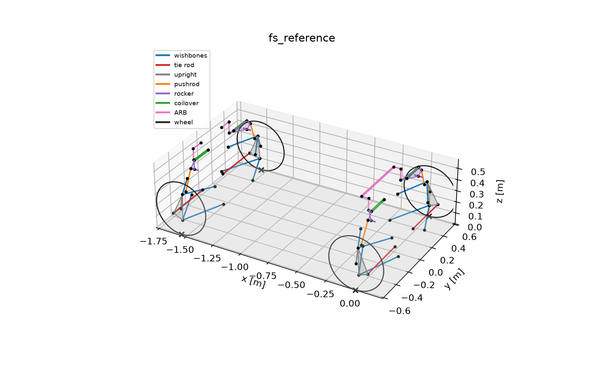

# Tutorial: a first session

This tutorial is a guided first session with `suspkin` for a new team member. You will load
the reference car, look at it, read its static numbers, sweep one wheel through bump and droop,
roll the whole car, build a report, change one hardpoint and see what it does, check a design
against constraints and run a tiny optimisation. Each step is done twice where it makes sense:
once from the command line and once from Python. Every output below was produced by running the
command shown, on `configs/vehicles/fs_reference.yaml`, with suspkin 1.1.0.

Allow about an hour. You need the [install](install.md) done (core install is enough; the `opt`
extra is not needed for the optimisation step here).

All commands run from the repository root. Prefix them with `uv run`, or with
`python -m uv run` on a machine where `uv` is not on `PATH`.

## 0. Three rules to carry with you

Full details are in [Conventions](../concepts/conventions.md). For this tutorial you need:

1. **Frame (ISO 8855).** $x$ forward, $y$ left, $z$ up. The origin is on the ground at the
   middle of the front axle. Hardpoints are given for the **left** side ($y > 0$); the right
   side is mirrored by the loader.
2. **Units.** Files and Python objects are SI: metres, radians, newtons, N/m. The command line
   takes and prints **mm and degrees**. Written CSV/JSON files are SI again. So a `camber`
   column of `-0.01745` is radians, which is $-1.000^\circ$.
3. **Wheel travel is positive in bump** (the wheel moves up relative to the body). Positive
   body roll is "left side up" (so the left wheel droops).

## 1. Look at the car

```bash
suspkin show configs/vehicles/fs_reference.yaml --out car.png
suspkin show configs/vehicles/fs_reference.yaml --roll 2 --heave 5 --out pose.png
```

Each command prints the path of the written image. The first draws the static geometry, the
second the car solved at 2 degrees of roll and 5 mm of heave. The picture below is a rendering of the reference car.
Without `--out` a matplotlib window opens; `--labels` writes the hardpoint names next to the
points; `--html` writes an interactive plotly page (needs the `viz` extra).



What you see: two wishbone pairs per axle (upper arm UCA, lower arm LCA), the tie rod from the
steering rack to the upright, the pushrod from the upper wishbone up to the rocker, and the
coilover and anti-roll bar (ARB) drop link on the rocker. The model of each hardpoint is
described in [Vehicle model](../concepts/vehicle-model.md).

## 2. The static summary

```bash
suspkin summary configs/vehicles/fs_reference.yaml
```

```text
metric                                   FL            RL  unit
camber                              -1.0000       -1.5000  deg
toe                                  0.0000        0.1000  deg
steer_angle                          0.0000       -0.1000  deg
caster                               4.9360        1.0416  deg
kpi                                  4.9360        4.6774  deg
scrub_radius                        17.7912       11.3202  mm
mechanical_trail                    20.1879        2.1336  mm
kingpin_offset_wc                   33.5000       24.0000  mm
spindle_length                      33.3841       24.0006  mm
half_track                         613.9791      595.9683  mm
half_track_change                    0.0000        0.0000  mm
contact_patch_dx                     0.0000        0.0000  mm
contact_patch_dy                     0.0000        0.0000  mm
wheel_center_recession               0.0000        0.0000  mm
wheelbase_change_contribution        0.0000        0.0000  mm
fvic_y                           -2671.7700    -1890.1020  mm
fvic_z                             180.3071      166.6076  mm
fvsa                              3285.7491     2486.0703  mm
fv_swing_angle                       3.1404        3.8322  deg
svic_x                                  nan           nan  mm
svic_z                                  nan           nan  mm
svsa                                    inf           inf  mm
sv_swing_angle                       0.0000        0.0000  deg
sv_wc_angle                          0.0000        0.0000  deg
rc_height                           33.7206       39.9991  mm
pushrod_angle                       64.7399       67.6404  deg
pushrod_angle_fv                    64.8681       67.6652  deg
rocker_rotation                      0.0000        0.0000  deg
coilover_compression                 0.0000        0.0000  mm
bump_stroke_remaining               40.0000       40.0000  mm
droop_stroke_remaining              40.0000       40.0000  mm
spring_force                       574.0000      696.0000  N
spring_rate                         35.0000       40.0000  N/mm
tyre_stiffness                     100.0000      100.0000  N/mm
camber_gain                         -0.0175       -0.0231  deg/mm
bump_steer                           0.0001        0.0003  deg/mm
caster_change                        0.0001        0.0000  deg/mm
track_change_rate                    0.0550        0.0672  mm/mm
rc_migration_rate                   -0.3379       -0.3307  mm/mm
mr_spring                            0.9807        0.9929  -
mr_progression                       0.0016        0.0022  1/mm
wheel_load_spring                  562.9010      691.0411  N
wheel_rate_linear                   33.6596       39.4320  N/mm
wheel_rate                          34.5673       40.9483  N/mm
ride_rate                           25.6877       29.0520  N/mm
```

This is the static pose (zero travel) of the front-left and rear-left corners; the right side
is the mirror image. The gradient rows (`camber_gain` and below) come from a short bump sweep
of $\pm 10$ mm (21 points) around the static pose. Each row is defined, with its formula and
sign, in [Metrics](../concepts/metrics.md). A reading guide to the numbers that matter most:

| Row | Value (FL / RL) | What it tells you |
|---|---|---|
| `camber` | -1.000 / -1.500 deg | Wheel inclination seen from the front; negative = top of the wheel leans inward. These are the static settings in the YAML (`static_camber`). [Camber](../concepts/metrics.md#camber) |
| `toe` | 0.000 / +0.100 deg | Positive = toe-in. Front zero, rear 0.1 deg. [Toe](../concepts/metrics.md#toe) |
| `caster`, `kpi` | caster 4.94 / 1.04 deg, kpi 4.94 / 4.68 deg | Side-view (caster) and front-view (kingpin inclination, KPI) lean of the steering axis, the line through the two ball joints. Caster gives self-aligning torque and trail. [Caster](../concepts/metrics.md#caster) |
| `scrub_radius` | 17.8 / 11.3 mm | Lateral distance on the ground between the point where the steering axis meets the ground and the tyre contact patch. Positive = the patch is outboard of that point. [Scrub radius](../concepts/metrics.md#scrub-radius) |
| `mechanical_trail` | 20.2 / 2.1 mm | Longitudinal distance between the steering axis ground point and the patch. [Mechanical trail](../concepts/metrics.md#mechanical-trail) |
| `fvic_y`, `fvic_z`, `fvsa` | -2672 mm, 180 mm, 3286 mm | Front-view instant centre: where the (extended) upper and lower arm lines cross. Here it is 2.7 m to the **right** of the car centreline for the left wheel, and only 180 mm high, so the line from the contact patch to it crosses the centreline just 34 mm above the ground: that is the roll centre. `fvsa` is the swing-arm length. [Front-view instant centre](../concepts/metrics.md#front-view-instant-centre) |
| `svic_*`, `sv_swing_angle` | nan, inf, 0 deg | The side-view arms are parallel, so the side-view instant centre is at infinity. Hence 0 % anti-dive below. |
| `rc_height` | 33.7 / 40.0 mm | Height of the roll centre above the ground at the car centreline (line from the patch through the front-view instant centre). [Roll centre height](../concepts/metrics.md#roll-centre-height-one-corner) |
| `pushrod_angle` | 64.7 / 67.6 deg | Elevation of the pushrod (rocker end higher than the wheel end). A steep rod loses little motion ratio; a flat one carries a high axial load. [Pushrod angles](../concepts/metrics.md#pushrod-angles) |
| `bump_stroke_remaining` | 40 mm | Room left before the coilover reaches its minimum length `length_min` (and `droop_stroke_remaining` before `length_max`). Both are 40 mm at the static length of 200 mm. |
| `spring_force`, `spring_rate` | 574 N, 35 N/mm | Static coilover preload force and spring constant, from the YAML. |
| `camber_gain` | -0.0175 / -0.0231 deg/mm | Camber change per mm of bump. Negative: the wheel gains negative camber as it moves up. [Gradients](../concepts/metrics.md#gradients) |
| `bump_steer` | 0.0001 / 0.0003 deg/mm | Toe change per mm of bump. Near zero is the aim. [Bump steer](../concepts/metrics.md#bump-steer) |
| `rc_migration_rate` | -0.338 mm/mm | The roll-centre height changes by -0.34 mm per mm of bump travel of this wheel. |
| `mr_spring` | 0.981 / 0.993 | **Motion ratio**: spring shortening per mm of wheel travel. [Motion ratio](../concepts/metrics.md#motion-ratio) |
| `wheel_rate` | 34.57 / 40.95 N/mm | Stiffness at the wheel: $k\,\mathrm{MR}^2$ plus a term from the spring preload and the MR progression. [Wheel rate](../concepts/metrics.md#wheel-rate) |
| `ride_rate` | 25.69 / 29.05 N/mm | Wheel rate in series with the tyre (100 N/mm). [Ride rate](../concepts/metrics.md#ride-rate) |

Now the car-level numbers:

```bash
suspkin vehicle configs/vehicles/fs_reference.yaml
```

```text
front.track                      1220.0000  mm
front.wheel_rate                   34.5673  N/mm
front.arb_wheel_rate_roll          32.2912  N/mm
front.roll_stiffness_springs      448.9858  N*m/deg
front.roll_stiffness_arb          419.4215  N*m/deg
front.roll_stiffness_tyres       1298.8740  N*m/deg
front.roll_stiffness              520.4454  N*m/deg
front.rc_height                    33.7206  mm
front.roll_camber                   0.8131  deg/deg
front.roll_steer                    0.0009  deg/deg
front.rc_migration                 65.9205  mm/deg (+ = toward left of the car centreline, for left-up roll)
front.rc_height_curvature          -0.5924  mm/deg^2
rear.track                       1180.0000  mm
rear.wheel_rate                    40.9483  N/mm
...
wheelbase                        1550.0000  mm
sprung_mass                       250.0000  kg
sprung_cg_height                  288.3200  mm
roll_axis_height_at_cg             37.0784  mm
roll_stiffness_total              989.6740  N*m/deg
roll_gradient                       0.6292  deg/g
ay_ref                              9.8100  m/s^2
load_transfer_front               336.7155  N
load_transfer_rear                332.6660  N
tlltd_front                        50.3025  %
anti_dive_front                     0.0000  %
anti_lift_rear                      0.0000  %
anti_squat_rear                     0.0000  %
anti_lift_front_accel                  n/a  %
pitch_centre_x                         nan  mm
pitch_centre_z                         nan  mm
max_steer_inner                    22.7415  deg
max_steer_outer                    22.7650  deg
ackermann_5deg                      0.3590  %
ackermann_10deg                     0.2459  %
ackermann_15deg                     0.0858  %
steering_ratio                      5.4164  deg/deg (handwheel/road wheel)
turning_radius                      3.6957  m
```

(The `rear.*` block repeats the front one: `rear.roll_stiffness` is 469.2 N m/deg, `rear.rc_height`
40.0 mm.) The rows you should be able to explain after this tutorial:

| Row | Value | Meaning |
|---|---|---|
| `roll_stiffness_*` | front 520 / rear 469 N m/deg | Moment per degree of body roll. Springs and ARB act in parallel; that sum is in series with the tyres. Total 989.7 N m/deg. [Roll stiffness](../concepts/metrics.md#roll-stiffness) |
| `roll_axis_height_at_cg` | 37.1 mm | Height of the line joining the front and rear roll centres, evaluated at the longitudinal position of the sprung CG. |
| `roll_camber` | 0.813 / 0.760 deg/deg | Change of the outer wheel's camber **relative to the ground** per degree of body roll. A rigid body would give 1; the linkage recovers only about 19 to 24 % of the roll. |
| `roll_gradient` | 0.629 deg/g | Body roll per g of lateral acceleration, including the weight moment of the sprung mass about the roll axis. [Roll gradient](../concepts/metrics.md#roll-gradient) |
| `load_transfer_front/rear` | 337 N / 333 N | Lateral load transfer per axle at `ay_ref` = 1 g. |
| `tlltd_front` | 50.3 % | Front share of the total lateral load transfer. Higher means the front axle carries more of the transfer, which tends toward understeer. [Load transfer and TLLTD](../concepts/metrics.md#load-transfer-and-tlltd) |
| `anti_dive_front`, `anti_squat_rear` | 0 % | Share of braking / driving load transfer carried by the links rather than the springs. Zero because the side-view arms are parallel. [Anti-features](../concepts/metrics.md#7-anti-features-and-pitch-centre) |
| `max_steer_inner/outer` | 22.7 / 22.8 deg | Road-wheel steer angles at the end of the rack travel (the outer is larger because the geometry is near parallel steer). |
| `ackermann_5deg` | 0.36 % | Ackermann percentage at 5 deg of outer-wheel steer: 100 % is true Ackermann, 0 % parallel steer. This car is nearly parallel. |
| `steering_ratio` | 5.42 deg/deg | Handwheel degrees per road-wheel degree, from the rack motion per pinion revolution (`c_factor` in the YAML, 0.09 m/rev) and the steer gain. |
| `turning_radius` | 3.70 m | Bicycle-model radius $L/\tan(\tfrac12(\delta_i+\delta_o))$ at full lock. |

See [Steering](../concepts/metrics.md#12-steering-vehicle-level) for the exact definitions.

## 3. Sweep one corner

```bash
suspkin sweep configs/vehicles/fs_reference.yaml --corner FL --travel -30 30 --steps 7 --metrics --out fl.csv
```

The command prints the path of the CSV. `--travel -30 30` is the wheel travel range in mm
(bump positive), `--steps 7` the number of points, `--metrics` adds metric and gradient columns
(it needs at least 3 steps). For a steering-rack sweep use `--rack-sweep MIN MAX` instead.

The CSV has 7 rows and 107 columns, all SI. The first columns are `corner`, `travel`, `rack`
(inputs), then the three solved unknowns `theta_uca`, `theta_lca`, `psi` (the two wishbone angles and the
spin of the upright about its ball-joint axis, see
[Corner kinematics](../concepts/corner-kinematics.md)), the rocker angle, `coilover_length`,
`toggle_margin`, `max_residual` (the solver's final error), then the 3D position of every
hardpoint (`uca_outer_x`, `uca_outer_y`, ...), then the metrics. Read it in Python and convert to display
units:

```python
import numpy as np
import pandas as pd

d = pd.read_csv("fl.csv")
show = d[["travel", "camber", "toe", "rc_height", "mr_spring"]].copy()
show["travel"] *= 1e3                       # m -> mm
show["camber"] = np.degrees(show["camber"])  # rad -> deg
show["toe"] = np.degrees(show["toe"])
show["rc_height"] *= 1e3
print(show.round(4).to_string(index=False))
```

```text
 travel  camber     toe  rc_height  mr_spring
  -30.0 -0.5708 -0.1938    44.1579     0.9335
  -20.0 -0.6929 -0.0862    40.6155     0.9434
  -10.0 -0.8359 -0.0219    37.1348     0.9627
    0.0 -1.0000  0.0000    33.7206     0.9799
   10.0 -1.1853 -0.0201    30.3779     0.9921
   20.0 -1.3923 -0.0821    27.1119     0.9949
   30.0 -1.6216 -0.1860    23.9287     0.9933
```

How to read it:

- **Camber** goes from -0.57 deg in droop to -1.62 deg at 30 mm bump: the wheel gains
  negative camber as it rises, about 0.0175 deg/mm around zero (the `camber_gain` of the
  summary; the CSV value -0.30493 is in rad/m, multiply by $180/\pi/1000$).
- **Toe** is almost flat near zero travel and curves to about -0.19 deg at both ends: a
  parabola. The slope at zero (bump steer) is tiny, which is what a good geometry looks like;
  the curvature away from zero is typical of a real design.
- **Roll centre height** falls from 44 mm to 24 mm as the wheel goes from droop to bump: the
  `rc_migration_rate` of -0.34 mm/mm. Roll centres that move this much are normal for short
  swing arms.
- **Motion ratio** rises from 0.934 in droop to 0.995 at +20 mm and then flattens: positive
  progression (`mr_progression` > 0) near zero, so the wheel rate rises in bump.

One honest note: at zero travel the 7-point table gives `mr_spring` = 0.9799, while the summary
(21 points over $\pm 10$ mm) gave 0.9807. Gradients are finite differences
(`numpy.gradient`) and depend on the point spacing; use finer steps for accuracy
([Gradients](../concepts/metrics.md#11-gradients)).

## 4. Body-pose sweep

A corner sweep moves one wheel. A vehicle sweep moves the **body** (heave, roll, pitch, or
the steering rack) and solves all four corners together, including the ARB coupling:

```bash
suspkin vsweep configs/vehicles/fs_reference.yaml --roll -2 2 --steps 5 --out roll.csv
```

Exactly one of `--heave` (mm), `--roll` (deg), `--pitch` (deg) or `--rack` (mm) is swept; the
others stay at their `--base-*` values. `--pivot X Y Z` (mm) moves the rotation centre; the
default is the CG. The CSV is SI with the per-corner prefixes `FL_`, `FR_`, `RL_`, `RR_` plus
vehicle columns such as `rc_front_y`, `rc_front_z`. For the roll sweep:

```text
 roll_deg  FL_travel_mm  FR_travel_mm  FL_camber
     -2.0       21.2572      -21.5319   -1.4199
     -1.0       10.6672      -10.7359   -1.1985
      0.0       -0.0000       -0.0000   -1.0000
      1.0      -10.7359       10.6672   -0.8247
      2.0      -21.5319       21.2572   -0.6728
```

(Columns converted to mm and deg as in section 3; the table lists only `FL_camber`.) At
+2 deg of roll (left side up) the left wheel droops by 21.5 mm and the right wheel bumps by
21.3 mm. The left wheel's camber **relative to the body** goes from -1.00 to -0.67 deg, a
change of only 0.16 deg per degree of roll. Relative to the **ground** the body roll adds to
it: `FL_camber_ground` is -2.67 deg and `FR_camber_ground` is +0.58 deg. The right wheel is
the outer one in a left turn, and its ground camber moves from -1.00 to +0.58 deg: 0.79 deg
per degree of roll, which is what the `roll_camber` of the summary (0.813 deg/deg, from a
finer fit) measures. The linkage recovers only about a fifth of the body roll. The difference
between chassis camber and ground camber is explained in
[Camber](../concepts/metrics.md#camber) and in
[Vehicle kinematics](../concepts/vehicle-kinematics.md).

## 5. Report

```bash
suspkin report configs/vehicles/fs_reference.yaml --out report/ --formats png --steps 21
```

The command prints `report/report.html`. It ran in about 9 s here. The folder contains:

```text
report/
  report.html  report.md  summary.json
  data/      fs_reference_front_corner.csv, _rear_corner, _rack, _heave, _roll, _pitch   (SI tables)
  figures/   corner_alignment_front.png, corner_position_*, corner_centres_*, actuation_*,
             steering.png, roll.png, heave_pitch.png, geometry_3d.png, roll_sweep.gif,
             summary_table_fs_reference.png
  bundles/   fs_reference/ (manifest.json, vehicle.yaml, summary.json, tables/)
```

Open `report.html` in a browser: a summary table, the 3D geometry and a roll animation, then
the figure groups. `--formats png,svg` (the default) writes vector copies too; `--no-3d` skips
the 3D view and the GIF; `--steps` sets the points per sweep (default 31). The CSVs in `data/`
are the same tables you built by hand in sections 3 and 4. The `bundles/` folder is a
re-openable result bundle: the web app can open it directly
([Web app guide](../guides/app.md)). How the report is assembled is in
[Sweeps and reports](../concepts/sweeps-and-reports.md).

Pass `--compare other.yaml` (repeatable) to overlay more designs on the same plots. You will
use that in section 7.

## 6. The same in Python

Everything the CLI does is a short pipeline of pure functions. This is the equivalent of
sections 2 and 3:

```python
import numpy as np
import suspkin as sk

vehicle = sk.load_vehicle("configs/vehicles/fs_reference.yaml")   # frozen, validated, SI
print(vehicle.vehicle.name, vehicle.vehicle.mass, "kg")
corners = sk.build_corners(vehicle)                               # FL, FR, RL, RR with mirroring
print(sorted(corners))
fl = corners["FL"]

travels = np.linspace(-0.030, 0.030, 7)                           # metres, bump positive
states = sk.sweep_corner(fl, travels)                             # solved corner states
table = sk.add_gradients(sk.metrics_frame(states, fl))            # pandas table, SI
print(table.shape)

summary = sk.vehicle_summary(vehicle)
print(f"roll gradient {np.degrees(summary.roll_gradient):.4f} deg/g")
print(f"front RC {summary.front.rc_height*1e3:.2f} mm  rear RC {summary.rear.rc_height*1e3:.2f} mm")
```

```text
fs_reference 290.0 kg
['FL', 'FR', 'RL', 'RR']
(7, 47)
roll gradient 0.6292 deg/g
front RC 33.72 mm  rear RC 40.00 mm
```

What the objects are:

| Call | Returns | Notes |
|---|---|---|
| `sk.load_vehicle(path)` | `Vehicle` | frozen pydantic model; raises `VehicleConfigError` with a readable message on a bad file |
| `sk.build_corners(vehicle)` | `dict[str, Corner]` | the four corners, right side mirrored from the left |
| `sk.sweep_corner(corner, travels)` | `list[CornerState]` | raises `KinematicsError` if the linkage cannot assemble |
| `sk.metrics_frame(states, corner)` | `pandas.DataFrame` | the metric columns of the states (47 columns with the gradients added) |
| `sk.add_gradients(df)` | `DataFrame` | adds `camber_gain`, `bump_steer`, `mr_spring`, ... |
| `sk.vehicle_summary(vehicle)` | `VehicleSummary` | front, rear, vehicle-level numbers; SI units |
| `sk.sweep_vehicle`, `sk.vehicle_frame` | states, table | the Python side of `vsweep` |
| `sk.run_standard_studies`, `sk.build_report` | studies, report folder | what `report` does |

The stable function list is `suspkin.__all__` ([Stability](../guides/stability.md));
the [Python API reference](../reference/api.md) has the signatures. The five scripts in
`examples/` are worked, runnable versions of this ([Examples](../guides/examples.md)).

## 7. Change one hardpoint and compare

A classic exercise: the tie rod inner point on the rack controls bump steer. If the inner end
is not on the line from the outer ball joint to the instant centre, toe changes with bump.
Move the front `tie_inner` 5 mm down and see the effect.

```python
import numpy as np
import suspkin as sk

vehicle = sk.load_vehicle("configs/vehicles/fs_reference.yaml")

data = vehicle.model_dump(by_alias=True)          # plain dict, safe to edit
x, y, z = data["front"]["hardpoints"]["tie_inner"]
data["front"]["hardpoints"]["tie_inner"] = (x, y, z - 0.005)   # 5 mm down, SI
variant = sk.Vehicle.model_validate(data)         # re-validates the new geometry
sk.save_vehicle(variant, "tie_down5.yaml")

for name, v in (("base", vehicle), ("tie_inner z -5 mm", variant)):
    c = sk.build_corners(v)["FL"]
    t = sk.add_gradients(sk.metrics_frame(sk.sweep_corner(c, np.linspace(-0.03, 0.03, 13)), c))
    r = t.iloc[int(np.argmin(np.abs(t["travel"])))]
    print(f"{name:<20} toe@+30mm {np.degrees(t['toe'].iloc[-1]):8.4f} deg  "
          f"bump steer {np.degrees(r['bump_steer'])/1e3:9.5f} deg/mm  "
          f"mr {r['mr_spring']:.4f}  rc {r['rc_height']*1e3:.2f}")
```

```text
base                 toe@+30mm  -0.1860 deg  bump steer   0.00008 deg/mm  mr 0.9805  rc 33.72
tie_inner z -5 mm    toe@+30mm   0.0657 deg  bump steer   0.00849 deg/mm  mr 0.9801  rc 33.72
```

Reading it: 5 mm of tie-rod height turned a bump steer of 0.0001 deg/mm into 0.0085 deg/mm, a
change of 0.25 deg of toe over 30 mm of bump. The motion ratio and roll centre did not move
(the tie rod does not touch the spring or the wishbones), which is expected: it only steers the
wheel. `Vehicle.model_validate` re-runs the geometry validation on the edited data, so a hardpoint
change that breaks the model is reported at that line, before any solving.

Now compare on the CLI, either the summary tables or a report with both designs:

```bash
suspkin summary tie_down5.yaml          # compare the rows with section 2
suspkin report configs/vehicles/fs_reference.yaml --compare tie_down5.yaml --out report_cmp/ \
    --formats png --steps 11 --no-3d
```

Comparing the two `summary` outputs line by line (`diff`), only front-left rows change:
`bump_steer` 0.0001 to 0.0085 deg/mm, `camber_gain` -0.0175 to -0.0182 deg/mm,
`track_change_rate` 0.0550 to 0.0579, `mr_spring` 0.9807 to 0.9802 and `wheel_rate` 34.57 to
34.54 N/mm; the whole RL column is identical. In `suspkin vehicle`, the rows tied to the front
steering move too: `front.roll_steer` 0.0009 to 0.0909 deg/deg, `ackermann_5deg` 0.36 to
0.45 % and `steering_ratio` 5.416 to 5.424. Roll centres, `tlltd_front` (50.30 to 50.29 %) and
the roll gradient barely change.
In `report_cmp/report.html` the two designs are overlaid on every figure and compared in the
summary table; the legend uses the YAML file names. (The report also shows the design label
from the `vehicle.name` field of each file, which is `fs_reference` in both.)

If you prefer editing by hand: copy `configs/vehicles/fs_reference.yaml`, change the numbers
(SI metres), and run `suspkin summary` on your copy. The file format is described in the
[Vehicle YAML guide](../guides/vehicle-yaml.md).

## 8. Check a design against constraints

A **study** YAML lists design variables, constraints (limits a design must respect) and
objectives (things to minimise). The command `check` evaluates the baseline vehicle of a study
against its constraints without changing anything:

```bash
suspkin check configs/studies/fs_reference_optimize.yaml
```

```text
name            type           value      min      max  unit           g  status  detail
camber_band_f   band          -0.629   -4.000    0.000  deg       -0.629  PASS
toe_band_f      band          -0.135   -0.500    0.500  deg       -3.654  PASS
bump_steer_r    slope          0.000   -0.020    0.020  deg/mm    -0.493  PASS
mr_front        value          0.980    0.900    1.100  -         -0.402  PASS
mr_rear         value          0.993    0.900    1.100  -         -0.464  PASS
travel_f        reach         10.224    0.000        -  mm       -10.224  PASS    bump stroke remaining
ubj_angle       joint_angle    5.931        -   25.000  deg     -190.687  PASS
rc_height_f     summary       33.721   10.000   80.000  mm        -0.339  PASS
tlltd_front     summary        0.503    0.450    0.600  -         -0.353  PASS
uca_front_zone  inside       -40.000        -    0.000  mm       -40.000  PASS
tie_len         distance     435.018  400.000        -  mm       -35.018  PASS
uca_above_lca   relation     325.000  225.000        -  mm      -100.000  PASS
12/12 constraints pass, feasible: yes

objective     type         raw  unit        f  weight  status  detail
camber_curve  curve      0.870  deg     8.702       1  OK
rc_f          target     6.279  mm      1.256       1  OK
bump_steer_f  minimize   0.011  deg/mm  1.076       1  OK      max_abs
mr_linearity  linearity  0.006  -       0.633     0.5  OK
f_total (weighted sum): 11.350
optimizer: mode weighted, method de+slsqp
```

(The column alignment in your terminal may differ slightly.) `g` is the **normalised
constraint value**: it is negative when the constraint is satisfied and positive when it is
violated, scaled by the constraint's `scale` so different units are comparable. `f` is the
normalised objective, and `f_total` the weighted sum the optimiser minimises (11.350 for the
baseline). Exit code 0 here; with `--strict`, exit code 1 means the baseline is infeasible
(useful in scripts). Details of each constraint type are in the
[Study YAML guide](../guides/study-yaml.md).

## 9. A tiny optimisation

```bash
suspkin optimize configs/studies/fs_reference_optimize.yaml --method de --evaluations 40 \
    --workers 1 --out opt_demo --no-report
```

```text
optimize: method de, mode weighted, 11 variables, 12 constraints, 4 objectives, 1 workers, budget 40 evaluations / 900 s
done: 44 new evaluations (44 in history), 2.7 s, 1 workers

objectives
objective     baseline   best  unit    f base  f best
camber_curve     0.870  0.931  deg      8.702   9.314
rc_f             6.279  1.021  mm       1.256   0.204
bump_steer_f     0.011  0.013  deg/mm   1.076   1.275
mr_linearity     0.006  0.006  -        0.633   0.604
f_total: baseline 11.350 -> best 11.095

constraints
constraint      baseline     best  unit      g base    g best  status
camber_band_f     -0.629   -0.530  deg       -0.629    -0.530  PASS
...
tie_len          435.018  449.065  mm       -35.018   -49.065  PASS
uca_above_lca    325.000  324.500  mm      -100.000  -99.500  PASS
feasible: baseline yes, best yes
```

(`...` marks rows omitted here; the program prints all 12.) The `--method de` option is
differential evolution (needs no extra); the YAML default `de+slsqp` runs DE for 80 % of the
budget then polishes with SLSQP. DE works in generations of a whole population, so 44
evaluations ran against a budget of 40. With only 40 evaluations the result is a smoke test, not
a design: `f_total` went from 11.350 to 11.095 mainly by moving the roll centre height from
33.7 to 39.0 mm (target 40 mm), at the price of a slightly worse camber curve. Real runs use
hundreds to thousands of evaluations and several workers.

The run folder holds `best.yaml` (the best design as a complete vehicle file, ready for
`suspkin summary` or `suspkin report --compare`), `history.csv` (every evaluation, normalised
variables, constraint and objective values), `result.json`, `meta.json`, `study.yaml`,
`vehicle.yaml` and `figures/` (`convergence.png`, `constraint_margins.png`, `parallel.png`).
Without `--no-report` the run also writes a before/after `report/`. How the optimiser works is
in [Optimisation](../concepts/optimization.md).

Compare the optimised design with the baseline exactly as in section 7:

```bash
suspkin report configs/vehicles/fs_reference.yaml --compare opt_demo/best.yaml --out report_opt/
```

## Where to go next

- Understand the numbers: [Conventions](../concepts/conventions.md), then
  [Metrics](../concepts/metrics.md).
- Build your own car: [Vehicle YAML](../guides/vehicle-yaml.md), then check it with
  `suspkin summary` and `suspkin show`.
- Define your own optimisation: [Study YAML](../guides/study-yaml.md).
- Compare designs interactively and edit hardpoints in the browser:
  [Web app](../guides/app.md).
- Many variables at once: [Surrogate optimisation](../guides/surrogate.md).
- Every CLI option: [Command line](../guides/cli.md).
