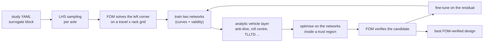

# Surrogate optimisation (experimental)

The neural surrogate replaces the exact kinematic model (the "full-order model", FOM) inside the
optimiser with two small neural networks, so that **all hardpoints of both axles** can be
optimised together. This guide is the workflow: sample, train, validate, optimise, read the
results. The principle, the channels, the network, the vehicle layer and the active-learning rules
are explained in [Neural surrogate and active learning](../concepts/surrogate.md).

It is **experimental**: `suspkin.surrogate` is not in `suspkin.__all__` and its Python API may
change in minor releases. The `surrogate:` study block and the commands below are additions to
study schema 1 ([Stability](stability.md)).

!!! note "Every reported design is FOM-verified"
    The networks only propose designs. `best.yaml`, `history.csv` and the Pareto designs of a
    surrogate run are always results of the exact solver, never network predictions.

## 1. When to use it

Optimising every hardpoint at once (the benchmark study has 90 variables) needs far more
evaluations than the FOM can afford. These numbers were measured by the developers on one
machine (GTX 1650) and are indicative:

| Quantity | Measured |
|---|---|
| One FOM evaluation of the reference study | about 240 ms per design |
| One surrogate evaluation (batch 1024) | about 2.5 to 2.9 ms per design |
| Sampling the front dataset (grid 41 x 21) | 14.8 samples/s, about 25 min for 20 000 samples (rear: about 2 min) |
| Dataset size | about 101 kB per front sample, about 5 kB per rear sample (the rear grid has no rack axis) |
| Final training, front, 600 epochs | about 51 min (rear about 10 min) on the GTX 1650 |

The surrogate pays off when you need very many evaluations, or when you can reuse trained
networks (and their dataset) for several studies on the same car. It has fixed costs that plain
`suspkin optimize` does not have: sampling, an architecture search and training. For a handful
of variables, plain `suspkin optimize` is simpler and needs no training. A benchmark comparing
both at equal cost is scripted (section 9) but its results are not recorded in the repository,
so there is no measured claim here that the surrogate matches direct optimisation.

## 2. How it works, in five steps



1. **Sampling.** A Latin hypercube in the unit cube of each axle's design variables (row 0 is
   the baseline). Each sample solves one corner of one axle over a grid of wheel travel (and rack
   for the front). Infeasible samples are kept and flagged.
2. **Two networks.** The front network predicts corner curves on a travel x rack grid, the
   rear network on a travel grid. Split 80 / 10 / 10 into train, validation and test; the test
   split is never used for training or model selection. The architecture is searched with Optuna.
3. **Analytic vehicle layer.** Vehicle quantities (anti-dive, roll centre, roll stiffness,
   TLLTD, roll gradient, Ackermann ...) are **never predicted**: they are computed from the
   predicted curves with the same formulas as the FOM.
4. **Optimisation on the networks.** The study's `optimizer` block runs on the networks inside a
   trust region around the best FOM-verified design, with a safety margin on constraints.
5. **Active learning.** Each iteration the FOM verifies the predicted optimum (and a few
   perturbations), the new curves are added to the dataset, and the networks are fine-tuned. The
   trust region halves when the prediction was poor and doubles when it was good and the step
   reached the boundary. The loop stops on agreement, stagnation, minimum radius, or a budget.

### Producible designs (hardpoint grid)

The study's `resolution` (default 0.5 mm, see the [Study YAML guide](study-yaml.md)) applies to
every design the optimisers choose, so the result can be manufactured. The training dataset stays
continuous (not snapped), so datasets and models do not depend on the resolution. At
optimisation time the network input is the snapped design, the FOM verifies the snapped design,
and `best.yaml` and the Pareto designs are on the grid. The trust-region radius cannot shrink
below one grid step of the coarsest variable.

## 3. Install

```bash
uv sync --extra surrogate
```

The extra adds `torch` (2.5 to 2.6) and `optuna`; a plain `uv sync` installs neither. On Windows
the CUDA 12.4 build of torch is installed (about 2.5 GB download); on Linux the CPU build; Intel
Macs are not supported ([Install](../getting-started/install.md)). `surrogate sample` needs
neither torch nor optuna.

Device selection, from `training.device` in the study or `--device`:

| Value | Behaviour |
|---|---|
| `auto` | CUDA if available, else CPU (default) |
| `cpu` | always CPU |
| `cuda` | CUDA; error (exit 2) if no CUDA device exists |

```bash
uv run python -c "import torch; print(torch.cuda.is_available())"
```

CPU and CUDA runs are not bit-identical; with the same seed a run repeats on the same device.

## 4. The `surrogate:` block

From `configs/studies/fs_reference_surrogate.yaml` (90 variables, every hardpoint of both axles).
The block, as committed:

```yaml
surrogate:
  grid:
    travel: {min: -30 mm, max: 30 mm, points: 41}   # both axles
    rack: {min: -30 mm, max: 30 mm, points: 21}     # front only
  dataset: {n_initial: 20000, seed: 1, lhs_optimization: auto}
  training: {device: auto, max_epochs: 600, patience: 600}
  hpo: {n_trials: 60, timeout: 90 min, parallel: auto, max_epochs: 300, subsample: 5000}
  active_learning:
    max_iterations: 50
    fom_evaluations: 2000          # FOM budget of the whole run, baseline included
    surrogate_evaluations: 20000   # budget of each inner search on the networks
    infill: {top: 0, perturb: 4}   # extra candidates besides the predicted optimum
    finetune: {epochs: 60, weight: 5.0}
    margin: 0.05                   # constraint margin on normalised g
    trust_region: {initial: 0.2, min: 0.01, max: 0.5}
    stop: {eps_f: 0.01, patience: 5}
```

The block has six groups: `grid` (travel and rack axes), `dataset` (sampling), `training`
(final training), `hpo` (architecture search), `active_learning` (loop budgets, infill, trust
region, stop rule, fine-tune schedule). Omitted keys take their defaults. Units in the block are
SI numbers or strings with units (`"30 mm"`, `"90 min"`). Every key with type, default and
validation rule is in the
[Study YAML guide](study-yaml.md#surrogate-experimental); what each group does is explained in the
[concept page](../concepts/surrogate.md#3-study-block-surrogate-and-optimizespecsurrogate).

!!! warning "Same study for every command"
    A dataset and a model store hashes of the vehicle baseline, the design space and the grid.
    Change the vehicle, the variables or the grid and you must sample and train again; the
    commands refuse a mismatch with a message saying which input differs.

## 5. Step by step

Run all commands from the repository root. `ROOT` is the surrogate folder; every command takes
the same one. Prefix with `uv run` (or `python -m uv run`).

```bash
# 1. Sample the dataset (resumable)
suspkin surrogate sample configs/studies/fs_reference_surrogate.yaml --root results/sur --workers auto

# 2. Architecture search and training (needs the surrogate extra)
suspkin surrogate train configs/studies/fs_reference_surrogate.yaml --root results/sur --device auto

# 3. Test-split error per channel
suspkin surrogate validate configs/studies/fs_reference_surrogate.yaml --root results/sur

# 4. Optimise with active learning
suspkin optimize configs/studies/fs_reference_surrogate.yaml --surrogate results/sur --out results/sur_run
```

| Command | Options |
|---|---|
| `surrogate sample STUDY` | `--root DIR` (required), `--axle front\|rear\|both` (default both), `--n N` (samples per axle, default from the study), `--workers N\|auto`, `--resume` |
| `surrogate train STUDY` | `--root DIR` (required), `--axle`, `--trials N`, `--timeout "2 h"`, `--device auto\|cpu\|cuda` |
| `surrogate validate STUDY` | `--root DIR` (required), `--axle`, `--device` |
| `optimize STUDY --surrogate DIR` | `--device`, `--evaluations N` (FOM budget of the whole run folder), `--time` (this invocation), `--resume` (needs `--out`), `--workers`, `--method`, `--no-report`, `--out RUN` |

Exit codes: 0 ok, 2 study, argument or data error, 1 from `validate` when a channel is over
tolerance and from `optimize` when no feasible design was found. Every option of every command is
in the [Command line guide](cli.md).

### 5.1 Sample

A small run to see the output (40 samples per axle, one worker; this is the real output):

```bash
suspkin surrogate sample configs/studies/fs_reference_surrogate.yaml --root results/sur_demo --n 40 --workers 1
```

```text
front: 40 samples, about 4045080 bytes uncompressed (101127 per sample)
front: rows 40/40
front: 40 samples (40 new), feasible 100.0 %, 3.2 s
rear: 40 samples, about 200920 bytes uncompressed (5023 per sample)
rear: rows 40/40
rear: 40 samples (40 new), feasible 100.0 %, 0.3 s
```

That is 12.5 front samples per second on one worker for this demo (the 14.8 samples/s of the
benchmark was measured at 20 000 samples). Notes:

- `sample` refuses a non-empty dataset folder (`... is not empty; use --resume or a new --out
  directory`, exit 2) unless you pass `--resume`, which keeps the existing shards and computes
  the rest; the result equals an uninterrupted run.
- It reports the **feasible fraction** and warns when it is below 30 %: the variable domains
  are probably too large (most random designs cannot assemble), so narrow them.
- With `--axle both`, an axle with no variables in the study is skipped.

### 5.2 Train

`surrogate train` runs an Optuna architecture search per axle (`hpo.n_trials` trials, stopping at
`hpo.timeout`), then retrains the best configuration on the full training split with
`training.max_epochs` and `training.patience`. The search trials are cheap screenings: each trains
on at most `hpo.subsample` rows for at most `hpo.max_epochs` epochs and is scored on the complete
validation split, so scores are comparable with the final model. Resuming a search in a folder
whose trials used another budget stops with an error: use a new `--root` or delete
`models/<axle>/`. The search resumes from `optuna.db`; `--trials` and `--timeout` override
`hpo.*`. Without a dataset it fails with `no dataset in ...; run surrogate sample first`.

At the end, `models/hpo_report.md` is written: per axle the budget, trial states, the best and
top-10 trials, pruning and the final model.

### 5.3 Validate

`surrogate validate` evaluates each axle's model on its **test** split and compares the error of
each channel with the channel's engineering tolerance. This is a real run (rear axle, using the
committed benchmark rear network and a fresh 40-sample dataset, so only 3 test rows: a format
demonstration, not a quality statement):

```bash
suspkin surrogate validate configs/studies/fs_reference_surrogate.yaml --root results/sur_demo --axle rear --device cpu
```

```text
device: cpu (requested cpu)
rear: 3 test samples, score 0.339, validity accuracy 100.0 %
  channel                          rmse        tol  unit    ratio  status
  camber                       0.003046       0.02  deg      0.15  ok
  toe                          0.001944       0.02  deg      0.10  ok
  caster                         0.0084       0.05  deg      0.17  ok
  ...
  sv_swing_angle                0.03511       0.05  deg      0.70  ok
  coilover_length               0.05026       0.05  mm       1.01  OVER
  rocker_angle                  0.01633       0.05  deg      0.33  ok
  pushrod_angle                 0.03074       0.05  deg      0.61  ok
  toggle_margin                   0.141       0.05  deg      2.82  OVER
  ...
  theta_uca                    0.007266       0.01  deg      0.73  ok
  theta_lca                    0.003303       0.01  deg      0.33  ok
  psi                          0.001947       0.01  deg      0.19  ok
<ROOT>/validation/rear
error: 2 channel(s) over tolerance
```

(`...` marks rows left out here; the command prints all 28 rear channels.) The exit code was 1
because two channels exceeded their tolerance. See section 7 for reading it.

### 5.4 Optimise

```bash
suspkin optimize configs/studies/fs_reference_surrogate.yaml --surrogate results/sur --out results/sur_run
```

The loop prints one line per iteration (`iter k: r ..., f_nn ..., f_fom ..., rho ..., best ...,
N FOM evals, T s`) and writes the run folder (section 6). `--evaluations N` is the FOM budget of
the whole run folder, baseline included; `--time` limits this invocation; `--resume` continues a
run in `--out`. Without CUDA, fine-tuning is skipped by default (section 8).

## 6. Output layout

```text
ROOT/
  dataset/<axle>/     shard_00000.npz ...  meta.json  lhs.npy
  models/
    hpo_report.md                  search report (written by `train`)
    <axle>/
      optuna.db, trials.csv, hpo_result.json     architecture search
      model/                       current network (model.pt, model.json, norm.npz)
      pre_al/                      network before the active-learning loop
      al_<k>/                      snapshot after iteration k
  validation/<axle>/  validation.csv worst.csv parity.csv worst_curves.csv summary.json figures/

RUN/                  (optimize --surrogate ROOT --out RUN)
  study.yaml, vehicle.yaml, meta.json, result.json
  history.csv         FOM history; sources `baseline`, `al_<k>`
  al.csv              one row per iteration
  al/iter_<k>/        surrogate_history.csv of the inner search
  figures/            al_progress, al_residual, al_radius (+ the usual optimiser figures)
  best.yaml           best FOM-verified design (pareto/ and pareto.csv in pareto mode)
```

Active learning **appends** its FOM rows to `ROOT/dataset/` (source `al_<k>`) and writes the
fine-tuned models into `ROOT/models/`; the model before the loop stays in `pre_al/`. So running
the loop twice on the same `ROOT` starts from the fine-tuned models of the first run; keep a
copy of `ROOT` if you want to repeat from the trained state.

## 7. Reading the results

### Validation

For each channel `validate` gives the test **RMSE** in display units, the channel **tolerance**
(engineering tolerance, not a fitted number), their **ratio** (RMSE / tolerance) and `ok` when
the ratio is at most 1. The `score` in the header is the mean ratio over channels; "validity
accuracy" is the fraction of grid nodes where the network's validity head agrees with the FOM
(a node is valid when the corner assembled and all values are finite). Exit code 0 means every
channel is within tolerance; 1 means at least one is over.

Tolerances differ per channel. Examples (from `suspkin.surrogate.channels`): camber and toe
0.02 deg, caster and KPI 0.05 deg, scrub radius, trail and contact-patch shifts 0.1 mm, swing
angles 0.05 deg, `coilover_length` 0.05 mm, rocker and pushrod angle 0.05 deg, rod-end and ball
joint angles 0.1 deg, solver coordinates `theta_uca`, `theta_lca`, `psi` 0.01 deg.

| File or figure | Shows |
|---|---|
| `validation.csv`, `summary.json` | per-channel RMSE, tolerance, ratio, pass or fail |
| RMSE / tolerance bars | the ratio per channel; bars above 1 are over tolerance |
| `parity.csv` (parity scatter) | predicted against FOM value on valid test points; points should lie on the diagonal |
| `worst_curves.csv` | FOM (solid) and predicted (dashed) curves of the worst test samples per channel |
| `worst.csv` | the worst samples |

What is normal: the mean score can be below 1 while single channels are above it. The benchmark
models trained on 20 000 samples per axle reach a final validation score of 0.864 (front) and
0.473 (rear), with `toggle_margin` and `coilover_length` (and `psi` on the front) still 2.6 to
4.5 tolerances off: `toggle_margin` has a kink where the rocker passes its dead centre and
`coilover_length` has a very tight tolerance (0.05 mm). These are validation scores
([report](../reports/surrogate-training.md)). The surrogate still works for optimisation because
the FOM verifies every candidate; large errors only slow the loop (the trust region shrinks)
and, on tight constraints near zero margin, can flip a predicted pass to a real fail, which the
FOM verification catches. If your model has many channels over tolerance, sample more, train
longer or narrow the domains. Run `validate` on your own model before trusting it.

### Active learning

`RUN/al.csv` has one row per iteration. Key columns: `radius`, `f_nn` (predicted), `f_fom`
(verified), `rho` (trust ratio: realised over predicted gain; below 0.25 the radius halves, above
0.75 and at the boundary it doubles), `best_f`, `n_fom`, `resid_front` / `resid_rear` (network
error at the new verified point, mean RMSE / tolerance), `kept_init_<axle>` (fine-tuning kept the
previous weights), `skipped_<axle>` and `skip_reason_<axle>`, `agree`, `improved`, `at_min`
and timings `sec_*`.

| Figure (`RUN/figures/`) | Shows | Good looks like |
|---|---|---|
| `al_progress` | best FOM-verified f, and f of the infill optimum from the FOM and from the network, per iteration | best f falls; the network and FOM curves converge |
| `al_residual` | network error at the infill optimum before fine-tuning, as mean RMSE / tolerance per axle (dashed line: tolerance = 1) | falls towards the tolerance line as the model learns the region |
| `al_radius` | trust-region radius (log scale) | shrinks around a good optimum; stuck at the minimum means the model cannot follow |

The **stop reason** is in `meta.json` (`active_learning`) and printed at the end:
`agreement` (network and FOM agree on f and feasibility for `stop.patience` iterations),
`stagnation`, `radius_min`, `max_iterations`, `fom_budget`, `time_budget`, `no_candidates` (the network
search returned nothing, or all infill points were already verified designs) or `error`. The final report and `best.yaml` are
the FOM-verified best; compare them with the baseline as with any optimisation
([Optimisation](../concepts/optimization.md)).

## 8. Fine-tuning cost and CPU runs

Fine-tuning dominated an active-learning iteration in the first benchmark (about 315 s per
iteration for both networks on the GTX 1650). The current defaults bring it to about 50 s
(CHANGELOG 1.1.0), and 10 to 60 s per axle in general:

- Replayed train rows and the validation split are normalised once and kept on the device; only
  new rows are appended.
- `epochs` caps a fine-tune and compresses the learning-rate schedule to it; `patience` stops it
  after that many epochs without a new best. A fine-tune never returns weights worse than it
  started with.
- `trigger`: an axle is fine-tuned only if the residual of the new verified point exceeds it
  (default 1.0: one tolerance). New rows are still appended to the dataset. `trigger: 0` always
  fine-tunes.
- Stall rule: after `skip_after` (2) consecutive fine-tunes that kept the starting weights, the
  axle is skipped for `skip_for` (2) iterations unless its residual exceeds
  `stall_override * trigger`. `skip_for: 0` turns the rule off.

**On the CPU** a front fine-tune takes many minutes per iteration, which would remove the
speed advantage. With `--device cpu`, or `auto` without CUDA, fine-tuning is therefore skipped by
default: the run logs this once, the networks stay as trained, new verified rows are still
appended and `al.csv` records `cpu` in `skip_reason_front` / `skip_reason_rear`. Set
`active_learning.finetune.on_cpu: run` to fine-tune on the CPU anyway.

## 9. Sharing and reusing trained models

The `models/` folder alone is enough to run `suspkin optimize STUDY --surrogate ROOT`: the models
are checked against the study through the hashes stored in `model.json`, the loop runs as usual
(FOM verification, trust region, stop rules, report), and fine-tuning is disabled for every axle
without `ROOT/dataset/<axle>` (`skip_reason` `no_dataset` in `al.csv`). Fine-tuning,
`surrogate validate` and `surrogate train` need the dataset. The dataset is large and stays local
but can be regenerated with `suspkin surrogate sample` (same study, same seed).

The repository ships the benchmark networks in
`results/benchmark_surrogate/surrogate/models/{front,rear}/` for
`configs/studies/fs_reference_surrogate.yaml`. The weights are stored with **Git LFS**: run
`git lfs install` and `git lfs pull`, otherwise `model.pt` is a 133-byte pointer file and
loading fails ([Install](../getting-started/install.md#git-lfs-for-the-committed-surrogate-models)).
To use them:

```bash
suspkin optimize configs/studies/fs_reference_surrogate.yaml \
    --surrogate results/benchmark_surrogate/surrogate --out results/sur_run
```

## 10. Helper scripts

| Script | Purpose |
|---|---|
| `scripts/benchmark_surrogate.py` | the whole comparison on `configs/studies/fs_reference_surrogate.yaml`: stages `sample`, `train`, `validate`, `al`, `de_same` (direct DE with the same number of FOM evaluations as the AL run), `de_total` (direct DE at the FOM-equivalent cost of AL plus dataset) and `report` (`benchmark.md`, `benchmark.json`) |
| `scripts/surrogate_hpo_report.py --root ROOT [--out FILE] [--axles front rear]` | regenerate `hpo_report.md` from an existing root, also while a search is running (the Optuna databases are read-only) |
| `scripts/surrogate_retrain_best.py STUDY --root ROOT --axle front\|rear [--device D]` | retrain only the best configuration of an existing search, without new trials (for example after an interrupted final training); marks trials left `RUNNING` as failed |

```bash
uv run python scripts/benchmark_surrogate.py --dry-run          # print the plan and what is done
uv run python scripts/benchmark_surrogate.py --device cuda --workers auto
```

Defaults: `--root results/benchmark_surrogate/surrogate`, `--run results/benchmark_surrogate/run`.
The script is resumable: a stage whose output exists is skipped, `--force STAGE` (repeatable)
redoes one. Exit code 1 of `validate`, `al` and the DE runs is accepted as a result.

## 11. Limitations and common messages

- **Experimental.** Not in `suspkin.__all__`; the API may change in minor releases.
- **Bound to its inputs.** Vehicle, variables, grid and channel list are hashed; a mismatch is
  refused (sample again, train again).
- **Symmetric variables only.** A variable moves the left point and the right side mirrors it.
- **Fixed grid.** The vehicle layer interpolates inside the grid and returns NaN outside it.
  Roll and heave beyond the travel range are not covered; travel 0 and rack 0 must be grid nodes.
- **Rates are finite differences** of the grid curves; their accuracy is bounded by the grid
  spacing. Spring rates and ARB stiffness are not variables on this path.
- **One ARB type per batch.** Constraints that need a column the vehicle layer does not provide
  are reported as unsolved, not approximated.
- **Windows.** Worker pools use `spawn`: a Python script that calls the surrogate functions
  directly needs an `if __name__ == "__main__":` guard. The CLI is safe.
- **Torch missing.** The numpy-only modules still import; loading a network raises an
  `ImportError`, which `optimize --surrogate` turns into exit code 2.

| Message (shortened) | Fix |
|---|---|
| `study has no 'surrogate' block` | add the block to the study |
| `... is not empty; use --resume or a new --out directory` | pass `--resume` or choose a new `--root` |
| `no dataset in ...; run surrogate sample first` | sample before training |
| `dataset does not match the study (... differs)` | the vehicle, variables or grid changed: sample into a new root |
| `model does not match the study` / `model was trained on another dataset` | retrain with `surrogate train` |
| `no trained model in ...; run surrogate train first` | run `train` before `validate` or `optimize --surrogate` |
| `the test split is empty; sample more points` | increase `--n` or `dataset.n_initial` |
| `--device cuda` without CUDA (exit 2) | use `--device auto` or `cpu`, or fix the torch install |
| `the constraints/objectives changed since the last run; start a new run` | do not `--resume` a changed study; use a new `--out` |
| `--resume needs an explicit run folder (--out)` | pass `--out RUN` |
| a LFS pointer where `model.pt` should be | `git lfs pull` |

## See also

- [Neural surrogate and active learning](../concepts/surrogate.md): the theory and the code.
- [Surrogate training report (Nov 2026)](../reports/surrogate-training.md): the benchmark run.
- [Command line](cli.md), [Study YAML](study-yaml.md), [Optimisation](../concepts/optimization.md).
- [Stability and versioning](stability.md).
