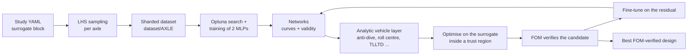

# Surrogate optimisation (experimental)

The v1.1 surrogate replaces the full-order model (FOM) inside the optimiser with two small neural
networks, so that **all hardpoints of both axles** can be optimised together. It is experimental:
the Python package `suspkin.surrogate` is not in `suspkin.__all__` and its API may change in minor
releases. The `surrogate:` study block and the commands below are additions to study schema 1
([Stability and versioning](stability.md)).

## When to use it

Optimising every hardpoint at once (the reference benchmark has 90 variables) needs far more
evaluations than the FOM can afford. One FOM evaluation of the reference study takes about 240 ms
per design; one surrogate evaluation takes about 2.5 to 2.9 ms per design at batch 1024.

The surrogate pays off when you need very many evaluations, or when you reuse the trained
networks. It has fixed costs that plain `suspkin optimize` does not have:

| Cost | Measured |
|---|---|
| Sampling the dataset (front, 41 x 21 grid) | 14.8 samples/s, about 23 min for 20 000 samples |
| Dataset size | about 100 kB per sample (float32) |
| Architecture search and training | `hpo.n_trials` trials per axle, up to `hpo.timeout` (default 4 h); each trial is capped by `hpo.max_epochs` and `hpo.subsample`, then the best configuration is retrained in full |
| Training, GPU smoke test (GTX 1650) | 4.4 s per epoch, 1.33 GB (20 000 samples, 21 x 41 grid) |

For a handful of variables, plain `suspkin optimize` is simpler and needs no training.
The benchmark that compares both approaches at equal cost
([benchmark script](#benchmark-script)) has not been run yet, so there is no measured claim
that the surrogate matches direct optimisation.

!!! note "Every reported design is FOM-verified"
    The networks only propose designs. `best.yaml` and the history are always FOM results.

## How it works



1. **Sampling.** A Latin hypercube in the unit cube of each axle's design variables; row 0 is the
   baseline. Each sample solves only the left corner of one axle (about half the cost of a full
   design). Infeasible samples are kept and flagged, because the validity output needs them.
2. **Two independent networks.** The front network predicts corner curves on a
   wheel-travel x rack grid; the rear network on a wheel-travel grid. The grid comes from
   `surrogate.grid`. The train / validation / test split is 80 / 10 / 10, fixed per row; the test
   split is never used for training or model selection. The architecture (layers, width,
   activation, residual connections, dropout, POD output, learning rate ...) is searched with
   Optuna (TPE sampler, Hyperband pruner); the objective is the mean over channels of RMSE divided
   by the channel tolerance.
3. **Analytic vehicle layer.** Vehicle-level quantities (anti-dive, anti-lift, anti-squat, roll
   centre, roll stiffness, TLLTD, roll gradient, Ackermann, ...) are **never predicted**. They are
   computed from the predicted curves with the same formulas as the FOM. Camber gain, bump steer
   and motion ratios are finite differences of the predicted curves.
4. **Optimisation on the surrogate.** The study's `optimizer` block (method, mode, seed) runs on
   the networks with a budget of `active_learning.surrogate_evaluations`, inside a trust region
   around the best FOM-verified design and with a margin on the constraints.
5. **Active learning.** Each iteration: the FOM evaluates the predicted optimum (and
   `infill.perturb` perturbations of it), the new curves are appended to the dataset, and the
   networks are fine-tuned from their current weights. The trust-region radius halves when the
   prediction was poor and doubles when it was good and the step reached the box boundary. The
   loop stops on agreement, stagnation, minimum radius, or an iteration, FOM or time budget.

### Producible designs (hardpoint grid)

The study's `resolution` (default 0.5 mm, see the [study YAML guide](study-yaml.md)) applies to
every design the optimisers choose. The training dataset stays continuous (Latin hypercube, not
snapped), so existing datasets and models remain valid; the resolution is not part of the
dataset or model hashes. At optimisation time:

- The network input is the snapped design re-encoded to the unit cube (decode, snap, encode), so
  a prediction belongs to a producible design. Two search points that snap to the same design
  share one prediction.
- The FOM verifies the snapped candidate. Infill points that snap to an already verified design
  are dropped; when no new grid design is left, the loop stops with `no_candidates`.
- The trust-region radius cannot shrink below one grid step of the coarsest variable (in unit-cube
  units); the effective minimum is `max(trust_region.min, step)`.
- The reported best design, the Pareto designs and `best.yaml` are on the grid. The `baseline` row
  of the history is the baseline snapped to the grid; the baseline reference of the report is the
  unsnapped vehicle.

### Channels and validity

Each network predicts, per grid point, 29 channels on the front and 28 on the rear (the steer angle
is front only):

| Group | Channels |
|---|---|
| Alignment, wheel position | camber, toe, steer angle (front), caster, KPI, scrub radius, mechanical trail, half-track change, contact-patch dx and dy, wheel-centre recession |
| Centres | front-view swing angle, side-view swing angle, side-view wheel-centre angle |
| Actuation | coilover length, rocker angle, pushrod angle, toggle margin |
| Joints | misalignment angle of each rod end and ball joint |
| Solver coordinates | `theta_uca`, `theta_lca`, `psi`, which rebuild the exact corner states |

Swing angles are stored as the angle of the **line** from the reference point (contact patch or wheel centre) to the instant centre, wrapped modulo 180 degrees to (-90, 90] degrees (0 = horizontal line, tolerance 0.05 deg). Direction is deliberately dropped: with nearly parallel arms the instant centre jumps from in front of to behind the reference point and the direction flips by 180 degrees, a step function of the design that a network cannot fit, while the line angle stays small and smooth. Roll centre, pitch centre and anti-dive / anti-squat / anti-lift need only the line (tan has period 180 degrees). Instant centres themselves go to infinity for parallel arms; the angle stays bounded. A **validity mask** per grid point marks where the
corner was kinematically solved and finite; a second network head predicts it. A query outside the
grid, or touching a masked node, gives NaN for the affected outputs, never an extrapolation.
Travel 0 and rack 0 must be grid nodes.

## Install

```bash
python -m uv sync --extra surrogate
```

The extra adds `torch` (2.5 to 2.6) and `optuna`. A plain `uv sync` installs neither. On Windows the
CUDA 12.4 build of torch is installed (about 2.5 GB download); on Linux the CPU build. Intel Macs
have no torch build in the pinned range, so the extra is not supported there.

Device selection, from the study (`training.device`) or `--device`:

| Value | Behaviour |
|---|---|
| `auto` | CUDA if available, else CPU (default) |
| `cpu` | Always CPU |
| `cuda` | CUDA; an error if no CUDA device exists |

Check CUDA:

```bash
python -m uv run python -c "import torch; print(torch.cuda.is_available())"
```

CPU and CUDA runs are not bit-identical; with the same seed a run repeats on the same device.

## The `surrogate:` block

From `configs/studies/fs_reference_surrogate.yaml` (90 variables, every hardpoint of both axles):

```yaml
surrogate:
  grid:
    travel: {min: -30 mm, max: 30 mm, points: 41}   # both axles
    rack: {min: -30 mm, max: 30 mm, points: 21}     # front only
  dataset: {n_initial: 20000, seed: 1, lhs_optimization: auto}
  training: {device: auto}
  hpo: {n_trials: 60, timeout: 90 min, parallel: auto, max_epochs: 300, subsample: 5000}
  active_learning:
    max_iterations: 50
    fom_evaluations: 2000          # FOM budget of the whole run, baseline included
    surrogate_evaluations: 20000   # budget of each inner search on the networks
    infill: {top: 0, perturb: 4}   # extra candidates besides the predicted optimum
    finetune: {epochs: 60, weight: 5.0, replay: 2048, patience: 30, trigger: 1.0}
    margin: 0.05                   # constraint margin on normalised g
    trust_region: {initial: 0.2, min: 0.01, max: 0.5}
    stop: {eps_f: 0.01, patience: 5}
```

| Key | Default | Meaning |
|---|---|---|
| `grid.travel`, `grid.rack` | required | Output grid; must contain 0. Omit `rack` to fix the rack at 0 |
| `dataset.n_initial` | 20000 | LHS samples per axle |
| `dataset.seed`, `dataset.shard_size` | 1, 500 | Seed of LHS and split; rows per shard |
| `dataset.lhs_optimization` | `auto` | `random-cd` up to 5000 samples, none above |
| `training.device` | `auto` | `auto`, `cpu` or `cuda` |
| `training.max_epochs`, `training.patience` | 2000, 100 | Epoch cap, early stopping |
| `hpo.n_trials`, `hpo.timeout` | 100, `4 h` | Optuna budget per axle |
| `hpo.parallel` | `auto` | Axles in parallel on CUDA, sequential on CPU |
| `hpo.max_epochs`, `hpo.subsample` | 300, all rows | Epoch cap and training rows of each search trial (`null` epochs: `training.max_epochs`); the final retrain is not reduced |
| `active_learning.max_iterations` | 50 | Iteration cap |
| `active_learning.fom_evaluations`, `.time` | 2000, none | FOM and wall-time budgets |
| `active_learning.surrogate_evaluations` | 20000 | Inner search budget |
| `active_learning.infill` | `top` 0, `perturb` 4 | Extra candidates per iteration |
| `active_learning.finetune` | 60, 5.0, 2048, 30 | `epochs` (cap), `weight` of new rows, `replay` of earlier rows, `patience` (epochs without a new best); scheduling keys `trigger`, `skip_after`, `skip_for`, `stall_override` and `on_cpu` (`skip` default, or `run`) below |
| `active_learning.margin` | 0.05 | Safety margin on constraints |
| `active_learning.trust_region` | 0.2, 0.01, 0.5 | `initial`, `min`, `max` radius in the unit cube |
| `active_learning.stop` | 0.01, 5 | `eps_f` agreement, `patience` iterations |

The exhaustive table, including `training.num_threads` and `training.finetune_lr_factor`, is in the
[Study YAML guide](study-yaml.md#surrogate-experimental).

## Step by step

Run all commands from the repository root. `DIR` is the surrogate root; every command takes the
same one.

```bash
# 1. Sample the dataset (resumable)
python -m uv run suspkin surrogate sample configs/studies/fs_reference_surrogate.yaml --root results/sur --workers auto

# 2. Architecture search and training
python -m uv run suspkin surrogate train configs/studies/fs_reference_surrogate.yaml --root results/sur --device auto

# 3. Test-split error per channel
python -m uv run suspkin surrogate validate configs/studies/fs_reference_surrogate.yaml --root results/sur

# 4. Optimise with active learning
python -m uv run suspkin optimize configs/studies/fs_reference_surrogate.yaml --surrogate results/sur --out results/sur_run
```

| Command | Useful options |
|---|---|
| `surrogate sample` | `--axle front\|rear\|both`, `--n N`, `--workers N\|auto`, `--resume` |
| `surrogate train` | `--axle`, `--trials N`, `--timeout "2 h"`, `--device` |
| `surrogate validate` | `--axle`, `--device` |
| `optimize --surrogate DIR` | `--device`, `--evaluations N` (FOM budget of the whole run folder), `--time` (this invocation), `--resume`, `--workers`, `--out RUN` |

Notes:

- `sample` refuses a non-empty dataset folder unless you pass `--resume`. It reports the feasible
  fraction and warns below 30 % (the variable domains are probably too large).
- `train` resumes its Optuna search from `optuna.db`; `--trials` and `--timeout` override
  `hpo.*`.
- `optimize --surrogate` needs `--out` to be given with `--resume`.
- Options and exit codes of every command are in the [CLI guide](cli.md).

### Output layout

```
DIR/
├── dataset/<axle>/     shard_00000.npz ...  meta.json  lhs.npy
├── models/<axle>/
│   ├── optuna.db, trials.csv      architecture search
│   ├── model/                     current network (model.pt, model.json, norm.npz)
│   ├── pre_al/                    network before the active-learning loop
│   └── al_<k>/                    snapshot after iteration k
└── validation/<axle>/  validation.csv worst.csv parity.csv worst_curves.csv summary.json figures/

RUN/                    (optimize --surrogate DIR --out RUN)
├── study.yaml, vehicle.yaml, meta.json
├── history.csv         FOM history; sources baseline, al_<k>
├── al.csv              one row per iteration
├── al/iter_<k>/        surrogate_history.csv of the inner search
├── figures/            al_progress, al_residual, al_radius
└── best.yaml           best FOM-verified design (pareto/ in Pareto mode)
```

Active learning appends its FOM rows to `DIR/dataset/` (source `al_<k>`) and writes fine-tuned
models into `DIR/models/`; the model before the loop stays in `pre_al/`.

## Reading the results

**Validation** (`validation/<axle>/`). For each channel, `validate` gives the test RMSE in mm or
deg, the channel tolerance, their **ratio** (RMSE / tolerance) and the validity accuracy. A ratio
below 1 means the channel is within tolerance. Exit code 0 means every channel is within tolerance,
1 that some channel is over. The tolerances are per channel (for example camber 0.02 deg, toe
0.01 deg, coilover length 0.1 mm, swing angles 0.05 deg).

| File or figure | Shows |
|---|---|
| `validation.csv`, `summary.json` | Per-channel RMSE, tolerance, ratio and pass / fail |
| RMSE / tolerance bars | The ratio per channel; bars above 1 are over tolerance |
| Parity scatter (`parity.csv`) | Predicted against FOM value on valid test points; points should lie on the diagonal |
| Worst curves (`worst_curves.csv`) | FOM (solid) and predicted (dashed) curves of the worst test samples per channel |
| `worst.csv` | The worst samples |

As of this guide no test RMSE per channel is recorded in the repository, so there is no reference
value to compare with. Run `validate` on your own model before trusting it.

**Active learning** (`RUN/figures/`, `RUN/al.csv`).

| Figure | Shows | Good looks like |
|---|---|---|
| `al_progress` | Best FOM-verified f, and f of the infill optimum from the FOM and from the network, per iteration | Best f falls; network and FOM curves converge |
| `al_residual` | Network error at the infill optimum before fine-tuning, as mean RMSE / tolerance, per axle (dashed line: tolerance = 1) | Falls towards the tolerance line as the model learns the region |
| `al_radius` | Trust-region radius (log scale) | Shrinks around a good optimum; stuck at the minimum means the model cannot follow |

`al.csv` also logs the trust ratio rho, feasibility, budgets, `kept_init_<axle>` (fine-tuning
kept the previous weights; a warning is printed) and `skipped_<axle>` (no fine-tuning this
iteration, see below). The stop reason is in `meta.json`: `agreement`,
`stagnation`, `radius_min`, `max_iterations`, `fom_budget`, `time_budget` or `no_candidates`.

### Fine-tuning cost

Fine-tuning dominated an active-learning iteration (about 300 s of 600 s on the front and rear
networks of the benchmark study, GTX 1650). The defaults keep it to roughly 10 to 60 s:

- The replayed train rows (`replay`) and the validation split are normalised once and kept on the
  device; only the new rows are appended each iteration. The replay subset is drawn once per run.
- `epochs` caps a fine-tune and the learning-rate schedule is compressed to it; `patience` stops
  it after that many epochs without a new best score of the run. The never-worse guarantee is
  unchanged: if no epoch beats the starting weights they are kept.
- `trigger`: an axle is fine-tuned only if the residual of the new verified point (`resid_<axle>`
  in `al.csv`, mean RMSE / tolerance) exceeds it (default 1.0, one tolerance). The new rows are
  still appended to the dataset and used by the next fine-tune. `trigger: 0` always fine-tunes.
- Stall rule: after `skip_after` (2) consecutive fine-tunes that kept the starting weights, the
  axle is skipped for `skip_for` (2) iterations, unless its residual exceeds
  `stall_override * trigger` (3). `skip_for: 0` turns the rule off.

### Fine-tuning on the CPU

On the CPU a fine-tune of the front network takes many minutes per iteration, which would throw
away the speed advantage of the surrogate. With `--device cpu`, or `auto` on a machine without
CUDA, fine-tuning is therefore skipped by default: the run logs this once at the start, the
networks stay as trained, the new verified rows are still appended to the dataset, and `al.csv`
records `cpu` in `skip_reason_front` / `skip_reason_rear` (`trigger` and `stall` skips are
recorded there too). The trust region, rho, FOM verification and stop rules are unchanged. Set
`active_learning.finetune.on_cpu: run` to fine-tune on the CPU anyway (the rules above then
apply). On CUDA nothing changes.

## Sharing trained models

The `models/` folder alone is enough to run `suspkin optimize STUDY --surrogate ROOT`: the
models are checked against the study through the hashes stored in `model.json`, the loop runs
as usual (FOM verification, trust region, stop rules, report), and fine-tuning is disabled for
every axle without `ROOT/dataset/<axle>` (`skip_reason` `no_dataset` in `al.csv`; the networks
stay as trained). Fine-tuning, `surrogate validate` and `surrogate train` need the dataset. It is
large and stays local, but can be regenerated with `suspkin surrogate sample` (same study, same
seed).

## Benchmark script

`scripts/benchmark_surrogate.py` runs the whole comparison of the design plan on
`configs/studies/fs_reference_surrogate.yaml` and writes a report:

```bash
python -m uv run python scripts/benchmark_surrogate.py --device cuda --workers auto
python -m uv run python scripts/benchmark_surrogate.py --dry-run
```

| Stage | What it does |
|---|---|
| `sample` | `surrogate sample` for both axles into `ROOT/dataset` |
| `train` | `surrogate train` into `ROOT/models` |
| `validate` | `surrogate validate` into `ROOT/validation` |
| `al` | `optimize --surrogate` into `RUN/al` |
| `de_same` | Direct DE with the same number of FOM evaluations as the AL run |
| `de_total` | Direct DE with the FOM-equivalent cost of AL plus the dataset (one corner sample counts as one evaluation: an assumption) |
| `report` | `RUN/benchmark.md` and `RUN/benchmark.json` |

Defaults: `--root results/benchmark_surrogate/surrogate`, `--run results/benchmark_surrogate/run`.
The script is resumable: a stage whose output exists is skipped, `--force STAGE` (repeatable)
redoes one, `--dry-run` prints the plan and what is done. Exit code 1 of `validate`, `al` and the
DE runs is accepted as a result. The design plan estimates 4 to 6 h in total (sampling about
30 min, architecture search 1.5 to 2 h, active learning 1 to 3 h, direct DE at the total cost about
30 min).

## Limitations and caveats

- **Experimental.** Not in `suspkin.__all__`; the API may change in minor releases.
- **Bound to its inputs.** A model and its dataset store hashes of the vehicle baseline, the design
  space and the grid, and the channel list. Change the vehicle, the variables or the grid and you
  must sample and train again. `sample --resume`, `train`, `validate` and `optimize --surrogate`
  refuse a mismatch.
- **Symmetric variables only.** A variable moves the left point and the right side mirrors it.
  Asymmetric variables are deferred.
- **Fixed grid.** The vehicle layer interpolates inside the grid and returns NaN outside it. Roll
  and heave beyond the travel range are not covered.
- **Rates are finite differences** of the grid curves; their accuracy is bounded by the grid
  spacing. Spring rates and ARB stiffness are not variables on this path.
- **One ARB type per batch**; constraints that need a column the vehicle layer does not provide are
  reported as unsolved, not approximated.
- **Windows.** The pools use `spawn`: a Python script that calls the surrogate functions directly
  needs an `if __name__ == "__main__":` guard. The CLI is safe.
- **Mostly infeasible samples.** If `sample` warns about a feasible fraction below 30 %, narrow the
  variable domains.

Typical messages:

| Message (shortened) | Fix |
|---|---|
| `study has no 'surrogate' block` | Add the block to the study |
| `... is not empty; use --resume or a new --out directory` | Pass `--resume` or choose a new `--root` |
| `dataset does not match the study (... differs)` | The vehicle, variables or grid changed: sample into a new root |
| `model does not match the study` / `model was trained on another dataset` | Retrain with `surrogate train` |
| `no trained model in ...; run surrogate train first` | Run `train` before `validate` or `optimize --surrogate` |
| `the test split is empty; sample more points` | Increase `--n` or `dataset.n_initial` |
| `--device cuda` without CUDA (exit 2) | Use `--device auto` or `cpu`, or fix the torch install |
| `the constraints/objectives changed since the last run; start a new run` | Do not `--resume` a changed study; use a new `--out` |
| `--resume needs an explicit run folder (--out)` | Pass `--out RUN` |

## See also

- [Surrogate API reference](../reference/surrogate.md)
- [Command line](cli.md) and [Study YAML](study-yaml.md)
- [Design plan, section 13](../DESIGN_PLAN.md) and [Architecture, section 15](../ARCHITECTURE.md)
- [Stability and versioning](stability.md)

## Search report

The search trials are a cheap screening: each one trains on at most `hpo.subsample` training
rows for at most `hpo.max_epochs` epochs (patience `min(training.patience, max(10, cap // 10))`),
and scores on the complete validation split, so trial scores are comparable with the final
model. The best configuration is then retrained on the full train split with `training.max_epochs`
and `training.patience`. Resuming a search in a folder whose trials used another budget stops
with an error: use a new `--root` or delete `models/<axle>/`.

At the end of `suspkin surrogate train`, `models/hpo_report.md` is written (one section per
axle: budget, trial states, best and top 10 trials, pruning, final model). To regenerate it from
an existing root, also while a search is still running (the databases are read-only):

```bash
python scripts/surrogate_hpo_report.py --root DIR [--out FILE]
```

To retrain only the best configuration of an existing search, without running new trials (for
example when the final training of an axle was interrupted), run the script below. It marks
trials left RUNNING as failed, saves `models/<axle>/model`, and refreshes `hpo_report.md`
for every axle, where the axle is marked "retrain only":

```bash
python scripts/surrogate_retrain_best.py STUDY.yaml --root DIR --axle rear [--device cuda]
```
