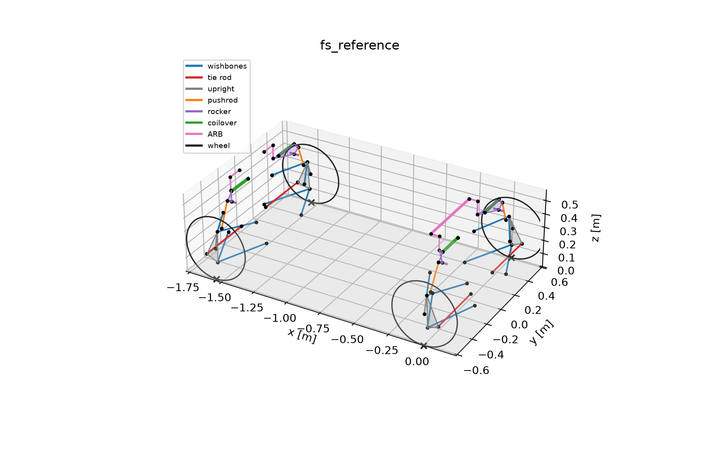
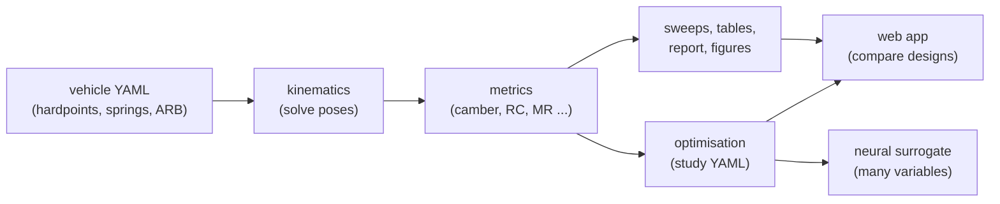

# suspkin

`suspkin` is a Python package for the kinematics of **Formula Student double-wishbone
pushrod suspensions**. You describe a car as a YAML file of hardpoints (the 3D positions of the
pivots, ball joints and rocker pickups). `suspkin` solves how the wheels move when the car
bumps, rolls, pitches or steers, turns that motion into the numbers a suspension designer reads
(camber, toe, caster, roll centre, motion ratio, anti-dive ...), draws and reports them, and can
search for better hardpoints automatically.



## The pipeline



1. **Vehicle model.** A validated, frozen description of the car in SI units, ISO 8855 frame
   (x forward, y left, z up, origin on the ground at mid front axle).
2. **Kinematics.** For a given wheel travel, steering rack position or body pose (heave, roll,
   pitch), a Newton solver finds where every point of every corner is.
3. **Metrics.** Pure functions turn solved positions into alignment, centres, anti-features,
   actuation, rates, roll and steering numbers, and finite-difference gradients (camber gain,
   bump steer, ...).
4. **Sweeps and reports.** Sweeps give pandas tables; a report bundles the standard studies
   into figures, CSV files and one HTML page.
5. **Optimisation.** A study YAML names design variables, constraints and objectives; several
   optimisers move the hardpoints to improve the design.
6. **Surrogate.** Two small neural networks replace the full model inside the optimiser so that
   all hardpoints of both axles can be optimised together; every reported design is re-checked
   with the exact solver.
7. **Web app.** A local browser app overlays many designs, lets you edit hardpoints and
   exports a self-contained snapshot.

Items 5 to 7 are **experimental** (see [Stability](guides/stability.md)).

## Who it is for

Members of a Formula Student team who design or tune a suspension and want to understand and
check it, not just click through a black box. You are expected to know calculus, linear algebra
and a little Python. You are not expected to know this code: the concept pages derive the math
and map each equation to the function that implements it.

## How to read these docs

The pages follow the [Diátaxis](https://diataxis.fr/) split: learning, doing, understanding,
looking up.

| Section | Read it when | Pages |
|---|---|---|
| **Getting started** | You are new and want a working session | [Install](getting-started/install.md), [Tutorial](getting-started/tutorial.md) |
| **Guides** | You know what you want to do and need the steps | [Vehicle YAML](guides/vehicle-yaml.md), [Study YAML](guides/study-yaml.md), [Command line](guides/cli.md), [Examples](guides/examples.md), [Surrogate optimisation](guides/surrogate.md), [Web app](guides/app.md), [Stability and versioning](guides/stability.md), [Development](guides/development.md) |
| **Concepts** | You want to know why a number is what it is, and which code computes it | see the list below |
| **Reference** | You need a signature, a parameter or a return type | [Python API](reference/index.md) and the per-package pages |
| **ADRs** | You want to know why the project is built this way | [ADR 0001 to 0008](adr/0001-webapp-architecture.md) |

Concept pages, in a sensible reading order:

1. [Conventions](concepts/conventions.md): frame, units, sign rules. Read this first.
2. [Vehicle model](concepts/vehicle-model.md): hardpoints, corners, mirroring, YAML loading.
3. [Corner kinematics](concepts/corner-kinematics.md): the constraint equations and the Newton solver.
4. [Vehicle kinematics](concepts/vehicle-kinematics.md): body poses, anti-roll bar.
5. [Metrics](concepts/metrics.md): every output column, with formula, sign and unit.
6. [Sweeps and reports](concepts/sweeps-and-reports.md): tables, standard studies, figures.
7. [Optimisation](concepts/optimization.md): study model, constraints, objectives, drivers.
8. [Surrogate](concepts/surrogate.md): the neural surrogate and active learning.
9. [Web app](concepts/web-app.md): server, endpoints, frontend contract.
10. [Architecture](concepts/architecture.md): package map, layering, testing.

A good first route: Install, Tutorial, Conventions, Metrics (the sections you meet in the
tutorial), then the Vehicle YAML guide to build your own car.

## Features

- Corner kinematics solved in 3D for bump, droop and steering rack travel, with rocker and
  pushrod (mounted on the upright, lower or upper wishbone), front and rear axles.
- Whole-car body motion: heave, roll, pitch and rack about a configurable pivot, with the
  anti-roll bar coupling.
- More than 40 per-corner metrics plus gradients, and a vehicle summary (rates, roll stiffness,
  roll gradient, load transfer distribution, anti-features, steering, Ackermann).
- Command line, Python API, matplotlib figures, interactive 3D, animations and an HTML report.
- Constrained, single- and multi-objective optimisation of hardpoints on a manufacturing grid
  (NSGA-II, differential evolution, SLSQP, DE plus SLSQP).
- A neural surrogate with active learning for studies with many variables (experimental).
- A local web app to compare designs, edit hardpoints and export snapshots (experimental).
- Pure-function numpy core, validated frozen YAML models, optional numba speed-up, golden
  regression and behaviour-lock tests.

## 30 seconds

```bash
uv run suspkin summary configs/vehicles/fs_reference.yaml
uv run suspkin report  configs/vehicles/fs_reference.yaml --out report/
```

or in Python:

```python
import suspkin as sk

vehicle = sk.load_vehicle("configs/vehicles/fs_reference.yaml")
summary = sk.vehicle_summary(vehicle)
print(summary.roll_gradient)   # 0.010981987822237214 rad per g (0.629 deg/g); SI inside the code
```

On a machine where `uv` is not on `PATH`, write `python -m uv` instead of `uv`.

Source: [github.com/canc-gmy/suspkin](https://github.com/canc-gmy/suspkin).
